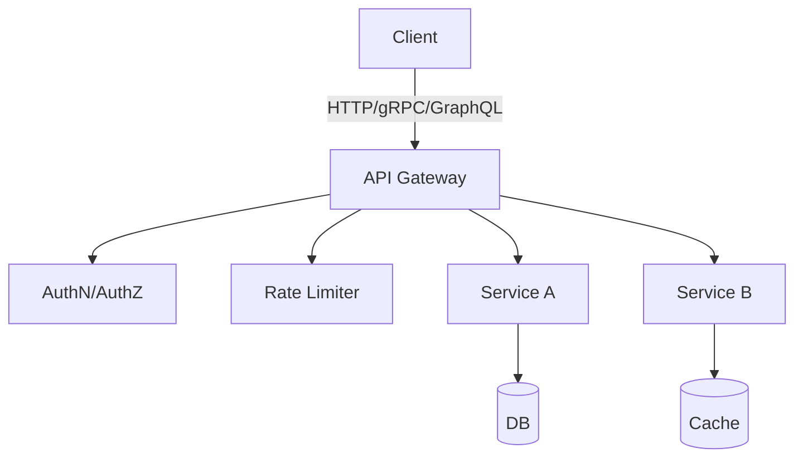
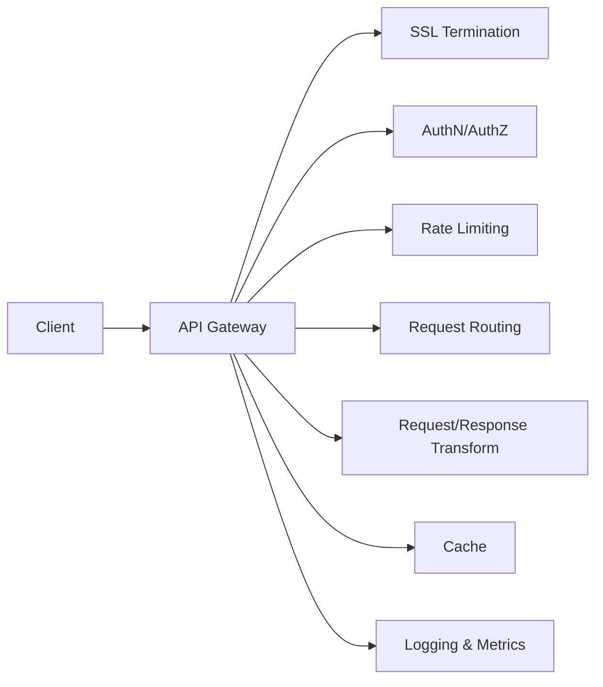

# 🧠 Topic: API Design Best Practices for System Design Interviews

> [!abstract] Executive Summary (ELI5)
> An API is a contract between two systems: "If you ask me this way, I will answer you that way." Good API design means the contract is predictable, versioned, safe to retry, and easy to understand without reading the source code. In a system design interview, the interviewer checks whether you can design that contract before you design the database.

---

## 🎯 The "Why"
- **Problem Solved:** APIs are the front door of your backend. A poorly designed API leaks implementation details, breaks clients on every deploy, and creates distributed-system hazards (retries creating duplicate data, partial failures, thundering herds).
- **Alternatives:** Internal-only gRPC for microservices, GraphQL for flexible frontend queries, event-driven async APIs for high-throughput pipelines. Each has a place.
- **Trade-offs:** REST is simple and cacheable but chatty; GraphQL is flexible but harder to cache and rate-limit; gRPC is efficient but requires proto contracts and HTTP/2 support.

## 💡 Mental Model & Analogy
- **Analogy:** A restaurant menu. The menu (API spec) tells you what you can order (endpoints), what ingredients you can customize (query params / fields), and how much it costs (rate limits / quotas). The kitchen (backend) can change recipes (refactor internals) as long as the menu still promises the same dishes.
- **Visual/Diagram:**


## 🛠️ Core Principles & Best Practices

### 1. Use Nouns, Not Verbs, in URLs
```http
# Bad
GET /getUser?id=123
POST /createOrder

# Good
GET /users/123
POST /orders
```
**Why:** HTTP methods already encode the action. URLs name resources.

### 2. Use Correct HTTP Methods and Status Codes

| Method | Safe | Idempotent | Use case |
|---|---|---|---|
| GET | Yes | Yes | Retrieve resource |
| POST | No | No | Create resource |
| PUT | No | Yes | Full replacement |
| PATCH | No | No* | Partial update |
| DELETE | No | Yes | Remove resource |

*PATCH idempotency depends on implementation (JSON Merge Patch vs JSON Patch).

| Status Code | Meaning | When to use |
|---|---|---|
| 200 OK | Success | Standard success |
| 201 Created | Success + new resource | After POST that creates |
| 204 No Content | Success, empty body | DELETE, empty PUT |
| 400 Bad Request | Client error | Validation failure, malformed JSON |
| 401 Unauthorized | Auth missing | No credentials provided |
| 403 Forbidden | Auth insufficient | Credentials present but insufficient |
| 404 Not Found | Resource missing | `/users/999` does not exist |
| 409 Conflict | State conflict | Duplicate email, optimistic locking |
| 429 Too Many Requests | Rate limit | Retry-After header required |
| 500 Internal Server Error | Server bug | Unexpected exception |
| 503 Service Unavailable | Temporarily down | Retry-After, circuit breaker open |

> [!warning] Interview gotcha
> Do NOT return 200 OK with an error body. HTTP status codes are part of the contract. Return the correct code and put details in the response body.

### 3. Version Your API from Day One
```http
# URL versioning (simple, explicit)
GET /v1/users/123
GET /v2/users/123

# Header versioning (cleaner URLs, harder to discover)
Accept: application/vnd.company.v2+json

# Query param versioning (easy to test, messy)
GET /users/123?api-version=2
```
**Interview rule:** URL versioning (`/v1/`, `/v2/`) is the safest answer because it is explicit, cache-friendly, and trivial to route at the gateway level.

### 4. Pagination — Always, Even If You Think You Don't Need It
```http
# Cursor-based (preferred for high-scale systems)
GET /orders?cursor=eyJpZCI6MTIzfQ==&limit=50

# Offset-based (simpler, fails on high-churn datasets)
GET /orders?offset=100&limit=50
```
**Why cursor-based?** Offset-based pagination (`LIMIT 100, 50`) is O(n) in the database; as the offset grows, query time grows. Cursor-based uses an indexed column (e.g., `id > last_seen_id`) and is O(1).

**Response envelope:**
```json
{
  "data": [...],
  "pagination": {
    "next_cursor": "abc123",
    "has_more": true
  }
}
```

### 5. Idempotency — Make Unsafe Operations Safe to Retry
```http
POST /payments
Idempotency-Key: 550e8400-e29b-41d4-a716-446655440000

{
  "amount": 100,
  "currency": "USD"
}
```
**Why:** Networks are unreliable. Clients retry. Without an idempotency key, a retry creates a second charge. The server stores the key for a TTL (e.g., 24 hours) and returns the same response for duplicate keys.

### 6. Rate Limiting and Throttling
Return these headers on every response:
```http
X-RateLimit-Limit: 1000
X-RateLimit-Remaining: 42
X-RateLimit-Reset: 1719230400
```
**Strategies:**
- **Token bucket:** Burst-friendly, good for user-facing APIs.
- **Sliding window log:** Precise, higher memory cost.
- **Fixed window:** Simple, but allows burst at window boundaries.

**Interview angle:** If asked "how do you prevent a client from DDoS-ing you?", mention the gateway-level rate limiter + per-user quotas + circuit breakers downstream.

### 7. Error Response Format — Be Consistent
```json
{
  "error": {
    "code": "PAYMENT_INSUFFICIENT_FUNDS",
    "message": "Your card does not have enough balance.",
    "details": {
      "available_balance": 42,
      "requested_amount": 100
    },
    "request_id": "req_abc123",
    "documentation_url": "https://api.example.com/docs/errors/PAYMENT_INSUFFICIENT_FUNDS"
  }
}
```
**Rules:**
- Machine-readable `code` (not just HTTP status).
- Human-readable `message`.
- `request_id` for traceability across distributed logs.
- Never expose stack traces or internal DB names.

### 8. Authentication & Authorization Patterns

| Pattern | Use case | Trade-off |
|---|---|---|
| API Keys | Internal services, simple integrations | Hard to rotate, no fine-grained scopes |
| OAuth 2.0 / JWT | User-facing apps, third-party integrations | Token size, revocation complexity |
| mTLS | Service-to-service in a mesh | Certificate management overhead |
| HMAC | Webhooks, signed requests | Shared secret management |

**JWT best practices:**
- Short expiry (e.g., 15 min) + refresh token rotation.
- Store claims, not sensitive data, in the payload.
- Validate `iss`, `aud`, `exp`, `nbf` strictly.
- Use asymmetric signing (RS256) if multiple services verify tokens.

### 9. Caching for APIs
```http
# Client-side cacheability
Cache-Control: max-age=3600, stale-while-revalidate=86400
ETag: "abc123"

# Conditional request
GET /users/123
If-None-Match: "abc123"
→ 304 Not Modified
```
**Layers:**
- **CDN:** Static assets, public GET responses.
- **API Gateway:** Cache safe, idempotent GETs with short TTLs.
- **Application cache:** Redis/Memcached for hot data.
- **Database cache:** Query result cache, connection pooling.

**Cache invalidation strategies:**
- TTL (simple, stale data acceptable).
- Write-through (write to cache + DB together, consistent but slower).
- Cache-aside (lazy load, risk of stale reads).
- Write-behind (async, high throughput, risk of loss).

### 10. API Gateway Responsibilities

**Do NOT put business logic in the gateway.** It is a thin layer for cross-cutting concerns.

### 11. Async APIs and Webhooks

**When to use polling vs webhooks vs SSE/WebSocket:**

| Pattern | Use case | Complexity |
|---|---|---|
| Polling | Simple, low-frequency updates | Low, but wasteful |
| Webhooks | Push notifications, event-driven | Medium (retry logic, signature verification) |
| SSE | One-way server push to browser | Low, HTTP-based |
| WebSocket | Real-time bidirectional chat/gaming | High (connection management, stateful) |
| gRPC Streaming | Microservice event streams | Medium (requires HTTP/2) |

**Webhook security:**
- Sign payloads with HMAC-SHA256 and share a secret.
- Include a timestamp to prevent replay attacks.
- Retry with exponential backoff + jitter (e.g., 1s, 2s, 4s, 8s, max 3 retries).
- Accept and acknowledge fast (return 200 immediately), then process asynchronously.

### 12. Schema Design and Evolution

**Backward compatibility rules:**
- **Additive changes are safe:** add new optional fields, new endpoints, new enum values.
- **Breaking changes require a new version:** removing fields, changing field types, making optional fields required.
- **Never reuse field names** with different semantics in the same version.
- **Use nullable / optional types** for new fields so old clients ignore them.

**Protobuf / gRPC specifics:**
- Field numbers are permanent. Never change a field number's meaning.
- Deleting a field? Reserve the field number and name to prevent reuse.
- Adding a new field? Old clients ignore it; new clients get a default value.

### 13. Bulk Operations
```http
POST /v1/bulk/orders
Content-Type: application/json

{
  "operations": [
    { "method": "POST", "path": "/orders", "body": {...} },
    { "method": "POST", "path": "/orders", "body": {...} }
  ]
}
```
**Rules:**
- Limit batch size (e.g., 100 items max).
- Return per-item status codes, not a single pass/fail.
- Use idempotency keys per item, not per batch.
- Consider async processing with a job ID if the batch is large.

### 14. API Documentation
- **OpenAPI (Swagger):** The industry standard. Generate server stubs, client SDKs, and interactive docs from a single spec.
- **Postman Collections:** Good for testing and sharing, but not a machine-readable contract.
- **GraphQL Introspection:** Self-documenting by design, but disable it in production.

**Interview tip:** Mention that you generate SDKs from OpenAPI specs and enforce linting (e.g., Spectral) in CI to prevent breaking changes.

## ⚠️ Pitfalls & Anti-patterns

- **Leaky abstractions:** Exposing database IDs (`user_id = 12345`) as public resource IDs without obfuscation (e.g., hashids, UUIDs) leaks information about scale and growth.
- **Chatty APIs:** Returning a user ID and forcing the client to make 10 more calls to fetch related data. Use field expansion (`?expand=orders,payments`) or GraphQL.
- **Inconsistent naming:** `user_id` in one endpoint, `userId` in another, `id` in a third. Pick one convention (snake_case is the HTTP/JSON standard) and enforce it.
- **Ignoring caching headers:** Returning `Cache-Control: no-store` on everything because "it is easier." This kills performance at scale.
- **Over-fetching:** Returning the entire user object when the client only needs the name. Use sparse fieldsets (`?fields=name,email`).
- **Missing request IDs:** Debugging a 500 error in a distributed system without a `request_id` is like finding a needle in 50 haystacks.
- **No health check endpoint:** `/health` and `/ready` are essential for load balancers and Kubernetes probes. `/health` = process is alive; `/ready` = process can accept traffic.
- **State in the URL:** `GET /orders?user_id=123` is fine. `GET /getOrdersForUser/123` is not RESTful and harder to evolve.

## 🔗 Deep Connections
- **Parent Topic:** [[System Design interview/concept_notes/Architecture Patterns Through the Harness Lens]]
- **Related Concepts:** [[URL-Shortener-Design]], [[Distributed-KV-Store-Architecture]], [[Latency Budget - System Design]], [[Data-Replication-Distributed-Systems]], [[Failure-Handling-Distributed-Systems]]
- **Prerequisites:** HTTP protocol basics, understanding of client-server architecture, familiarity with JSON and REST conventions.
- **Next steps:** [[GraphQL vs REST Trade-offs]], [[gRPC in Microservices]], [[API Gateway Patterns]]

## ❓ Active Recall Questions

> [!faq]- What is the difference between 401 Unauthorized and 403 Forbidden?
> 401 = credentials are missing or invalid. 403 = credentials are present but insufficient for the requested resource.

> [!faq]- Why is cursor-based pagination preferred over offset-based for high-scale systems?
> Offset-based pagination uses `LIMIT offset, count`, which is O(n) as the offset grows. Cursor-based pagination uses an indexed column (`id > last_seen`) and is O(1), making it stable and fast even with billions of rows.

> [!faq]- What headers should an API return for rate limiting?
> `X-RateLimit-Limit`, `X-RateLimit-Remaining`, and `X-RateLimit-Reset` (or the newer IETF `RateLimit-*` standard headers).

> [!faq]- How do you make a POST request safe to retry without creating duplicates?
> Use an `Idempotency-Key` header. The server stores the key and the response for a TTL (e.g., 24 hours) and returns the same response for duplicate keys instead of reprocessing the operation.

> [!faq]- What is the difference between a webhook and polling, and when would you choose each?
> Polling is simple but wasteful; the client asks repeatedly. Webhooks push events to the client when they happen, reducing latency and load. Use webhooks for real-time or event-driven needs; use polling for simple, low-frequency integrations where infrastructure overhead matters.

> [!faq]- Why should you version an API from day one even if you only have one version?
> Because once you need a breaking change, it is too late to introduce versioning without breaking all existing clients. `/v1/` costs nothing on day one and saves everything on day 500.

> [!faq]- What is the risk of exposing auto-incrementing database IDs as public resource IDs?
> It leaks information about the scale of your system (competitors can estimate user counts by creating an account and reading their ID) and can enable enumeration attacks.

> [!faq]- What should a well-formed error response contain?
> A machine-readable `code`, a human-readable `message`, a `request_id` for traceability, optional `details` for debugging, and a `documentation_url` pointing to the error catalog. Never include stack traces or internal DB schemas.
