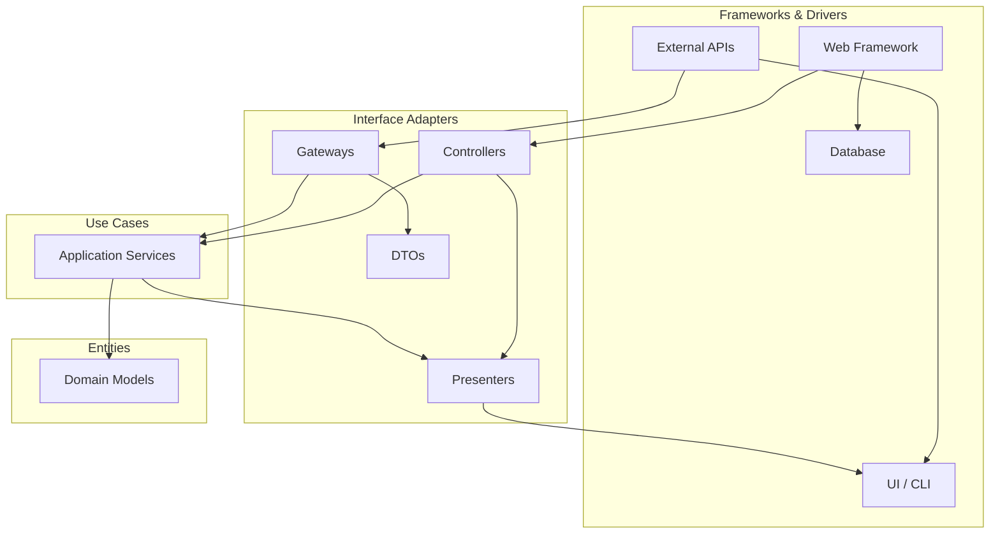

# 🧠 Topic: Clean Architecture

> [!abstract] Executive Summary (ELI5)
> Clean Architecture is a way to organize code so that the most important parts — the business rules — do not depend on less important things like the web framework, the database, or the UI. You can swap React for Vue, PostgreSQL for MongoDB, or REST for gRPC without touching the core logic.

---

## 🎯 The "Why"
- **Problem Solved:**
  - Business logic gets tangled with framework code, making the system fragile.
  - Changing a database or UI framework forces changes across the whole codebase.
  - Unit testing becomes hard because dependencies on web servers, ORMs, and external APIs leak into every class.
  - Code reuse suffers when domain rules are coupled to a specific delivery mechanism.
- **Alternatives:** [[MVC]], [[Layered Architecture]], [[Hexagonal Architecture]], [[Onion Architecture]].
- **Trade-offs:** More files and explicit boundaries upfront, but in return you get independent deployable/testable core logic, easier framework swaps, and delayed infrastructure decisions.

## 💡 Mental Model & Analogy
- **Analogy:** "This is like an onion. The inner rings are the most precious and stable rules of the business; the outer rings are the noisy, changeable world of frameworks, devices, and delivery mechanisms. You can peel or replace an outer ring without cutting the core."
- **Visual/Diagram:**

> [!tip] The Dependency Rule
> Source code dependencies can only point **inward**. Nothing in an inner circle can know anything about something in an outer circle.

## 🛠️ Core Principles

### The Four Layers

| Layer | Responsibility | Must Know About |
|---|---|---|
| **Entities** | Enterprise-wide business rules and domain objects. | Nothing outside themselves. |
| **Use Cases** | Application-specific business rules; orchestrate entities. | Entities only. |
| **Interface Adapters** | Convert data between use cases and the outside world. | Use cases and external formats. |
| **Frameworks & Drivers** | Concrete frameworks, databases, web servers, devices. | Adapters only. |

### Examples Across Different Applications

The same four layers appear in almost every system. Below are quick sketches for six different domains. Each row shows *one representative object* that would live in that layer.

#### 1. E-commerce
| Layer | Example |
|---|---|
| Entities | `Order`, `Product`, `Money` |
| Use Cases | `PlaceOrder`, `ApplyDiscount`, `ProcessRefund` |
| Interface Adapters | `OrderController`, `OrderRepositoryGateway`, `OrderDto` |
| Frameworks & Drivers | Express.js routes, PostgreSQL, Stripe SDK, React checkout page |

#### 2. Banking / FinTech
| Layer | Example |
|---|---|
| Entities | `Account`, `Transaction`, `Currency` |
| Use Cases | `TransferMoney`, `CalculateInterest`, `FreezeAccount` |
| Interface Adapters | `TransactionController`, `AccountRepositoryGateway`, `BalancePresenter` |
| Frameworks & Drivers | Fastify, Oracle DB, SWIFT/gRPC partner APIs, mobile app |

#### 3. Task Management (e.g., Trello clone)
| Layer | Example |
|---|---|
| Entities | `Task`, `Board`, `Collaborator` |
| Use Cases | `CreateTask`, `AssignTask`, `MoveTaskToColumn` |
| Interface Adapters | `TaskController`, `BoardQueryGateway`, `TaskViewModel` |
| Frameworks & Drivers | NestJS, MongoDB, WebSocket notifications, SPA frontend |

#### 4. Blog / CMS
| Layer | Example |
|---|---|
| Entities | `Article`, `Author`, `Comment` |
| Use Cases | `PublishArticle`, `ModerateComment`, `SchedulePost` |
| Interface Adapters | `ArticleController`, `SearchRepositoryGateway`, `ArticleSummaryDto` |
| Frameworks & Drivers | Django, Elasticsearch, S3 asset store, markdown renderer |

#### 5. Healthcare
| Layer | Example |
|---|---|
| Entities | `Patient`, `Prescription`, `Appointment` |
| Use Cases | `BookAppointment`, `IssuePrescription`, `CheckInsuranceEligibility` |
| Interface Adapters | `AppointmentController`, `PatientRecordGateway`, `Hl7MessageAdapter` |
| Frameworks & Drivers | Spring Boot, FHIR server, HIPAA-compliant blob storage, clinic tablet app |

#### 6. Social Media
| Layer | Example |
|---|---|
| Entities | `Post`, `User`, `Like`, `Feed` |
| Use Cases | `CreatePost`, `GenerateFeed`, `FollowUser` |
| Interface Adapters | `PostController`, `FeedCacheGateway`, `PostPresenter` |
| Frameworks & Drivers | Phoenix/LiveView, Redis timeline cache, Kafka events, mobile clients |

## ⚠️ Pitfalls & Anti-patterns
- **Common Mistakes:**
  - Letting Entities import framework types (e.g., `import { Entity } from 'typeorm'` inside domain objects).
  - Putting business rules directly into controllers or repository implementations.
  - Creating "fat use cases" that know about HTTP status codes or SQL.
- **When NOT to use:**
  - A tiny script or proof-of-concept where the cost of boundaries outweighs the benefit.
  - A CRUD-heavy admin tool with almost no business logic.
- **Performance/Security considerations:**
  - Extra mapping layers add allocations; batch and profile hot paths.
  - Keep authentication/authorization at the adapter layer, but model permissions as domain concepts when they are business rules.

## 🔗 Deep Connections
- **Parent Topic:** [[Software Architecture]]
- **Related Concepts:** [[SOLID]], [[Domain-Driven Design]], [[Hexagonal Architecture]], [[Onion Architecture]], [[Dependency Inversion Principle]]
- **Prerequisites:** Basic OOP, unit testing, dependency injection.

## ❓ Active Recall Questions
> [!faq]- What is the primary constraint of Clean Architecture?
> Dependencies must point inward; inner circles cannot depend on outer circles.

> [!faq]- Why would you place `Order` rules inside Entities instead of a controller?
> Because entities represent stable business rules that should survive changes to web frameworks, databases, and UIs.

> [!faq]- Which layer knows about HTTP requests and JSON responses?
> The Interface Adapters layer (controllers, presenters, DTOs). Use cases only receive plain language objects.

---
## 📝 How to use this template effectively
1. **Never Copy-Paste:** If you find yourself copying documentation, stop. Read, close the tab, and write it from memory.
2. **Iterate:** Fill the 'ELI5' and 'Analogy' first. If you can't explain it simply, you don't understand it yet.
3. **The "Why" is King:** Seniority is defined by knowing *when* and *why* to use a tool, not just *how*.
