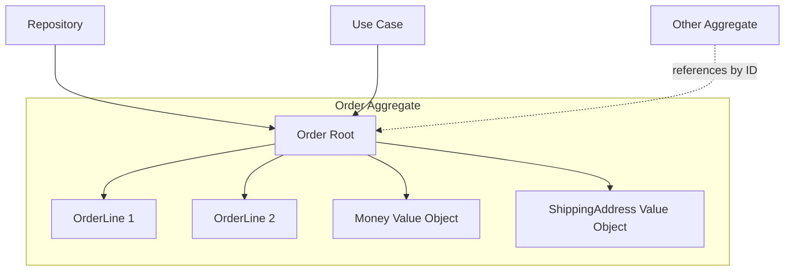

# 🧠 Topic: DDD Aggregates

> [!abstract] Executive Summary (ELI5)
> An aggregate is a cluster of related objects that must stay consistent together. One object acts as the root gatekeeper — you can only access the cluster through it. Think of it as a family: you call the house phone, and the parent (root) decides which child (entity) can talk.

---

## 🎯 The "Why"
- **Problem Solved:**
  - Invariants span multiple objects (e.g., "an order total must equal the sum of its line items"), but without a boundary, any code can modify any object directly.
  - Database transactions grow too large and lock too many rows when everything is connected.
  - It is unclear which object is responsible for enforcing cross-object rules.
- **Alternatives:**
  - **Direct graph navigation:** every entity can reference any other entity, leading to a "big ball of mud."
  - **Database triggers:** business rules live in the database instead of the domain model.
- **Trade-offs:** Aggregates require careful boundary design. Too large and they become a bottleneck; too small and invariants are hard to enforce.

## 💡 Mental Model & Analogy
- **Analogy:** "An aggregate is like a sealed envelope. Inside are several documents (entities and value objects) that belong together. You can only hand the envelope to someone, not the individual papers. The address on the envelope is the aggregate root ID. If you want to change something inside, you must open the envelope — that is, load the entire aggregate."
- **Visual/Diagram:**


> [!tip] The Golden Rule
> External objects can only reference the aggregate root. They must not hold direct references to internal entities.

## 🛠️ Core Principles

### What Is an Aggregate?
A cluster of domain objects that:
- Is treated as a single unit for data changes.
- Has one designated root entity that controls access.
- Enforces all invariants within its boundary.
- Is loaded and saved as a whole.

### What Is an Aggregate Root?
The root is the only entity inside an aggregate that:
- Can be referenced from outside the aggregate.
- Is loaded through a repository.
- Guards the aggregate's invariants.
- Can perform operations on internal objects.

### Design Rules
1. **Reference by identity, not by pointer.** Other aggregates should only know the root's ID.
2. **One transaction per aggregate.** Do not modify two aggregates in the same transaction if you can avoid it.
3. **Keep aggregates small.** Large aggregates hurt concurrency and performance.
4. **Delete the root, delete the whole aggregate.** Internal objects should not outlive the root.

### Examples Across Domains

#### 1. E-commerce: `Order` Aggregate
```typescript
class Order { // Aggregate Root
  private constructor(
    private readonly id: OrderId,
    private lines: OrderLine[],
    private status: OrderStatus,
    private shippingAddress: Address,
  ) {}

  addItem(product: Product, quantity: number): void {
    if (this.status !== OrderStatus.PENDING) throw new Error('Order is finalized');
    this.lines.push(new OrderLine(product, quantity));
    this.ensureTotalIsPositive();
  }

  removeItem(lineId: OrderLineId): void {
    this.lines = this.lines.filter(l => l.id !== lineId);
    this.ensureTotalIsPositive();
  }

  private ensureTotalIsPositive(): void {
    if (this.lines.length === 0) throw new Error('Order must have at least one item');
  }
}
// OrderLine is an internal entity; you cannot access it directly from a repository.
```

#### 2. Banking: `Account` Aggregate
```typescript
class Account { // Aggregate Root
  private constructor(
    private readonly id: AccountId,
    private balance: Money,
    private transactions: Transaction[],
  ) {}

  debit(amount: Money): void {
    if (amount.isGreaterThan(this.balance)) throw new Error('Insufficient funds');
    this.balance = this.balance.subtract(amount);
    this.transactions.push(new Transaction(amount, TransactionType.DEBIT));
  }
}
// Transaction is internal to the Account aggregate.
```

#### 3. Task Management: `Board` Aggregate
```typescript
class Board { // Aggregate Root
  private constructor(
    private readonly id: BoardId,
    private columns: Column[],
    private tasks: Task[],
  ) {}

  moveTask(taskId: TaskId, fromColumnId: ColumnId, toColumnId: ColumnId): void {
    const task = this.tasks.find(t => t.id === taskId);
    if (!task) throw new Error('Task not found');
    task.moveTo(toColumnId);
    // invariant: a task must belong to exactly one column
  }
}
// Task is an internal entity; you access it through Board.
```

#### 4. Blog/CMS: `Article` Aggregate
```typescript
class Article { // Aggregate Root
  private constructor(
    private readonly id: ArticleId,
    private title: string,
    private body: string,
    private comments: Comment[],
    private status: ArticleStatus,
  ) {}

  addComment(author: AuthorId, content: string): void {
    if (this.status !== ArticleStatus.PUBLISHED) throw new Error('Comments only on published articles');
    this.comments.push(new Comment(author, content));
  }

  moderateComment(commentId: CommentId): void {
    const comment = this.comments.find(c => c.id === commentId);
    if (comment) comment.markAsModerated();
  }
}
// Comment is internal to Article.
```

#### 5. Healthcare: `Prescription` Aggregate
```typescript
class Prescription { // Aggregate Root
  private constructor(
    private readonly id: PrescriptionId,
    private medications: Medication[],
    private status: PrescriptionStatus,
  ) {}

  addMedication(med: Medication): void {
    if (this.status !== PrescriptionStatus.DRAFT) throw new Error('Cannot modify issued prescription');
    if (this.hasConflict(med)) throw new Error('Drug conflict');
    this.medications.push(med);
  }

  issue(): void {
    if (this.medications.length === 0) throw new Error('Empty prescription');
    this.status = PrescriptionStatus.ISSUED;
  }
}
```

#### 6. Social Media: `Thread` Aggregate
```typescript
class Thread { // Aggregate Root
  private constructor(
    private readonly id: ThreadId,
    private rootPost: Post,
    private replies: Post[],
  ) {}

  addReply(author: UserId, content: string): void {
    if (this.rootPost.isLocked()) throw new Error('Thread is locked');
    this.replies.push(new Post(author, content));
  }
}
// Post is internal to Thread; rootPost is the starting post.
```

## ⚠️ Pitfalls & Anti-patterns
- **Common Mistakes:**
  - Creating an aggregate that spans the entire domain (anemic "root" with everything inside).
  - Allowing direct references from one aggregate's internal entity to another aggregate's internal entity.
  - Loading an aggregate and its entire graph (N+1, deep loading).
  - Forcing two aggregates into the same database transaction.
- **When NOT to use:**
  - A simple lookup table or reference data with no invariants.
  - A reporting or read model where eventual consistency is acceptable.
- **Performance/Security considerations:**
  - Large aggregates hurt concurrency; keep them small and reference other aggregates by ID.
  - Use eventual consistency between aggregates via domain events rather than distributed transactions.

## 🔗 Deep Connections
- **Parent Topic:** [[Domain-Driven Design]]
- **Related Concepts:** [[Entities Layer]], [[DDD Domain Services]], [[DDD Application Services]], [[Domain Events]], [[Repository Pattern]], [[Value Object]]
- **Prerequisites:** Entities, value objects, transactional boundaries.

## ❓ Active Recall Questions
> [!faq]- Why should other aggregates only reference the root by ID?
> To maintain clear boundaries and prevent one aggregate from accidentally corrupting another's internal state.

> [!faq]- Can you modify two aggregates in one transaction?
> Ideally, no. DDD prefers one transaction per aggregate. If you need cross-aggregate consistency, use eventual consistency via domain events.

> [!faq]- What happens when you delete an aggregate root?
> The entire aggregate (root + all internal objects) is deleted as a single unit.

---
## 📝 How to use this template effectively
1. **Never Copy-Paste:** If you find yourself copying documentation, stop. Read, close the tab, and write it from memory.
2. **Iterate:** Fill the 'ELI5' and 'Analogy' first. If you can't explain it simply, you don't understand it yet.
3. **The "Why" is King:** Seniority is defined by knowing *when* and *why* to use a tool, not just *how*.
