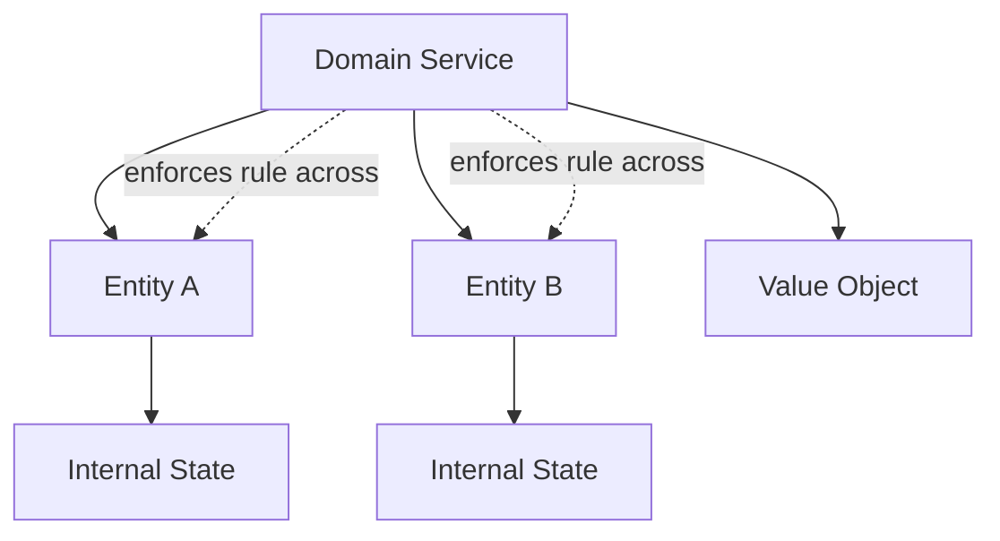

# 🧠 Topic: DDD Domain Services

> [!abstract] Executive Summary (ELI5)
> A domain service holds a business rule that doesn't belong to any single entity or value object. It is still part of the domain, but it coordinates multiple objects to perform a calculation or decision.

---

## 🎯 The "Why"
- **Problem Solved:**
  - Some business logic naturally involves multiple entities or value objects, and forcing it into one of them creates an unnatural ownership.
  - An entity becomes a "god object" when it tries to hold logic that concerns other entities.
  - Business rules about comparing, ranking, or transferring between entities have no clear home.
- **Alternatives:**
  - **Stuffing the logic into one entity:** `accountA.transferTo(accountB, amount)` — this makes Account responsible for another Account's state.
  - **Putting it in an application service:** blurs the line between domain and orchestration.
  - **Static utility methods:** hide the domain rule and make it untestable in context.
- **Trade-offs:** Domain services are necessary but easy to overuse. If the logic can live in an entity, it should.

## 💡 Mental Model & Analogy
- **Analogy:** "A domain service is like a referee in a soccer game. The referee is not a player (entity) and does not kick the ball (value object), but they enforce rules that involve both teams. A player cannot be their own referee; the rule belongs to the game itself."
- **Visual/Diagram:**


> [!tip] The Litmus Test
> If a business rule involves two or more aggregates, or requires state that no single entity owns, it belongs in a domain service.

## 🛠️ Core Principles

### What Is a Domain Service?
A domain service is a stateless object that:
- Embodies a significant business rule.
- Does not belong to any single entity or value object.
- Has no identity and no lifecycle.
- Is part of the domain layer, not the application layer.
- Can depend on entities, value objects, and other domain services.

### Domain Service vs Application Service
| Domain Service | Application Service |
|---|---|
| Holds business rules. | Holds orchestration logic. |
| Stateless, no side effects (or controlled ones). | Can have side effects (sends emails, calls APIs). |
| Example: `PricingCalculator`, `FraudDetector`. | Example: `PlaceOrderUseCase`, `TransferMoneyUseCase`. |
| Part of the domain core. | Part of the application/use case layer. |

### When to Use a Domain Service
1. The logic involves multiple aggregates.
2. The logic requires access to a repository or external read-only data.
3. The logic is a cross-cutting domain rule (e.g., pricing, risk assessment).
4. The logic is a calculation or algorithm that doesn't fit in any entity.

### Examples Across Domains

#### 1. E-commerce: `PricingCalculator`
```typescript
class PricingCalculator {
  calculateTotal(order: Order, discountRules: DiscountRule[]): Money {
    let total = order.subtotal();
    for (const rule of discountRules) {
      total = rule.apply(total, order);
    }
    return total;
  }
}
// This spans Order, DiscountRule, and Money — no single entity owns it.
```

#### 2. Banking: `FraudDetector`
```typescript
class FraudDetector {
  evaluate(
    source: Account,
    target: Account,
    amount: Money,
    recentTransactions: Transaction[],
  ): boolean {
    if (amount.isGreaterThan(source.dailyLimit())) return true;
    if (this.isRapidTransfer(recentTransactions)) return true;
    if (target.isOnBlacklist()) return true;
    return false;
  }
}
// Uses multiple aggregates and historical data.
```

#### 3. Task Management: `WorkloadBalancer`
```typescript
class WorkloadBalancer {
  assignBestMember(task: Task, members: TeamMember[]): TeamMember {
    const available = members.filter(m => m.isAvailable());
    if (available.length === 0) throw new Error('No available members');
    return available.sort((a, b) => a.currentLoad() - b.currentLoad())[0];
  }
}
// Uses Task and multiple TeamMembers — no single entity owns the balancing logic.
```

#### 4. Blog/CMS: `ContentModerator`
```typescript
class ContentModerator {
  isAppropriate(content: string, authorReputation: AuthorReputation): boolean {
    if (authorReputation.isTrusted()) return true;
    return !this.profanityFilter.containsProfanity(content);
  }
}
// Cross-cuts Article and Author reputation.
```

#### 5. Healthcare: `DrugInteractionChecker`
```typescript
class DrugInteractionChecker {
  hasConflict(medications: Medication[], newMedication: Medication): boolean {
    for (const existing of medications) {
      if (this.knownConflicts.exists(existing, newMedication)) return true;
    }
    return false;
  }
}
// Uses multiple Medications and an external knowledge base.
```

#### 6. Social Media: `FeedRanker`
```typescript
class FeedRanker {
  rank(posts: Post[], userPreferences: UserPreferences): Post[] {
    return posts.sort((a, b) => {
      const scoreA = this.relevanceScore(a, userPreferences);
      const scoreB = this.relevanceScore(b, userPreferences);
      return scoreB - scoreA;
    });
  }
}
// Uses multiple Posts and UserPreferences — no single entity owns ranking.
```

## ⚠️ Pitfalls & Anti-patterns
- **Common Mistakes:**
  - Turning a domain service into a dumping ground for all logic that doesn't fit elsewhere.
  - Making a domain service stateful or giving it database write responsibilities.
  - Confusing a domain service with an application service or use case.
  - Calling a domain service when the logic clearly belongs inside an entity.
- **When NOT to use:**
  - The logic clearly belongs to one entity or value object.
  - The logic is purely technical (e.g., formatting, serialization) — use a utility or adapter.
- **Performance/Security considerations:**
  - Domain services should be stateless and side-effect-free; avoid network calls inside them.
  - If a domain service needs read-only data, pass it in as arguments rather than injecting repositories.

## 🔗 Deep Connections
- **Parent Topic:** [[Domain-Driven Design]]
- **Related Concepts:** [[Entities Layer]], [[DDD Aggregates]], [[DDD Application Services]], [[Value Object]], [[Domain Events]]
- **Prerequisites:** Entities, aggregates, value objects, clean separation between domain and application layers.

## ❓ Active Recall Questions
> [!faq]- How do you decide whether logic belongs in an entity or a domain service?
> If the logic can be expressed using only the state of a single entity and its value objects, it belongs in the entity. If it needs multiple aggregates or external read-only data, it belongs in a domain service.

> [!faq]- What is the difference between a domain service and an application service?
> A domain service holds business rules and is part of the domain core. An application service orchestrates use cases and may have side effects like sending emails or saving to repositories.

> [!faq]- Should a domain service have side effects?
> No. Domain services should be stateless and ideally side-effect-free. Side effects belong in the application layer or in entities.

---
## 📝 How to use this template effectively
1. **Never Copy-Paste:** If you find yourself copying documentation, stop. Read, close the tab, and write it from memory.
2. **Iterate:** Fill the 'ELI5' and 'Analogy' first. If you can't explain it simply, you don't understand it yet.
3. **The "Why" is King:** Seniority is defined by knowing *when* and *why* to use a tool, not just *how*.
