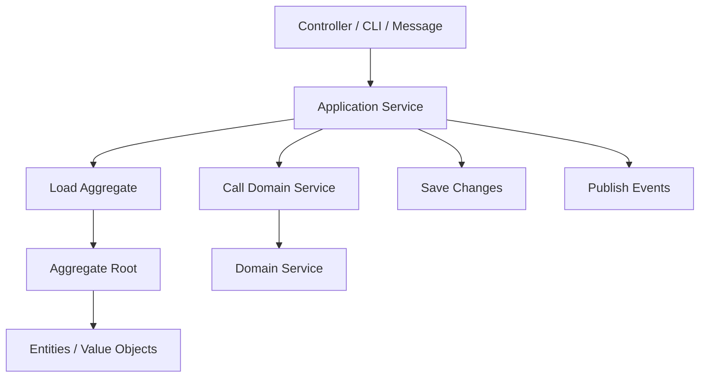

# 🧠 Topic: Application Service in DDD

> [!abstract] Executive Summary (ELI5)
> An application service is the thin orchestration layer that sits between the outside world and the domain. It receives a command, loads the right aggregates, calls domain services if needed, saves changes, and publishes events. It does not contain business rules; it only coordinates.

---

## 🎯 The "Why"
- **Problem Solved:**
  - Controllers and frameworks leak into the domain layer when there is no clear boundary between delivery and business logic.
  - Transaction management, security checks, and event publishing get mixed with entity code.
  - The same operation is duplicated across web, mobile, and batch entry points because there is no single orchestration point.
- **Alternatives:**
  - **Fat controllers:** routing, validation, and business logic all in one place.
  - **Domain services doing everything:** domain logic and orchestration mixed together.
  - **Putting everything in the UI layer.**
- **Trade-offs:** More explicit layers, but you get a clear boundary, reusable operations, and the ability to test orchestration without a web server or database.

## 💡 Mental Model & Analogy
- **Analogy:** "An application service is like a stage director. The director does not act, sing, or play music (business rules), but they tell the actors when to enter, which props to use, and when the curtain falls (transaction boundary). The audience sees the play; the director makes it happen."
- **Visual/Diagram:**


> [!tip] The Thin Layer Rule
> If you find business rules inside an application service, stop. Move them to an entity, a value object, or a domain service.

## 🛠️ Core Principles

### What Is an Application Service?
An application service is an orchestration object that:
- Receives a command or query from the delivery mechanism.
- Loads aggregates through repositories.
- Delegates business decisions to entities, value objects, or domain services.
- Saves changes and commits the transaction.
- Publishes domain events for side effects.
- Contains **no business rules** and **no framework dependencies**.

### Key Responsibilities
| Responsibility | What It Does | What It Does NOT Do |
|---|---|---|
| **Orchestration** | Calls repositories, domain services, and aggregates in the right order. | Implement business rules. |
| **Transaction boundary** | Ensures that all changes within one operation succeed or fail together. | Handle database specifics (SQL, ORM). |
| **Security / Authorization** | Checks if the user is allowed to perform the operation. | Implement authentication (that belongs in adapters). |
| **Event publishing** | Publishes domain events after a successful commit. | Process the events (that belongs to event handlers). |
| **DTO mapping** | Converts input to domain objects and output to DTOs. | Validate input format (that belongs in adapters). |

### Application Service vs Domain Service vs Use Case
| Layer | Contains | Example |
|---|---|---|
| **Application Service** | Orchestration, transaction, authorization. | `PlaceOrderService.execute(command)` |
| **Domain Service** | Cross-aggregate business rules. | `PricingCalculator.calculateTotal(...)` |
| **Use Case** | Often a 1:1 mapping with application service in Clean Architecture. | `PlaceOrderUseCase` |

> [!tip] In practice, "Application Service" and "Use Case" are often the same class, especially in Clean Architecture and Hexagonal Architecture. The naming depends on the methodology you follow.

### Examples Across Domains

#### 1. E-commerce: `PlaceOrderService`
```typescript
class PlaceOrderService {
  constructor(
    private orderRepository: IOrderRepository,
    private inventoryService: IInventoryService,
    private pricingCalculator: PricingCalculator,
    private eventPublisher: IEventPublisher,
  ) {}

  async execute(command: PlaceOrderCommand): Promise<void> {
    const customer = await this.orderRepository.findCustomer(command.customerId);
    const order = Order.create(command.orderId, customer);

    for (const line of command.lines) {
      const product = await this.inventoryService.checkAvailability(line.productId);
      order.addItem(product, line.quantity);
    }

    const total = this.pricingCalculator.calculateTotal(order, command.discountRules);
    order.setTotal(total);

    await this.orderRepository.save(order);
    this.eventPublisher.publish(new OrderPlacedEvent(order));
  }
}
```

#### 2. Banking: `TransferMoneyService`
```typescript
class TransferMoneyService {
  constructor(
    private accountRepository: IAccountRepository,
    private fraudDetector: FraudDetector,
    private eventPublisher: IEventPublisher,
  ) {}

  async execute(command: TransferCommand): Promise<void> {
    const source = await this.accountRepository.findById(command.sourceId);
    const target = await this.accountRepository.findById(command.targetId);

    const isFraud = this.fraudDetector.evaluate(source, target, command.amount, []);
    if (isFraud) throw new FraudDetectedError();

    source.debit(command.amount);
    target.credit(command.amount);

    await this.accountRepository.save(source);
    await this.accountRepository.save(target);
    this.eventPublisher.publish(new MoneyTransferredEvent(source.id, target.id, command.amount));
  }
}
```

#### 3. Task Management: `AssignTaskService`
```typescript
class AssignTaskService {
  constructor(
    private taskRepository: ITaskRepository,
    private userRepository: IUserRepository,
    private workloadBalancer: WorkloadBalancer,
    private eventPublisher: IEventPublisher,
  ) {}

  async execute(command: AssignTaskCommand): Promise<void> {
    const task = await this.taskRepository.findById(command.taskId);
    const members = await this.userRepository.findTeamMembers(command.teamId);
    const bestMember = this.workloadBalancer.assignBestMember(task, members);

    task.assign(bestMember.id);

    await this.taskRepository.save(task);
    this.eventPublisher.publish(new TaskAssignedEvent(task.id, bestMember.id));
  }
}
```

#### 4. Blog/CMS: `PublishArticleService`
```typescript
class PublishArticleService {
  constructor(
    private articleRepository: IArticleRepository,
    private contentModerator: ContentModerator,
    private eventPublisher: IEventPublisher,
  ) {}

  async execute(command: PublishArticleCommand): Promise<void> {
    const article = await this.articleRepository.findById(command.articleId);
    const author = await this.articleRepository.findAuthor(article.authorId);

    if (!this.contentModerator.isAppropriate(article.body, author.reputation)) {
      throw new ContentRejectedError();
    }

    article.publish(new Date());

    await this.articleRepository.save(article);
    this.eventPublisher.publish(new ArticlePublishedEvent(article.id));
  }
}
```

#### 5. Healthcare: `BookAppointmentService`
```typescript
class BookAppointmentService {
  constructor(
    private appointmentRepository: IAppointmentRepository,
    private doctorSchedule: IDoctorSchedule,
    private eventPublisher: IEventPublisher,
  ) {}

  async execute(command: BookAppointmentCommand): Promise<void> {
    const slot = await this.doctorSchedule.reserve(command.doctorId, command.slotId);
    const patient = await this.appointmentRepository.findPatient(command.patientId);

    const appointment = Appointment.book(command.appointmentId, patient.id, slot);

    await this.appointmentRepository.save(appointment);
    this.eventPublisher.publish(new AppointmentBookedEvent(appointment.id, patient.id));
  }
}
```

#### 6. Social Media: `CreatePostService`
```typescript
class CreatePostService {
  constructor(
    private postRepository: IPostRepository,
    private feedCache: IFeedCache,
    private eventPublisher: IEventPublisher,
  ) {}

  async execute(command: CreatePostCommand): Promise<void> {
    const post = Post.create(command.postId, command.authorId, command.content);

    await this.postRepository.save(post);
    await this.feedCache.invalidate(command.authorId);
    this.eventPublisher.publish(new PostCreatedEvent(post));
  }
}
```

## ⚠️ Pitfalls & Anti-patterns
- **Common Mistakes:**
  - Putting business rules inside the application service (e.g., calculating discounts, validating domain invariants).
  - Making application services too large or giving them too many responsibilities.
  - Calling the database directly from the application service instead of going through repositories.
  - Handling HTTP concerns (status codes, headers, cookies) inside the application service.
- **When NOT to use:**
  - A simple CRUD operation with no orchestration — a repository adapter may be enough.
  - A read-only query that does not change state — consider a query handler or read model instead.
- **Performance/Security considerations:**
  - Keep application services stateless and thread-safe.
  - Transaction boundaries should match the operation boundary; avoid long-running transactions inside application services.
  - Authorization checks belong here, but authentication belongs in the delivery layer.

## 🔗 Deep Connections
- **Parent Topic:** [[Domain-Driven Design]]
- **Related Concepts:** [[Use Cases Layer]], [[DDD Aggregates]], [[DDD Domain Services]], [[Entities Layer]], [[Clean Architecture]], [[Hexagonal Architecture]], [[Repository Pattern]], [[Domain Events]]
- **Prerequisites:** Entities, aggregates, domain services, repositories, dependency injection.

## ❓ Active Recall Questions
> [!faq]- What is the single most important rule for an application service?
> It must not contain business rules. It only orchestrates entities, domain services, and repositories.

> [!faq]- What is the difference between an application service and a domain service?
> An application service orchestrates the operation and manages the transaction boundary. A domain service holds a business rule that spans multiple aggregates.

> [!faq]- Should an application service publish domain events?
> Yes, after a successful transaction commit. The application service is the natural place to know that the operation succeeded and that side effects should be triggered.

---
## 📝 How to use this template effectively
1. **Never Copy-Paste:** If you find yourself copying documentation, stop. Read, close the tab, and write it from memory.
2. **Iterate:** Fill the 'ELI5' and 'Analogy' first. If you can't explain it simply, you don't understand it yet.
3. **The "Why" is King:** Seniority is defined by knowing *when* and *why* to use a tool, not just *how*.
