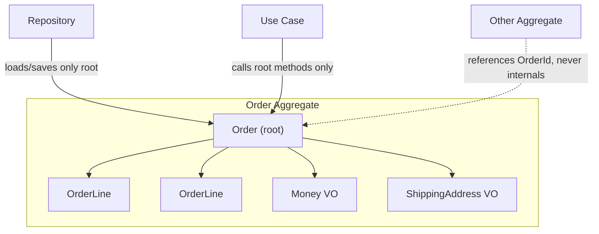

# 🧠 Topic: DDD Aggregate Root

> [!abstract] Executive Summary (ELI5)
> The aggregate root is the single entry point to a cluster of related objects. It is the only member of the cluster the outside world is allowed to see, hold, or reference. Think of a hotel room: you don't walk in and grab a guest's suitcase directly — you knock on the door and the front desk (the root) decides what happens. The root enforces the cluster's rules and guarantees the whole group stays consistent.

---

## 🎯 The "Why"
- **Problem Solved:**
  - Without a single gatekeeper, any code can reach inside a cluster and mutate an internal object, silently breaking invariants that span the group (e.g., an `OrderLine` added without the `Order` knowing, leaving the total wrong).
  - There is no clear answer to "who loads this?", "who saves it?", or "who enforces the rules?" — every caller improvises.
  - References spread freely across the object graph, so changing one cluster ripples into unrelated modules.
- **Alternatives:**
  - **Direct graph navigation:** any object holds a pointer to any other; invariants live nowhere and break everywhere.
  - **Anemic root with validation services:** a service enforces rules the data bag cannot — logic drifts away from the data it protects.
- **Trade-offs:** A root centralizes control, which is safer but can become a bottleneck if the aggregate is too large. The root is more restrictive than a free graph, and that restriction is the whole point.

## 💡 Mental Model & Analogy
- **Analogy:** "The aggregate root is the receptionist of a secured office. Visitors (other code) talk only to reception; reception fetches the right person, escorts the request, and records what changed. You never wander the halls alone."
- **Visual/Diagram:**


> [!tip] The Golden Rule
> Outside code may only reference the root — by identity. It must never hold a direct reference to an internal entity, and it must never instantiate or mutate internals directly.

## 🛠️ Core Principles

### What Is the Aggregate Root?
The root is the **one entity** inside an aggregate that:
- Is the only member referenceable from outside the aggregate.
- Is loaded and saved through a repository — the repository knows nothing about internals.
- Owns and enforces **all** of the aggregate's invariants.
- Is the only object allowed to modify internal entities and value objects.
- Defines the cluster's lifecycle: delete the root, delete the whole aggregate.

> [!note] Root is a class; aggregate is a boundary — the naming trap
> The **root** is the actual class (`Order`) — the only thing that exists as a runtime object. The **aggregate** is the *boundary concept* drawn around that class and its internals. We reuse the root's name for the whole cluster ("the Order aggregate"), so the two words sound identical — but one is an object, the other is a boundary. See the framing in [[DDD Aggregates]] and the full three-way comparison (Bounded Context vs Aggregate vs Aggregate Root) in [[DDD Bounded Context]].

### The Root's Responsibilities
| Responsibility | What it means |
|---|---|
| **Entry point** | All operations go through root methods; internals are never exposed mutably. |
| **Invariant guardian** | After any root method returns, every invariant holds — the root never lets the cluster enter an invalid state. |
| **Factory for internals** | The root creates internal entities/value objects; outsiders cannot construct them in a broken state. |
| **Boundary for references** | Other aggregates hold only the root's ID, never a pointer to internals. |
| **Persistence contract** | The repository deals in roots; it never hands out or accepts bare internals. |
| **Concurrency boundary** | The root is the lock unit — one transaction modifies one root. |

### Reference Rules
1. **External → root:** by identity only (`orderId: OrderId`), never a live reference to internals.
2. **Root → internals:** the root may hold direct references and pass them around *internally*.
3. **Internal → external:** internal entities reference other aggregates by ID, never by pointer.
4. **Internal ↔ internal:** internal entities may reference each other within the same aggregate.

```typescript
// Other aggregate holds an OrderId, not an OrderLine.
class Invoice {
  constructor(private readonly orderId: OrderId) {} // ✅ identity reference
}
```

### Invariant Enforcement
The root protects rules that span the whole cluster. Every mutating method must leave the cluster consistent before returning.
```typescript
class Order { // root
  private lines: OrderLine[] = [];

  addLine(product: Product, qty: number): void {
    if (qty <= 0) throw new Error('Quantity must be positive');
    this.lines.push(OrderLine.create(product, qty)); // root creates the internal
    this.ensureUniqueProducts();                      // root enforces the invariant
  }

  private ensureUniqueProducts(): void {
    const seen = new Set<ProductId>();
    for (const l of this.lines) {
      if (seen.has(l.productId)) throw new Error('Duplicate product in order');
      seen.add(l.productId);
    }
  }
}
```

### Root vs Internal Entity
| Aspect | Aggregate Root | Internal Entity |
|---|---|---|
| Referenced from outside | Yes, by ID. | No. |
| Loaded via repository | Yes. | No — only via the root. |
| Guards cluster invariants | Yes. | Only its own local rules. |
| Can be deleted independently | No — deleting it deletes the cluster. | No — it dies with the root. |
| Example | `Order`. | `OrderLine`. |

## 💻 Examples Across Domains

### 1. E-commerce: `Order` (root) and `OrderLine` (internal)
The root owns the collection, creates lines, and recalculates the total. Outsiders never touch an `OrderLine`.
```typescript
class Order {
  private constructor(
    private readonly id: OrderId,
    private lines: OrderLine[],
    private status: OrderStatus,
  ) {}

  static place(id: OrderId): Order {
    return new Order(id, [], OrderStatus.PENDING);
  }

  addLine(product: Product, qty: number): void {
    if (this.status !== OrderStatus.PENDING) throw new Error('Order is finalized');
    if (qty <= 0) throw new Error('Quantity must be positive');
    const existing = this.lines.find(l => l.productId.equals(product.id));
    if (existing) existing.increaseQuantity(qty);
    else this.lines.push(OrderLine.create(product, qty));
    this.recalculateTotal();
  }

  removeLine(lineId: OrderLineId): void {
    this.lines = this.lines.filter(l => !l.id.equals(lineId));
    if (this.lines.length === 0) throw new Error('Order cannot be empty');
  }

  total(): Money {
    return this.lines.reduce((sum, l) => sum.add(l.subtotal()), Money.zero());
  }
}
```

### 2. Banking: `Account` (root) and `Transaction` (internal)
The ledger lives inside the root; deposits/withdrawals append an immutable internal entry and update the balance together.
```typescript
class Account {
  private constructor(
    private readonly id: AccountId,
    private balance: Money,
    private entries: Transaction[],
  ) {}

  static open(id: AccountId, deposit: Money): Account {
    const a = new Account(id, deposit, []);
    a.entries.push(Transaction.deposit(deposit));
    return a;
  }

  withdraw(amount: Money): void {
    if (amount.isGreaterThan(this.balance)) throw new Error('Insufficient funds');
    this.balance = this.balance.subtract(amount);
    this.entries.push(Transaction.withdrawal(amount)); // root owns the ledger
  }

  deposit(amount: Money): void {
    this.balance = this.balance.add(amount);
    this.entries.push(Transaction.deposit(amount));
  }
}
// Transaction has no repository — you only ever load/save the Account.
```

### 3. Task Management: `Board` (root) and `Task` (internal)
The board controls which task is in which column; a task cannot be moved by anything but the board.
```typescript
class Board {
  private constructor(
    private readonly id: BoardId,
    private columns: Column[],
    private tasks: Task[],
  ) {}

  addTask(title: string, into: ColumnId): void {
    const col = this.requireColumn(into);
    if (col.isFull()) throw new Error('Column at capacity');
    this.tasks.push(Task.create(title, col.id));
  }

  moveTask(taskId: TaskId, toColumnId: ColumnId): void {
    const task = this.tasks.find(t => t.id.equals(taskId));
    if (!task) throw new Error('Task not found');
    const target = this.requireColumn(toColumnId);
    if (target.isFull()) throw new Error('Target column full');
    task.moveTo(target.id); // root delegates, but owns the rule
  }

  private requireColumn(id: ColumnId): Column {
    const c = this.columns.find(c => c.id.equals(id));
    if (!c) throw new Error('Unknown column');
    return c;
  }
}
```

### 4. Healthcare: `Prescription` (root) and `Medication` (internal)
The root checks for drug interactions before allowing any medication in — a rule no single `Medication` could enforce alone.
```typescript
class Prescription {
  private constructor(
    private readonly id: PrescriptionId,
    private meds: Medication[],
    private status: PrescriptionStatus,
  ) {}

  addMedication(med: Medication): void {
    if (this.status !== PrescriptionStatus.DRAFT) throw new Error('Prescription issued');
    if (this.hasInteraction(med)) throw new Error('Drug interaction detected');
    this.meds.push(med);
  }

  private hasInteraction(med: Medication): boolean {
    return this.meds.some(m => m.interactsWith(med));
  }

  issue(): void {
    if (this.meds.length === 0) throw new Error('Cannot issue empty prescription');
    this.status = PrescriptionStatus.ISSUED;
  }
}
```

### 5. Logistics: `Shipment` (root) and `Stop` (internal)
The route is a sequence of stops; only the root can reorder them and validate continuity.
```typescript
class Shipment {
  private constructor(
    private readonly id: ShipmentId,
    private route: Stop[],
    private status: ShipmentStatus,
  ) {}

  static plan(id: ShipmentId, stops: Stop[]): Shipment {
    if (stops.length < 2) throw new Error('Route needs origin and destination');
    return new Shipment(id, stops, ShipmentStatus.PLANNED);
  }

  depart(): void {
    if (this.route[0].isCompleted()) throw new Error('Already departed');
    this.status = ShipmentStatus.IN_TRANSIT;
  }

  arriveAtStop(stopId: StopId): void {
    const next = this.nextUncompletedStop();
    if (!next.id.equals(stopId)) throw new Error('Out-of-order arrival');
    next.markCompleted();
  }

  private nextUncompletedStop(): Stop {
    const s = this.route.find(s => !s.isCompleted());
    if (!s) throw new Error('Route fully completed');
    return s;
  }
}
```

### 6. Social Media: `Thread` (root) and `Reply` (internal)
The thread decides whether a reply is allowed (e.g., locked thread, rate limit); a reply cannot self-insert.
```typescript
class Thread {
  private constructor(
    private readonly id: ThreadId,
    private root: Post,
    private replies: Reply[],
    private locked: boolean,
  ) {}

  reply(author: UserId, content: string): void {
    if (this.locked) throw new Error('Thread is locked');
    if (content.trim().length === 0) throw new Error('Empty reply');
    this.replies.push(Reply.from(author, content));
  }

  lock(): void { this.locked = true; }
  unlock(): void { this.locked = false; }
}
// Reply is constructed only by the Thread; it never appears in a repository.
```

## ⚠️ Pitfalls & Anti-patterns
- **Common Mistakes:**
  - Returning a mutable reference to an internal collection (`getLines(): OrderLine[]`), letting callers bypass the root.
  - Exposing internal entities through a repository (e.g., `OrderLineRepository`) — there is one repository per root, not per entity.
  - Holding a direct object pointer to another aggregate's internal entity instead of a root ID.
  - Making the root a "god object" that swallows unrelated concerns (persistence, notifications) — those belong to services/adapters.
  - Letting two roots share a transaction so invariants are enforced across boundaries by accident.
- **When NOT to model a root:**
  - When the cluster has no cross-object invariants — a simple entity or value object suffices.
  - For read models / projections where you present flattened data with no consistency rules.
- **Performance/Security considerations:**
  - The root is the transactional and locking boundary; oversized roots serialize access and hurt throughput.
  - Exposing internals (even read-only mutable references) can leak state that callers then mutate, so prefer returning copies or read-only views.

## 🔗 Deep Connections
- **Parent Topic:** [[Domain-Driven Design]]
- **Related Concepts:** [[DDD Aggregates]], [[DDD Entities]], [[DDD Domain Services]], [[Application Service in DDD]], [[Repository Pattern]], [[Domain Events]]
- **Prerequisites:** Entities, value objects, transactional consistency, the aggregate concept.
- **Scope note:** [[DDD Aggregates]] covers the aggregate *concept* (boundaries, size, one-transaction-per-aggregate). This note zooms in on the **root** — the entity that acts as sole entry point, invariant guardian, and persistence contract.

## ❓ Active Recall Questions
> [!faq]- What is the single most important rule about referencing an aggregate from the outside?
> Reference the root by identity only. Never hold a direct pointer to an internal entity.

> [!faq]- Why is there one repository per aggregate root, not per entity?
> Because internals are only ever accessed through the root. A repository for an internal entity would let callers bypass the root and its invariants.

> [!faq]- Who should create and validate an internal entity — the caller or the root?
> The root. It constructs internals in a valid state and enforces every cross-object invariant before returning.

> [!faq]- What happens to the aggregate's internals when the root is deleted?
> The entire cluster is deleted. Internal entities must not outlive their root.

> [!faq]- Why is the root the concurrency boundary?
> Because all changes to the cluster go through it, the root defines the unit that must stay transactionally consistent — one transaction modifies one root.

---
## 📝 How to use this template effectively
1. **Never Copy-Paste:** If you find yourself copying documentation, stop. Read, close the tab, and write it from memory.
2. **Iterate:** Fill the 'ELI5' and 'Analogy' first. If you can't explain it simply, you don't understand it yet.
3. **The "Why" is King:** Seniority is defined by knowing *when* and *why* to use a tool, not just *how*.
