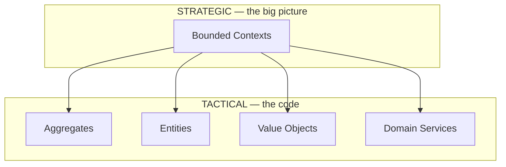

# 🧠 Topic: DDD Bounded Context

> [!abstract] Executive Summary (ELI5)
> A bounded context is a boundary inside which a domain model means one clear, consistent thing. Inside the "Sales" context, the word "Order" means a purchase a customer is making. Inside "Shipping," the word "Order" means a box on a truck. Both are valid — because they live in *different* bounded contexts. The boundary exists so a single word never has to mean two things at once.

---

## 🎯 The "Why"
- **Problem Solved:**
  - One word means different things to different teams: "Customer" is a billing profile to Finance, a shipping address to Logistics, and a complaint history to Support. Forcing them into one mega-`Customer` class produces a tangled blob that serves no one.
  - Without boundaries, every change to one part of the model ripples into unrelated modules, because everything is connected to everything.
  - Teams cannot work independently when they share a single mutable model.
- **Alternatives:**
  - **One giant model ("big ball of mud"):** every concept appears once and means everything. It collapses under its own weight as the domain grows.
  - **No model at all:** each feature writes raw SQL and ad-hoc objects. No shared language exists to reason about the domain.
- **Trade-offs:** Bounded contexts require you to define how they relate (context mapping) and to translate at the edges. In return you get autonomous models, teams that move independently, and terms that always mean one thing within a context.

## 💡 Mental Model & Analogy
- **Analogy:** "A bounded context is like a country with its own language. In the UK, 'chips' means thick fried potatoes; in the US, 'chips' means thin crisps. Neither is wrong — but you need to know which country you're in for the word to make sense. A bounded context is the border that gives a term its single, unambiguous meaning."
- **Visual/Diagram:**
```mermaid
graph TD
    subgraph BC1["Bounded Context: Sales"]
        direction TB
        A1["Order aggregate<br/>(purchase intent)"]
        A2["Customer aggregate<br/>(buyer profile)"]
    end
    subgraph BC2["Bounded Context: Shipping"]
        direction TB
        B1["Shipment aggregate<br/>(delivery manifest)"]
        B2["Package aggregate<br/>(physical box)"]
    end
    subgraph BC3["Bounded Context: Support"]
        direction TB
        C1["Ticket aggregate<br/>(complaint case)"]
        C2["CaseNote aggregate"]
    end
    BC1 -.->|"translates 'Order'|" BC2
    BC1 -.->|"translates 'Order'|" BC3
```

> [!tip] The Golden Rule
> A bounded context protects the **language**, not the data. Inside it, every term has exactly one meaning. The same word can mean something different in another context — and that is correct.

## 🛠️ Core Principles

### What Is a Bounded Context?
A bounded context:
- Is a **language boundary** — inside it, the ubiquitous language is consistent and unambiguous.
- Owns **one model** for the concepts within its scope. There is no single "global" model.
- Is **strategic** — it shapes how the system is divided and how teams are organized, not how a single class is written.
- Typically becomes a **deployable or organizational unit** — a service, a module, a team's ownership area.
- Contains **many aggregates**, each with its own [[DDD Aggregate Root|root]].

### What It Is NOT
- It is **not an aggregate.** An aggregate protects data consistency; a bounded context protects language. See the comparison table below.
- It is **not a database.** Sharing a database does not create a bounded context — and often signals the opposite (a耦合 boundary).
- It is **not a layer** in Clean Architecture. Layers are technical (UI / domain / data); bounded contexts are about the *meaning* of the domain.

### Strategic vs Tactical — Where Bounded Context Sits
Bounded context is a **strategic** pattern. Strategic DDD draws the language boundaries (bounded contexts); tactical DDD fills each one with aggregates, entities, and services.



### 🏆 Bounded Context vs Aggregate vs Aggregate Root
This is the table that resolves the three-way confusion. Read it carefully.

| Aspect | Bounded Context | Aggregate | Aggregate Root |
|---|---|---|---|
| **What kind of thing is it?** | A language boundary (strategic concept). | A consistency boundary around a cluster of objects. | A specific entity — the single entry point to an aggregate. |
| **Protects** | The **language**: every term means one thing inside it. | The **data**: a cluster of objects stays consistent. | The **aggregate's invariants** and entry point. |
| **Scale** | Huge — a whole subdomain. | Small — one transactional cluster. | Smallest — one class. |
| **How many per system?** | A handful (one per subdomain). | Many per bounded context. | Exactly one per aggregate. |
| **Contains** | Many aggregates + services + a ubiquitous language. | A root + internal entities + value objects. | (itself + references to internals). |
| **Question it answers** | "What does 'Order' *mean* here?" | "Which objects must stay consistent together?" | "Who is the single door into this cluster?" |
| **Exists as code?** | No — it's an organizational/module boundary. | No — it's a *concept* drawn around a cluster. | **Yes** — it's the actual class (`Order`). |
| **Has a repository?** | No. | No (the repository serves the root). | Yes — one repository per root. |
| **Analogy** | A country (its own language). | A household (one set of rules). | The household's front door. |

> [!note] The naming trap
> "Order" appears in three sentences — *the Order bounded context*, *the Order aggregate*, *the Order root* — but they are at three different zoom levels. We reuse the root's name for the cluster and sometimes the context. The **root** is the only one that is a real class; the other two are boundaries at different scales.

### Examples Across Domains: Same Word, Different Model
The whole point of bounded contexts is that the same noun is modeled differently in each one.

| Domain | Sales Context | Shipping Context | Support Context |
|---|---|---|---|
| E-commerce | `Order` = purchase intent, cart, totals | `Shipment` = boxes, route, carrier | `Ticket` = complaint referencing an order ID |
| Banking | `Account` = product a customer signed up for | `LedgerEntry` = a posted movement | `Dispute` = a case contesting a charge |
| Healthcare | `Patient` = insurance profile | `Patient` = bed assignment, vitals | `Patient` = treatment history |
| Logistics | `Route` = planned stops and ETA | `Leg` = a truck's actual driven segment | `Claim` = a damage/loss report |

In each row, the leftmost noun is *not the same class* as the rightmost — they share an English word, nothing more. The bounded context is what keeps them from colliding.

## 💻 Examples Across Domains

### 1. E-commerce: Order means three different things
Each context owns its own model. They communicate only by IDs and events across the boundary.
```typescript
// ── Sales Bounded Context ─────────────────────────────
// "Order" = a purchase a customer intends to make
class Order { // aggregate root
  constructor(private readonly id: OrderId, private lines: OrderLine[]) {}
  total(): Money { /* sum of lines */ }
}

// ── Shipping Bounded Context ──────────────────────────
// "Order" does not exist here. The same real-world purchase is a Shipment.
class Shipment { // aggregate root
  constructor(private readonly orderId: OrderId, private packages: Package[]) {}
  // note: it references the Sales Order only by ID, never by the Sales model
}

// ── Support Bounded Context ───────────────────────────
// Here the same purchase is just a reference number on a Ticket.
class Ticket { // aggregate root
  constructor(private readonly id: TicketId, private readonly orderRef: OrderId) {}
}
```

### 2. Banking: Account is a product, a ledger entry, and a dispute
The word "Account" is owned differently by three teams, each with a clean, narrow model.
```typescript
// ── Sales/CRM Context ────────────────────────────────
class Account { // the product the customer signed up for
  constructor(private readonly id: AccountId, private tier: AccountTier) {}
}

// ── Ledger/Accounting Context ────────────────────────
class LedgerAccount { // where postings land
  constructor(private readonly code: string, private balance: Money) {}
  post(entry: LedgerEntry): void { /* ... */ }
}

// ── Disputes Context ─────────────────────────────────
class DisputedCharge { // a customer contesting a transaction
  constructor(private readonly id: DisputeId, private readonly sourceTxnId: TxnId) {}
}
```

### 3. Healthcare: Patient has three models
Clinical, admissions, and billing each keep their own view of "Patient," translating by ID at the edges.
```typescript
// ── Clinical Context ─────────────────────────────────
class Patient { // treatment history, diagnoses, allergies
  constructor(private readonly id: PatientId, private allergies: Allergy[]) {}
}

// ── Admissions Context ───────────────────────────────
class Admission { // bed assignment, ward, vitals
  constructor(private readonly patientId: PatientId, private bed: BedId) {}
}

// ── Billing Context ──────────────────────────────────
class InsuredParty { // insurance profile, coverage limits
  constructor(private readonly patientId: PatientId, private policy: PolicyId) {}
}
```

### 4. Logistics: Route is a plan, a leg, and a claim
Planning, execution, and claims-handling each own their own model of "the route."
```typescript
// ── Planning Context ─────────────────────────────────
class PlannedRoute { // scheduled stops, ETA, assigned carrier
  constructor(private readonly id: RouteId, private stops: Stop[]) {}
}

// ── Execution Context ────────────────────────────────
class DrivenLeg { // actual GPS segment a truck drove
  constructor(private readonly routeId: RouteId, private distance: Distance) {}
}

// ── Claims Context ───────────────────────────────────
class DamageClaim { // a loss/damage report against a route
  constructor(private readonly id: ClaimId, private readonly routeId: RouteId) {}
}
```

### 5. Task Management: Project vs Board vs Portfolio
The word "Project" is modeled differently by the team executing it, the PMO tracking it, and billing.
```typescript
// ── Execution Context ────────────────────────────────
class Board { // tasks, columns, WIP limits — what the team works on
  constructor(private readonly id: BoardId, private tasks: Task[]) {}
}

// ── Portfolio/PMO Context ────────────────────────────
class Initiative { // milestones, budget, status for reporting
  constructor(private readonly id: InitiativeId, private status: Status) {}
}

// ── Billing Context ──────────────────────────────────
class BillableProject { // hours logged, rate, invoiced amount
  constructor(private readonly id: ProjectId, private hoursLogged: number) {}
}
```

### 6. Social Media: User vs Author vs Account
A person is a content producer, an identity, and a moderation subject — three contexts, three models.
```typescript
// ── Publishing Context ───────────────────────────────
class Author { // writes posts, owns content
  constructor(private readonly id: UserId, private followers: UserId[]) {}
}

// ── Identity/Auth Context ────────────────────────────
class Account { // credentials, email, 2FA
  constructor(private readonly id: UserId, private hashedPassword: string) {}
}

// ── Moderation Context ───────────────────────────────
class Subject { // reports against them, strikes, suspensions
  constructor(private readonly id: UserId, private strikes: number) {}
}
```

## ⚠️ Pitfalls & Anti-patterns
- **Common Mistakes:**
  - Building one giant bounded context for the whole system — the "big ball of mud," where every term means everything and nothing.
  - Treating a shared database as a bounded context. Sharing storage does not give you a language boundary; it usually signals the opposite.
  - Leaking one context's model into another (e.g., the Shipping context importing the Sales `Order` class), collapsing the boundary.
  - Drawing boundaries along technical layers (UI / domain / data) instead of along language/subdomain lines.
  - Forgetting to map how contexts relate (see [[Context Mapping]]), so integration happens ad-hoc and rots.
- **When NOT to use multiple bounded contexts:**
  - In a small, single-purpose application where one consistent model genuinely covers the whole domain.
  - In a prototype where the subdomains are still unclear and over-partitioning adds overhead.
- **Performance/Security considerations:**
  - Bounded contexts often become separate services/modules; align boundaries with team ownership and deployment independence.
  - Communication across contexts should go by ID + events/messages, never by sharing live object references, to preserve autonomy and avoid coupling.

## 🔗 Deep Connections
- **Parent Topic:** [[Domain-Driven Design]]
- **Related Concepts:** [[Ubiquitous Language]], [[Context Mapping]], [[DDD Aggregates]], [[DDD Aggregate Root]], [[DDD Entities]], [[Domain Events]]
- **Prerequisites:** Basic domain modeling, the idea that a "model" is an interpretation, not a mirror of reality.
- **Scope note:** This note covers the **strategic** language boundary. [[DDD Aggregates]] covers the **tactical** consistency boundary that lives *inside* a bounded context. [[DDD Aggregate Root]] is the single class that acts as the entry point to one aggregate. The three operate at different zoom levels — see the comparison table above.

## ❓ Active Recall Questions
> [!faq]- What does a bounded context protect — the language or the data?
> The language. Inside a bounded context, every term has one consistent meaning. An aggregate, by contrast, protects data consistency.

> [!faq]- The word "Order" exists in both Sales and Shipping. Should they share one Order class?
> No. Each bounded context owns its own model. In Sales, Order is a purchase; in Shipping, the same real-world thing is a Shipment. They reference each other by ID, not by a shared class.

> [!faq]- What is the difference between a bounded context and an aggregate?
> Scale and purpose. A bounded context is a large language boundary containing many aggregates; an aggregate is a small consistency boundary around one cluster of objects.

> [!faq]- Is a bounded context the same as a microservice?
> Not necessarily. A bounded context is a modeling concept; it *can* be deployed as a microservice, but it can also be a module within a monolith. The boundary is about language, not deployment.

> [!faq]- Why should contexts communicate by ID and events, not by sharing live objects?
> Sharing live objects couples the models together and collapses the boundary. Communicating by ID and events keeps each context's model autonomous and its language unambiguous.

---
## 📝 How to use this template effectively
1. **Never Copy-Paste:** If you find yourself copying documentation, stop. Read, close the tab, and write it from memory.
2. **Iterate:** Fill the 'ELI5' and 'Analogy' first. If you can't explain it simply, you don't understand it yet.
3. **The "Why" is King:** Seniority is defined by knowing *when* and *why* to use a tool, not just *how*.
