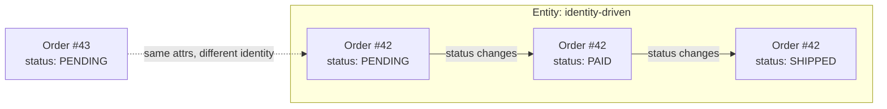

# 🧠 Topic: DDD Entities

> [!abstract] Executive Summary (ELI5)
> An entity is a domain object whose defining trait is **identity**, not its attributes. Two customers named "Jane" with the same email are still different people if their IDs differ — just like two $10 bills are distinct objects even though they look identical. An entity has a lifecycle: it is created, changes over time, and may be archived, all while keeping the same identity.

---

## 🎯 The "Why"
- **Problem Solved:**
  - Without identity, you cannot tell whether two records describe the same real-world thing after its attributes change (a customer renames themselves, an order's status flips).
  - Equality by attribute value breaks the moment two distinct things happen to share the same values (two identical reservations for the same seat).
  - Persistence models leak in: database primary keys become the only notion of "same," so the domain forgets how to reason about identity before anything is saved.
- **Alternatives:**
  - **Value Object:** when an object is fully described by its values and has no lifecycle (e.g., `Money`, `Address`) — use a value object, not an entity.
  - **Anemic data bag:** a plain struct with public fields and no behavior — works for CRUD, loses all domain rules.
- **Trade-offs:** Entities are mutable and stateful, which makes them harder to reason about and test than immutable value objects. Use them only when identity and lifecycle genuinely matter.

## 💡 Mental Model & Analogy
- **Analogy:** "An entity is like a person. You can dye your hair, change your name, move countries — you are still *you*, tracked by your identity (social security number). A value object is like a temperature reading: `20°C` is `20°C`; there is no 'same reading' to track, only equal values."
- **Visual/Diagram:**


> [!tip] The Golden Rule
> If the question "is this the *same* one?" matters more than "does this have the *same* values?", it is an entity.

## 🛠️ Core Principles

### What Makes Something an Entity?
An entity:
- Has a **stable identity** that persists across attribute changes and across time.
- Has a **lifecycle** — creation, state transitions, eventual removal or archival.
- Is **mutable**, but only through methods that guard its invariants.
- Is compared by **identity**, not by attribute equality.

### Identity vs Equality
| Aspect | Entity | Value Object |
|---|---|---|
| Distinguished by | Identity (an ID). | Attribute values. |
| Equality | Same ID → equal, even if attrs differ. | All attrs match → equal. |
| Mutability | Mutable through controlled methods. | Immutable. |
| Lifecycle | Created, changed, destroyed. | None — created and discarded. |
| Example | `Customer`, `Order`, `Account`. | `Money`, `Email`, `Address`. |

### Designing Identity
1. **Generate identity early** — assign an ID at creation, before persistence, so the entity is trackable in memory.
2. **Identity is immutable** — the ID never changes for the lifetime of the entity.
3. **Identity can be** a GUID, a domain-specific code (`ORD-2026-0001`), or a surrogate key — but it must be unique within the bounded context.
4. **Override equality** — entities must compare by ID, not by fields.
```typescript
class Customer {
  constructor(private readonly id: CustomerId, private name: string) {}

  equals(other: Customer): boolean {
    return this.id.equals(other.id); // identity, not attributes
  }
}
```

### Entities Inside Aggregates
- An entity can be an **aggregate root** (referenced from outside) or an **internal entity** (accessed only through its root).
- Internal entities still have identity *within the aggregate*, but the outside world never references them directly.
- See [[DDD Aggregates]] for how root and internal entities cooperate.

## 💻 Examples Across Domains

### 1. E-commerce: `Customer`
Identity survives a rename; equality is by `CustomerId`.
```typescript
class CustomerId { constructor(public readonly value: string) {} }

class Customer {
  private constructor(
    private readonly id: CustomerId,
    private name: string,
    private email: Email,
  ) {}

  static register(id: CustomerId, name: string, email: Email): Customer {
    if (name.trim().length === 0) throw new Error('Name required');
    return new Customer(id, name, email);
  }

  rename(newName: string): void {
    if (newName.trim().length === 0) throw new Error('Name required');
    this.name = newName; // identity unchanged
  }

  equals(other: Customer): boolean {
    return this.id.value === other.id.value;
  }
}

const a = Customer.register(new CustomerId('c-1'), 'Jane', email);
const b = Customer.register(new CustomerId('c-2'), 'Jane', email);
a.equals(b); // false — different identity, same attributes
```

### 2. Banking: `Account`
Lifecycle: `open → debit/credit → close`. Identity persists across balance changes.
```typescript
class Account {
  private constructor(
    private readonly id: AccountId,
    private balance: Money,
    private status: AccountStatus,
  ) {}

  static open(id: AccountId, deposit: Money): Account {
    return new Account(id, deposit, AccountStatus.ACTIVE);
  }

  debit(amount: Money): void {
    if (this.status !== AccountStatus.ACTIVE) throw new Error('Account closed');
    if (amount.isGreaterThan(this.balance)) throw new Error('Insufficient funds');
    this.balance = this.balance.subtract(amount);
  }

  close(): void {
    if (!this.balance.isZero()) throw new Error('Cannot close a non-zero account');
    this.status = AccountStatus.CLOSED;
  }

  equals(other: Account): boolean {
    return this.id.equals(other.id);
  }
}
```

### 3. Task Management: `Task`
State transitions are part of the lifecycle; identity stays fixed.
```typescript
class Task {
  private constructor(
    private readonly id: TaskId,
    private title: string,
    private status: TaskStatus,
    private assignee?: UserId,
  ) {}

  static create(id: TaskId, title: string): Task {
    return new Task(id, title, TaskStatus.TODO);
  }

  start(): void {
    if (this.status !== TaskStatus.TODO) throw new Error('Only TODO tasks can start');
    this.status = TaskStatus.IN_PROGRESS;
  }

  complete(): void {
    if (this.status !== TaskStatus.IN_PROGRESS) throw new Error('Only in-progress tasks complete');
    this.status = TaskStatus.DONE;
  }

  equals(other: Task): boolean {
    return this.id.equals(other.id);
  }
}
```

### 4. Healthcare: `Patient`
Identity must survive even when all demographic fields change.
```typescript
class Patient {
  private constructor(
    private readonly id: PatientId,
    private name: string,
    private dateOfBirth: Date,
    private allergies: Allergy[],
  ) {}

  static admit(id: PatientId, name: string, dob: Date): Patient {
    return new Patient(id, name, dob, []);
  }

  correctName(corrected: string): void {
    this.name = corrected; // data correction — still the same patient
  }

  recordAllergy(allergy: Allergy): void {
    if (this.allergies.some(a => a.equals(allergy))) return; // idempotent
    this.allergies.push(allergy);
  }

  equals(other: Patient): boolean {
    return this.id.equals(other.id);
  }
}
```

### 5. Logistics: `Shipment`
The same shipment moves through locations while keeping its identity.
```typescript
class Shipment {
  private constructor(
    private readonly id: ShipmentId,
    private location: Location,
    private status: ShipmentStatus,
  ) {}

  static dispatch(id: ShipmentId, from: Location): Shipment {
    return new Shipment(id, from, ShipmentStatus.IN_TRANSIT);
  }

  arriveAt(loc: Location): void {
    if (this.status === ShipmentStatus.DELIVERED) throw new Error('Already delivered');
    this.location = loc;
  }

  deliver(): void {
    this.status = ShipmentStatus.DELIVERED;
  }

  equals(other: Shipment): boolean {
    return this.id.equals(other.id);
  }
}
```

### 6. Blog/CMS: `Article`
Identity persists across edits; the version history belongs to one article.
```typescript
class Article {
  private constructor(
    private readonly id: ArticleId,
    private body: string,
    private status: ArticleStatus,
    private revisions: number,
  ) {}

  static draft(id: ArticleId, body: string): Article {
    return new Article(id, body, ArticleStatus.DRAFT, 1);
  }

  edit(newBody: string): void {
    if (this.status === ArticleStatus.PUBLISHED) throw new Error('Unpublish before editing');
    this.body = newBody;
    this.revisions++;
  }

  equals(other: Article): boolean {
    return this.id.equals(other.id);
  }
}
```

## ⚠️ Pitfalls & Anti-patterns
- **Common Mistakes:**
  - Comparing entities by attribute values instead of identity (`a.email === b.email`), so a rename makes one entity "disappear."
  - Letting the database auto-increment ID be the *only* identity, so an entity is unidentifiable before it is saved.
  - Modeling everything as an entity — lookup data, currencies, and statuses are usually value objects.
  - Exposing setters that bypass invariants, erasing the lifecycle rules.
- **When NOT to use an entity:**
  - When the object is fully described by its values (`Money`, `Address`, `DateRange`) — use a value object.
  - For pure reference/lookup data with no lifecycle.
- **Performance/Security considerations:**
  - Generating identity in the domain (UUID) avoids a round-trip to the DB and lets entities be compared before persistence.
  - Equality-by-identity bugs are subtle and surface as duplicate or "missing" records in production.

## 🔗 Deep Connections
- **Parent Topic:** [[Domain-Driven Design]]
- **Related Concepts:** [[DDD Aggregates]], [[DDD Domain Services]], [[Application Service in DDD]], [[Value Object]], [[Entities Layer]]
- **Prerequisites:** Object-oriented design, encapsulation, the difference between identity and equality.
- **Scope note:** This note covers the DDD *tactical pattern* (identity + lifecycle). [[Entities Layer]] covers the *architectural layer* in Clean/Hexagonal Architecture. They overlap but answer different questions.

## ❓ Active Recall Questions
> [!faq]- What single trait distinguishes an entity from a value object?
> Identity. An entity is tracked by a stable ID across attribute changes; a value object is defined entirely by its values and has no identity.

> [!faq]- Two customers share the same name and email. Are they the same entity?
> Only if they share the same identity. Same attributes with different IDs means two distinct entities.

> [!faq]- Why should an entity override `equals` to compare by identity?
> So that two references to the same real-world thing are recognized as equal even after its attributes change — preventing duplicates and "lost" records.

> [!faq]- Can an entity be identified before it is saved to a database?
> Yes — generate identity in the domain (e.g., a UUID) at creation. This lets the entity be tracked and compared without depending on persistence.

---
## 📝 How to use this template effectively
1. **Never Copy-Paste:** If you find yourself copying documentation, stop. Read, close the tab, and write it from memory.
2. **Iterate:** Fill the 'ELI5' and 'Analogy' first. If you can't explain it simply, you don't understand it yet.
3. **The "Why" is King:** Seniority is defined by knowing *when* and *why* to use a tool, not just *how*.
