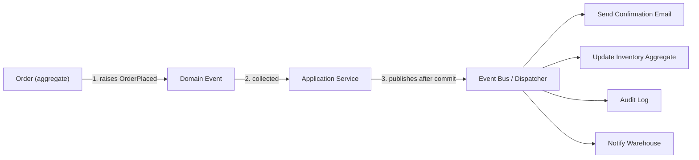

# 🧠 Topic: DDD Domain Events

> [!abstract] Executive Summary (ELI5)
> A domain event is a formal announcement that something meaningful just happened in the domain — like a newspaper headline: "Order Placed!", "Payment Received!". The aggregate that caused it doesn't know or care who reads the news; it just publishes the fact. Subscribers (other aggregates, an email service, an audit log) decide what to do with it. Events let different parts of the system react to changes without being wired together directly.

---

## 🎯 The "Why"
- **Problem Solved:**
  - Side effects (send a confirmation email, update a read model, notify a warehouse) get hard-coded into the aggregate or application service, tangling cause with effect.
  - Keeping two aggregates consistent requires either a giant transaction (slow, locks everything) or direct calls that couple the aggregates together.
  - There is no record of what happened in the domain — only its current state — so auditing and debugging "how did we get here?" is guesswork.
- **Alternatives:**
  - **Direct method calls:** the aggregate explicitly invokes every side effect. Works, but every new reaction means editing the aggregate — closed for extension.
  - **Distributed two-phase commit:** keep multiple aggregates transactionally consistent. Correct but slow, fragile, and often unavailable.
  - **Change Data Capture at the DB:** infer events by diffing tables. Decoupled from the domain language and usually too coarse.
- **Trade-offs:** Events add indirection — the reaction is no longer one click away in the code, it lives in a handler somewhere. In return you get decoupling, extensibility, eventual consistency between aggregates, and a built-in audit trail.

## 💡 Mental Model & Analogy
- **Analogy:** "A domain event is like a town crier shouting 'The harvest is in!'. The crier (the aggregate) only states a fact about the past. The baker, the tax collector, and the festival planner (handlers) each react in their own way — and the crier doesn't need to know any of them."
- **Visual/Diagram:**


> [!tip] The Golden Rule
> A domain event describes something that **already happened** — name it in the past tense (`OrderPlaced`, not `PlaceOrder`), and never use it as a disguised command.

## 🛠️ Core Principles

### What Is a Domain Event?
A domain event:
- Is a record of a meaningful occurrence in the domain (a fact about the past).
- Is named in the **past tense** — `OrderPlaced`, `PaymentReceived`, `UserRegistered`.
- Is **immutable**: once raised, it never changes (you cannot un-bake the fact).
- Carries the data needed to understand the event — usually the IDs of the involved aggregates, plus key values.
- Is raised by an **aggregate** (or entity) when its state changes; it is **published** by the application service after the transaction commits.

### Event vs Command
| Aspect | Domain Event | Command |
|---|---|---|
| Tense | Past — "X happened". | Imperative — "do X". |
| Intent | States a fact; reactions are optional. | Requests an action; expects it to happen. |
| Rejected? | No — it already happened. | Yes — a command can be rejected. |
| Audience | Anyone who subscribes. | A specific handler. |
| Example | `OrderPlaced`. | `PlaceOrder`. |

### The Event Lifecycle
1. **Raised** — an aggregate records the event internally while changing state.
2. **Collected** — the application service (or unit of work) gathers events from the aggregate after the operation.
3. **Published** — after a successful transaction commit, the events are dispatched to handlers.
4. **Handled** — each handler reacts: update another aggregate, send an email, write an audit entry.

> [!warning] Publish After Commit
> If you publish before the transaction commits and it then rolls back, handlers will act on an event for state that never persisted. Use the transactional outbox pattern when you need guaranteed delivery.

### Design Rules
1. **Past-tense names.** `OrderShipped`, never `ShipOrder`.
2. **Carry identity, not whole aggregates.** Embed `orderId`, not the entire `Order` graph. Handlers reload what they need.
3. **Make them immutable value objects.** See [[Value Object]] — events are structurally equal if their fields match.
4. **Publish after commit.** The event is only meaningful once the change is durable.
5. **Keep handlers idempotent.** Delivery may retry; a second `OrderPlaced` must not create a second confirmation email.
6. **One event per meaningful change**, not per field mutation — model at the domain-language level.

## 💻 Examples Across Domains

### 1. E-commerce: `OrderPlaced`
The aggregate raises the event; the application service publishes it after commit.
```typescript
class OrderPlaced {
  constructor(
    public readonly orderId: OrderId,
    public readonly customerId: CustomerId,
    public readonly total: Money,
    public readonly occurredAt: Date,
  ) {}
}

class Order { // aggregate root
  private events: object[] = [];

  static place(id: OrderId, customer: CustomerId, lines: OrderLine[]): Order {
    const order = new Order(id, customer, lines, OrderStatus.PENDING);
    order.events.push(new OrderPlaced(id, customer, order.total(), new Date()));
    return order;
  }

  pullEvents(): object[] {
    const pending = this.events;
    this.events = [];
    return pending;
  }
}

// Application service — publishes ONLY after the commit succeeds
class PlaceOrderService {
  constructor(
    private orders: OrderRepository,
    private bus: EventBus,
    private uow: UnitOfWork,
  ) {}

  async execute(cmd: PlaceOrderCommand): Promise<void> {
    const order = Order.place(OrderId.next(), cmd.customerId, cmd.lines);
    await this.uow.run(async (tx) => {
      await this.orders.save(order, tx);
    }); // commit happens here
    for (const e of order.pullEvents()) await this.bus.publish(e); // after commit
  }
}
```

### 2. Banking: `MoneyDeposited` and `WithdrawalCompleted`
Events keep aggregates decoupled: the `Account` aggregate announces a deposit; a separate `Ledger` aggregate reacts without the `Account` knowing it exists.
```typescript
class MoneyDeposited {
  constructor(
    public readonly accountId: AccountId,
    public readonly amount: Money,
    public readonly occurredAt: Date,
  ) {}
}

class Account {
  private events: object[] = [];

  deposit(amount: Money): void {
    this.balance = this.balance.add(amount);
    this.events.push(new MoneyDeposited(this.id, amount, new Date()));
  }

  pullEvents(): object[] {
    const pending = this.events;
    this.events = [];
    return pending;
  }
}

// A handler in another bounded context — the Account knows nothing about it
class OnMoneyDeposited {
  constructor(private ledger: LedgerRepository) {}

  async handle(e: MoneyDeposited): Promise<void> {
    await this.ledger.append(new LedgerEntry(e.accountId, e.amount, 'CREDIT'));
  }
}
```

### 3. Task Management: `TaskCompleted`
Completing a task publishes an event that updates a project's progress — without the `Task` referencing the `Project`.
```typescript
class TaskCompleted {
  constructor(
    public readonly taskId: TaskId,
    public readonly projectId: ProjectId,
    public readonly completedBy: UserId,
    public readonly occurredAt: Date,
  ) {}
}

class Task {
  private events: object[] = [];

  complete(by: UserId): void {
    if (this.status !== TaskStatus.IN_PROGRESS) throw new Error('Not in progress');
    this.status = TaskStatus.DONE;
    this.events.push(new TaskCompleted(this.id, this.projectId, by, new Date()));
  }

  pullEvents(): object[] { const e = this.events; this.events = []; return e; }
}

class OnTaskCompleted {
  constructor(private projects: ProjectRepository) {}

  async handle(e: TaskCompleted): Promise<void> {
    const project = await this.projects.ofId(e.projectId);
    project.recordCompletion(e.taskId); // separate aggregate reacts
    await this.projects.save(project);
  }
}
```

### 4. Healthcare: `PrescriptionIssued`
Issuing a prescription triggers pharmacy fulfillment and an audit entry — both pure reactions.
```typescript
class PrescriptionIssued {
  constructor(
    public readonly prescriptionId: PrescriptionId,
    public readonly patientId: PatientId,
    public readonly medications: readonly Medication[],
    public readonly issuedBy: DoctorId,
    public readonly occurredAt: Date,
  ) {}
}

class Prescription {
  private events: object[] = [];

  issue(by: DoctorId): void {
    if (this.meds.length === 0) throw new Error('Empty prescription');
    this.status = PrescriptionStatus.ISSUED;
    this.events.push(new PrescriptionIssued(this.id, this.patientId, [...this.meds], by, new Date()));
  }

  pullEvents(): object[] { const e = this.events; this.events = []; return e; }
}
```

### 5. Logistics: `ShipmentDelivered`
Delivery fires an event that closes out the order and notifies the customer — reactions live outside the shipment aggregate.
```typescript
class ShipmentDelivered {
  constructor(
    public readonly shipmentId: ShipmentId,
    public readonly orderId: OrderId,
    public readonly signedBy: string,
    public readonly occurredAt: Date,
  ) {}
}

class Shipment {
  private events: object[] = [];

  deliver(signedBy: string): void {
    if (this.status === ShipmentStatus.DELIVERED) throw new Error('Already delivered');
    this.status = ShipmentStatus.DELIVERED;
    this.events.push(new ShipmentDelivered(this.id, this.orderId, signedBy, new Date()));
  }

  pullEvents(): object[] { const e = this.events; this.events = []; return e; }
}
```

### 6. Social Media: `PostPublished`
Publishing a post fans out to followers and an analytics pipeline — the `Post` aggregate stays unaware of either.
```typescript
class PostPublished {
  constructor(
    public readonly postId: PostId,
    public readonly authorId: UserId,
    public readonly occurredAt: Date,
  ) {}
}

class Post {
  private events: object[] = [];

  publish(): void {
    if (this.status === ArticleStatus.PUBLISHED) throw new Error('Already published');
    this.status = ArticleStatus.PUBLISHED;
    this.events.push(new PostPublished(this.id, this.authorId, new Date()));
  }

  pullEvents(): object[] { const e = this.events; this.events = []; return e; }
}
```

## ⚠️ Pitfalls & Anti-patterns
- **Common Mistakes:**
  - Publishing before the transaction commits, so handlers act on state that later rolls back.
  - Naming events as commands (`ShipOrder`) — that reads as a request, not a fact, and misleads handlers.
  - Embedding the entire aggregate in the event, leaking internals and bloating every handler call.
  - Event storms: each handler raises more events, creating runaway chains or infinite loops.
  - Non-idempotent handlers that duplicate side effects (two confirmation emails) when delivery retries.
- **When NOT to use a domain event:**
  - When the reaction is a direct, synchronous part of the same transaction and the same aggregate — just call a method.
  - When you only need to query current state — that is a read, not an event.
- **Performance/Security considerations:**
  - For guaranteed delivery across processes, use the **transactional outbox** pattern: write the event in the same DB transaction, then a relay publishes it.
  - Avoid putting secrets or PII in events that fan out to many handlers or an external message bus.

## 🔗 Deep Connections
- **Parent Topic:** [[Domain-Driven Design]]
- **Related Concepts:** [[DDD Aggregate Root]], [[DDD Aggregates]], [[Application Service in DDD]], [[DDD Domain Services]], [[Repository Pattern]], [[Event Sourcing]], [[CQRS]]
- **Prerequisites:** Aggregates, the difference between commands and events, eventual consistency.
- **Scope note:** Events are raised by the [[DDD Aggregate Root|aggregate root]] while it changes state, and published by the [[Application Service in DDD|application service]] after commit. Storing the full sequence of events as the source of truth is [[Event Sourcing]] — a separate, more advanced pattern.

## ❓ Active Recall Questions
> [!faq]- Why are domain events named in the past tense?
> Because they describe something that already happened — a fact. A past-tense name (`OrderPlaced`) signals "react to this," not "please do this," and keeps events distinct from commands.

> [!faq]- Why publish events after the transaction commits, not before?
> If you publish before commit and the transaction rolls back, handlers will react to a change that never persisted — sending emails for orders that were never saved.

> [!faq]- Who raises an event, and who publishes it?
> The aggregate raises the event while changing state. The application service collects and publishes it after a successful commit.

> [!faq]- Why should handlers be idempotent?
> Delivery can retry (especially across processes via a message bus). An idempotent handler applied twice produces the same result as once — no duplicate emails or double-charges.

> [!faq]- How do domain events help keep aggregates consistent without distributed transactions?
> Instead of locking multiple aggregates in one transaction, the first aggregate publishes an event and others react to it asynchronously — eventual consistency without the cost of two-phase commit.

---
## 📝 How to use this template effectively
1. **Never Copy-Paste:** If you find yourself copying documentation, stop. Read, close the tab, and write it from memory.
2. **Iterate:** Fill the 'ELI5' and 'Analogy' first. If you can't explain it simply, you don't understand it yet.
3. **The "Why" is King:** Seniority is defined by knowing *when* and *why* to use a tool, not just *how*.
