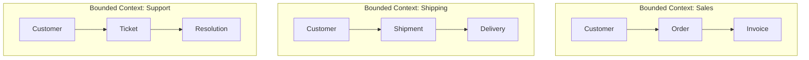

# 🧠 Topic: Domain-Driven Design

> [!abstract] Executive Summary (ELI5)
> Domain-Driven Design (DDD) is a way of building software by deeply understanding the business problem first. Developers and domain experts collaborate to create a shared language (Ubiquitous Language) and organize the system into Bounded Contexts — self-contained models where every term has one clear meaning.

---

## 🎯 The "Why"
- **Problem Solved:**
  - Business people speak one language; developers speak another. Requirements get lost in translation.
  - The same word (e.g., "Customer") means different things in sales, shipping, and support, causing model confusion.
  - Complex business logic is buried in services or databases instead of being expressed in code.
- **Alternatives:**
  - **Data-Driven Design:** start with tables and relationships; business logic is an afterthought.
  - **CRUD-centric architecture:** no domain model; everything is a direct database mapping.
  - **Transaction Script:** procedural code without reusable domain objects.
- **Trade-offs:** DDD requires investment in discovery, modeling, and a shared language. It pays off in complex domains but can be overkill for simple CRUD.

## 💡 Mental Model & Analogy
- **Analogy:** "DDD is like translating a foreign novel. A literal translation (data-driven design) misses the nuance. A good translator (DDD practitioner) learns the culture, captures idioms, and ensures the story makes sense in the new language. The Bounded Context is the genre — a legal thriller uses different vocabulary than a romance novel, even if both have 'contracts.'"
- **Visual/Diagram:**

> [!tip] Ubiquitous Language
> Every term in the model must be used consistently in code, tests, diagrams, and conversations with stakeholders. If a developer says "Order" and a business person says "Transaction," pick one and align.

## 🛠️ Core Principles

### Strategic Patterns (The Big Picture)
| Pattern | What It Is | Deep Dive |
|---|---|---|
| **Ubiquitous Language** | A shared vocabulary between developers and domain experts, used everywhere. | — |
| **Bounded Context** | A boundary inside which a domain model is consistent and unambiguous. | [[DDD Bounded Context]] |
| **Context Mapping** | How different bounded contexts relate: shared kernel, customer-supplier, anti-corruption layer, etc. | — |

### Tactical Patterns (The Code)
| Pattern | What It Is | Deep Dive |
|---|---|---|
| **Entity** | An object with identity and a lifecycle. | [[DDD Entities]] |
| **Value Object** | An immutable object defined by its attributes. | [[Value Object]] |
| **Aggregate** | A cluster of objects treated as a single consistency boundary. | [[DDD Aggregates]] |
| **Domain Service** | Business logic that doesn't fit in any single entity or value object. | [[DDD Domain Services]] |
| **Application Service** | Orchestration layer that coordinates use cases and manages transactions. | [[Application Service in DDD]] |
| **Domain Event** | A record of a meaningful occurrence in the domain, raised by an aggregate and published after commit. | [[Domain Events]] |
| **Repository** | A collection-like interface for persisting and retrieving aggregates. | [[Repository Pattern]] |
| **Factory** | A mechanism for creating complex aggregates while enforcing invariants. | [[Factory Pattern]] |

### Examples Across Domains
The same domain words appear differently across bounded contexts:

| Domain | Sales Context | Shipping Context | Support Context |
|---|---|---|---|
| E-commerce | `Customer` (buyer), `Order` (purchase intent) | `Customer` (recipient), `Order` (delivery manifest) | `Customer` (complainant), `Order` (case reference) |
| Banking | `Account` (savings product) | `Account` (ledger entry) | `Account` (dispute record) |
| Healthcare | `Patient` (insurance profile) | `Patient` (bed assignment) | `Patient` (treatment history) |

## ⚠️ Pitfalls & Anti-patterns
- **Common Mistakes:**
  - Applying DDD to a simple CRUD app where no modeling is needed.
  - Creating one giant "domain model" instead of multiple bounded contexts.
  - Skipping ubiquitous language and inventing technical terms that business people don't recognize.
  - Confusing entities with data models or database tables.
- **When NOT to use:**
  - A simple CRUD admin panel with no business rules.
  - A prototype where the domain is still unknown and likely to change drastically.
- **Performance/Security considerations:**
  - Bounded contexts can be deployed as separate services or modules; align boundaries with team autonomy.
  - Aggregates define transactional consistency boundaries; don't force distributed transactions across aggregates.

## 🔗 Deep Connections
- **Parent Topic:** [[Software Architecture]]
- **Related Concepts:** [[Clean Architecture]], [[Hexagonal Architecture]], [[Entities Layer]], [[DDD Bounded Context]], [[DDD Aggregates]], [[DDD Domain Services]], [[Application Service in DDD]], [[CQRS]], [[Event Sourcing]]
- **Prerequisites:** Object-oriented design, basic modeling, collaboration with stakeholders.

## ❓ Active Recall Questions
> [!faq]- What is the difference between a Bounded Context and a subdomain?
> A subdomain is a part of the business domain (e.g., billing, shipping). A bounded context is a software boundary where a model is consistent. They often map 1:1, but not always.

> [!faq]- Why is Ubiquitous Language important?
> It prevents silent misalignment between developers and business experts by forcing the same terms to be used in conversation, code, and diagrams.

> [!faq]- When should you use DDD?
> When the business domain is complex, the cost of modeling is lower than the cost of misunderstanding the domain, and the system will evolve for years.

---
## 📝 How to use this template effectively
1. **Never Copy-Paste:** If you find yourself copying documentation, stop. Read, close the tab, and write it from memory.
2. **Iterate:** Fill the 'ELI5' and 'Analogy' first. If you can't explain it simply, you don't understand it yet.
3. **The "Why" is King:** Seniority is defined by knowing *when* and *why* to use a tool, not just *how*.
