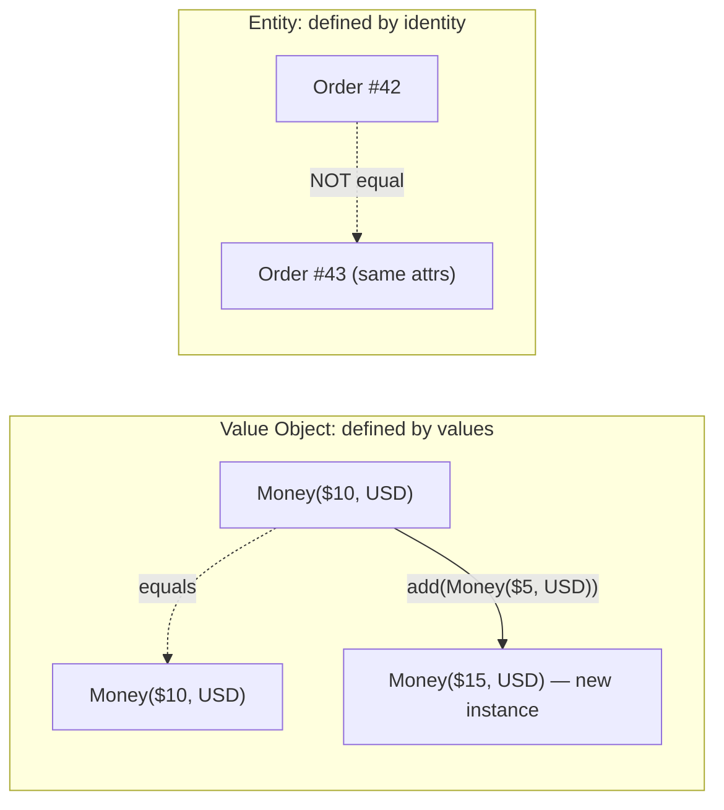

# 🧠 Topic: DDD Value Object

> [!abstract] Executive Summary (ELI5)
> A value object is a domain object defined entirely by **its values**, with no identity and no lifecycle. Two `Money` amounts of `$10 USD` are interchangeable — you don't care *which* ten-dollar bill, only that it is ten dollars. Value objects are immutable: instead of changing one, you create a new one.

---

## 🎯 The "Why"
- **Problem Solved:**
  - Identity everywhere: even trivial descriptions (an address, a price, a date range) get tracked as unique things, forcing needless database rows, equality bugs, and accidental mutation.
  - Mutable shared state: a `Money` object passed around and mutated by one caller silently corrupts every other holder of the same reference.
  - Logic-free data: validation and combination rules (e.g., "cannot add USD to EUR") scatter into services instead of living with the value they protect.
- **Alternatives:**
  - **Primitive obsession:** represent a price as a raw `number`, an email as a `string`. Fast, but untyped — the compiler cannot catch a cents/dollars mix-up, and validation repeats at every call site.
  - **Entity for everything:** give every description an ID. This is heavier, harder to test, and semantically wrong for things defined purely by their attributes.
- **Trade-offs:** Value objects are simpler and safer than entities (immutable, no lifecycle), but they have no identity — so they cannot be loaded by a repository on their own or tracked across changes. They live inside entities and aggregates.

## 💡 Mental Model & Analogy
- **Analogy:** "A value object is like a temperature reading. `20°C` is `20°C` — there is no 'the original 20°C' to track. If the room warms to `21°C`, you don't *modify* the old reading; you take a new one. Two readings of `20°C` are interchangeable."
- **Visual/Diagram:**


> [!tip] The Golden Rule
> If two instances with identical attributes are interchangeable, it is a value object. If "which one?" matters, it is an entity.

## 🛠️ Core Principles

### What Makes Something a Value Object?
A value object:
- Is defined entirely by **its attribute values**, not by an identity.
- Is **immutable** — it is never modified; operations return new instances.
- Compares by **structural equality**: two instances with the same values are equal.
- Has **no lifecycle** — it is created, used, and discarded; it is not created/changed/destroyed over time.
- May contain **behavior**: validation on construction and pure operations (add, combine, convert).

### The Three Building Blocks
1. **Immutability** — every field is `readonly`; "changes" produce a new value object.
2. **Structural equality** — `equals()` compares every attribute; equal values mean equal objects.
3. **Self-validating constructor** — it is impossible to create a value object in an invalid state (e.g., negative money, malformed email).

### Value Object vs Entity
| Aspect | Value Object | Entity |
|---|---|---|
| Defined by | Attribute values. | Identity. |
| Equality | All attributes match. | Same ID. |
| Mutability | Immutable — operations return new instances. | Mutable through controlled methods. |
| Lifecycle | None — created and discarded. | Created, changed, destroyed. |
| Persisted independently | No — stored as part of an entity/aggregate. | Yes — via a repository. |
| Example | `Money`, `Email`, `Address`, `DateRange`. | `Customer`, `Order`, `Account`. |

### Immutability in Practice
"Changing" a value object means returning a new one. This keeps every existing reference valid.
```typescript
class Money {
  constructor(
    private readonly amount: number,
    private readonly currency: string,
  ) {
    if (amount < 0) throw new Error('Money cannot be negative');
  }

  add(other: Money): Money {
    if (this.currency !== other.currency) throw new Error('Currency mismatch');
    return new Money(this.amount + other.amount, this.currency); // new instance
  }

  equals(other: Money): boolean {
    return this.amount === other.amount && this.currency === other.currency;
  }
}
```

### Replace Primitives with Value Objects
The act of wrapping a raw primitive in a typed value object is called **escaping primitive obsession**. It moves validation to one place and lets the compiler enforce correctness.

## 💻 Examples Across Domains

### 1. E-commerce: `Money` and `EmailAddress`
Two canonical value objects: money (amount + currency) and an email (validated on construction).
```typescript
class Money {
  constructor(
    private readonly amount: number,
    private readonly currency: string,
  ) {
    if (amount < 0) throw new Error('Money cannot be negative');
    if (!currency) throw new Error('Currency required');
  }

  static zero(currency: string): Money {
    return new Money(0, currency);
  }

  add(other: Money): Money {
    this.assertSameCurrency(other);
    return new Money(this.amount + other.amount, this.currency);
  }

  multiply(factor: number): Money {
    return new Money(this.amount * factor, this.currency);
  }

  isGreaterThan(other: Money): boolean {
    this.assertSameCurrency(other);
    return this.amount > other.amount;
  }

  equals(other: Money): boolean {
    return this.amount === other.amount && this.currency === other.currency;
  }

  private assertSameCurrency(other: Money): void {
    if (this.currency !== other.currency) throw new Error('Currency mismatch');
  }
}

class EmailAddress {
  private constructor(private readonly value: string) {}

  static create(raw: string): EmailAddress {
    if (!/^[^@\s]+@[^@\s]+\.[^@\s]+$/.test(raw)) throw new Error('Invalid email');
    return new EmailAddress(raw.toLowerCase());
  }

  equals(other: EmailAddress): boolean {
    return this.value === other.value;
  }
}
```

### 2. Logistics: `Address`
An address has no identity of its own; two identical addresses are interchangeable. It is immutable — "changing" the city returns a new address.
```typescript
class Address {
  constructor(
    private readonly street: string,
    private readonly city: string,
    private readonly postalCode: string,
    private readonly country: string,
  ) {
    if (!street || !city || !postalCode || !country) throw new Error('Incomplete address');
  }

  withCity(newCity: string): Address {
    return new Address(this.street, newCity, this.postalCode, this.country);
  }

  equals(other: Address): boolean {
    return this.street === other.street
      && this.city === other.city
      && this.postalCode === other.postalCode
      && this.country === other.country;
  }
}
```

### 3. Healthcare: `Dosage`
A dosage is a measured quantity — defined by amount + unit — and is validated against safe ranges on construction.
```typescript
class Dosage {
  constructor(
    private readonly amount: number,
    private readonly unit: string,
  ) {
    if (amount <= 0) throw new Error('Dosage must be positive');
    if (!unit) throw new Error('Unit required');
  }

  isWithinRange(min: Dosage, max: Dosage): boolean {
    if (this.unit !== min.unit || this.unit !== max.unit) throw new Error('Unit mismatch');
    return this.amount >= min.amount && this.amount <= max.amount;
  }

  equals(other: Dosage): boolean {
    return this.amount === other.amount && this.unit === other.unit;
  }
}
```

### 4. Task Management: `DateRange`
A range is fully described by its start and end; equality is structural, and overlap is a pure computation.
```typescript
class DateRange {
  constructor(
    private readonly start: Date,
    private readonly end: Date,
  ) {
    if (start >= end) throw new Error('Start must precede end');
  }

  overlaps(other: DateRange): boolean {
    return this.start < other.end && other.start < this.end;
  }

  durationInDays(): number {
    return Math.round((this.end.getTime() - this.start.getTime()) / 86_400_000);
  }

  equals(other: DateRange): boolean {
    return this.start.getTime() === other.start.getTime()
      && this.end.getTime() === other.end.getTime();
  }
}
```

### 5. Banking: `Currency` and `Iban`
A currency code is a value object — fully defined by its ISO code, validated against known currencies.
```typescript
class Currency {
  private static readonly KNOWN = new Set(['USD', 'EUR', 'GBP', 'JPY']);
  private constructor(private readonly code: string) {}

  static from(code: string): Currency {
    const upper = code.toUpperCase();
    if (!Currency.KNOWN.has(upper)) throw new Error(`Unknown currency: ${code}`);
    return new Currency(upper);
  }

  equals(other: Currency): boolean {
    return this.code === other.code;
  }
}

class Iban {
  private constructor(private readonly value: string) {}

  static create(raw: string): Iban {
    const cleaned = raw.replace(/\s+/g, '').toUpperCase();
    if (!/^[A-Z]{2}\d{2}[A-Z0-9]{10,30}$/.test(cleaned)) throw new Error('Invalid IBAN');
    return new Iban(cleaned);
  }

  equals(other: Iban): boolean {
    return this.value === other.value;
  }
}
```

### 6. Social Media: `Hashtag` and `Handle`
Both are normalized on construction (lowercased, prefixed), so two identical inputs always produce equal objects.
```typescript
class Handle {
  private constructor(private readonly value: string) {}

  static create(raw: string): Handle {
    const trimmed = raw.replace(/^@/, '').toLowerCase();
    if (!/^[a-z0-9_]{1,15}$/.test(trimmed)) throw new Error('Invalid handle');
    return new Handle(trimmed);
  }

  equals(other: Handle): boolean {
    return this.value === other.value;
  }
}
```

## ⚠️ Pitfalls & Anti-patterns
- **Common Mistakes:**
  - Adding an ID "just in case," turning a value object into a half-entity with both identity and value equality — the worst of both worlds.
  - Exposing setters or mutating internal state, breaking immutability and every holder of the reference.
  - Implementing `equals` by reference instead of by attribute values.
  - Primitive obsession: leaving money as a `number` and an email as a `string`, so validation and units drift across call sites.
- **When NOT to use a value object:**
  - When "which one?" genuinely matters (a specific customer, a specific order) — that is an entity.
  - For one-off throwaway values in a small, stable domain where a primitive is enough and the indirection adds noise.
- **Performance/Security considerations:**
  - Immutability can create short-lived objects under heavy load; modern GC handles this well, but avoid value objects in tight numeric loops where allocation cost dominates.
  - Normalizing and validating on construction (e.g., lowercasing an email, stripping IBAN spaces) prevents duplicate-but-equal records and injection-style data bugs.

## 🔗 Deep Connections
- **Parent Topic:** [[Domain-Driven Design]]
- **Related Concepts:** [[DDD Entities]], [[DDD Aggregates]], [[DDD Aggregate Root]], [[DDD Domain Services]], [[Application Service in DDD]]
- **Prerequisites:** Object-oriented design, immutability, the difference between identity and equality.
- **Scope note:** This note covers the DDD *tactical pattern*. Value objects typically live inside entities and aggregates as their internal attributes — see [[DDD Aggregate Root]] for how the root owns and creates them.

## ❓ Active Recall Questions
> [!faq]- What single trait distinguishes a value object from an entity?
> It has no identity. A value object is defined entirely by its attribute values; an entity is tracked by a stable ID.

> [!faq]- Why are value objects immutable, and how do you "change" one?
> Immutability guarantees that every reference to the object stays valid. You never mutate — you return a new instance with the changed value.

> [!faq]- Two `Money($10, USD)` instances are created separately. Are they equal?
> Yes — value objects use structural equality. If all attributes match, the instances are equal and interchangeable.

> [!faq]- Can a value object be loaded by a repository on its own?
> No. Value objects have no identity and no independent lifecycle; they are stored as part of an entity or aggregate.

> [!faq]- What is primitive obsession, and how do value objects fix it?
> Using raw primitives (a price as `number`, an email as `string`) loses type safety and scatters validation. Wrapping them in value objects centralizes validation and lets the compiler enforce correctness.

---
## 📝 How to use this template effectively
1. **Never Copy-Paste:** If you find yourself copying documentation, stop. Read, close the tab, and write it from memory.
2. **Iterate:** Fill the 'ELI5' and 'Analogy' first. If you can't explain it simply, you don't understand it yet.
3. **The "Why" is King:** Seniority is defined by knowing *when* and *why* to use a tool, not just *how*.
