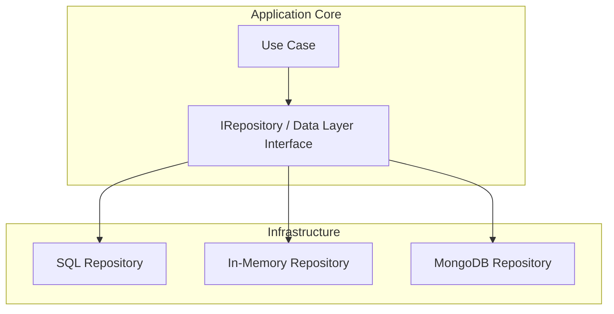

# 🧠 Topic: Data Layer Interface

> [!abstract] Executive Summary (ELI5)
> A Data Layer Interface is the contract that the application core uses when it needs to store or retrieve data. It describes what persistence operations are available — save, find, delete — without saying whether the actual storage is PostgreSQL, MongoDB, or an in-memory array. In hexagonal architecture this contract is a driven port.

---

## 🎯 The "Why"
- **Problem Solved:**
  - Business logic depends directly on SQL, ORM queries, or database-specific SDKs.
  - Unit tests need a real database because persistence code is inseparable from use cases.
  - Switching databases or adding caching forces rewrites across the whole codebase.
  - Schema migration concerns leak into domain models.
- **Alternatives:**
  - **Active Record:** entities carry persistence methods like `order.save()`.
  - **Data Mapper without interface:** a mapper object is used, but it is still concrete and framework-bound.
  - **Raw queries in use cases:** SQL strings live inside application logic.
- **Trade-offs:**
  - More interfaces and mapping code.
  - In return you get testable use cases, delayed technology decisions, and the freedom to swap storage implementations.

## 💡 Mental Model & Analogy
- **Analogy:** "A Data Layer Interface is like a filing cabinet label. The label says ‘drawer for invoices, drawer for receipts.’ You can put a paper filing cabinet, a digital archive, or a cloud storage behind that label. The office worker only needs to know the label, not the technology."
- **Visual/Diagram:**


> [!tip] The Core Rule
> The interface is defined by the core, implemented by infrastructure. The core says what it needs; adapters decide how to provide it.

## 🛠️ Core Principles & Code Snippets

### What Is a Data Layer Interface?
It is a driven port that:
- Declares persistence operations needed by the core.
- Uses domain types on the inside and maps them to storage types on the outside.
- Hides connection strings, ORM sessions, query languages, and transaction APIs.
- Can be replaced by an in-memory implementation for tests without changing use cases.

### Example
```typescript
// Driven port owned by the application core
interface IBookRepository {
  save(book: Book): Promise<void>;
  findById(id: BookId): Promise<Book | null>;
  findAvailable(): Promise<Book[]>;
}

// SQL adapter in infrastructure
class SqlBookRepository implements IBookRepository {
  constructor(private readonly db: Knex) {}

  async save(book: Book): Promise<void> {
    await this.db('books')
      .insert({
        id: book.id.value,
        title: book.title,
        author: book.author,
        is_available: book.isAvailable,
      })
      .onConflict('id')
      .merge();
  }

  async findById(id: BookId): Promise<Book | null> {
    const row = await this.db('books').where('id', id.value).first();
    return row ? this.toDomain(row) : null;
  }

  private toDomain(row: BookRow): Book {
    return Book.reconstitute(
      new BookId(row.id),
      row.title,
      row.author,
      row.is_available,
    );
  }
}

// In-memory adapter for tests
class InMemoryBookRepository implements IBookRepository {
  private books = new Map<string, Book>();

  async save(book: Book): Promise<void> {
    this.books.set(book.id.value, book);
  }

  async findById(id: BookId): Promise<Book | null> {
    return this.books.get(id.value) ?? null;
  }

  async findAvailable(): Promise<Book[]> {
    return Array.from(this.books.values()).filter(b => b.isAvailable);
  }
}
```

### Relationship to Hexagonal Architecture
In hexagonal terminology:
- The **Data Layer Interface** is a **driven port**.
- **SQL Repository**, **MongoDB Repository**, and **In-Memory Repository** are **driven adapters**.
- The use case depends only on the port, never on a concrete adapter.

See also [[Hexagonal Architecture]], [[Dependency Inversion]], [[Entities Layer]].

## ⚠️ Pitfalls & Anti-patterns
- **ORM entities as domain entities:** `PrismaBook` leaking into use cases breaks the abstraction.
- **Repository knows about use cases:** a repository should not import use case classes or application DTOs.
- **Putting queries in the interface:** `findByEmailAndStatusAndCreatedAfter` is a smell — interfaces should express intent, not expose every possible query permutation.
- **No interface at all:** a use case directly imports `SqlBookRepository` couples business logic to SQL.

## 🔗 Deep Connections
- **Parent Topic:** [[Hexagonal Architecture]]
- **Related Concepts:** [[Repository Pattern]], [[Dependency Inversion]], [[Entities Layer]], [[Use Cases Layer]], [[Domain Layer Interface]]
- **Prerequisites:** [[Interfaces and Abstract Classes]], [[SOLID Principles]]

## ❓ Active Recall Questions
> [!faq]- Why is the Data Layer Interface owned by the application core and not by the database layer?
> Because the core must define what it needs. If the database layer owned the interface, the core would depend on infrastructure, inverting the dependency rule.

> [!faq]- What is the main benefit of having an in-memory implementation of the Data Layer Interface?
> Unit tests can run without a real database, making them fast, deterministic, and independent of external state.

---

## Related Notes
- [[Hexagonal Architecture]]
- [[Dependency Inversion]]
- [[Entities Layer]]
- [[Use Cases Layer]]
- [[Domain Layer Interface]]
