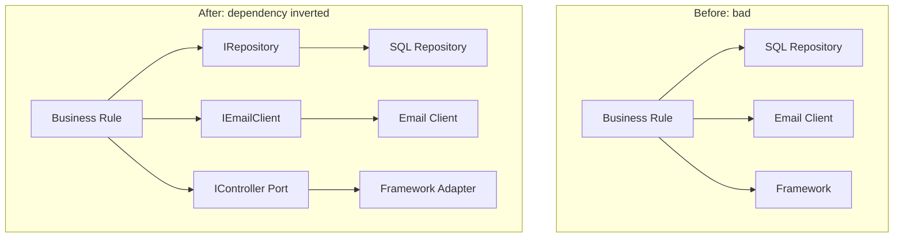

# 🧠 Topic: Dependency Inversion

> [!abstract] Executive Summary (ELI5)
> Dependency Inversion says that important decisions should not depend on small details. Instead of a business rule calling a specific database or framework directly, both the rule and the detail depend on the same simple contract — an interface. This lets you swap the detail without touching the rule.

---

## 🎯 The "Why"
- **Problem Solved:**
  - High-level modules become brittle because they import concrete low-level modules (`SQLBookRepository`, `FastifyController`, `SendGridEmailClient`).
  - Business logic is hard to unit test because it drags in databases, HTTP servers, and third-party APIs.
  - Replacing a library or infrastructure technology forces rewrites deep in the application core.
  - Framework-specific code leaks into domain models and use cases.
- **Alternatives:**
  - **Direct instantiation:** `new SqlRepository()` inside a use case.
  - **Service Locator:** hide dependencies behind a global registry — still couples code to a lookup mechanism.
  - **Factory methods:** better, but can still create concrete dependencies if not designed carefully.
- **Trade-offs:**
  - More interfaces, more wiring, and a steeper learning curve for newcomers.
  - In return you get testability, delayed infrastructure decisions, and a domain core that outlives frameworks.

## 💡 Mental Model & Analogy
- **Analogy:** "Think of a orchestra conductor and the musicians. The conductor does not know how to play the violin or trumpet; she only knows the musical score. The musicians do not need to know who is conducting; they only follow the score. The score is the abstraction. Both conductor and musicians depend on it."
- **Visual/Diagram:**


> [!tip] The Core Rule
> High-level modules should not depend on low-level modules. Both should depend on abstractions. Abstractions should not depend on details. Details should depend on abstractions.

## 🛠️ Core Principles & Code Snippets

### The Two Rules
1. **High-level modules depend on abstractions, not low-level modules.**
2. **Abstractions are owned by the high-level module.** The interface lives where the policy lives.

### Example: Without Dependency Inversion
```typescript
// Bad: use case knows SQL, HTTP, and a specific email provider
class PlaceOrderUseCase {
  async execute(input: PlaceOrderInput) {
    const repo = new SqlOrderRepository();
    const email = new SendGridEmailClient();
    const order = await repo.findById(input.orderId);
    order.confirm();
    await repo.save(order);
    await email.send(order.customerEmail, 'Confirmed');
  }
}
```

### Example: With Dependency Inversion
```typescript
// Owned by the application core
interface IOrderRepository {
  findById(id: OrderId): Promise<Order | null>;
  save(order: Order): Promise<void>;
}

interface IEmailNotifier {
  send(to: string, subject: string): Promise<void>;
}

class PlaceOrderUseCase {
  constructor(
    private readonly orderRepo: IOrderRepository,
    private readonly notifier: IEmailNotifier,
  ) {}

  async execute(input: PlaceOrderInput) {
    const order = await this.orderRepo.findById(input.orderId);
    if (!order) throw new Error('Order not found');
    order.confirm();
    await this.orderRepo.save(order);
    await this.notifier.send(order.customerEmail, 'Confirmed');
  }
}
```

> [!tip] Interface Ownership
> Put `IOrderRepository` next to the use case that needs it, not next to the SQL adapter. The core owns the contract; infrastructure only implements it.

### How It Connects to Hexagonal Architecture
In Hexagonal Architecture the abstraction is called a **port**. The concrete technology is an **adapter**. Dependency Inversion is the mechanism that makes ports-and-adapters work:
- The core defines ports.
- Adapters implement those ports.
- The core never imports an adapter.

See also [[Hexagonal Architecture]], [[Ports and Adapters]].

## ⚠️ Pitfalls & Anti-patterns
- **Interface per class:** creating `IOrderRepository` just to have an interface, while the implementation mirrors it exactly. Interfaces should express *roles*, not duplicate classes.
- **Leaking framework types:** ports that return `Express.Response` or accept `Prisma.OrderCreateInput` are not real abstractions.
- **Dependency Inversion vs Dependency Injection:** Inversion is the principle; injection is one technique to achieve it. You can invert dependencies without a DI container.
- **Putting abstractions in shared libs owned by infrastructure:** if the SQL team owns the interface, the abstraction is upside-down.
- **Over-engineering small scripts:** for a one-off CLI tool, direct dependencies may be fine. Apply the principle where the cost of change is high.

## 🔗 Deep Connections
- **Parent Topic:** [[SOLID Principles]]
- **Related Concepts:** [[Hexagonal Architecture]], [[Clean Architecture]], [[Entities Layer]], [[Use Cases Layer]], [[Inversion of Control]], [[Dependency Injection]]
- **Prerequisites:** [[Interfaces and Abstract Classes]], [[Software Architecture]]

## ❓ Active Recall Questions
> [!faq]- What is the difference between Dependency Inversion and Dependency Injection?
> Dependency Inversion is a design principle: depend on abstractions. Dependency Injection is a technique for supplying those abstractions at runtime. Inversion is the goal; injection is one way to get there.

> [!faq]- Who should own the interface in a ports-and-adapters design?
> The application core owns the port. Adapters are in the outer layer and only implement contracts defined by the core.

---

## Related Notes
- [[Hexagonal Architecture]]
- [[Clean Architecture]]
- [[Entities Layer]]
- [[Use Cases Layer]]
