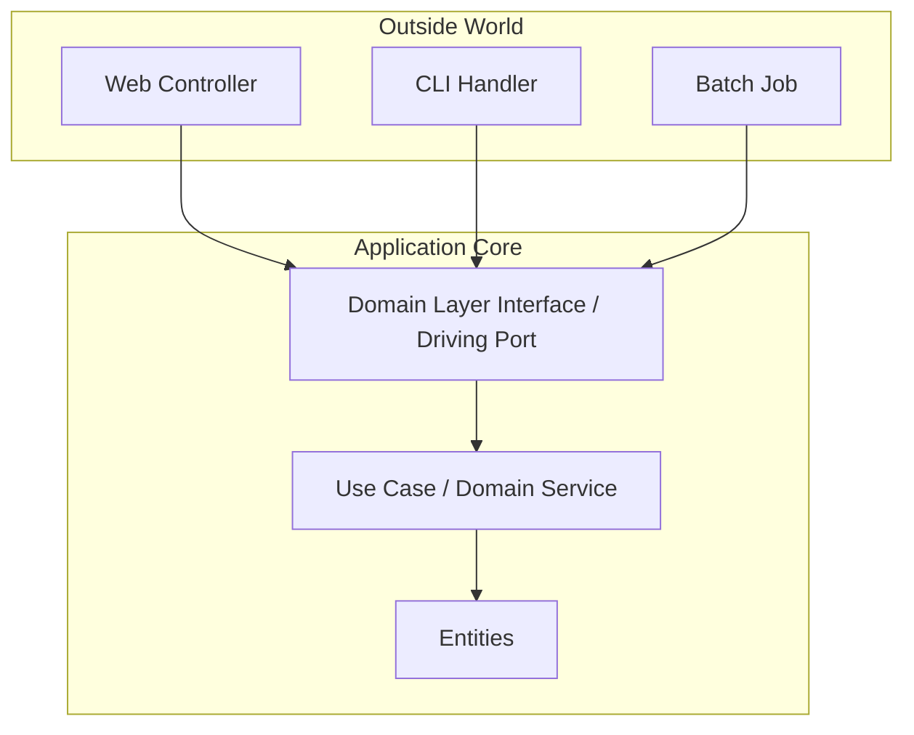

# 🧠 Topic: Domain Layer Interface

> [!abstract] Executive Summary (ELI5)
> A Domain Layer Interface is the contract that the domain layer offers to the outside world. It describes what the domain can do without exposing how it does it. In hexagonal architecture it is often realized as a driving port — the entry point through which callers interact with the application core.

---

## 🎯 The "Why"
- **Problem Solved:**
  - External code calls domain objects directly, bypassing invariants and transaction boundaries.
  - Use cases, controllers, and batch jobs each invoke domain logic differently, making behavior inconsistent.
  - The domain becomes coupled to delivery mechanisms because HTTP request shapes leak into entity methods.
- **Alternatives:**
  - **Fat entities with public setters:** callers mutate state arbitrarily.
  - **Anemic domain model:** all logic lives in services and entities are just bags of data.
  - **Direct controller-to-entity calls:** routing concerns bypass application rules.
- **Trade-offs:**
  - More interfaces and explicit entry points.
  - In return you protect domain invariants, make the domain testable without infrastructure, and make the system’s capabilities explicit.

## 💡 Mental Model & Analogy
- **Analogy:** "A Domain Layer Interface is like the menu of a restaurant. The menu tells you which dishes you can order and what you get back. It does not reveal the kitchen layout, the recipe, or which supplier delivered the ingredients."
- **Visual/Diagram:**


> [!tip] The Core Rule
> The interface lives inside the domain or application layer and is owned by it. Callers depend on the interface; the domain does not depend on callers.

## 🛠️ Core Principles & Code Snippets

### What Is a Domain Layer Interface?
It is a contract that:
- Declares the operations the domain exposes.
- Uses only domain types in its signature (entities, value objects, domain events).
- Hides persistence, messaging, and UI concerns.
- Is implemented by an application service or domain service inside the core.

### Example
```typescript
// Driving port owned by the application core
interface IOrderService {
  placeOrder(command: PlaceOrderCommand): Promise<Order>;
  cancelOrder(orderId: OrderId, reason: string): Promise<Order>;
  getOrder(orderId: OrderId): Promise<Order | null>;
}

// Implementation lives inside the core
class OrderService implements IOrderService {
  constructor(
    private readonly orderRepository: IOrderRepository,
    private readonly pricingService: IPricingService,
  ) {}

  async placeOrder(command: PlaceOrderCommand): Promise<Order> {
    const order = Order.create(command);
    const price = await this.pricingService.calculate(order);
    order.setPrice(price);
    await this.orderRepository.save(order);
    return order;
  }

  // ...
}
```

### Relationship to Hexagonal Architecture
In hexagonal terminology:
- The **Domain Layer Interface** is a **driving port**.
- **Controllers**, **CLI handlers**, and **jobs** are **driving adapters**.
- The interface belongs to the core, so driving adapters depend inward, never outward.

See also [[Hexagonal Architecture]], [[Use Cases Layer]], [[Dependency Inversion]].

## ⚠️ Pitfalls & Anti-patterns
- **Leaking infrastructure types into the interface:** ports should not expose `Request`, `Response`, `PrismaClient`, or `Connection`.
- **Putting the interface next to the adapter:** if the implementation is in infrastructure, the abstraction is upside-down.
- **One giant interface:** `IApplication` with fifty methods breaks the Interface Segregation Principle.
- **Confusing domain services with application services:** domain services contain pure business logic; application services orchestrate use cases and ports.

## 🔗 Deep Connections
- **Parent Topic:** [[Hexagonal Architecture]]
- **Related Concepts:** [[Use Cases Layer]], [[Dependency Inversion]], [[Application Service in DDD]], [[Entities Layer]]
- **Prerequisites:** [[Interfaces and Abstract Classes]], [[SOLID Principles]]

## ❓ Active Recall Questions
> [!faq]- Why must the Domain Layer Interface be owned by the core?
> Because ownership determines the direction of dependencies. If the interface is owned by infrastructure, the core would have to depend outward, violating the dependency rule.

> [!faq]- Can a domain layer interface return primitive types?
> Sometimes, but prefer domain types (entities, value objects, or read models). Primitives are acceptable for trivial queries, but they should not leak framework-specific structures.

---

## Related Notes
- [[Hexagonal Architecture]]
- [[Use Cases Layer]]
- [[Dependency Inversion]]
- [[Entities Layer]]
