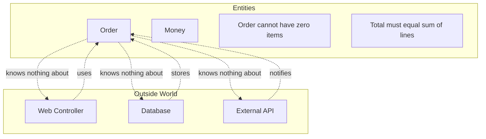

# 🧠 Topic: Entities Layer

> [!abstract] Executive Summary (ELI5)
> The Entities layer is the innermost circle of Clean Architecture. It contains the objects that represent real-world business concepts — like an Order, an Account, or a Patient — together with the rules that govern how they behave. Entities know nothing about databases, web frameworks, or HTTP; they only know the language of the business.

---

## 🎯 The "Why"
- **Problem Solved:**
  - Business rules end up scattered across controllers, services, and validators, making them hard to find and change.
  - Changing a framework or database forces rewriting logic that should be stable.
  - Multiple applications (web, mobile, batch, admin) duplicate the same domain rules because there is no shared place for them.
- **Alternatives:**
  - **Anemic Domain Model:** entities are plain data bags with no behavior; services hold all the logic.
  - **Transaction Script:** each use case is a procedure that manipulates raw data; no real domain objects.
  - **Active Record:** domain objects are tightly coupled to persistence.
- **Trade-offs:**
  - Rich entities require more design discipline and can be harder for newcomers to follow.
  - In return you get a single source of truth for business rules, easier testing, and protection from framework churn.

## 💡 Mental Model & Analogy
- **Analogy:** "An entity is like a board-game piece with its own rule card. A chess king does not ask the app server whether it can move one square; the rule is built into the piece itself. The board and the players are adapters; the piece and its rules are the entity."
- **Visual/Diagram:**


> [!tip] The Golden Rule
> An entity must compile and make sense even if you delete every framework, database, and UI from the project.

## 🛠️ Core Principles

### What Is an Entity?
An entity is a domain object that:
- Has a conceptual identity that survives changes to its attributes.
- Encapsulates business rules, invariants, and behavior.
- Has **zero** dependencies on outer layers.
- Speaks the language of the business, not the language of the database or framework.

### Anatomy of a Well-Designed Entity
1. **Identity** — a stable identifier (not necessarily a database auto-increment).
2. **State** — the data that matters to the business.
3. **Invariants** — rules that must always be true (e.g., "an order must have at least one item").
4. **Behavior** — methods that change state while enforcing invariants.
5. **No infrastructure imports** — no ORM decorators, no HTTP types, no SQL.

### Entity vs Value Object
| Entity | Value Object |
|---|---|
| Has identity (`OrderId`, `AccountId`). | Defined only by its values (`Money`, `Email`, `Address`). |
| Mutable through controlled methods. | Usually immutable. |
| Represents a thing with a lifecycle. | Represents a measurement or description. |
| Example: `Order`, `Patient`, `Post`. | Example: `Money`, `Currency`, `Status`. |

### Rich vs Anemic Models
- **Rich model:** entities protect their own invariants.
  ```typescript
  class Order {
    addItem(product: Product, quantity: number): void {
      if (quantity <= 0) throw new Error('Quantity must be positive');
      this.items.push(new OrderLine(product, quantity));
      this.recalculateTotal();
    }
  }
  ```
- **Anemic model:** entities are public data holders.
  ```typescript
  class Order {
    items: OrderLine[] = []; // anyone can mutate
  }
  // logic lives in OrderService.addItem(order, product, quantity)
  ```

> [!tip] Prefer rich models when the business rules are non-trivial. Use anemic models only for trivial CRUD.

## 💻 Examples Across Domains

### 1. E-commerce: `Order` and `Money`
```typescript
class Money {
  constructor(private readonly amount: number, private readonly currency: string) {
    if (amount < 0) throw new Error('Money cannot be negative');
  }

  add(other: Money): Money {
    if (this.currency !== other.currency) throw new Error('Currency mismatch');
    return new Money(this.amount + other.amount, this.currency);
  }
}

class Order {
  private constructor(
    private readonly id: OrderId,
    private items: OrderLine[],
    private status: OrderStatus,
  ) {}

  static create(id: OrderId): Order {
    return new Order(id, [], OrderStatus.PENDING);
  }

  addItem(product: Product, quantity: number): void {
    if (this.status !== OrderStatus.PENDING) {
      throw new Error('Cannot modify a finalized order');
    }
    if (quantity <= 0) throw new Error('Quantity must be positive');
    this.items.push(new OrderLine(product, quantity));
  }

  total(): Money {
    return this.items.reduce((sum, line) => sum.add(line.subtotal()), Money.zero());
  }
}
```

### 2. Banking: `Account` and `Transaction`
```typescript
class Account {
  private constructor(
    private readonly id: AccountId,
    private balance: Money,
  ) {}

  static open(id: AccountId, initialDeposit: Money): Account {
    return new Account(id, initialDeposit);
  }

  debit(amount: Money): Transaction {
    if (amount.isGreaterThan(this.balance)) {
      throw new Error('Insufficient funds');
    }
    this.balance = this.balance.subtract(amount);
    return new Transaction(this.id, amount, TransactionType.DEBIT);
  }

  credit(amount: Money): Transaction {
    this.balance = this.balance.add(amount);
    return new Transaction(this.id, amount, TransactionType.CREDIT);
  }
}
```

### 3. Task Management: `Task`
```typescript
class Task {
  private constructor(
    private readonly id: TaskId,
    private title: string,
    private status: TaskStatus,
    private assignee?: UserId,
  ) {}

  assign(userId: UserId): void {
    if (this.status === TaskStatus.DONE) {
      throw new Error('Cannot assign a completed task');
    }
    this.assignee = userId;
  }

  complete(): void {
    if (this.status !== TaskStatus.IN_PROGRESS) {
      throw new Error('Only in-progress tasks can be completed');
    }
    this.status = TaskStatus.DONE;
  }
}
```

### 4. Blog/CMS: `Article`
```typescript
class Article {
  private constructor(
    private readonly id: ArticleId,
    private title: string,
    private body: string,
    private status: ArticleStatus,
  ) {}

  publish(now: Date): void {
    if (this.status !== ArticleStatus.DRAFT) {
      throw new Error('Only drafts can be published');
    }
    if (this.title.length < 5) throw new Error('Title too short');
    this.status = ArticleStatus.PUBLISHED;
  }

  isPublished(): boolean {
    return this.status === ArticleStatus.PUBLISHED;
  }
}
```

### 5. Healthcare: `Prescription`
```typescript
class Prescription {
  private constructor(
    private readonly id: PrescriptionId,
    private readonly patientId: PatientId,
    private medications: Medication[],
    private status: PrescriptionStatus,
  ) {}

  addMedication(medication: Medication): void {
    if (this.status !== PrescriptionStatus.DRAFT) {
      throw new Error('Cannot modify an issued prescription');
    }
    if (this.hasConflict(medication)) {
      throw new Error('Conflicts with existing medication');
    }
    this.medications.push(medication);
  }

  issue(): void {
    if (this.medications.length === 0) {
      throw new Error('Cannot issue an empty prescription');
    }
    this.status = PrescriptionStatus.ISSUED;
  }
}
```

### 6. Social Media: `Post` and `Like`
```typescript
class Post {
  private constructor(
    private readonly id: PostId,
    private readonly authorId: UserId,
    private content: string,
    private likes: Like[],
  ) {}

  edit(newContent: string): void {
    if (newContent.length > 280) throw new Error('Post too long');
    this.content = newContent;
  }

  like(userId: UserId): void {
    if (this.hasLikeFrom(userId)) {
      throw new Error('User already liked this post');
    }
    this.likes.push(new Like(userId));
  }

  likeCount(): number {
    return this.likes.length;
  }
}
```

## ⚠️ Pitfalls & Anti-patterns
- **Common Mistakes:**
  - Decorating entities with ORM attributes (`@Entity`, `@Column`) so they cannot be used without the ORM.
  - Exposing setters for every field and losing invariants.
  - Using database auto-increment IDs as the only identity and leaking them everywhere.
  - Putting HTTP status codes, JSON parsing, or framework exceptions inside entities.
  - Creating "god entities" that know about unrelated concepts.
- **When NOT to use rich entities:**
  - Pure CRUD with no business rules.
  - Simple config or lookup tables.
  - Prototypes where the domain is still undefined and rapid change is expected.
- **Performance/Security considerations:**
  - Validation inside entities protects the domain, but input sanitization (SQL injection, XSS) belongs in adapters.
  - Heavy entity graphs can be expensive to load; use aggregates to define consistency boundaries.

## 🔗 Deep Connections
- **Parent Topic:** [[Clean Architecture]], [[Hexagonal Architecture]]
- **Related Concepts:** [[Value Object]], [[Aggregate]], [[Domain-Driven Design]], [[SOLID]], [[Repository Pattern]], [[Anemic Domain Model]]
- **Prerequisites:** Object-oriented design, encapsulation, basic unit testing.

## ❓ Active Recall Questions
> [!faq]- Why should an entity not import a web framework or ORM?
> Because entities represent stable business rules. Coupling them to volatile infrastructure defeats the purpose of isolating the domain.

> [!faq]- What is the difference between an entity and a value object?
> An entity has identity and a lifecycle; a value object is defined entirely by its attribute values and is usually immutable.

> [!faq]- What is an invariant, and where should it live?
> An invariant is a rule that must always be true. It should live inside the entity (or aggregate) that owns it, enforced by constructors and mutating methods.

---
## 📝 How to use this template effectively
1. **Never Copy-Paste:** If you find yourself copying documentation, stop. Read, close the tab, and write it from memory.
2. **Iterate:** Fill the 'ELI5' and 'Analogy' first. If you can't explain it simply, you don't understand it yet.
3. **The "Why" is King:** Seniority is defined by knowing *when* and *why* to use a tool, not just *how*.
