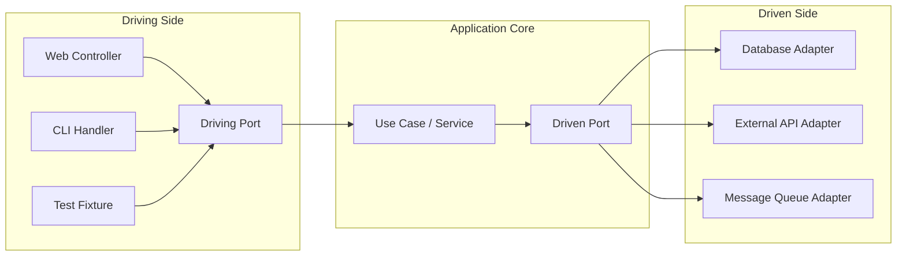

# 🧠 Topic: Hexagonal Architecture

> [!abstract] Executive Summary (ELI5)
> Hexagonal Architecture (Ports and Adapters) builds the application as a self-contained core with clearly defined entry and exit points. The core exposes "ports" — simple interfaces — and the outside world connects through "adapters" that implement those interfaces. Swap a web API for a CLI, or PostgreSQL for an in-memory store, without touching the core.

---

## 🎯 The "Why"
- **Problem Solved:**
  - Frameworks and delivery mechanisms dictate too much of the application structure.
  - Tests require a real database, HTTP server, or message broker because business logic is coupled to them.
  - Replacing an external provider or storage technology creates cascading changes.
  - UI and infrastructure concerns obscure what the application actually does.
- **Alternatives:** [[Clean Architecture]], [[Onion Architecture]], [[Layered Architecture]], [[MVC]].
- **Trade-offs:** You write more interfaces and adapter glue, but you gain testability, delayed technology decisions, and the ability to drive the app from multiple UIs or transports.

## 💡 Mental Model & Analogy
- **Analogy:** "This is like a kitchen appliance with standardized plugs. The appliance is the application core; the power socket and control panel are ports. You can plug it into a European outlet, a car inverter, or a generator — all are adapters that fit the same port. The appliance does not care which adapter you use."
- **Visual/Diagram:**

> [!tip] The Core Rule
> The application core defines **ports**. Adapters implement them. The core never depends on a concrete adapter.

## 🛠️ Core Principles

### Ports
Interfaces owned by the application core. They describe *what* the core needs or offers, not *how* it is provided.

| Port Type | Direction | Purpose |
|---|---|---|
| **Driving** | Inbound | How the outside world triggers the application (e.g., `IOrderService`). |
| **Driven** | Outbound | What the application needs from the outside world (e.g., `IOrderRepository`, `IPaymentGateway`). |

### Adapters
Concrete implementations of ports. They translate between the core's language and the technology's language.

| Adapter Type | Examples |
|---|---|
| **Driving** | REST controller, GraphQL resolver, CLI command, scheduled job, test script |
| **Driven** | SQL repository, NoSQL repository, HTTP client, email sender, file system wrapper, in-memory stub |

### Examples Across Different Applications

#### 1. E-commerce
| Element | Example |
|---|---|
| Driving Port | `IOrderService.placeOrder(command)` |
| Driving Adapter | `OrderController` (REST), `OrderCliCommand` |
| Driven Port | `IOrderRepository`, `IPaymentGateway`, `IInventoryClient` |
| Driven Adapter | `PostgresOrderRepository`, `StripePaymentAdapter`, `HttpInventoryClient`, `InMemoryOrderRepository` for tests |

#### 2. Banking / FinTech
| Element | Example |
|---|---|
| Driving Port | `ITransferService.transfer(source, target, amount)` |
| Driving Adapter | `TransferController`, `AccountEventHandler` |
| Driven Port | `IAccountRepository`, `IFraudChecker`, `INotificationService` |
| Driven Adapter | `OracleAccountRepository`, `RuleEngineFraudAdapter`, `SesEmailAdapter`, `FakeFraudChecker` |

#### 3. Task Management (e.g., Trello clone)
| Element | Example |
|---|---|
| Driving Port | `ITaskService.createTask(boardId, title)` |
| Driving Adapter | `TaskController`, `SlackBotCommand`, `WebSocketHandler` |
| Driven Port | `ITaskRepository`, `IBoardNotifier`, `IUserDirectory` |
| Driven Adapter | `MongoTaskRepository`, `RedisNotifier`, `LdapUserDirectory`, `SpyTaskRepository` |

#### 4. Blog / CMS
| Element | Example |
|---|---|
| Driving Port | `IArticleService.publishArticle(id)` |
| Driving Adapter | `ArticleController`, `AdminCli`, `WebhookReceiver` |
| Driven Port | `IArticleRepository`, `ISearchEngine`, `IAssetStore` |
| Driven Adapter | `ElasticsearchArticleRepository`, `S3AssetStore`, `MeilisearchAdapter`, `InMemorySearchEngine` |

#### 5. Healthcare
| Element | Example |
|---|---|
| Driving Port | `IAppointmentService.bookAppointment(request)` |
| Driving Adapter | `AppointmentController`, `KioskTerminalHandler` |
| Driven Port | `IAppointmentRepository`, `IPatientRecordClient`, `INotificationSender` |
| Driven Adapter | `FhirAppointmentRepository`, `EpicPatientRecordAdapter`, `SmsNotificationAdapter`, `StubNotificationSender` |

#### 6. Social Media
| Element | Example |
|---|---|
| Driving Port | `IFeedService.generateFeed(userId)` |
| Driving Adapter | `FeedController`, `MobileGraphQLResolver`, `BatchJob` |
| Driven Port | `IPostRepository`, `IFeedCache`, `IEventPublisher` |
| Driven Adapter | `CassandraPostRepository`, `RedisFeedCache`, `KafkaEventPublisher`, `MapBasedFeedCache` |

## ⚠️ Pitfalls & Anti-patterns
- **Common Mistakes:**
  - Creating one giant port per aggregate instead of small, role-based ports.
  - Leaking framework annotations or ORM entities into the application core.
  - Writing adapters that bypass ports and call use cases through private methods.
  - Confusing driving and driven ports — a repository is driven, not driving.
- **When NOT to use:**
  - A throwaway prototype where you will likely discard the code.
  - A system that is purely a thin wrapper over a framework with no domain logic.
- **Performance/Security considerations:**
  - Adapter mapping and interface indirection add small overhead; profile before optimizing.
  - Security rules belong in the core when they are business rules, and in driving adapters when they are transport concerns (e.g., CORS, TLS, JWT validation).

## 🔗 Deep Connections
- **Parent Topic:** [[Software Architecture]]
- **Related Concepts:** [[Clean Architecture]], [[Onion Architecture]], [[Dependency Inversion Principle]], [[SOLID]], [[Test Doubles]]
- **Prerequisites:** Interfaces/abstract classes, dependency injection, basic unit testing with mocks/stubs.

## ❓ Active Recall Questions
> [!faq]- What is the difference between a port and an adapter?
> A port is an interface owned by the core; an adapter is the concrete implementation that connects the core to a specific technology.

> [!faq]- Why are test doubles also considered adapters?
> Because they implement the same driven ports as real infrastructure, allowing the core to run without databases, networks, or external services.

> [!faq]- Can one application have multiple driving adapters?
> Yes. The same core can be driven by a REST API, a CLI, a message consumer, or a scheduled job, all through the same driving ports.

---
## 📝 How to use this template effectively
1. **Never Copy-Paste:** If you find yourself copying documentation, stop. Read, close the tab, and write it from memory.
2. **Iterate:** Fill the 'ELI5' and 'Analogy' first. If you can't explain it simply, you don't understand it yet.
3. **The "Why" is King:** Seniority is defined by knowing *when* and *why* to use a tool, not just *how*.
