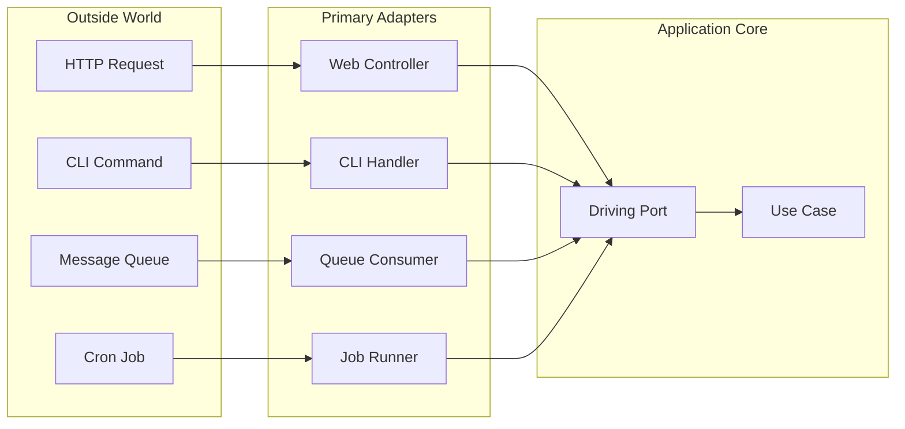

# 🧠 Topic: Primary Adapter

> [!abstract] Executive Summary (ELI5)
> A Primary Adapter is the piece of code that lets the outside world start a conversation with the application. It translates external input — an HTTP request, a CLI command, a message from a queue, or a scheduled job trigger — into a call to the application core. The core does not know which adapter called it.

---

## 🎯 The "Why"
- **Problem Solved:**
  - Delivery mechanisms are mixed with business logic, making the system hard to test and migrate.
  - The same use case cannot be reused across web, CLI, batch, and messaging entry points.
  - Framework-specific code leaks into application services and domain models.
- **Alternatives:**
  - **Controller with direct service calls:** no clear boundary between transport and application logic.
  - **Fat controller:** routing, validation, persistence, and domain rules live in one place.
  - **Framework-annotated entities:** domain objects carry HTTP or ORM annotations.
- **Trade-offs:**
  - More files and an extra translation step.
  - In return you can drive the same use case from many transports and test the core without starting a server.

## 💡 Mental Model & Analogy
- **Analogy:** "A Primary Adapter is like a receptionist at an office. A visitor can arrive by car, by bike, or on foot, but the receptionist translates each arrival into the same internal process: ‘You have an appointment, please sign here.’ The office staff does not care how the visitor got there."
- **Visual/Diagram:**


> [!tip] The Core Rule
> Primary adapters depend on the application core, never the other way around. They translate external input into core input and forward the result back to the external world.

## 🛠️ Core Principles & Code Snippets

### What Is a Primary Adapter?
A Primary Adapter:
- Receives input from the outside world.
- Validates and maps that input to a core input model (command or query).
- Calls a driving port or use case.
- Maps the core output back to a transport-specific response.
- Does not contain business rules.

### Example: Web Controller as Primary Adapter
```typescript
// Driving port owned by the core
interface IOrderService {
  placeOrder(command: PlaceOrderCommand): Promise<Order>;
}

// Primary adapter in infrastructure
class OrderController {
  constructor(private readonly orderService: IOrderService) {}

  async handleCreate(req: Request, res: Response) {
    // 1. Validate and map external input
    const command = new PlaceOrderCommand(
      req.body.customerId,
      req.body.items,
    );

    // 2. Call the core
    const order = await this.orderService.placeOrder(command);

    // 3. Map core output to HTTP response
    res.status(201).json({
      id: order.id.value,
      status: order.status,
      total: order.total.amount,
    });
  }
}
```

### Example: CLI Handler as Another Primary Adapter
```typescript
class PlaceOrderCliHandler {
  constructor(private readonly orderService: IOrderService) {}

  async run(args: string[]) {
    const [customerId, ...itemIds] = args;
    const command = new PlaceOrderCommand(customerId, itemIds);
    const order = await this.orderService.placeOrder(command);
    console.log(`Order ${order.id.value} placed.`);
  }
}
```

Both adapters call the same use case through the same port. The core does not know whether it was invoked via HTTP or CLI.

### Relationship to Hexagonal Architecture
In hexagonal terminology:
- **Primary Adapter** = **Driving Adapter**.
- It depends on a **driving port** defined by the core.
- It sits in the outer layer, together with other infrastructure concerns.

See also [[Hexagonal Architecture]], [[Domain Layer Interface]], [[Use Cases Layer]], [[Dependency Inversion]].

## ⚠️ Pitfalls & Anti-patterns
- **Business logic in the adapter:** validation of pure format is fine; validation of business rules belongs in the core.
- **Returning domain entities directly:** adapters should map to DTOs or view models, not leak entities to the client.
- **Adapter bypassing the port:** calling repositories or domain objects directly breaks the architecture boundary.
- **One adapter per use case obsession:** sometimes a single controller can host a few related actions, but keep it thin.

## 🔗 Deep Connections
- **Parent Topic:** [[Hexagonal Architecture]]
- **Related Concepts:** [[Domain Layer Interface]], [[Use Cases Layer]], [[Dependency Inversion]], [[Secondary Adapter]]
- **Prerequisites:** [[Ports and Adapters]], [[SOLID Principles]]

## ❓ Active Recall Questions
> [!faq]- What makes an adapter "primary" rather than "secondary"?
> A primary adapter initiates the interaction. It drives the application. A secondary adapter is called by the core as a side effect — for example, to send an email or save data.

> [!faq]- Can a primary adapter depend on a repository directly?
> No. It should depend only on the driving port or use case. Direct repository access couples the adapter to persistence details and bypasses application rules.

---

## Related Notes
- [[Hexagonal Architecture]]
- [[Domain Layer Interface]]
- [[Use Cases Layer]]
- [[Dependency Inversion]]
