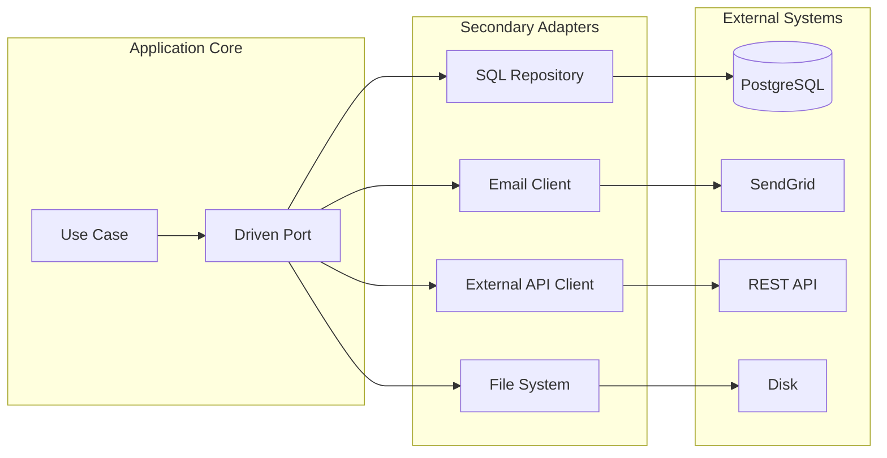

# 🧠 Topic: Secondary Adapter

> [!abstract] Executive Summary (ELI5)
> A Secondary Adapter is the code that lets the application core talk to the outside world. The core decides when to call it — for example, to save data, send an email, or call another service. The adapter hides the messy details of that external system behind a simple interface.

---

## 🎯 The "Why"
- **Problem Solved:**
  - Business logic depends directly on specific databases, email providers, or HTTP clients.
  - Replacing a third-party service forces changes inside use cases.
  - Unit tests fail when the network, database, or file system is unavailable.
  - Framework-specific code leaks into the application core.
- **Alternatives:**
  - **Direct SDK calls inside use cases:** `sendgrid.send(...)` mixed with domain logic.
  - **Concrete repository classes imported by the core:** no abstraction, no test seam.
  - **ORM entities used as domain entities:** persistence concerns shape the domain model.
- **Trade-offs:**
  - More interfaces and mapping code.
  - In return you get testability, swappable infrastructure, and a core that survives technology changes.

## 💡 Mental Model & Analogy
- **Analogy:** "A Secondary Adapter is like a universal travel adapter. Your laptop only knows its own power plug shape; the adapter converts that into whatever the wall socket requires — European, UK, USB-C. The laptop does not need to know which country it is in."
- **Visual/Diagram:**


> [!tip] The Core Rule
> The application core defines the port. The secondary adapter implements it. The core never imports a concrete adapter.

## 🛠️ Core Principles & Code Snippets

### What Is a Secondary Adapter?
A Secondary Adapter:
- Implements a driven port defined by the application core.
- Is triggered by the core, not the other way around.
- Translates between domain types and external system types.
- Hides connection, protocol, and framework details.
- Can be replaced by a test double without changing the core.

### Example: Repository as Secondary Adapter
```typescript
// Driven port owned by the core
interface IOrderRepository {
  save(order: Order): Promise<void>;
  findById(id: OrderId): Promise<Order | null>;
}

// Secondary adapter in infrastructure
class SqlOrderRepository implements IOrderRepository {
  constructor(private readonly db: Knex) {}

  async save(order: Order): Promise<void> {
    await this.db('orders')
      .insert({
        id: order.id.value,
        customer_id: order.customerId.value,
        status: order.status,
        total: order.total.amount,
      })
      .onConflict('id')
      .merge();
  }

  async findById(id: OrderId): Promise<Order | null> {
    const row = await this.db('orders').where('id', id.value).first();
    return row ? this.toDomain(row) : null;
  }

  private toDomain(row: OrderRow): Order {
    return Order.reconstitute(
      new OrderId(row.id),
      new CustomerId(row.customer_id),
      OrderStatus.fromString(row.status),
      Money.of(row.total),
    );
  }
}
```

### Example: Notification Service as Secondary Adapter
```typescript
// Driven port
interface IOrderNotifier {
  notifyCustomer(email: string, message: string): Promise<void>;
}

// Secondary adapter
class SendGridOrderNotifier implements IOrderNotifier {
  constructor(private readonly client: SendGridClient) {}

  async notifyCustomer(email: string, message: string): Promise<void> {
    await this.client.send({ to: email, text: message });
  }
}
```

### Relationship to Hexagonal Architecture
In hexagonal terminology:
- **Secondary Adapter** = **Driven Adapter**.
- It implements a **driven port** defined by the core.
- It lives in the outer layer, together with other infrastructure concerns.

See also [[Hexagonal Architecture]], [[Data Layer Interface]], [[Dependency Inversion]], [[Primary Adapter]].

## ⚠️ Pitfalls & Anti-patterns
- **Leaking external types into the port:** a port should not expose `Knex.QueryBuilder`, `Prisma.Order`, or `SendGrid.MailData`.
- **Adapter calling back into the core:** a secondary adapter should not invoke use cases or domain services.
- **Business logic in the adapter:** mapping and protocol handling are fine; decisions belong in the core.
- **Mocking the adapter in every test:** sometimes it is better to mock the port, not the adapter. The port is the contract.

## 🔗 Deep Connections
- **Parent Topic:** [[Hexagonal Architecture]]
- **Related Concepts:** [[Data Layer Interface]], [[Dependency Inversion]], [[Entities Layer]], [[Use Cases Layer]], [[Primary Adapter]]
- **Prerequisites:** [[Ports and Adapters]], [[SOLID Principles]]

## ❓ Active Recall Questions
> [!faq]- What is the difference between a primary and a secondary adapter?
> A primary adapter drives the application — it receives external input and calls the core. A secondary adapter is driven by the application — the core calls it through a port to perform a side effect.

> [!faq]- Why must secondary adapters implement interfaces owned by the core?
> Because the core must define what it needs. If the adapter owned the interface, the core would depend on infrastructure, violating the dependency rule.

---

## Related Notes
- [[Hexagonal Architecture]]
- [[Data Layer Interface]]
- [[Dependency Inversion]]
- [[Primary Adapter]]
