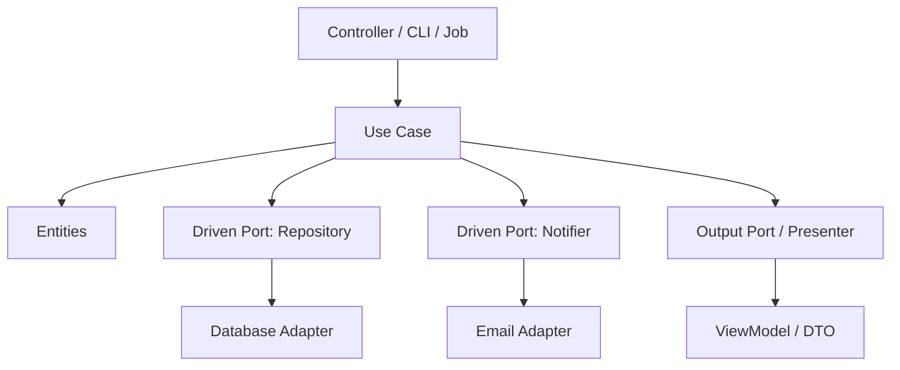

# 🧠 Topic: Use Cases Layer

> [!abstract] Executive Summary (ELI5)
> The Use Cases layer contains the application-specific business operations — one class per operation. It orchestrates entities, asks questions through ports, and returns a result. It does not know whether it is being called from a web controller, a CLI, or a test fixture.

---

## 🎯 The "Why"
- **Problem Solved:**
  - Controllers and services become fat and mixed: routing, validation, persistence, notifications, and domain logic all live together.
  - It is unclear where a specific user-facing operation begins and ends.
  - Reusing the same operation from multiple entry points (web, mobile, batch, admin) leads to duplicated or inconsistent code.
- **Alternatives:**
  - **Fat Service classes** with dozens of unrelated methods.
  - **Transaction Script:** procedural scripts that bypass any domain model.
  - **Putting everything in controllers.**
- **Trade-offs:**
  - More classes and explicit boundaries.
  - In return you get a clear map of what the system can do, easy testing without HTTP or databases, and the ability to swap delivery mechanisms.

## 💡 Mental Model & Analogy
- **Analogy:** "A use case is like a recipe card in a professional kitchen. It tells the cook exactly which ingredients (entities) to use, in what order, and which tools (ports/adapters) to call. The same recipe can be cooked on gas, induction, or a campfire — the recipe itself never changes."
- **Visual/Diagram:**


> [!tip] One Operation, One Class
> Each use case class represents exactly one user-observable operation: `PlaceOrder`, `TransferMoney`, `BookAppointment`.

## 🛠️ Core Principles

### What Is a Use Case?
A use case is an application-specific operation that:
- Receives a plain input object.
- Loads entities through driven ports.
- Orchestrates those entities.
- Calls outbound ports when side effects are needed.
- Returns a plain output object or delegates to an output port.
- Knows **nothing** about HTTP, JSON, SQL, ORMs, UI frameworks, or message brokers.

### Anatomy of a Use Case
```typescript
class PlaceOrderUseCase {
  constructor(
    private orderRepository: IOrderRepository,
    private paymentGateway: IPaymentGateway,
    private inventory: IInventoryService,
    private presenter: IPlaceOrderPresenter,
  ) {}

  async execute(input: PlaceOrderInput): Promise<void> {
    const customer = await this.orderRepository.findCustomer(input.customerId);
    const order = Order.create(input.orderId, customer);

    for (const line of input.lines) {
      const product = await this.inventory.checkAvailability(line.productId, line.quantity);
      order.addItem(product, line.quantity);
    }

    const payment = await this.paymentGateway.charge(order.total(), customer.paymentMethod);
    order.confirm(payment);

    await this.orderRepository.save(order);
    this.presenter.present(OrderDto.from(order));
  }
}
```

### Key Responsibilities
| Responsibility | Example |
|---|---|
| **Orchestrate entities** | Load `Order`, call `order.addItem()`, then `order.confirm()`. |
| **Coordinate driven ports** | Save to repository, send notification, call external API. |
| **Enforce application rules** | "A guest cannot place an order." |
| **Map to output** | Convert the result into a DTO or view model. |

### What Does NOT Belong in a Use Case?
- HTTP request/response handling.
- Framework-specific annotations.
- Direct SQL or ORM queries.
- UI rendering logic.
- Low-level domain invariants that belong inside entities.

## 💻 Examples Across Domains

### 1. E-commerce: `PlaceOrderUseCase`
```typescript
class PlaceOrderUseCase {
  constructor(
    private orderRepository: IOrderRepository,
    private paymentGateway: IPaymentGateway,
    private inventory: IInventoryService,
    private presenter: IPlaceOrderPresenter,
  ) {}

  async execute(input: PlaceOrderInput): Promise<void> {
    const customer = await this.orderRepository.findCustomer(input.customerId);
    const order = Order.create(input.orderId, customer);

    for (const line of input.lines) {
      const product = await this.inventory.checkAvailability(line.productId, line.quantity);
      order.addItem(product, line.quantity);
    }

    const payment = await this.paymentGateway.charge(order.total(), customer.paymentMethod);
    order.confirm(payment);

    await this.orderRepository.save(order);
    this.presenter.present(OrderDto.from(order));
  }
}
```

### 2. Banking: `TransferMoneyUseCase`
```typescript
class TransferMoneyUseCase {
  constructor(
    private accountRepository: IAccountRepository,
    private transactionRepository: ITransactionRepository,
    private fraudChecker: IFraudChecker,
    private notifier: INotificationService,
  ) {}

  async execute(input: TransferInput): Promise<void> {
    const source = await this.accountRepository.findById(input.sourceId);
    const target = await this.accountRepository.findById(input.targetId);

    const isSuspicious = await this.fraudChecker.evaluate(source, target, input.amount);
    if (isSuspicious) throw new FraudDetectedError();

    const debitTx = source.debit(input.amount);
    const creditTx = target.credit(input.amount);

    await this.accountRepository.save(source);
    await this.accountRepository.save(target);
    await this.transactionRepository.save(debitTx);
    await this.transactionRepository.save(creditTx);

    await this.notifier.sendTransferReceipt(source.ownerEmail, debitTx);
  }
}
```

### 3. Task Management: `AssignTaskUseCase`
```typescript
class AssignTaskUseCase {
  constructor(
    private taskRepository: ITaskRepository,
    private userRepository: IUserRepository,
    private notifier: IBoardNotifier,
  ) {}

  async execute(input: AssignTaskInput): Promise<void> {
    const task = await this.taskRepository.findById(input.taskId);
    const user = await this.userRepository.findById(input.userId);

    task.assign(user.id);

    await this.taskRepository.save(task);
    await this.notifier.notifyAssigned(task.id, user.email);
  }
}
```

### 4. Blog/CMS: `PublishArticleUseCase`
```typescript
class PublishArticleUseCase {
  constructor(
    private articleRepository: IArticleRepository,
    private searchEngine: ISearchEngine,
    private feedPublisher: IFeedPublisher,
  ) {}

  async execute(input: PublishArticleInput): Promise<void> {
    const article = await this.articleRepository.findById(input.articleId);

    article.publish(new Date());

    await this.articleRepository.save(article);
    await this.searchEngine.index(article);
    await this.feedPublisher.publish(article);
  }
}
```

### 5. Healthcare: `BookAppointmentUseCase`
```typescript
class BookAppointmentUseCase {
  constructor(
    private appointmentRepository: IAppointmentRepository,
    private doctorSchedule: IDoctorSchedule,
    private patientRecordClient: IPatientRecordClient,
    private notifier: INotificationService,
  ) {}

  async execute(input: BookAppointmentInput): Promise<void> {
    const slot = await this.doctorSchedule.reserve(input.doctorId, input.slotId);
    const patient = await this.patientRecordClient.findPatient(input.patientId);

    const appointment = Appointment.book(input.appointmentId, patient.id, slot);

    await this.appointmentRepository.save(appointment);
    await this.notifier.sendAppointmentConfirmation(patient.email, appointment);
  }
}
```

### 6. Social Media: `CreatePostUseCase`
```typescript
class CreatePostUseCase {
  constructor(
    private postRepository: IPostRepository,
    private feedCache: IFeedCache,
    private eventPublisher: IEventPublisher,
  ) {}

  async execute(input: CreatePostInput): Promise<void> {
    const post = Post.create(input.postId, input.authorId, input.content);

    await this.postRepository.save(post);
    await this.feedCache.invalidate(input.authorId);
    await this.eventPublisher.publish(new PostCreatedEvent(post));
  }
}
```

## ⚠️ Pitfalls & Anti-patterns
- **Common Mistakes:**
  - Mixing HTTP status codes, request objects, or session handling inside the use case.
  - Creating a single `AppService` with dozens of methods instead of small, focused use cases.
  - Putting domain invariants in use cases that should live in entities.
  - Calling adapters directly without going through ports.
  - Returning framework-specific types from `execute()`.
- **When NOT to use:**
  - A trivial CRUD system where each operation is just a database insert/update with no orchestration.
  - A script or data pipeline where the concept of a "user operation" does not apply.
- **Performance/Security considerations:**
  - Use cases can span multiple driven ports; wrap multi-step writes in a transaction boundary (often handled by a unit-of-work port).
  - Authorization can be a cross-cutting concern, but business-level permissions should be modeled explicitly and checked inside the use case or entity.

## 🔗 Deep Connections
- **Parent Topic:** [[Clean Architecture]], [[Hexagonal Architecture]]
- **Related Concepts:** [[Entities Layer]], [[Application Service]], [[Repository Pattern]], [[Unit of Work]], [[Command Pattern]], [[CQRS]]
- **Prerequisites:** Entities, dependency injection, interfaces/ports.

## ❓ Active Recall Questions
> [!faq]- What is the single most important responsibility of a use case?
> To orchestrate exactly one application-specific operation by coordinating entities and driven ports.

> [!faq]- Why should a use case not know about HTTP?
> Because the same operation may be triggered by a REST controller, a CLI command, a message consumer, or a test. HTTP is a delivery concern, not a business operation concern.

> [!faq]- What is the difference between an entity invariant and a use case rule?
> An entity invariant is always true for that object (e.g., "an order cannot have zero items"). A use case rule governs a specific operation (e.g., "a guest cannot place an order").

---
## 📝 How to use this template effectively
1. **Never Copy-Paste:** If you find yourself copying documentation, stop. Read, close the tab, and write it from memory.
2. **Iterate:** Fill the 'ELI5' and 'Analogy' first. If you can't explain it simply, you don't understand it yet.
3. **The "Why" is King:** Seniority is defined by knowing *when* and *why* to use a tool, not just *how*.
