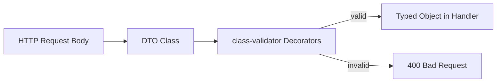

# 🧠 Topic: Data Transfer Object (DTO) in NestJS

> [!abstract] Executive Summary (ELI5)
> A DTO is a plain class that defines the shape of data traveling between the client and your application. It tells NestJS what fields to expect, what types they should be, and which rules they must follow — so the framework can validate and transform the data before it reaches your business logic.

---

## 🎯 The "Why"
- **Problem Solved:** Without a DTO, your route handlers receive shapeless, untyped plain objects. DTOs provide a contract for incoming data, enabling type safety, automatic validation, and self-documenting APIs.
- **Alternatives:**
  - **TypeScript interfaces:** They disappear at runtime, so Nest can't use them for validation or transformation.
  - **Inline validation in handlers:** Repetitive, breaks SRP, and hard to test.
  - **Zod schemas:** Good alternative, but less integrated with Nest's `ValidationPipe` metatype system.
- **Trade-offs:** DTOs require classes and extra boilerplate, but they become the single source of truth for both type information and validation rules.

## 💡 Mental Model & Analogy
- **Analogy:** "A DTO is like a customs declaration form. Before a package crosses the border, the form defines exactly what is inside, how much of it, and whether it's allowed. If the form doesn't match the contents, the shipment is rejected."
- **Visual/Diagram:**


## 🛠️ Core Principles & Code Snippets

### 1. DTOs Must Be Classes, Not Interfaces
TypeScript interfaces are erased during transpilation. Nest needs runtime access to the DTO's metatype to perform validation and auto-transformation. Use concrete classes.

```typescript
// ✅ Good: class with decorators
export class CreateUserDto {
  @IsEmail()
  email: string;

  @IsNotEmpty()
  @MinLength(8)
  password: string;
}

// ❌ Bad: interface disappears at runtime
export interface CreateUserDto {
  email: string;
  password: string;
}
```

> [!tip] Implementation Note
> Avoid `import type { CreateUserDto }` in controllers. Use a regular `import { CreateUserDto }` so the class remains available at runtime.

### 2. Basic DTO with Validation
Install dependencies:
```bash
npm i --save class-validator class-transformer
```

```typescript
import { IsString, IsInt, IsOptional } from 'class-validator';

export class CreateCatDto {
  @IsString()
  name: string;

  @IsInt()
  age: number;

  @IsOptional()
  @IsString()
  breed?: string;
}
```

Bind `ValidationPipe` globally:
```typescript
async function bootstrap() {
  const app = await NestFactory.create(AppModule);
  app.useGlobalPipes(new ValidationPipe());
  await app.listen(3000);
}
```

Use the DTO in a controller:
```typescript
@Post()
create(@Body() createCatDto: CreateCatDto) {
  return this.catsService.create(createCatDto);
}
```

### 3. DTOs for Different Request Parts
DTOs are not limited to request bodies. You can use them for route params and query strings too.

```typescript
export class FindOneParams {
  @IsNumberString()
  id: string;
}

@Get(':id')
findOne(@Param() params: FindOneParams) {
  return this.catsService.findOne(params.id);
}
```

### 4. Mapped Types for CRUD
Use `@nestjs/mapped-types` to derive update DTOs from create DTOs without duplication.

```bash
npm i --save @nestjs/mapped-types
```

```typescript
import { PartialType, PickType, OmitType, IntersectionType } from '@nestjs/mapped-types';

export class CreateCatDto {
  @IsString() name: string;
  @IsInt() age: number;
  @IsString() breed: string;
}

// All fields optional
export class UpdateCatDto extends PartialType(CreateCatDto) {}

// Only specific fields
export class UpdateCatAgeDto extends PickType(CreateCatDto, ['age'] as const) {}

// Exclude specific fields
export class UpdateCatDto extends OmitType(CreateCatDto, ['name'] as const) {}

// Combine two DTOs
export class CreateCatWithColorDto extends IntersectionType(
  CreateCatDto,
  AdditionalCatInfo,
) {}
```

### 5. Key ValidationPipe Options
```typescript
new ValidationPipe({
  whitelist: true,              // strip properties without decorators
  forbidNonWhitelisted: true,     // throw when unexpected properties are sent
  transform: true,              // convert plain objects to DTO class instances
  disableErrorMessages: true,     // hide error details in production
  errorFormat: 'grouped',         // 'list' (default) or 'grouped'
})
```

| Option | Effect |
|--------|--------|
| `whitelist` | Removes properties not decorated in the DTO |
| `forbidNonWhitelisted` | Throws instead of stripping when combined with `whitelist` |
| `transform` | Casts payloads to DTO instances and auto-converts primitives (e.g., string → number) |
| `disableErrorMessages` | Prevents leaking validation details to the client |
| `exceptionFactory` | Lets you customize the thrown exception |

## ⚠️ Pitfalls & Anti-patterns
- **Common Mistakes:**
  - Using TypeScript interfaces for DTOs — they won't validate.
  - Using `import type` for DTOs — the class is erased at runtime.
  - Forgetting to install `class-transformer` along with `class-validator` — both are required by `ValidationPipe`.
- **When NOT to use:**
  - For simple internal service methods where TypeScript types alone are sufficient.
  - When you want runtime validation without adding class decorators — Zod may be a cleaner fit.
- **Performance/Security considerations:**
  - `transform: true` creates class instances for every request. Usually fine, but measure under high load.
  - Never expose raw `class-validator` errors in production; use `disableErrorMessages` or an exception filter.
  - Be careful with `whitelist: false` — it allows clients to inject extra properties that your handler might accidentally pass downstream.

## 🔗 Deep Connections
- **Parent Topic:** [[Validating Request Data with Pipes]]
- **Related Concepts:** [[NestJS Routing Decorators]], [[class-validator]], [[Mapped Types]], [[NestJS Controller and Request Lifecycle]]
- **Prerequisites:** TypeScript classes, NestJS controllers, decorators, basic validation concepts.

## ❓ Active Recall Questions
> [!faq]- Why must DTOs be classes instead of interfaces in NestJS?
> TypeScript interfaces are erased at runtime. NestJS needs the DTO class's metatype to perform validation and transformation through `ValidationPipe`.

> [!faq]- What is the difference between `whitelist: true` and `forbidNonWhitelisted: true`?
> `whitelist: true` strips unknown properties silently. `forbidNonWhitelisted: true` throws a `BadRequestException` when unknown properties are present.

> [!faq]- What does `transform: true` do in `ValidationPipe`?
> It converts incoming plain objects into instances of the DTO class and automatically converts primitive types (e.g., path/query string to number) based on the handler's type signature.

---
*This note follows the Technical-Deep-Dive template. Status: new → update to `growing` after hands-on practice.*
