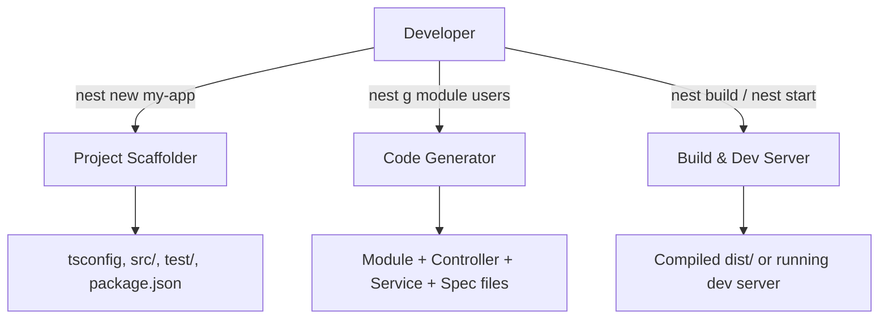

# 🧠 Topic: NestJS CLI Overview

> [!abstract] Executive Summary (ELI5)
> NestJS CLI is a command-line assistant that scaffolds new NestJS projects, generates boilerplate code (modules, controllers, services), and automates common development tasks so you don't have to create files and wire up dependencies manually.

---

## 🎯 The "Why"
- **Problem Solved:** Manual setup of NestJS projects is tedious — you need tsconfig, entry points, folder structure, module wiring, and dependency injection configuration. CLI automates all of this.
- **Alternatives:**
  - **Manual scaffolding:** Create files by hand (error-prone, slow).
  - **Other frameworks' CLI:** Angular CLI (similar concept, different ecosystem), Express generator (less opinionated, no DI).
- **Trade-offs:** Nest CLI is highly opinionated — great for consistency, but less flexible if you want a custom project structure.

## 💡 Mental Model & Analogy
- **Analogy:** "This is like a cookie-cutter factory. You tell it 'I want a star-shaped cookie' (a module), and it stamps out the perfect shape with all the right cutouts (files, imports, tests) instantly."
- **Visual/Diagram:**


## 🛠️ Core Principles & Code Snippets

### Installation
```bash
# Global installation (recommended for CLI access)
npm install -g @nestjs/cli

# Local project creation
nest new my-project
```

### Key Commands
```bash
nest new <name>          # Scaffold a new project
nest generate <schematic> <name>  # Generate code (alias: nest g)
nest build               # Compile TypeScript to dist/
nest start               # Run compiled application
nest start --watch       # Run with file watcher (hot reload)
nest test                # Run unit tests (Jest)
```

### Available Schematics (Generators)
```bash
nest g module users      # Creates users.module.ts + updates app.module.ts
nest g controller users  # Creates users.controller.ts + spec + updates module
nest g service users     # Creates users.service.ts + spec + updates module
nest g resource users    # Creates full CRUD scaffold (module, controller, service, DTO, entity)
```

> [!tip] Implementation Note
 > Always use `nest g resource <name>` when starting a new feature — it creates the complete CRUD boilerplate including DTOs, entities, and controller methods, saving significant time.

### Default Scripts in `package.json`
When you create a new project with `nest new`, the following scripts are pre-configured in `package.json`:

```json
{
  "scripts": {
    "build": "nest build",
    "format": "prettier --write \"src/**/*.ts\" \"test/**/*.ts\"",
    "start": "nest start",
    "start:dev": "nest start --watch",
    "start:debug": "nest start --debug --watch",
    "start:prod": "node dist/main",
    "lint": "eslint \"{src,apps,libs,test}/**/*.ts\" --fix",
    "test": "jest",
    "test:watch": "jest --watch",
    "test:cov": "jest --coverage",
    "test:debug": "node --inspect-brk -r tsconfig-paths/register -r ts-node/register node_modules/jest/bin/jest --runInBand",
    "test:e2e": "jest --config ./test/jest-e2e.json"
  }
}
```

| Script | Purpose |
|--------|---------|
| `build` | Compiles the project into `dist/` |
| `format` | Formats source and test files with Prettier |
| `start` | Runs the application in production mode (compiled) |
| `start:dev` | Runs with file watcher and hot reload |
| `start:debug` | Runs with debugger + hot reload |
| `start:prod` | Runs the already compiled application from `dist/main` |
| `lint` | Lints and auto-fixes TypeScript files |
| `test` | Runs unit tests once (Jest) |
| `test:watch` | Runs unit tests in watch mode |
| `test:cov` | Runs tests with coverage report |
| `test:debug` | Runs tests with Node.js inspector for debugging |
| `test:e2e` | Runs end-to-end tests from the `test/` folder |

## ⚠️ Pitfalls & Anti-patterns
- **Common Mistakes:**
  - Generating files without understanding the DI wiring — always check how `providers` and `controllers` are registered in the module.
  - Forgetting to add `--watch` during development and manually restarting the server.
- **When NOT to use:**
  - For very small, simple scripts where a full NestJS framework is overkill.
  - When you need a custom DI container or non-standard module structure (CLI enforces conventions).
- **Performance/Security considerations:**
  - The `nest start --watch` mode uses more memory than production builds; don't use it in production.
  - Generated code doesn't include authentication or authorization — always add guards manually.

## 🔗 Deep Connections
- **Parent Topic:** [[NestJS Framework Overview]]
- **Related Concepts:** [[Dependency Injection]], [[TypeScript Decorators]], [[Modular Architecture]], [[Jest Testing]]
- **Prerequisites:** Basic TypeScript, Node.js/npm, understanding of MVC pattern.

## ❓ Active Recall Questions
> [!faq]- What is the difference between `nest g module` and `nest g resource`?
> `module` creates only the module file, while `resource` creates a full CRUD scaffold including module, controller, service, DTO, and entity.

> [!faq]- Why does `nest g service` automatically update the module file?
> Because NestJS uses Dependency Injection. Services must be registered as `providers` in a module so the IoC container can resolve and inject them.

> [!faq]- What command would you use for hot-reload during development?
> `nest start --watch` (or `nest start --watch --debug` for debugging).

---
*This note follows the Technical-Deep-Dive template. Status: new → update to `growing` after hands-on practice.*
