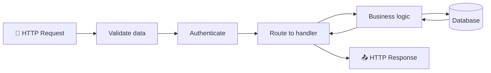
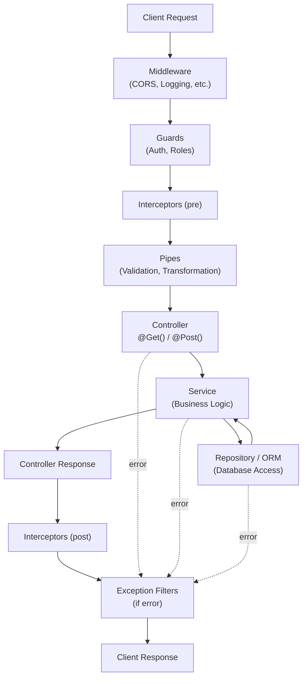
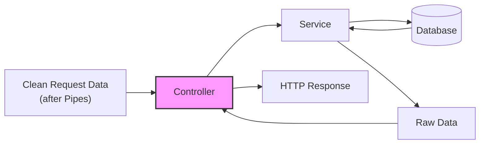

## Is the teacher's schema correct?

**Short answer: yes, as a high-level overview.**

The teacher describes a four-step backend request lifecycle that is universal across frameworks:

1. **Validate the data contained in the request.**
2. **Make sure the user is authenticated.**
3. **Route to a particular function, run business logic, access a database.**
4. **Form the response and send it back.**

This is a valid mental model. However, in practice the order is more specific and the framework provides dedicated layers for each step. In NestJS the execution order looks like this:

| Step | NestJS Layer | Purpose |
|------|-------------|---------|
| 1 | **Middleware** (optional) | Global cross-cutting concerns (logging, CORS, compression) |
| 2 | **Guards** | Authentication & Authorization — is the user allowed? |
| 3 | **Interceptors** (pre) | Pre-processing (logging, caching, timeout) |
| 4 | **Pipes** | Validation & Transformation of request data |
| 5 | **Controller** | Route handler receives clean, validated data |
| 6 | **Service** | Business logic execution |
| 7 | **Repository / ORM** | Database access (queries, inserts, updates) |
| 8 | **Service** | Returns data to controller |
| 9 | **Controller** | Forms the HTTP response |
| 10 | **Interceptors** (post) | Post-processing (transform response shape) |
| 11 | **Exception Filters** | Catch any unhandled errors and format them |
| 12 | **Client** | Receives the final response |

### Key insight

The teacher's schema is the **what** (the logical flow). The NestJS layer model is the **how** (the implementation order). Both are correct, but the layer model is more precise.

---

## Can validation and authentication swap places?

**Yes. This is an architectural decision, not a framework rule.**

### Default NestJS order: Authentication first

In the standard NestJS execution order, **Guards (authentication) run before Pipes (validation)**. This means the framework checks "who are you?" before checking "is your data valid?".

**Rationale:** Don't waste CPU parsing and validating request bodies from unauthenticated users.

### Alternative: Validation first

Some teams prefer to **validate the request body before checking authentication**. The reasoning is: if the data is malformed, there is no point in parsing JWT tokens or querying the user database.

**Rationale:** Reject garbage requests early, before touching the auth system.

### How to change the order in NestJS

| Approach | Method |
|----------|--------|
| **Middleware for validation** | Run `express-validator` or custom validation in Middleware, which executes before Guards. |
| **Guard + Pipe composition** | A Guard can do lightweight validation (e.g., check if body exists) before the full Pipe validation. |
| **Custom Pipe with auth check** | A Pipe can inspect `req.user` set by a preceding Guard. This keeps the default order but the Pipe can reject based on auth context. |

### Which is better?

| Scenario | Recommended order |
|----------|-------------------|
| Public API with heavy traffic | Auth first — save validation CPU for authenticated users only |
| Internal API with complex payloads | Validation first — catch malformed data before token parsing |
| File upload endpoints | Validation first — check file size/type before auth to prevent DoS |
| Payment endpoints | Auth first — security-critical, never process unauthorized requests |

**Key point:** The order is a trade-off between **security** (reject unauthorized early) and **efficiency** (reject invalid data early). There is no universal "correct" answer. The teacher's schema places validation first, which is common in many frameworks and valid for many use cases. NestJS defaults to auth first, but this is configurable.


---

## What is a NestJS Controller?

A **Controller** is a class decorated with `@Controller()`. Its responsibility is to:

- **Route requests** — map HTTP methods and paths to class methods (`@Get()`, `@Post()`, etc.)
- **Orchestrate** — delegate business logic to Services
- **Form the response** — return the data that becomes the HTTP response body
- **Handle errors** — let exceptions bubble up to Exception Filters

A Controller should **not** contain business logic or database queries directly. It is the "traffic cop" of the application.

```ts
@Controller('users')
export class UsersController {
  constructor(private readonly usersService: UsersService) {}

  @Get(':id')
  findOne(@Param('id') id: string) {
    return this.usersService.findOne(id); // delegates to service
  }
}
```

---

## Controller code examples

### Example 1: Basic CRUD with route parameters

```ts
import { Controller, Get, Post, Put, Delete, Param, Body } from '@nestjs/common';

@Controller('users')
export class UsersController {
  @Get()
  findAll(): string[] {
    return ['Alice', 'Bob', 'Charlie'];
  }

  @Get(':id')
  findOne(@Param('id') id: string): string {
    return `User ${id}`;
  }

  @Post()
  create(@Body() body: { name: string }): string {
    return `Created user: ${body.name}`;
  }

  @Put(':id')
  update(@Param('id') id: string, @Body() body: { name: string }): string {
    return `Updated user ${id} to ${body.name}`;
  }

  @Delete(':id')
  remove(@Param('id') id: string): string {
    return `Deleted user ${id}`;
  }
}
```

**What to pay attention to:**
- `@Param('id')` extracts the route parameter from the URL (`/users/42` → `id = '42'`)
- `@Body()` extracts the entire request body
- `@Controller('users')` sets the base path; the full path becomes `/users/:id`
- The return value is automatically serialized as JSON and sent with `200 OK`

### Example 2: Query parameters and request object

```ts
import { Controller, Get, Query, Req, Res, HttpStatus } from '@nestjs/common';
import { Request, Response } from 'express';

@Controller('products')
export class ProductsController {
  @Get()
  findAll(
    @Query('category') category: string,
    @Query('limit') limit: number = 10,
  ): { category: string; limit: number } {
    return { category, limit };
  }

  @Get('legacy')
  legacyEndpoint(@Req() req: Request, @Res() res: Response): void {
    // Direct access to Express request/response objects
    // Use only when you need low-level control
    res.status(HttpStatus.OK).json({ userAgent: req.headers['user-agent'] });
  }
}
```

**What to pay attention to:**
- `@Query('category')` extracts query string parameters (`?category=books&limit=5`)
- Type casting is automatic for primitives (`limit: number` works if the query string is numeric)
- `@Req()` and `@Res()` give you the raw Express objects. Avoid them unless you need platform-specific features — NestJS handles responses automatically in most cases

### Example 3: Controller with dependency injection (Service layer)

```ts
import { Controller, Get, Post, Body, Param } from '@nestjs/common';
import { UsersService } from './users.service';

@Controller('users')
export class UsersController {
  constructor(private readonly usersService: UsersService) {}

  @Get()
  async findAll() {
    return this.usersService.findAll();
  }

  @Get(':id')
  async findOne(@Param('id') id: string) {
    return this.usersService.findOne(id);
  }

  @Post()
  async create(@Body() dto: CreateUserDto) {
    return this.usersService.create(dto);
  }
}
```

**What to pay attention to:**
- `private readonly usersService: UsersService` in the constructor triggers **Dependency Injection**. NestJS automatically creates or reuses the service instance
- `readonly` is good practice — the controller should not reassign the service reference
- The controller does not know how `findAll` is implemented. It only knows the service interface
- `async` is needed when the service returns a Promise (database calls, external APIs)

### Example 4: Controller with DTOs and validation

```ts
// dto/create-user.dto.ts
import { IsEmail, IsString, MinLength } from 'class-validator';

export class CreateUserDto {
  @IsString()
  @MinLength(2)
  name: string;

  @IsEmail()
  email: string;
}
```

```ts
// dto/update-user.dto.ts
import { PartialType } from '@nestjs/mapped-types';
import { CreateUserDto } from './create-user.dto';

export class UpdateUserDto extends PartialType(CreateUserDto) {}
```

```ts
import { Controller, Get, Post, Put, Delete, Body, Param, UsePipes, ValidationPipe } from '@nestjs/common';
import { CreateUserDto } from './dto/create-user.dto';
import { UpdateUserDto } from './dto/update-user.dto';
import { UsersService } from './users.service';

@Controller('users')
@UsePipes(new ValidationPipe({ transform: true }))
export class UsersController {
  constructor(private readonly usersService: UsersService) {}

  @Get()
  findAll() {
    return this.usersService.findAll();
  }

  @Post()
  create(@Body() dto: CreateUserDto) {
    // dto is already validated and transformed by ValidationPipe
    return this.usersService.create(dto);
  }

  @Put(':id')
  update(@Param('id') id: string, @Body() dto: UpdateUserDto) {
    return this.usersService.update(id, dto);
  }

  @Delete(':id')
  remove(@Param('id') id: string) {
    return this.usersService.remove(id);
  }
}
```

**What to pay attention to:**
- DTOs (Data Transfer Objects) define the shape of request/response data. They are plain classes, not interfaces, because `class-validator` decorators attach to classes
- `@UsePipes(new ValidationPipe({ transform: true }))` at the controller level applies validation to all routes in that controller. You can also apply it globally in `main.ts`
- `transform: true` automatically converts types (e.g., `query` string to `number` if the DTO field is typed as `number`)
- `PartialType` from `@nestjs/mapped-types` creates a DTO where all fields are optional — useful for `PATCH`/`PUT` updates

### Example 5: Custom status codes and response headers

```ts
import { Controller, Post, HttpCode, HttpStatus, Header, Redirect } from '@nestjs/common';

@Controller('orders')
export class OrdersController {
  @Post()
  @HttpCode(HttpStatus.CREATED) // 201 instead of default 200
  @Header('Cache-Control', 'none')
  create() {
    return { orderId: 'abc-123' };
  }

  @Post('checkout')
  @Redirect('https://payment-gateway.com/checkout', 302)
  checkout() {
    // NestJS sends a 302 redirect to the payment gateway
    return;
  }
}
```

**What to pay attention to:**
- `@HttpCode(HttpStatus.CREATED)` overrides the default `200` for `@Post()` to `201 Created`
- `@Header()` sets response headers. Use `@Res()` for multiple headers if needed
- `@Redirect()` is convenient for OAuth flows, payment callbacks, or legacy redirects

### Example 6: Controller with route prefix and nested resources

```ts
import { Controller, Get, Post, Delete, Param } from '@nestjs/common';

@Controller('users/:userId/posts')
export class UserPostsController {
  @Get()
  findAll(@Param('userId') userId: string) {
    return `All posts for user ${userId}`;
  }

  @Post()
  create(@Param('userId') userId: string, @Body() body: { title: string }) {
    return `Created post "${body.title}" for user ${userId}`;
  }

  @Delete(':postId')
  remove(
    @Param('userId') userId: string,
    @Param('postId') postId: string,
  ) {
    return `Deleted post ${postId} from user ${userId}`;
  }
}
```

**What to pay attention to:**
- The controller prefix can contain multiple parameters: `@Controller('users/:userId/posts')`
- Route methods can have their own parameters: `@Delete(':postId')` → full path `/users/42/posts/7`
- This pattern is common for nested REST resources (users → posts → comments)

### Example 7: Full RESTful controller with all NestJS layers

```ts
import {
  Controller, Get, Post, Put, Patch, Delete,
  Body, Param, Query, UseGuards, UseInterceptors,
  UsePipes, ValidationPipe, HttpCode, HttpStatus,
} from '@nestjs/common';
import { AuthGuard } from './auth.guard';
import { LoggingInterceptor } from './logging.interceptor';
import { TransformInterceptor } from './transform.interceptor';
import { CreateUserDto } from './dto/create-user.dto';
import { UpdateUserDto } from './dto/update-user.dto';
import { UsersService } from './users.service';

@Controller('users')
@UseGuards(AuthGuard)           // runs before pipes and handlers
@UseInterceptors(LoggingInterceptor, TransformInterceptor)
@UsePipes(new ValidationPipe({ transform: true, whitelist: true }))
export class UsersController {
  constructor(private readonly usersService: UsersService) {}

  @Get()
  @HttpCode(HttpStatus.OK)
  findAll(@Query('page') page: number = 1, @Query('limit') limit: number = 10) {
    return this.usersService.findAll({ page, limit });
  }

  @Get(':id')
  findOne(@Param('id') id: string) {
    return this.usersService.findOne(id);
  }

  @Post()
  @HttpCode(HttpStatus.CREATED)
  create(@Body() dto: CreateUserDto) {
    return this.usersService.create(dto);
  }

  @Put(':id')
  update(@Param('id') id: string, @Body() dto: UpdateUserDto) {
    return this.usersService.update(id, dto);
  }

  @Patch(':id')
  partialUpdate(@Param('id') id: string, @Body() dto: Partial<UpdateUserDto>) {
    return this.usersService.partialUpdate(id, dto);
  }

  @Delete(':id')
  @HttpCode(HttpStatus.NO_CONTENT)
  remove(@Param('id') id: string) {
    return this.usersService.remove(id);
  }
}
```

**What to pay attention to:**
- `@UseGuards(AuthGuard)` at the controller level protects every route. You can also apply it to individual methods
- `@UseInterceptors(LoggingInterceptor)` runs before and after the handler (pre/post logic)
- `@UsePipes(new ValidationPipe({ whitelist: true }))` strips any properties from the body that are not decorated in the DTO. This prevents mass-assignment attacks
- `@HttpCode(HttpStatus.NO_CONTENT)` on `@Delete()` returns `204` with no body — a common REST convention
- `@Patch()` is for partial updates, `@Put()` is for full replacements. In practice, many APIs treat them the same

---

## Diagram 1: High-level request flow (teacher's schema)



---

## Diagram 2: NestJS-specific execution order



---

## Diagram 3: "What a controller does" (zoomed in)



---

## What to pay attention to

1. **Validation happens before the controller**, not inside it. In NestJS, Pipes (often `ValidationPipe`) handle this. The controller receives already validated data.
2. **Authentication is a Guard, validation is a Pipe.** In the default NestJS order, Guards run before Pipes. However, this order is configurable. The choice between "auth first" vs "validation first" depends on your security and performance priorities. See the section above for details.
3. **The controller does not do business logic.** It delegates to a Service. This is the single most important separation of concerns in NestJS.
4. **Database access happens in the Service layer**, typically through a Repository or ORM. The controller never talks to the database directly.
5. **The response can be shaped by interceptors.** If you need to wrap every response in a standard envelope `{ data, status, timestamp }`, use an Interceptor, not a controller.
6. **Errors can be thrown anywhere** and are caught by Exception Filters. The controller does not need `try/catch` for everything if you have a global exception filter.

---

## NestJS layer analogy

| Layer | Restaurant Analogy | Responsibility |
|-------|---------------------|----------------|
| Middleware | Security guard at the door | Initial screening, logging |
| Guards | Maître d' checking reservation | Is this person allowed in? |
| Interceptors | Waiter taking notes before/after | Pre/post processing, timing |
| Pipes | Sommelier checking the wine | Is this input valid and properly shaped? |
| Controller | Head waiter assigning the table | Routes to the right kitchen station |
| Service | Chef | Business logic, preparation |
| Repository | Pantry / Storage | Database access |
| Exception Filters | Manager handling complaints | Formats error responses |

---

## Common mistakes when learning controllers

- **Putting validation logic inside the controller** — use `class-validator` + `ValidationPipe` instead.
- **Calling the database directly from the controller** — always go through a Service.
- **Returning raw database objects** — use DTOs (Data Transfer Objects) to control the shape of the response.
- **Not handling authentication at the Guard level** — don't check `req.headers.authorization` inside a controller method.
- **Writing business logic in the controller** — if the method has more than 3-4 lines of logic, it probably belongs in a Service.

---

## Related notes

- [[NestJS Project Initialization]]
- [[NestJS TypeScript Configuration]]
