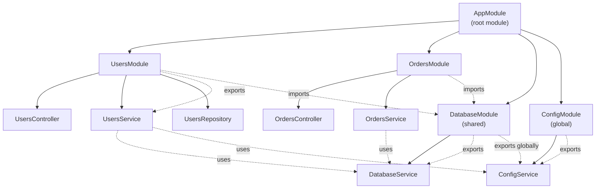

## What is a Module in NestJS?

A **Module** is a class decorated with `@Module()`. It is the building block of a NestJS application. Every application has at least one module — the **root module** (usually `AppModule`).

Modules serve three purposes:

1. **Encapsulation** — group related controllers, services, and providers together
2. **Dependency Injection** — define which providers are available to other modules
3. **Application structure** — organize the codebase into cohesive units (features, domains)

Think of a module as a **container** that declares: "here are my components, and here is what I share with the outside world."

```ts
import { Module } from '@nestjs/common';
import { UsersController } from './users.controller';
import { UsersService } from './users.service';

@Module({
  controllers: [UsersController],
  providers: [UsersService],
})
export class UsersModule {}
```

---

## The @Module decorator options

| Property | Purpose | What it accepts |
|----------|---------|-----------------|
| `controllers` | Route handlers that belong to this module | Array of controller classes |
| `providers` | Injectable classes (services, repositories, helpers) that NestJS can instantiate | Array of provider classes |
| `exports` | Providers that other modules can import and use | Array of provider classes or tokens |
| `imports` | Other modules whose exported providers become available here | Array of module classes |

**Analogy:** A module is like a restaurant kitchen.
- `controllers` = the waiters who take orders (receive requests)
- `providers` = the chefs, sous-chefs, and equipment inside the kitchen
- `exports` = the dishes that leave the kitchen to the dining room
- `imports` = ingredients and tools borrowed from another kitchen

---

## Example 1: The root module (AppModule)

Every NestJS application starts with a root module. It is the entry point for the dependency injection container.

```ts
import { Module } from '@nestjs/common';
import { UsersModule } from './users/users.module';
import { OrdersModule } from './orders/orders.module';
import { AppController } from './app.controller';
import { AppService } from './app.service';

@Module({
  imports: [UsersModule, OrdersModule],
  controllers: [AppController],
  providers: [AppService],
})
export class AppModule {}
```

**What to pay attention to:**
- The root module imports feature modules. This makes the feature modules' exported providers available throughout the application
- `AppController` and `AppService` are typically for application-level concerns (health checks, root routes)
- Feature modules (UsersModule, OrdersModule) should contain their own controllers, services, and domain logic

---

## Example 2: Feature module (UsersModule)

A feature module encapsulates a single domain or business capability.

```ts
// users/users.module.ts
import { Module } from '@nestjs/common';
import { UsersController } from './users.controller';
import { UsersService } from './users.service';
import { UsersRepository } from './users.repository';

@Module({
  controllers: [UsersController],
  providers: [UsersService, UsersRepository],
  exports: [UsersService], // other modules can use UsersService
})
export class UsersModule {}
```

```ts
// users/users.controller.ts
import { Controller, Get, Post, Body, Param } from '@nestjs/common';
import { UsersService } from './users.service';

@Controller('users')
export class UsersController {
  constructor(private readonly usersService: UsersService) {}

  @Get()
  findAll() {
    return this.usersService.findAll();
  }

  @Post()
  create(@Body() dto: CreateUserDto) {
    return this.usersService.create(dto);
  }
}
```

```ts
// users/users.service.ts
import { Injectable } from '@nestjs/common';
import { UsersRepository } from './users.repository';

@Injectable()
export class UsersService {
  constructor(private readonly usersRepository: UsersRepository) {}

  findAll() {
    return this.usersRepository.findAll();
  }

  create(dto: CreateUserDto) {
    return this.usersRepository.create(dto);
  }
}
```

```ts
// users/users.repository.ts
import { Injectable } from '@nestjs/common';

@Injectable()
export class UsersRepository {
  private users = [];

  findAll() {
    return this.users;
  }

  create(user) {
    this.users.push(user);
    return user;
  }
}
```

**What to pay attention to:**
- `UsersRepository` is a provider but not exported. Only `UsersService` is exported. This means other modules can use `UsersService` but cannot directly access `UsersRepository`
- The `UsersController` can inject both `UsersService` and `UsersRepository` because they are in the same module's `providers` array
- This is **information hiding** — the repository is an implementation detail of the Users feature

---

## Example 3: Shared module (DatabaseModule)

A shared module provides utilities that many feature modules need. It is a module with `exports` that other modules `import`.

```ts
// database/database.module.ts
import { Module, Global } from '@nestjs/common';
import { DatabaseService } from './database.service';

@Module({
  providers: [DatabaseService],
  exports: [DatabaseService],
})
export class DatabaseModule {}
```

```ts
// database/database.service.ts
import { Injectable } from '@nestjs/common';

@Injectable()
export class DatabaseService {
  query(sql: string) {
    // execute SQL
    return [];
  }
}
```

```ts
// users/users.module.ts
import { Module } from '@nestjs/common';
import { DatabaseModule } from '../database/database.module';
import { UsersController } from './users.controller';
import { UsersService } from './users.service';

@Module({
  imports: [DatabaseModule], // now DatabaseService is available here
  controllers: [UsersController],
  providers: [UsersService],
})
export class UsersModule {}
```

```ts
// users/users.service.ts
import { Injectable } from '@nestjs/common';
import { DatabaseService } from '../database/database.service';

@Injectable()
export class UsersService {
  constructor(private readonly databaseService: DatabaseService) {}

  findAll() {
    return this.databaseService.query('SELECT * FROM users');
  }
}
```

**What to pay attention to:**
- `DatabaseModule` exports `DatabaseService`. Any module that imports `DatabaseModule` can inject `DatabaseService`
- Without `exports: [DatabaseService]`, importing `DatabaseModule` would not give you access to `DatabaseService`
- Shared modules are the primary mechanism for reusing providers across the application

---

## Example 4: Global module

A global module makes its exports available everywhere without explicit imports. Use sparingly.

```ts
// config/config.module.ts
import { Module, Global } from '@nestjs/common';
import { ConfigService } from './config.service';

@Global()
@Module({
  providers: [ConfigService],
  exports: [ConfigService],
})
export class ConfigModule {}
```

```ts
// config/config.service.ts
import { Injectable } from '@nestjs/common';

@Injectable()
export class ConfigService {
  get(key: string): string {
    return process.env[key];
  }
}
```

```ts
// users/users.service.ts
import { Injectable } from '@nestjs/common';
import { ConfigService } from '../config/config.service';

@Injectable()
export class UsersService {
  constructor(
    private readonly configService: ConfigService, // works without importing ConfigModule
  ) {}

  findAll() {
    const dbHost = this.configService.get('DB_HOST');
    // ...
  }
}
```

**What to pay attention to:**
- `@Global()` makes the module's exports available in every module without `imports: [ConfigModule]`
- This is convenient for cross-cutting concerns (config, logging, database connection)
- **Overuse leads to hidden dependencies** — it becomes unclear which modules depend on what. Prefer explicit imports for feature modules
- Good use cases for global modules: ConfigService, LoggerService, PrismaClient, database connection pool

---

## Example 5: Dynamic module (for configuration)

Dynamic modules are created at runtime with configuration. They are used for database connections, external SDKs, or reusable modules that need setup parameters.

```ts
// database/database.module.ts
import { Module, DynamicModule } from '@nestjs/common';
import { DatabaseService } from './database.service';

@Module({})
export class DatabaseModule {
  static forRoot(options: { host: string; port: number }): DynamicModule {
    return {
      module: DatabaseModule,
      providers: [
        {
          provide: 'DATABASE_OPTIONS',
          useValue: options,
        },
        DatabaseService,
      ],
      exports: [DatabaseService],
    };
  }
}
```

```ts
// database/database.service.ts
import { Injectable, Inject } from '@nestjs/common';

@Injectable()
export class DatabaseService {
  constructor(
    @Inject('DATABASE_OPTIONS') private readonly options: { host: string; port: number },
  ) {}

  connect() {
    console.log(`Connecting to ${this.options.host}:${this.options.port}`);
  }
}
```

```ts
// app.module.ts
import { Module } from '@nestjs/common';
import { DatabaseModule } from './database/database.module';

@Module({
  imports: [
    DatabaseModule.forRoot({
      host: 'localhost',
      port: 5432,
    }),
  ],
})
export class AppModule {}
```

**What to pay attention to:**
- `static forRoot()` is a convention for modules that need one-time configuration (like `@nestjs/typeorm` or `@nestjs/mongoose`)
- The `provide: 'DATABASE_OPTIONS'` syntax uses a custom token (string) instead of a class. This is called **custom provider**
- `@Inject('DATABASE_OPTIONS')` tells NestJS to inject the value associated with that token
- Dynamic modules return a module object with `module`, `providers`, `exports`, and optionally `imports`
- Another common pattern is `forRootAsync()` for asynchronous configuration (e.g., reading from environment variables via `ConfigService`)

---

## Example 6: Re-exporting modules

A module can re-export modules it imports. This is useful for aggregating modules.

```ts
// core/core.module.ts
import { Module } from '@nestjs/common';
import { DatabaseModule } from '../database/database.module';
import { ConfigModule } from '../config/config.module';
import { LoggerModule } from '../logger/logger.module';

@Module({
  imports: [DatabaseModule, ConfigModule, LoggerModule],
  exports: [DatabaseModule, ConfigModule, LoggerModule], // re-export
})
export class CoreModule {}
```

```ts
// app.module.ts
import { Module } from '@nestjs/common';
import { CoreModule } from './core/core.module';
import { UsersModule } from './users/users.module';

@Module({
  imports: [CoreModule, UsersModule], // UsersModule now has access to Database, Config, and Logger
})
export class AppModule {}
```

**What to pay attention to:**
- `CoreModule` imports and re-exports `DatabaseModule`, `ConfigModule`, and `LoggerModule`
- Any module that imports `CoreModule` gets access to all re-exported modules' providers
- This reduces boilerplate — instead of importing three modules everywhere, you import one `CoreModule`
- Be careful not to create circular dependencies between modules

---

## Module diagram: how imports and exports work



---

## How modules relate to the request lifecycle

In [[NestJS Controller and Request Lifecycle]], we saw the execution flow: Middleware → Guards → Interceptors → Pipes → Controller → Service → Repository.

**Modules determine which components participate in this flow:**

1. **Controllers declared in a module** handle HTTP requests for that module's routes
2. **Providers in a module** are instantiated by the NestJS DI container when the module is loaded
3. **Guards, Pipes, and Interceptors** can be registered globally or per-module. If registered at the module level, they apply to all controllers in that module

```ts
@Module({
  controllers: [UsersController],
  providers: [
    UsersService,
    {
      provide: APP_GUARD,
      useClass: AuthGuard, // applies to all controllers in this module
    },
  ],
})
export class UsersModule {}
```

**What to pay attention to:**
- `APP_GUARD`, `APP_PIPE`, `APP_INTERCEPTOR`, and `APP_FILTER` are special tokens for registering global-scoped middleware within a module
- They are registered in the module's providers array but apply globally (or module-wide) instead of per-route

---

## Common mistakes when learning modules

1. **Forgetting to add a provider to `providers`** — if you inject a class that is not in `providers`, NestJS throws `Nest can't resolve dependencies`
2. **Forgetting to export a shared provider** — a provider in `providers` is private to the module. Other modules can only use it if it is in `exports`
3. **Circular imports** — Module A imports Module B, and Module B imports Module A. This causes a runtime error. Solution: use `forwardRef(() => ModuleB)` or refactor the shared code into a third module
4. **Putting everything in the root module** — the root module should only import feature modules. Business logic belongs in feature modules
5. **Using `@Global()` for everything** — global modules hide dependencies. Prefer explicit imports to make the dependency graph clear
6. **Not using `forwardRef()` when needed** — when two modules depend on each other, `forwardRef(() => Module)` breaks the circular reference at the module level

---

## Module organization best practices

| Pattern | Use case | Example |
|---------|----------|---------|
| **Feature module** | One domain or business capability | `UsersModule`, `OrdersModule` |
| **Shared module** | Utilities used by many features | `DatabaseModule`, `LoggerModule` |
| **Global module** | Cross-cutting concerns that almost everything needs | `ConfigModule` (use sparingly) |
| **Dynamic module** | Configurable/reusable modules | `DatabaseModule.forRoot()`, `CacheModule.register()` |
| **Core module** | Aggregates shared modules for convenience | `CoreModule` imports and re-exports Database, Config, Logger |

**Recommended structure:**

```
src/
  app.module.ts          # root module, imports feature modules
  main.ts                # bootstrap
  users/
    users.module.ts      # feature module
    users.controller.ts
    users.service.ts
    users.repository.ts
    dto/
  orders/
    orders.module.ts     # feature module
    orders.controller.ts
    orders.service.ts
  database/
    database.module.ts   # shared module
    database.service.ts
  config/
    config.module.ts     # global module
    config.service.ts
  core/
    core.module.ts       # re-exports shared modules
```

---

## What to pay attention to

1. **Modules are the boundary of encapsulation.** A provider in `providers` is private unless explicitly `exported`
2. **The DI container is scoped to modules.** When you import a module, you get access to its exported providers. This is how dependency injection works across modules
3. **Controllers are never exported.** They are only listed in `controllers` of their own module. Other modules do not need to import a module to use its controllers — routes are automatically registered
4. **Module imports are transitive only through `exports`.** If Module A imports Module B, and Module B imports Module C, Module A does NOT have access to Module C's providers unless Module B re-exports Module C
5. **Use feature modules from day one.** Even in a small app, organizing by feature makes it easier to grow. The root module should be thin

---

## Related notes

- [[NestJS Controller and Request Lifecycle]]
- [[NestJS Project Initialization]]
- [[NestJS TypeScript Configuration]]
