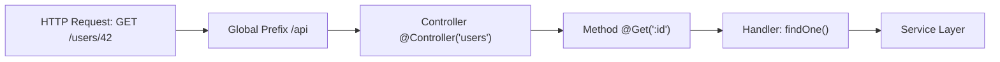

# NestJS Routing Decorators

> [!abstract] Executive Summary (ELI5)
> In NestJS, routing decorators are like **labels on a restaurant menu** that tell the kitchen (your application) how to handle each incoming order (HTTP request). The `@Controller()` label says "this is the kitchen section," while `@Get()`, `@Post()`, etc. say "this is how to prepare a specific dish." The framework reads these labels and routes each request to the right handler without you writing manual routing code.

---

## 🎯 The "Why"

- **Problem Solved:** Manually wiring routes in Express/Node.js leads to scattered route definitions, hard-to-trace request flows, and boilerplate code. NestJS decorators centralize routing logic as declarative metadata on classes and methods, making the application structure self-documenting.
- **Alternatives:** 
  - Express-style: `app.get('/users', handler)` — imperative, scattered, hard to compose.
  - Fastify route schemas — performant but less opinionated on structure.
- **Trade-offs:** 
  - **Pro:** Declarative, metadata-driven, easy to test and compose with DI.
  - **Con:** Magic via reflection; beginners may struggle to understand *why* it works without reading the framework internals.

---

## 💡 Mental Model & Analogy

- **Analogy:** "A controller is like a **department in a hospital**. The `@Controller('patients')` sign tells visitors where to go. Each decorator like `@Get('/:id')` is like a **specific clinic room** within that department, handling a particular type of request."
- **Visual:**



---

## 🛠️ Core Principles & Code Snippets

### 1. Controller Decorator: `@Controller()`

Defines the route **prefix** for all methods in the class. Think of it as the base URL segment.

```typescript
@Controller('users')  // All routes prefixed with /users
export class UsersController {}
```

**Techniques:**
- **Global prefix + controller prefix:** If you set `app.setGlobalPrefix('api')` in `main.ts`, the above becomes `/api/users`.
- **Nested paths:** `@Controller('users/profiles')` or even dynamic segments `@Controller('users/:id')` (though prefer method-level for params).

### 2. Method Decorators: HTTP Verbs

| Decorator | HTTP Verb | Typical Use |
|-----------|-----------|-------------|
| `@Get()` | GET | Read / retrieve data |
| `@Post()` | POST | Create new resource |
| `@Put()` | PUT | Full update (replace) |
| `@Patch()` | PATCH | Partial update |
| `@Delete()` | DELETE | Remove resource |
| `@All()` | Any | Catch-all (rare, usually avoid) |
| `@Options()` | OPTIONS | CORS preflight |
| `@Head()` | HEAD | Metadata without body |

```typescript
@Controller('users')
export class UsersController {
  @Get()              // GET /users
  findAll() { return this.service.findAll(); }

  @Get(':id')         // GET /users/:id
  findOne(@Param('id') id: string) { return this.service.findOne(id); }

  @Post()             // POST /users
  create(@Body() dto: CreateUserDto) { return this.service.create(dto); }

  @Put(':id')         // PUT /users/:id
  update(@Param('id') id: string, @Body() dto: UpdateUserDto) {
    return this.service.update(id, dto);
  }

  @Patch(':id')       // PATCH /users/:id
  patch(@Param('id') id: string, @Body() dto: PatchUserDto) {
    return this.service.patch(id, dto);
  }

  @Delete(':id')      // DELETE /users/:id
  remove(@Param('id') id: string) { return this.service.remove(id); }
}
```

### 3. Route Parameters & Wildcards

```typescript
@Get(':id')                 // Named parameter
@Get('posts/*')            // Wildcard route (catches /users/posts/anything)
@Get(['users', 'admins']) // Multiple paths for same handler
```

> [!tip] Param Validation
> Always validate `@Param('id')` with pipes. A raw `id` from the URL is a **string** — `ParseIntPipe` or `ParseUUIDPipe` will save you from subtle type bugs.

```typescript
@Get(':id')
findOne(@Param('id', ParseIntPipe) id: number) { ... }
```

### 4. Status Code & Header Decorators

```typescript
@Post()
@HttpCode(201)                     // Override default 200 for POST
@Header('Cache-Control', 'none')    // Set response headers
@Redirect('https://example.com')    // Redirect response
@Render('index')                    // Template rendering (MVC)
create() { ... }
```

### 5. Route Matching Priority (Order Matters!)

NestJS evaluates routes in the order they are **defined in the source code**. This is a **first-match-wins** system: the framework builds an internal route registry at bootstrap, and each incoming request is checked against that registry from top to bottom. The first route whose pattern matches the URL gets the request. Everything after it is ignored.

#### Internal Model

At startup, NestJS (via `reflect-metadata`) sees your controller like this:

```typescript
// NestJS Internal Route Registry (in order of definition):
// 1. GET /users/admins        ← checked first
// 2. GET /users/:id           ← checked second
// 3. GET /users/:id/posts    ← checked third
// 4. GET /users/*            ← checked last

@Controller('users')
export class UsersController {
  @Get('admins')       // Registry index 0
  getAdmins() { ... }

  @Get(':id')          // Registry index 1
  findOne(@Param('id') id: string) { ... }

  @Get(':id/posts')    // Registry index 2
  getPosts(@Param('id') id: string) { ... }
}
```

Request `GET /users/admins`:
1. Does `/users/admins` match `/users/admins`? Yes → `getAdmins()` executes. Stop.
2. Registry index 1 and 2 never see the request.

#### The Golden Rule: Static Before Parameterized

```typescript
@Controller('products')
export class ProductsController {
  @Get('search')       // ✅ Static route first — matches /products/search
  search() { ... }

  @Get('featured')     // ✅ Static route first — matches /products/featured
  featured() { ... }

  @Get(':id')          // ✅ Parameterized after — catches /products/anything-else
  findOne(@Param('id') id: string) { ... }
}
```

#### The Trap: Reversed Order Creates Dead Code

```typescript
@Controller('products')
export class ProductsController {
  @Get(':id')         // ❌ Registered FIRST. Matches ANY single segment.
  findOne(@Param('id') id: string) { ... }

  @Get('search')      // ❌ Registered SECOND. NEVER reached.
  search() { ... }    //    GET /products/search → hits findOne(id="search")
}
```

> [!danger] Why NestJS Cannot Sort Routes Automatically
> A framework cannot know your business intent. Is `search` a special static endpoint or a product ID? Only you know. Therefore NestJS preserves the order you wrote, exactly like Express.js underneath.

#### The "Me" Trap (Special Static Endpoints)

A common pattern is a `/users/me` endpoint alongside `/users/:id`:

```typescript
@Controller('users')
export class UsersController {
  @Get(':id')          // ❌ Catches /users/me — treats "me" as an ID
  findOne(@Param('id') id: string) { ... }

  @Get('me')           // ❌ DEAD CODE. Never reached.
  getCurrentUser() { ... }
}
```

**Fix:**

```typescript
@Controller('users')
export class UsersController {
  @Get('me')           // ✅ Checked first
  getCurrentUser() { ... }

  @Get(':id')          // ✅ Only catches non-"me" IDs
  findOne(@Param('id') id: string) { ... }
}
```

#### Wildcard Routes Are the Greediest

The `*` wildcard matches everything and must be placed **absolutely last**:

```typescript
@Controller('files')
export class FilesController {
  @Get('*')           // ❌ Catches /files/upload, /files/download, everything
  catchAll() { ... }

  @Get('upload')      // ❌ DEAD — never reached
  upload() { ... }
}
```

#### Multiple Path Arrays

Each element in an array gets its own slot in the registry at the position where the decorator is defined:

```typescript
@Get(['users', 'admins'])  // Expands to two registry entries at this index
findAll() { ... }
```

#### Production Convention

Teams usually adopt this explicit ordering convention:

```typescript
@Controller('products')
export class ProductsController {
  // 1. Static routes first
  @Get('search')
  search() { ... }

  @Get('featured')
  featured() { ... }

  // 2. Then parameterized routes
  @Get(':id')
  findOne(@Param('id') id: string) { ... }

  @Get(':id/reviews')
  findReviews(@Param('id') id: string) { ... }

  // 3. Wildcards last (if ever)
  @Get('*')
  fallback() { ... }
}
```

#### How to Diagnose Dead Routes

Run NestJS in debug mode to see the actual route table at bootstrap:

```bash
NEST_DEBUG=true npm run start
```

If your static route is listed below a parameterized one that could match it, it is unreachable.

### 6. Custom Decorators (DRY Techniques)

Compose decorators to reduce repetition across controllers:

```typescript
// Custom method decorator combining common metadata
export const Auth = (...roles: Role[]) => {
  return applyDecorators(
    SetMetadata('roles', roles),
    UseGuards(AuthGuard, RolesGuard),
    ApiBearerAuth(),
    ApiUnauthorizedResponse({ description: 'Unauthorized' }),
  );
};

// Usage
@Controller('users')
export class UsersController {
  @Auth('admin')
  @Delete(':id')
  remove(@Param('id') id: string) { ... }
}
```

### 7. Async / Promise Handling

```typescript
@Get()
async findAll(): Promise<User[]> {     // ✅ NestJS handles the promise
  return await this.service.findAll();
}

@Get()
findAll(): Observable<User[]> {        // ✅ Also supports RxJS Observables
  return this.service.findAll();
}
```

---

## ⚠️ Pitfalls & Anti-patterns

### 1. The "Stringly-Typed" Route Trap

```typescript
// ❌ Bad: Route string repeated, no type safety
@Get('user/:id/posts/:postId')
getPost(@Param('id') userId: string, @Param('postId') postId: string) { ... }

// ✅ Better: Extract into constants, use DTOs for query/body
export const ROUTES = {
  USER_POST: 'users/:id/posts/:postId',
} as const;
```

### 2. Forgetting Route Order

```typescript
@Controller('products')
export class ProductsController {
  @Get(':id')         // ❌ Catches ALL /products/* including "search"
  findOne(@Param('id') id: string) { ... }

  @Get('search')      // ❌ Dead code — never reached
  search() { ... }
}
```

### 3. Overloading Controllers with Business Logic

```typescript
// ❌ Bad: Controller doing too much
@Post()
create(@Body() dto: CreateUserDto) {
  const hashed = await bcrypt.hash(dto.password, 10);  // ❌
  const user = await this.repo.save({ ...dto, password: hashed }); // ❌
  await this.emailService.sendWelcome(user.email);    // ❌
  return user;
}

// ✅ Good: Delegate to service layer
@Post()
create(@Body() dto: CreateUserDto) {
  return this.usersService.create(dto);
}
```

### 4. Misusing `@All()` for Convenience

```typescript
// ❌ Anti-pattern: Using @All() to avoid verb specificity
@All('endpoint')
handleEverything() { ... }
```
> This breaks HTTP semantics, makes caching impossible, and confuses clients. Always use explicit verbs.

### 5. Route Collisions with Global Prefixes

```typescript
// main.ts
app.setGlobalPrefix('api/v1');

// users.controller.ts
@Controller('api/users')  // ❌ Results in /api/v1/api/users — confusing!
```

### 6. `@Body()` Without Validation

```typescript
// ❌ Dangerous: Any JSON shape is accepted
@Post()
create(@Body() body: any) { ... }

// ✅ Good: Use class-validator decorators in DTOs
export class CreateUserDto {
  @IsEmail()
  email: string;

  @MinLength(8)
  password: string;
}
```

### 7. Synchronous Route Handlers Blocking the Event Loop

```typescript
// ❌ Bad: CPU-intensive work in controller
@Get('report')
generateReport() {
  return this.expensiveSyncCalculation(); // Blocks!
}

// ✅ Good: Offload to worker threads or async stream
@Get('report')
async generateReport() {
  return this.service.generateAsync(); // Non-blocking
}
```

---

## 🔗 Deep Connections

- **Parent Topic:** [[NestJS Controller and Request Lifecycle]], [[NestJS Modules]]
- **Related Concepts:** [[Dependency Injection]], [[Middleware & Guards]], [[Pipes & Validation]], [[Interceptors]], [[REST API Design]]
- **Prerequisites:** TypeScript Decorators, Express.js routing fundamentals, HTTP verbs and status codes
- **Framework Internals:** NestJS uses `reflect-metadata` to store route metadata on classes/methods, then scans controllers at bootstrap to build an internal route registry mapped to the underlying HTTP adapter (Express or Fastify).

---

## ❓ Active Recall Questions

> [!faq]- What happens if you place `@Get(':id')` before `@Get('search')` in the same controller?
> The parameterized route catches first. `/products/search` will be treated as `id = "search"`, and the static `search` route becomes unreachable. Static routes must always be defined **before** parameterized ones.

> [!faq]- Why should `@Body()` DTOs use class-validator instead of TypeScript interfaces?
> Interfaces are erased at compile time. Class-validator decorators on classes provide runtime metadata that NestJS pipes can use to validate and transform incoming data. Interfaces cannot enforce validation.

> [!faq]- What is the difference between `@Put()` and `@Patch()` in REST semantics, and how does NestJS treat them?
> `@Put()` semantically replaces the entire resource. `@Patch()` applies a partial update. NestJS treats them identically at the routing level — the difference is purely semantic and should be enforced in your service logic.

> [!faq]- How does `ParseIntPipe` improve route safety?
> It transforms and validates the `@Param()` value at the framework level before your handler executes. If the param is not a valid number, Nest throws a `BadRequestException` automatically, preventing type-coercion bugs in your service layer.

> [!faq]- What is `applyDecorators` and when should you use it?
> It composes multiple decorators into a single reusable decorator. Use it when you find yourself repeating the same decorator stack (e.g., auth + guards + swagger metadata) across multiple controller methods.