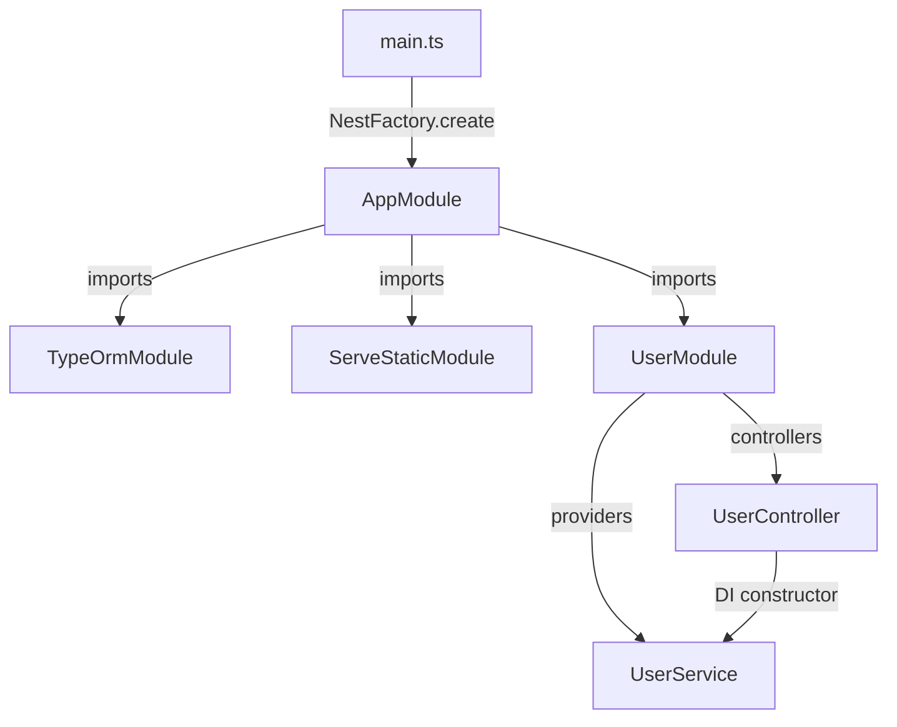

# 🧠 NestJS — Архитектура и Точка Входа (Auth Academy Stage 0)

> [!abstract] Executive Summary (ELI5)
> NestJS — это фреймворк для Node.js, который организует твой код в модули и автоматически связывает их между собой. Ты описываешь «что есть», а фреймворк сам разбирается, «как это соединить».

---

## 🎯 The "Why"

- **Problem Solved:** В обычном Express ты сам создаёшь `app = express()`, сам подключаешь middleware, сам следишь за порядком импортов. В большом проекте это превращается в спагетти. NestJS решает это через **модули** и **Dependency Injection**.
- **Alternatives:** Fastify (быстрее, но без DI), Express (гибкость, но нет структуры), Koa (middleware-цепочки).
- **Trade-offs:** NestJS добавляет абстракцию. Новичку кажется многословным, но в больших проектах структура окупается. Если нужен микросервис с одним эндпоинтом — может быть overkill.

---

## 💡 Mental Model & Analogy

- **Analogy:** NestJS — это **Lego-конструктор**. У тебя есть коробки (модули), внутри которых детали (контроллеры, сервисы). Ты не склеиваешь детали клеем (ручные импорты), а вставляешь их по штырькам (Dependency Injection). Главная коробка — `AppModule`, в ней собраны все остальные.
- **Visual/Diagram:**



---

## 🛠️ Core Principles & Code Snippets

### 1. Точка входа — `main.ts`

```typescript
import { NestFactory } from '@nestjs/core';
import { AppModule } from './app.module';

async function bootstrap() {
  const app = await NestFactory.create(AppModule);
  app.enableCors({ origin: true, credentials: true });
  await app.listen(process.env.PORT ?? 3000);
}
bootstrap();
```

**Ключевые моменты:**
- `NestFactory.create(AppModule)` — **не просто создать сервер**. NestJS рекурсивно обходит все модули, собирает контроллеры, сервисы, провайдеры, резолвит зависимости (DI) и только потом поднимает HTTP-сервер (по умолчанию на Express).
- NestJS — это **IoC-контейнер** (Inversion of Control). Ты не говоришь «вот маршруты, вот хендлеры». Ты говоришь: «вот модули, вот классы, вот декораторы» — а фреймворк сам собирает всё воедино.
- `bootstrap()` — просто конвенция, имя функции может быть любым.
- `app.enableCors()` — разрешает кросс-доменные запросы. Нужен для тестирования через curl/Postman.
- `app.listen(3000)` — стартует HTTP-сервер. Под капотом это `express.listen()`.

### 2. Корневой модуль — `AppModule`

```typescript
@Module({
  imports: [
    TypeOrmModule.forRoot({ ... }),
    ServeStaticModule.forRoot({ ... }),
    UserModule,
  ],
})
export class AppModule {}
```

**Ключевые моменты:**
- `@Module()` — декоратор, который говорит NestJS: «это модуль, вот его состав».
- `imports` — другие модули, которые этот модуль использует. NestJS подключает их рекурсивно.
- `TypeOrmModule.forRoot()` — подключает SQLite (на этапе 0). `synchronize: true` — автоматически создаёт таблицы (только для dev).
- `ServeStaticModule` — раздаёт статические файлы из `public/`.
- `UserModule` — наш первый модуль (сущность User).

### 3. Декораторы (Decorators) — главный инструмент NestJS

NestJS активно использует **TypeScript декораторы** (экспериментальная фича, включена в `tsconfig.json` через `emitDecoratorMetadata` и `experimentalDecorators`).

Примеры декораторов, которые мы встретим:
- `@Module()` — декларация модуля
- `@Controller()` — декларация контроллера (маршруты)
- `@Injectable()` — маркер для DI (сервис)
- `@Entity()` — TypeORM: это класс = таблица в БД
- `@Get()`, `@Post()` — HTTP-методы эндпоинтов
- `@Body()` — извлечь тело запроса
- `@InjectRepository()` — DI для TypeORM репозитория

**Как это работает:** Декоратор — это функция, которая вызывается при объявлении класса/метода/свойства. Она добавляет **метаданные** (через `reflect-metadata`). NestJS потом читает эти метаданные через `Reflection API` и понимает, что с чем связать.

---

## ⚠️ Pitfalls & Anti-patterns

- **Синхронный `bootstrap()`:** Всегда используй `async/await`. NestFactory.create возвращает Promise.
- **Не использовать `experimentalDecorators` в tsconfig:** Без этого декораторы не скомпилируются. NestJS не работает без декораторов.
- **Думать, что NestJS — просто Express:** Под капотом — да, Express/Fastify. Но абстракция выше. Ты не пишешь `app.get('/', handler)`, ты пишешь классы с декораторами.
- **Забывать про `synchronize: true` в продакшене:** TypeORM автоматически меняет схему БД. В проде используй миграции.

---

## 🔗 Deep Connections

- **Parent Topic:** [[Node.js — Architecture and Internals]]
- **Related Concepts:** [[Dependency Injection]], [[TypeScript Decorators]], [[Express vs NestJS]], [[Inversion of Control (IoC)]]
- **Next in this vault:** [[NestJS — Модули, DI и Контроллеры (Auth Academy Stage 1)]] — *будет добавлено после Этапа 1*

---

## ❓ Active Recall Questions

> [!faq]- Что делает `NestFactory.create(AppModule)`? Почему это не просто «создать сервер»?
> Он создаёт IoC-контейнер, рекурсивно обходит модули, собирает зависимости, инициализирует провайдеры и только потом поднимает HTTP-сервер.

> [!faq]- Почему NestJS использует декораторы? Что такое метаданные?
> Декораторы добавляют метаданные к классам/методам через `reflect-metadata`. NestJS читает их в runtime и понимает, какие маршруты к каким классам привязать, какие зависимости внедрить.

> [!faq]- В чём разница между `imports` в `@Module()` и обычным `import` в TypeScript?
> `import` в TypeScript — это compile-time (связывание кода). `imports` в `@Module()` — это runtime декларация для IoC-контейнера (какие модули входят в состав этого модуля).

---

## 📝 Auth Academy — Stage 0 Context

- Проект: `auth-academy` (NestJS + TypeScript + SQLite + TypeORM)
- На этом этапе реализовано: `main.ts`, `AppModule`, `UserModule`, `UserEntity`, `UserController`, `UserService`, `public/index.html`
- Статус: **Фундамент завершён.** Этап 1 будет: Basic Authentication + bcrypt + Guards.

*Эта заметка будет расширяться после каждого этапа Auth Academy.*
