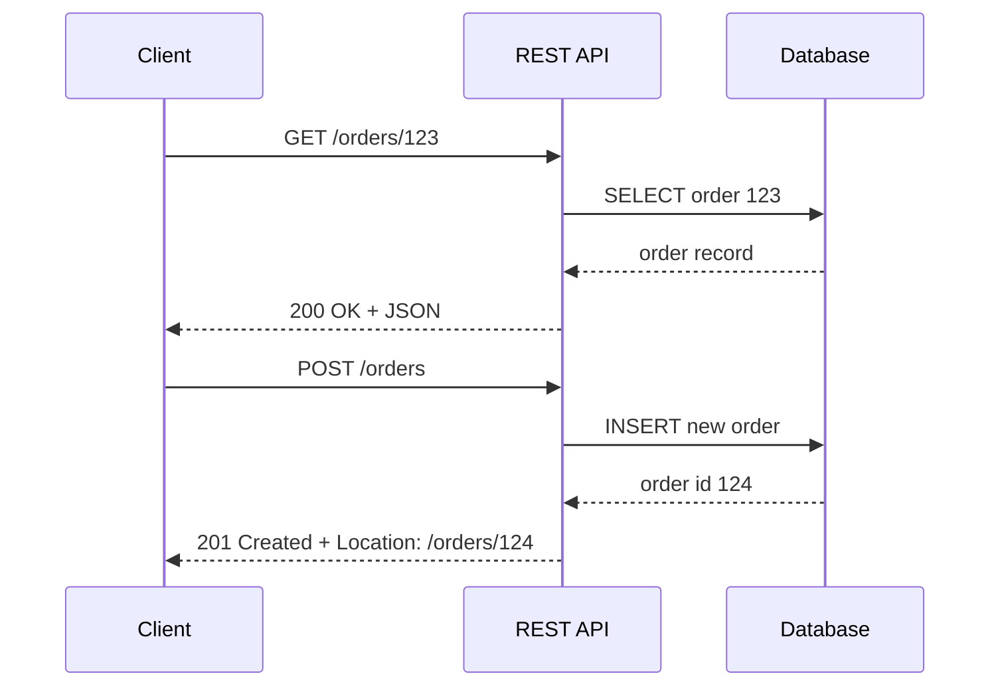

# 🧠 Topic: RESTful API Design

> [!abstract] Executive Summary (ELI5)
> A RESTful API is like a well-organized library. Each book (resource) has a stable address (URL). You use standard actions (HTTP methods like GET, POST, PUT, DELETE) to read, create, update, or remove books. The librarian (server) responds with clear status codes so you always know what happened.

---

## 🎯 The "Why"
- **Problem Solved:** Teams need a predictable, language-agnostic way for clients and servers to communicate over the internet. Without conventions, every integration becomes a bespoke guessing game of URLs, payloads, and error semantics.
- **Alternatives:**
    - **RPC / gRPC:** Tighter coupling, excellent for internal high-performance services, heavier tooling for browser clients.
    - **GraphQL:** Lets clients fetch exactly what they need, but adds complexity, caching challenges, and can expose abuse surfaces.
    - **SOAP:** Protocol-heavy, XML-based, strong enterprise tooling but verbose and less web-native.
    - **Websockets / SSE:** Great for real-time push, not a replacement for request/response resource operations.
- **Trade-offs:**
    - **Pros:** Simple mental model, leverages HTTP infrastructure (caching, proxies, load balancers), easy to debug with curl, massive ecosystem.
    - **Cons:** Chatty for complex graphs of data, no single spec (unlike gRPC/GraphQL), versioning can become painful at scale, easy to do "REST-ish" wrong.

## 💡 Mental Model & Analogy
- **Analogy:** A REST API is like a **post office** handling standardized forms.
    - The **address on the envelope** is the URL (`/orders/123`).
    - The **action requested** is the HTTP method (GET = "tell me", POST = "create new", PUT = "replace", PATCH = "modify", DELETE = "remove").
    - The **delivery status** is the HTTP status code (200 = OK, 201 = created, 404 = not found, 500 = server fault).
    - The **letter inside** is the representation (usually JSON).
- **Visual/Diagram:**


## 🛠️ Core Principles & Code Snippets

### 1. Resources are Nouns, Not Verbs
Use plural nouns for collections. Avoid verbs in URLs.

```http
# Good
GET    /orders
GET    /orders/123
POST   /orders
PATCH  /orders/123
DELETE /orders/123

# Bad
GET /getOrder/123
POST /createOrder
DELETE /deleteOrder/123
```

### 2. Use HTTP Methods Semantically

| Method | Idempotent | Safe | Typical Use |
|--------|------------|------|-------------|
| GET    | Yes        | Yes  | Retrieve resource(s) |
| POST   | No         | No   | Create a new resource |
| PUT    | Yes        | No   | Full replacement of a resource |
| PATCH  | No*        | No   | Partial modification |
| DELETE | Yes        | No   | Remove a resource |

\* PATCH *can* be idempotent depending on the operation semantics (e.g., `{"status": "shipped"}`), but is not guaranteed.

### 3. Return Correct Status Codes

```http
200 OK              — GET/PUT/PATCH succeeded
201 Created         — POST succeeded, resource created
204 No Content      — DELETE succeeded or empty PUT/PATCH response
400 Bad Request     — Client sent malformed payload
401 Unauthorized    — Authentication required
403 Forbidden       — Authenticated, but not allowed
404 Not Found       — Resource does not exist
409 Conflict        — Business rule conflict (e.g., duplicate)
422 Unprocessable   — Validation errors
500 Internal Error  — Server-side failure
```

### 4. Idempotency for Mutation Safety

Retries in distributed systems can send the same request twice. Use idempotency keys for non-idempotent writes.

```http
POST /payments
Idempotency-Key: 550e8400-e29b-41d4-a716-446655440000

{
  "orderId": "order-123",
  "amount": 1999,
  "currency": "USD"
}
```

> [!tip] Implementation Note
> Store the idempotency key with the resulting response for 24 hours. If the same key arrives, return the cached response instead of re-executing the operation.

### 5. Pagination for Collections

Never return an unbounded list. Use cursor pagination for high-churn data, offset pagination for stable datasets.

```http
GET /orders?limit=20&cursor=eyJpZCI6MTIzfQ==

{
  "data": [...],
  "pagination": {
    "nextCursor": "eyJpZCI6MTQ1fQ==",
    "hasMore": true
  }
}
```

### 6. Versioning Strategy

Pick one strategy and stick to it across the organization:

```http
# URL versioning (simple, explicit)
GET /v1/orders/123

# Header versioning (cleaner URLs)
GET /orders/123
Accept: application/vnd.acme.v1+json
```

URL versioning is easier for external consumers and infrastructure; header versioning keeps URLs clean but requires better tooling.

### 7. HATEOAS (Optional but Powerful)

Include links to related actions so clients can navigate the API without hardcoding URLs.

```json
{
  "id": "order-123",
  "status": "pending",
  "_links": {
    "self": { "href": "/orders/order-123" },
    "cancel": { "href": "/orders/order-123/cancel", "method": "POST" },
    "pay": { "href": "/orders/order-123/payments", "method": "POST" }
  }
}
```

### 8. Consistent Error Responses

```json
{
  "error": {
    "code": "INSUFFICIENT_INVENTORY",
    "message": "Not enough stock for SKU-42",
    "target": "items[0].quantity",
    "details": [
      { "code": "MAX_AVAILABLE", "message": "12 units available" }
    ]
  }
}
```

## ⚠️ Pitfalls & Anti-patterns
- **Common Mistakes:**
    - Using POST for everything because "it's easier."
    - Returning 200 with an error body instead of proper status codes.
    - Deeply nested resources beyond 2–3 levels (`/users/1/orders/2/items/3/reviews`).
    - Exposing internal database IDs or implementation details in URLs.
- **When NOT to use:**
    - Real-time bidirectional communication — prefer WebSockets or SSE.
    - Strict contract-driven internal microservices where gRPC is a better fit.
    - Complex querying with many optional filters and joins — GraphQL may reduce chattiness.
- **Performance/Security considerations:**
    - Always use HTTPS in production.
    - Implement rate limiting to prevent abuse.
    - Validate and sanitize all input; never trust the client.
    - Use `Cache-Control`, `ETag`, and conditional requests for cacheable reads.

## 🔗 Deep Connections
- **Parent Topic:** [[Distributed Systems]], [[Backend Engineering]]
- **Related Concepts:** [[HTTP Semantics]], [[Idempotency Keys]], [[API Gateway]], [[Pagination Strategies]], [[API Versioning]], [[HATEOAS]]
- **Prerequisites:** Basic HTTP, JSON, web architecture

## ❓ Active Recall Questions
> [!faq]- Why should URLs use nouns instead of verbs?
> URLs identify resources, not actions. HTTP methods already express the action.

> [!faq]- What is the difference between 401 and 403?
> 401 means "I don't know who you are" (authentication required). 403 means "I know who you are, but you can't do this" (authorization failure).

> [!faq]- Why is PATCH not always idempotent?
> PATCH applies a partial update. If the patch is relative (e.g., "increment by 1"), replaying it changes the result each time.

> [!faq]- When would you choose cursor pagination over offset pagination?
> Cursor pagination is better for large, frequently changing datasets because it avoids skipped/duplicate rows when insertions happen during traversal.

---
## 📝 How to use this note effectively
1. **Never Copy-Paste:** Read, close the tab, and write from memory.
2. **Iterate:** Update the ELI5 and analogy as your understanding deepens.
3. **The "Why" is King:** Seniority is defined by knowing *when* and *why* to use REST, not just *how*.
4. **Update the Status:** Move from `new` -> `growing` -> `mastered` as you apply these principles in real projects.
