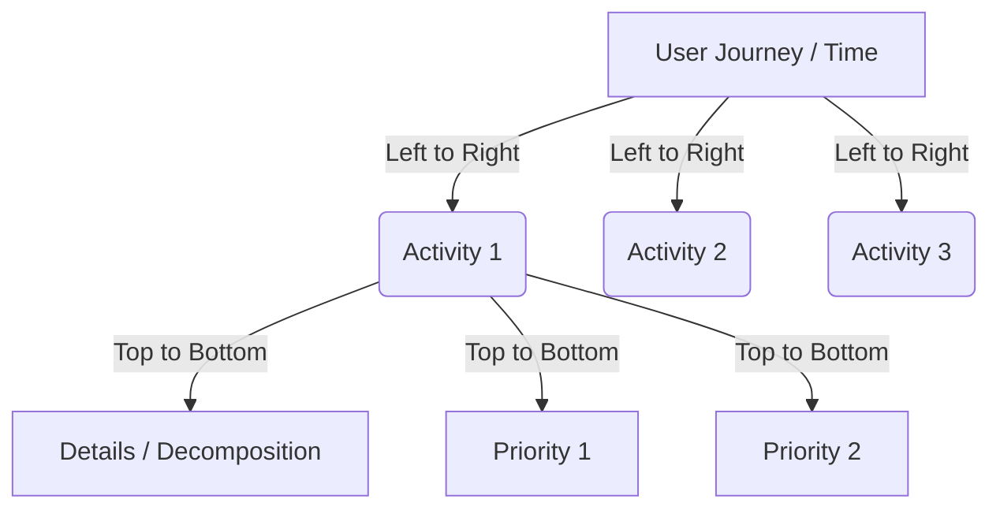

# 🧠 Topic: User Story Mapping (Chapter 1 - The Big Picture)

> [!abstract] Executive Summary (ELI5)
> User Story Mapping is a visual way to organize Agile user stories in two dimensions: time (the user's journey) and depth (details and priority). It prevents the "lost big picture" problem of flat backlogs by focusing on shared understanding rather than just writing requirements.

---

## 🎯 The "Why"
- **Problem Solved:** The "Tragedy of the Flat Backlog." When you just prioritize a flat list of features, you lose the overarching context of what the user is actually trying to accomplish. You might build the highest-value features but fail to deliver a cohesive end-to-end flow.
- **Alternatives:** Traditional flat backlogs (Jira lists), massive PRDs (Product Requirements Documents).
- **Trade-offs:** Requires synchronous collaboration, physical space (or a good virtual whiteboard), and time upfront to hash out the narrative. However, it drastically reduces wasted engineering effort.

## 💡 Mental Model & Analogy
- **Analogy:** "A flat backlog is like a grocery list organized by item price. A Story Map is like a recipe." You need the sequence and context of the recipe to actually bake the cake, not just a list of ingredients.
- **Visual/Diagram:** 

## 🛠️ Core Principles
- **Telling, Not Writing:** Stories get their name from *how they should be used*, not what should be written. The goal is **Shared Understanding**, not perfect documentation.
- **Talk and Doc:** Externalize thinking immediately. Don't let words vaporize. (Think -> Write -> Explain -> Place).
- **Breadth Before Depth ("Mile wide, inch deep"):** Map out the entire end-to-end user story (left-to-right) before you get bogged down in decomposing the specific details of one step (top-to-bottom).
- **Frame the Idea:** Always start with the business goals, the desired outcomes, and identifying the *most important user* before diving into activities.

> [!tip] Implementation Note
> If you put one card to the left and another to the right, you communicate *sequence* without saying a word. If you put one card below another, you communicate *decomposition* or *priority*. 

## ⚠️ Pitfalls & Anti-patterns
- **Common Mistakes:** Getting too passionate about the details of step 1 and spending hours breaking it down before figuring out if step 5 even makes sense.
- **The Output Trap:** Focusing on how much software to build (output) rather than the goals the software is meant to achieve (outcomes). 
- **Treating cards as requirements:** Writing a card and throwing it over the wall to developers without the accompanying conversation.

## 🔗 Deep Connections
- **Parent Topic:** [[Agile Methodologies]], [[Product Development]]
- **Related Concepts:** [[Behavior Driven Development (BDD)]], [[Domain Driven Design (DDD)]]

## ❓ Active Recall Questions
> [!faq]- What does the horizontal vs vertical axis represent in a story map?
> Horizontal = Time (The narrative flow of the user's journey).
> Vertical = Details, decomposition, and prioritization.

> [!faq]- What is the "Tragedy of the Flat Backlog"?
> Prioritizing individual tickets without seeing the "big picture" end-to-end flow, often leading to building disjointed features that don't solve the core user problem.
