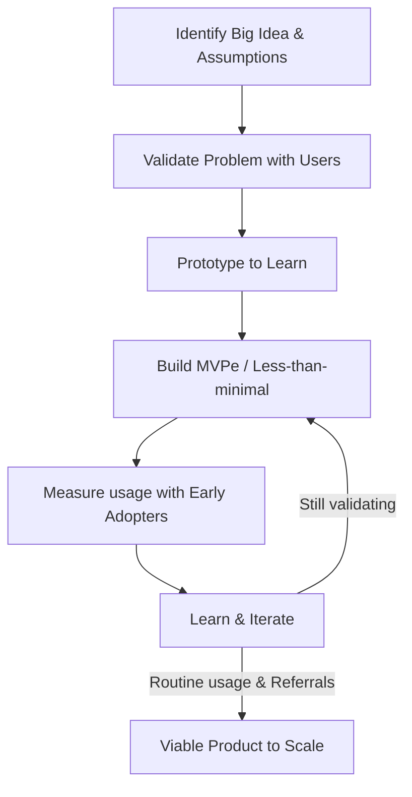

# 🧠 Topic: Product Discovery & Validated Learning (User Story Mapping)

> [!abstract] Executive Summary (ELI5)
> Before building massive software projects, we must focus on learning if we're building the right thing. By releasing small, usable, and safe-to-fail experiments to early adopters ("development partners"), we validate our assumptions via an iterative Build-Measure-Learn loop until we reach a truly Minimum Viable Product.

---

## 🎯 The "Why"
- **Problem Solved:** Prevents building features or full products that nobody actually uses. It minimizes the risk of wasting engineering time on unvalidated assumptions.
- **Alternatives:** Traditional Waterfall delivery (building part-by-part with no usable increment until the end) or Big Bang releases based purely on executive intuition.
- **Trade-offs:** Requires direct customer collaboration, comfort with releasing "less-than-minimal" (sometimes embarrassing) software, and embracing "bad news" early in the development cycle.

## 💡 Mental Model & Analogy
*Connect this technical concept to a real-world object or process.*
- **Analogy:** "Henrik Kniberg's Skateboard-to-Car Strategy". If the goal is transportation, don't build a car by releasing a wheel, then an axle, then an engine. Instead, release a skateboard -> scooter -> bicycle -> motorcycle -> car. Every step is usable, solves the core need minimally, and yields validated learning about the customer's behavior.
- **Visual/Diagram:** 

## 🛠️ Core Principles
*Focus on Product Discovery and Validation.*

- **Discuss the Opportunity:** Don't start with a backlog. Ask: *What's the big idea? Who are the customers? Why do they want it? Why are we building it?* 
- **Prototype to Learn:** Use narrative scenarios, wireframes, and non-working prototypes to get initial feedback. Discovering flaws at the prototype stage is incredibly cheap.
- **Beware of What Users Say:** Users are terrible at predicting what they will actually use. Demonstrations generate "polite" excitement. True validation is whether they *choose to use the product every day*.
- **Build to Learn (MVPe):** A Minimum Viable Product Experiment. Build *less than minimal*. Put it in front of "development partners" (early adopters) who acutely feel the pain. 
- **Architectural Hacks for Speed:** If backend teams (e.g., DBA) block rapid testing due to the structural risk of migrations, use in-memory databases to test with a tiny subset of early users. Fast iterations on the UI/business logic safely validate the product before committing to expensive data-model changes.

> [!tip] Implementation Note
> Minimize what you build to *only what you need to learn*. If your first release is production-ready for the general market, you have built too much.

## ⚠️ Pitfalls & Anti-patterns
- **Common Mistakes:** Building part-by-part (e.g., a wheel, then chassis) resulting in unusable increments. Treating MVP as "Phase 1" of a fixed scope rather than an experiment for learning.
- **When NOT to use:** For deeply understood problems with zero market risk (e.g., upgrading a well-known infrastructure component where requirements are 100% stable and fully understood).
- **Performance/Security considerations:** Early experiments might use throwaway code or unsafe architectures (like in-memory DBs for persistence) which *must not* scale to general availability without significant hardening.

## 🔗 Deep Connections
- **Parent Topic:** [[Agile Methodology]], [[Product Management]]
- **Related Concepts:** [[Lean Startup]], [[Build-Measure-Learn]], [[Minimum Viable Product]]
- **Prerequisites:** Understanding what an MVP is and the costs associated with iterative software engineering.

## ❓ Active Recall Questions
> [!faq]- What is the difference between a traditional MVP and an MVPe?
> An MVPe (Minimum Viable Product Experiment) is explicitly designed to learn something, not necessarily to be viable for the general market. It focuses on validated learning with a small cohort of development partners.

> [!faq]- According to the skateboard-to-car analogy, why is building a wheel first an anti-pattern?
> Because a wheel alone provides no usable value to the customer and thus yields no behavioral data or validated learning about the core assumption (which is transportation).

---
## 📝 How to use this template effectively
1. **Never Copy-Paste:** If you find yourself copying documentation, stop. Read, close the tab, and write it from memory.
2. **Iterate:** Fill the 'ELI5' and 'Analogy' first. If you can't explain it simply, you don't understand it yet.
3. **The "Why" is King:** Seniority is defined by knowing *when* and *why* to use a tool, not just *how*.
4. **Update the Status:** Move from `new` -> `growing` -> `mastered` as you apply this in real projects.
