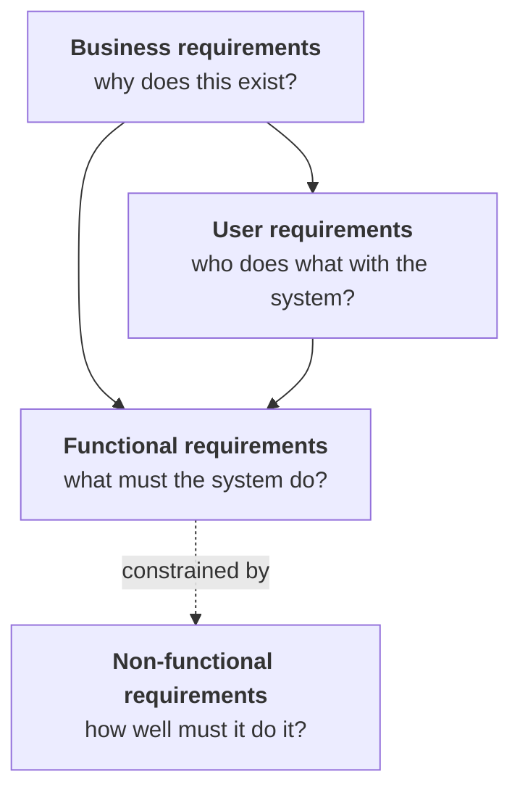

# 🧠 Topic: Business Requirements (бизнес-требования)

> [!abstract] Executive Summary (ELI5)
> Business requirements answer the **"why"** before anyone is allowed to ask "what" or "how". They are the top of the requirements pyramid: a measurable business gain that justifies building the product at all. Without them, the team optimises for features; with them, the team optimises for outcomes.

---

## 🎯 The "Why"

- **Problem Solved:** Teams routinely build excellent software that solves the **wrong problem**. Business requirements anchor every downstream decision (features, scope, priorities, release content) to a verifiable business outcome.
- **Alternatives:**
  - "Just build what the customer asks for" — *no*. Customers ask for solutions; without a business goal there is no way to evaluate whether the solution fits (Chapter 7 trap: *ideas-as-requirements*).
  - "We'll figure out the goals as we go" — works only for trivial, low-risk work. For anything non-trivial it produces scope creep and unbounded projects (Chapter 5: *«нечеткие бизнес-цели — гарантия свободного проекта, в котором невозможно определить момент завершения»*).
  - Vision-only (no scope) — pretty slogans, no operational filter for change requests.
- **Trade-offs:** Writing business requirements forces sponsors to commit to **measurable** goals, which means becoming accountable. Sponsors often resist this. That resistance itself is diagnostic — it usually means no one actually knows why the project exists.

---

## 💡 Mental Model & Analogy

> A product without business requirements is like a road trip without a destination. You can drive efficiently, you can have a great car, you can pick interesting stops — but you will never know whether you arrived.

**Hierarchy of requirements (Wiegers, Ch. 1 + Ch. 5):**

Business requirements are **not** a parent of *everything* — NFRs often derive directly from business goals (e.g. a compliance goal produces availability / auditability NFRs). Treat the tree as directional, not strictly hierarchical.

---

## 🛠️ Core Principles

### What business requirements are composed of

> [!warning] Correction to a common phrasing
> People often say "business requirements = product vision + project scope". **Not quite.** Vision and scope are the *expressions* of business requirements — the artefacts. The *source material* is different.

| Layer | What it is | Examples |
|---|---|---|
| **Source** (input) | Business opportunities, business goals, success criteria, vision statement | "Reduce chemical inventory cost by 25% in 12 months" |
| **Expression** (output) | Product vision + project scope, captured in a Vision & Scope document | See [[Product Vision and Project Scope]] |

A team that writes a vision document **without** first extracting the goals is doing it backwards. The vision will look plausible and be hollow.

### The non-negotiables

1. **Measurable.** "Become world-class" is not a goal. "Reduce average call-handling time from 4:30 to 3:00 by Q3" is. (Wiegers Ch. 5, Table 5-1.)
2. **Time-bound.** Every goal has a deadline, otherwise it cannot drive sequencing decisions.
3. **Outcome-oriented, not output-oriented.** "Ship 12 features" is an output. "Reduce support tickets per active user by 30%" is an outcome.
4. **Owned by a named sponsor.** Goals without an owner are wishes. See [[#The sponsor is not the same as a privileged user class]].
5. **Used as a filter.** Every change request, every new feature idea is checked against them — see Chapter 5 invariants below.

### Invariants from Chapter 5 (test your project against these)

- Every proposed feature is checked: *does it advance a business goal?* If not, it does not belong in this release.
- Every conflicting requirement is resolved in favour of the **primary stakeholder's** business goals — not the loudest voice.
- Every assumption and dependency is written down, because unwritten assumptions are the primary source of "but I thought…" failures.
- Scope changes are allowed — but they trigger a budget/schedule/resource conversation, not a silent addition.

---

## ⚠️ Pitfalls & Anti-patterns

- **"Merging two systems into one" as a goal.** Wiegers is explicit: customers don't care how many systems they use. Consolidation is a *solution*, not a *goal*. Probe for the underlying outcome (cost? UX? compliance?).
- **Confusing the sponsor with a user.** The sponsor is rarely a user; users are rarely sponsors. Misidentifying leads to optimizing for the wrong party — see [[#The sponsor is not the same as a privileged user class]].
- **Compliance-as-only-goal.** Compliance projects have a clear goal ("avoid being fined"), but if that is the *only* goal the product will be minimal and joyless. Look for the second-order business goal underneath.
- **No success criteria.** "We'll know it when we see it" never works. If the team cannot describe success numerically, the project is not yet ready to start.
- **Scope defined as features, not as outcomes.** A feature list is a consequence of scope, not its definition. Start from "which user needs / business events are in this release".

---

## 🔗 Deep Connections

**This note is the parent / index for the Business Requirements cluster.** The atomic notes below each develop one concept from Chapter 5 in depth:

| Atomic note | Question it answers |
|---|---|
| [[Product Vision and Project Scope]] | Vision vs scope — what changes slowly, what changes per release, and how do overlapping releases interact? |
| [[Vision and Scope Document]] | The artefact, the template, and several project-size variations. |
| [[Business Goals Model]] | The problem→goal decomposition tree (Wiegers Fig. 5-5) as a reusable framework, plus the dialogue pattern for eliciting goals from sponsors. |
| [[Vision Statement Template]] | The Moore (1991) keyword template for a one-paragraph vision. |
| [[Assumptions and Dependencies]] | What counts as an assumption, the assumption→risk pipeline, and how to surface hidden assumptions. |

**Cross-references outside this cluster:**

- **Parent topic:** [[Business Analysis README]] (the BA area map).
- **Downstream:** [[User Classes and Product Champions]] (Chapter 6) — the people who supply *user* requirements, distinct from the sponsors who supply *business* requirements.
- **Downstream:** [[Requirements Elicitation]] (Chapter 7) — the actual elicitation techniques; this note says *what* to extract, Chapter 7 says *how*.
- **Toolkit home:** [[Requirements-Engineering-Roadmap]] — Wave 1 (`requirements-intake` skill) consumes these concepts directly.

---

## ❓ Active Recall Questions

> [!faq]- What are the two layers of "business requirements" — source vs expression — and why does the distinction matter?
> **Source:** opportunities, goals, success criteria, vision. **Expression:** Vision & Scope document. The distinction matters because writing the document without first extracting the goals produces a hollow artefact.

> [!faq]- A sponsor proposes: "Our goal is to merge the legacy CRM and the new CRM into one system." How do you respond?
> Consolidation is a solution, not a goal. Ask: "What business outcome do you expect from consolidation?" (cost reduction? uniform UX? single source of truth?). One of those answers is the goal; the merge is one possible means.

> [!faq]- Name five invariants from Chapter 5 that you can use as a checklist on any project.
> (1) Measurable goals. (2) Time-bound. (3) Outcome-oriented. (4) Named sponsor. (5) Used as a change-request filter — every proposed feature is checked against them.

> [!faq]- Why are business requirements *not* the strict parent of NFRs?
> NFRs (availability, auditability, throughput) often derive *directly* from a business goal (e.g. a compliance or SLA goal), bypassing the user-requirements layer. Treat the requirement hierarchy as directional, not strictly tree-shaped.

---

## 📝 Reading map for Chapter 5

If you're reading Wiegers Ch. 5 for the first time, the chapter is dense but has a clear spine:

1. **§"Formulating business requirements"** → defines the term. → this note.
2. **§"Product vision and project scope"** → the two basic elements. → [[Product Vision and Project Scope]].
3. **§"Conflicting business requirements"** (the kiosk example). → [[Product Vision and Project Scope#Conflicts of business interest]].
4. **§"Vision and scope document"** + **template (Fig. 5-3)**. → [[Vision and Scope Document]].
5. **§"Business goals"** + **Table 5-1** + **Fig. 5-4 (dialogue)** + **Fig. 5-5 (model)**. → [[Business Goals Model]].
6. **§"Vision statement"** (Moore template). → [[Vision Statement Template]].
7. **§"Assumptions and dependencies"**. → [[Assumptions and Dependencies]].
8. **§"Ways to depict project scope"** (context diagram, ecosystem map, feature tree, event list). → future note on scope representation (TODO).
9. **§"Using business goals to drive scope decisions"** + **"Agile"** + **"Knowing when you're done"**. → revisit this note, "Invariants" section.
