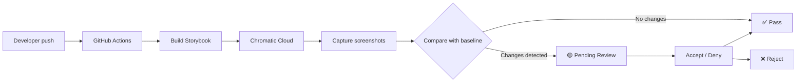

# 🧠 Topic: Chromatic — Визуальная регрессия и CI/CD flow

> [!abstract] Executive Summary (ELI5)
> Chromatic — это робот-фотограф, который делает скриншот каждого состояния UI-компонента и сравнивает их с «эталонными» фотографиями. Если пиксель сдвинулся или цвет изменился — робот орёт: «Внимание, визуальный баг!» Он работает поверх Storybook, где каждый компонент уже изолированно показан во всех своих состояниях.

---

## 🎯 The "Why"

### Problem Solved
Когда разработчик меняет CSS в одном компоненте, он ломает отступы в другом — и никто не замечает до продакшена. Юнит-тесты не ловят визуальные баги (padding, color, border), а ручное тестирование каждого состояния каждого компонента — не масштабируется.

Chromatic решает это, автоматически сравнивая скриншоты Storybook-сториз с эталоном (baseline).

### Alternatives
| Инструмент | Что делает | Почему не Chromatic |
|---|---|---|
| **Percy** (BrowserStack) | Визуальная регрессия | Платный, меньше интеграций со Storybook |
| **Playwright screenshot tests** | Локальные скриншот-тесты | Нет облачного baseline-менеджмента, сложнее share diff с дизайнерами |
| **Jest + jest-image-snapshot** | Скриншоты в юнит-тестах | Хрупкие, требуют локального хранения baseline в git |
| **Ручное тестирование** | Человек смотрит UI | Медленно, ненадёжно, не масштабируется |

### Trade-offs
- **За**: Zero-config интеграция со Storybook, облачный baseline, shareable diff UI для дизайнеров, TurboSnap для экономии квоты.
- **Против**: Freemium (плата за снапшоты выше лимита), зависимость от внешнего сервиса, baseline требует human approval (или настройки auto-accept).

## 💡 Mental Model & Analogy

- **Analogy:** Chromatic — это система видеонаблюдения в музее. Каждая картина (компонент) сфотографирована в идеальном состоянии (baseline). Камеры каждую ночь делают новые фото и сверяют их с архивом. Если рама съехала на 2 мм — сигнализация. Если картину заменили на подделку — сигнализация.

- **Visual/Diagram:**


## 🛠️ Core Principles & Code Snippets

### 1. Flow разработки с Chromatic

```
feature/input-field
├── Разработка компонента
├── Написание stories (все состояния: default, error, disabled, focus)
├── Push ветки
├── Создание PR → main
│   └── GitHub Actions: chromatic.yml
│       ├── Build Storybook
│       ├── Capture screenshots
│       └── Compare with main baseline
│
├── Review в Chromatic UI
│   ├── Дизайнер смотрит side-by-side diff
│   ├── Принимает (Accept) или отклоняет (Deny)
│   └── GitHub check обновляется
│
└── Merge PR → main
    └── GitHub Actions: chromatic.yml (main)
        └── autoAcceptChanges: true
            └── Baseline обновлён
```

### 2. Базовый workflow (GitHub Actions)

```yaml
name: Chromatic
on:
  push:
    branches: [main]
  pull_request:
    branches: [main]

jobs:
  chromatic:
    runs-on: ubuntu-latest
    steps:
      - uses: actions/checkout@v4
        with:
          fetch-depth: 0  # TurboSnap требует полную git history

      - uses: actions/setup-node@v4
        with:
          node-version: 22
          cache: npm

      - run: npm ci

      - name: Run Chromatic (main)
        if: github.ref == 'refs/heads/main'
        uses: chromaui/action@latest
        with:
          projectToken: ${{ secrets.CHROMATIC_PROJECT_TOKEN }}
          autoAcceptChanges: true
          onlyChanged: true

      - name: Run Chromatic (PR)
        if: github.event_name == 'pull_request'
        uses: chromaui/action@latest
        with:
          projectToken: ${{ secrets.CHROMATIC_PROJECT_TOKEN }}
          exitZeroOnChanges: true
          onlyChanged: true
```

### 3. Вариации подходов

| Режим | `exitZeroOnChanges` | Эффект | Когда использовать |
|---|---|---|---|
| **Strict** | `false` (или не указан) | PR блокируется до Accept в Chromatic UI | Команда зрелая, дизайнер всегда review-ит |
| **Soft** | `true` | PR мержится, Chromatic показывает diff но не блокирует | Внедрение, команда привыкает к инструменту |
| **Auto-accept main** | `autoAcceptChanges: true` | Baseline обновляется автоматически | Всегда на main после merge |

### 4. TurboSnap — экономия квоты

```yaml
with:
  onlyChanged: true  # Снимает скриншоты только для изменённых stories
```

**Как работает**: Chromatic анализирует git diff и dependency graph Webpack/Vite. Если изменился только `button.tsx` — снимаются только stories кнопки, а не весь Storybook.

**Требование**: `fetch-depth: 0` в `actions/checkout@v4` (иначе Chromatic не видит историю для анализа).

### 5. Интеграция с Storybook

Chromatic — это **облачный layer** поверх Storybook:

```
Storybook (локальная разработка)
├── stories.tsx  ← источник truth для компонентов
├── preview.ts   ← global decorators, MSW, a11y
└── main.ts      ← config

Chromatic (облако)
├── Получает build-storybook output
├── Запускает stories в изолированном браузере
├── Делает скриншот каждого story
└── Сравнивает с baseline
```

**Важно**: Chromatic не заменяет Storybook. Он использует ваши `.stories.tsx` как набор тест-кейсов для визуального тестирования.

## ⚠️ Pitfalls & Anti-patterns

### Common Mistakes
1. **Запуск на каждый push в любую ветку** — сжигает квоту. Достаточно `pull_request` и `push: [main]`.
2. **Забыть `fetch-depth: 0`** — TurboSnap не работает, снимаются все stories.
3. **Baseline из багованного состояния** — если первый прогон создал baseline с багом, Chromatic считает это нормой. Нужно вручную пересоздать baseline.
4. **Flaky stories** — анимации, таймеры, случайные данные в stories дают ложные срабатывания. Stories должны быть детерминированными.
5. **Смешивать functional и visual testing** — Chromatic ловит visual regressions, но не скажет «border должен быть красным». Для этого нужны отдельные assertions (computed styles).

### When NOT to use
- Проект без Storybook (Chromatic бесполезен без изолированных stories).
- Команда из 1 разработчика без дизайнера (ручная проверка быстрее).
- Если UI меняется каждый день радикально (baseline устаревает быстрее, чем обновляется).
- Ограниченный бюджет и >100 компонентов с десятками состояний (квота закончится быстро).

## 🔗 Deep Connections

- **Parent Topic:** [[CI-CD Pipeline]], [[Frontend Testing Strategy]]
- **Related Concepts:**
  - [[Storybook]] — источник stories для Chromatic
  - [[Visual Regression Testing]] — категория тестирования
  - [[Playwright]] — альтернатива для локальных скриншот-тестов
  - [[Design Tokens]] — если токены меняются, Chromatic покажет массовый diff
  - [[Feature-Sliced Design]] — в FSD каждый слой (shared/ui, entities/ui) имеет stories, которые Chromatic тестирует
  - [[Rule Based Assertions]] — концепт из T-032: кодирование acceptance criteria в виде assertions на computed styles (дополнение к Chromatic)
- **Upstream:** [[Design System]] — Chromatic защищает дизайн-систему от визуальных регрессий
- **Downstream:** [[Code Review Process]] — Chromatic добавляет visual review в процесс ревью PR

## ❓ Active Recall Questions

> [!faq]- Почему Chromatic запускается дважды: на PR и на push в main? Зачем два раза?
> На PR — сравнение с baseline для обнаружения regressions. На push в main — обновление baseline (autoAcceptChanges), чтобы следующие PR сравнивались с актуальным эталоном.

> [!faq]- Что будет, если baseline создан с багом?
> Chromatic считает баг нормой. Все последующие PR будут проходить, пока кто-то не зайдёт в интерфейс Chromatic и не пересоздаст baseline вручную.

> [!faq]- Почему `fetch-depth: 0` обязателен для TurboSnap?
> TurboSnap анализирует git history и dependency graph, чтобы понять, какие stories изменились. Без полной истории Chromatic не может сделать этот анализ и снимает все stories.

> [!faq]- В чём разница между `exitZeroOnChanges: true` и strict mode?
> `exitZeroOnChanges: true` — Chromatic показывает diff, но GitHub check остаётся зелёным. PR можно мержить без review. Strict mode (без флага) — GitHub check висит Pending до тех пор, пока кто-то не нажмёт Accept в Chromatic UI.

> [!faq]- Chromatic проверяет «border должен быть красным»?
> Нет. Chromatic сравнивает пиксели. Он скажет «скриншот изменился», но не «ожидался красный border». Для проверки конкретных стилей нужны Rule Based Assertions (computed styles через Playwright/Vitest).

---
## 📝 How to use this template effectively
1. **Never Copy-Paste:** If you find yourself copying documentation, stop. Read, close the tab, and write it from memory.
2. **Iterate:** Fill the 'ELI5' and 'Analogy' first. If you can't explain it simply, you don't understand it yet.
3. **The "Why" is King:** Seniority is defined by knowing *when* and *why* to use a tool, not just *how*.
