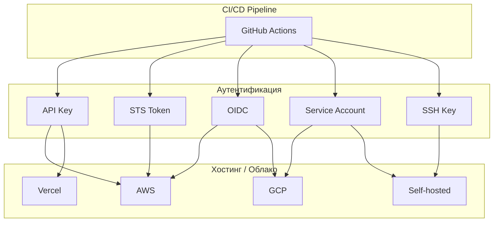
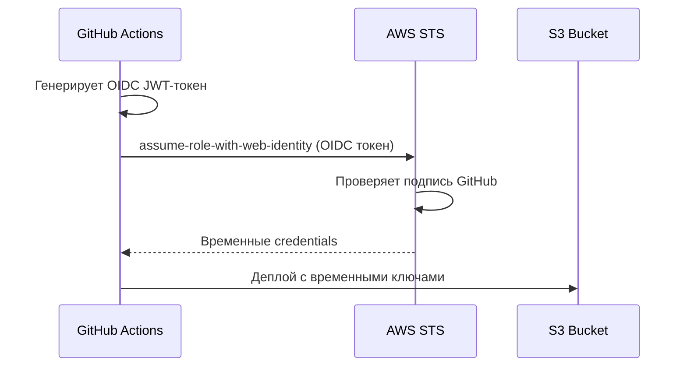

# 🧠 Topic: Аутентификация в CI/CD — Схемы деплоя

> [!abstract] Executive Summary (ELI5)
> Когда CI-система (типа GitHub Actions) деплоит ваш код на сервер или в облако, хостинг должен убедиться: «это точно легитимный деплой, а не злоумышленник?» Аутентификация в CI/CD — это набор способов, как CI-система предъявляет свои «документы» хостингу. От простых паролей до сложных временных токенов — каждый способ имеет свои риски и применимость.

---

## 🎯 The "Why"

### Problem Solved
CI/CD pipeline запускается автоматически, без человека. Как хостинг-платформа (AWS, Vercel, Netlify, Google Cloud) понимает, что запрос на деплой идёт от доверенной системы, а не от случайного бота? Нужен механизм аутентификации — способ доказать личность в автоматическом режиме.

### Alternatives
| Схема | Краткое описание | Когда использовать |
|---|---|---|
| **Long-lived API Keys** | Постоянный токен, хранится в секретах | Простые проекты, legacy |
| **STS Temporary Tokens** | Временные ключи через AWS STS | AWS, корпоративная безопасность |
| **OIDC / Workload Identity** | Без секретов вообще, через криптографию | Современные облака, gold standard |
| **Service Accounts** | Выделенный пользователь для CI | GCP, Kubernetes, self-hosted |
| **SSH Keys** | RSA/ED25519 ключи для git-деплоя | GitHub Pages, VPS, старые сервера |
| **mTLS (Certificates)** | Клиентский сертификат | Enterprise, zero-trust архитектуры |
| **GitHub Environments + Protection** | Абстракция окружений с approve | Любой проект с разделением сред |

### Trade-offs
- **За**: Без аутентификации нет автоматического деплоя. Каждая схема — компромисс между удобством и безопасностью.
- **Против**: Сложные схемы (OIDC) требуют настройки на стороне облака. Простые схемы (API Keys) рискуют утекть и дать злоумышленнику вечный доступ.

---

## 💡 Mental Model & Analogy

- **Analogy:** Деплой — это как доставка ценного груза в охраняемое здание. Хостинг — охрана у входа. Аутентификация — это способ, как курьер (CI) доказывает, что ему можно пройти:
  - **API Key** = постоянный пропуск в кармане. Удобно, но если украдут — охрана не отличит вора от курьера.
  - **STS Token** = разовый пропуск, действует до конца смены. Украли — через 12 часов не работает.
  - **OIDC** = курьер звонит из головного офиса, охрана перезванивает туда для подтверждения. Никаких физических пропусков, невозможно украсть.

- **Visual/Diagram:**


---

## 🛠️ Core Principles & Code Snippets

### 1. Long-lived API Keys (Классика)

**Как работает:** Генерируете токен в панели управления хостингом → сохраняете в GitHub Secrets → используете в workflow.

```yaml
# Vercel
jobs:
  deploy:
    runs-on: ubuntu-latest
    steps:
      - uses: actions/checkout@v4
      - run: npm ci && npm run build
      - run: vercel --prod --token ${{ secrets.VERCEL_TOKEN }}
```

```yaml
# Netlify
jobs:
  deploy:
    runs-on: ubuntu-latest
    steps:
      - uses: actions/checkout@v4
      - run: npm ci && npm run build
      - run: npx netlify-cli deploy --prod --auth ${{ secrets.NETLIFY_AUTH_TOKEN }}
```

**Плюсы:** Просто, работает везде.
**Минусы:** Токен вечный. Если утечёт (утёчка логов, уход сотрудника) — злоумышленник имеет доступ до ручного отзыва.

---

### 2. STS Temporary Tokens (AWS)

**Как работает:** У вас есть личный IAM Access Key (долгосрочный), но деплоить вы не можете напрямую. Вы запускаете скрипт `assume-role`, который обращается к AWS STS и получает временные credentials: `Access Key ID` + `Secret Access Key` + `Session Token`.

```bash
# Локальная генерация временного токена
aws sts assume-role \
  --role-arn arn:aws:iam::123456789:role/ProductionDeployRole \
  --role-session-name "github-actions-deploy" \
  --duration-seconds 3600  # 1 час

# Ответ:
# {
#   "Credentials": {
#     "AccessKeyId": "ASIA...",
#     "SecretAccessKey": "...",
#     "SessionToken": "FwoGZXIvYXdzEBYaD...",
#     "Expiration": "2026-05-15T15:00:00Z"
#   }
# }
```

**В GitHub Actions (без OIDC):**
```yaml
jobs:
  deploy:
    runs-on: ubuntu-latest
    steps:
      - uses: actions/checkout@v4

      - name: Configure AWS Credentials
        uses: aws-actions/configure-aws-credentials@v4
        with:
          aws-access-key-id: ${{ secrets.AWS_ACCESS_KEY_ID }}         # личный
          aws-secret-access-key: ${{ secrets.AWS_SECRET_ACCESS_KEY }}  # личный
          aws-region: eu-central-1
          role-to-assume: arn:aws:iam::123456789:role/DeployRole      # роль
          role-duration-seconds: 3600

      - run: aws s3 sync dist/ s3://my-production-bucket
```

**Плюсы:** Временные ключи истекают автоматически. Даже если украдут — через час бесполезны.
**Минусы:** Нужен личный ключ в Secrets (хотя и с ограниченными правами). Требует настройки IAM ролей.

---

### 3. OIDC / Workload Identity (Золотой стандарт)

**Как работает:** GitHub Actions генерирует **временный OIDC-токен** (JWT) прямо во время выполнения. AWS/GCP/Azure проверяют подпись этого токена и выдают роль. **Никаких секретов в GitHub вообще.**



**В GitHub Actions (с OIDC):**
```yaml
jobs:
  deploy:
    runs-on: ubuntu-latest
    permissions:
      id-token: write   # ← обязательно для OIDC!
      contents: read
    steps:
      - uses: actions/checkout@v4

      - name: Configure AWS Credentials
        uses: aws-actions/configure-aws-credentials@v4
        with:
          role-to-assume: arn:aws:iam::123456789:role/GitHubActionsRole
          aws-region: eu-central-1
          # НЕТ aws-access-key-id! НЕТ секретов!

      - run: aws s3 sync dist/ s3://my-production-bucket
```

**Настройка на стороне AWS:**
1. Создать IAM Role (`GitHubActionsRole`)
2. Trust Policy разрешает `token.actions.githubusercontent.com`
3. Указать `StringEquals` условия: `repo:my-org/fsd-shopping-cart`, `branch:main`

```json
{
  "Version": "2012-10-17",
  "Statement": [{
    "Effect": "Allow",
    "Principal": {
      "Federated": "arn:aws:iam::123456789:oidc-provider/token.actions.githubusercontent.com"
    },
    "Action": "sts:AssumeRoleWithWebIdentity",
    "Condition": {
      "StringEquals": {
        "token.actions.githubusercontent.com:aud": "sts.amazonaws.com"
      },
      "StringLike": {
        "token.actions.githubusercontent.com:sub": "repo:my-org/fsd-shopping-cart:ref:refs/heads/main"
      }
    }
  }]
}
```

**Плюсы:** Нет секретов в GitHub → нечего украсть. Автоматическая ротация. Привязка к конкретному репозиторию/ветке.
**Минусы:** Сложнее настроить впервые. Не все платформы поддерживают.

---

### 4. Service Accounts (GCP, Kubernetes)

**Как работает:** Вы создаёте выделенного пользователя (не человека, а «робота») с ограниченными правами. Его ключи хранятся в Secrets.

**Google Cloud:**
```yaml
jobs:
  deploy:
    runs-on: ubuntu-latest
    steps:
      - uses: actions/checkout@v4

      - name: Setup GCP Auth
        uses: google-github-actions/auth@v2
        with:
          credentials_json: ${{ secrets.GCP_SERVICE_ACCOUNT_KEY }}

      - name: Deploy to App Engine
        uses: google-github-actions/deploy-appengine@v2
        with:
          deliverables: app.yaml
```

**Kubernetes (self-hosted):**
```yaml
jobs:
  deploy:
    runs-on: ubuntu-latest
    steps:
      - uses: actions/checkout@v4

      - name: Setup kubectl
        uses: azure/setup-kubectl@v4

      - name: Configure kubeconfig
        run: |
          echo "${{ secrets.KUBECONFIG }}" | base64 -d > ~/.kube/config

      - run: kubectl set image deployment/app app=my-image:latest
```

**Плюсы:** Чёткое разделение прав. Сервисный аккаунт можно ограничить только нужными ресурсами.
**Минусы:** Ключи долгоживущие. Нужна ротация. В K8s лучше использовать OIDC через IRSA (IAM Roles for Service Accounts).

---

### 5. SSH Keys (Git-based деплой)

**Как работает:** CI клонирует/пушит код на сервер через SSH. Используется для GitHub Pages, VPS, старых серверов.

```yaml
jobs:
  deploy:
    runs-on: ubuntu-latest
    steps:
      - uses: actions/checkout@v4
      - run: npm ci && npm run build

      - name: Setup SSH
        uses: webfactory/ssh-agent@v0.9.0
        with:
          ssh-private-key: ${{ secrets.SSH_PRIVATE_KEY }}

      - run: |
          git remote add production git@server.com:/var/www/repo.git
          git push production main
```

**Плюсы:** Просто для bare-metal серверов.
**Минусы:** Ключи долгоживущие. Нужно управлять `known_hosts`. Риск компрометации при утечке private key.

---

### 6. mTLS (Mutual TLS / Клиентские сертификаты)

**Как работает:** CI предъявляет X.509 сертификат при HTTPS-соединении. Сервер проверяет валидность сертификата и CA.

```yaml
jobs:
  deploy:
    runs-on: ubuntu-latest
    steps:
      - uses: actions/checkout@v4

      - name: Deploy with mTLS
        run: |
          curl --cert ${{ secrets.CLIENT_CERT }} \
               --key ${{ secrets.CLIENT_KEY }} \
               --cacert ${{ secrets.CA_CERT }} \
               -X POST https://api.production.com/deploy \
               -d @artifact.zip
```

**Плюсы:** Высокий уровень безопасности. Сертификаты можно отозвать через CRL/OCSP.
**Минусы:** Сложная инфраструктура PKI. Не нужно для 99% проектов.

---

## 📊 Сравнительная таблица

| Схема | Сложность | Безопасность | Срок жизни | Поддержка платформ | Когда использовать |
|---|---|---|---|---|---|
| **API Key** | ⭐ Низкая | ⭐⭐ Средняя | Вечный | Все | Прототипы, простые проекты |
| **STS Token** | ⭐⭐ Средняя | ⭐⭐⭐ Высокая | 1–12 часов | AWS | AWS, корпоративные проекты |
| **OIDC** | ⭐⭐⭐ Высокая | ⭐⭐⭐⭐⭐ Максимальная | 5–60 минут | AWS, GCP, Azure, HashiCorp | Production, enterprise |
| **Service Account** | ⭐⭐ Средняя | ⭐⭐ Средняя | Вечный (ключа) | GCP, Azure, K8s | GCP, Kubernetes |
| **SSH Key** | ⭐⭐ Средняя | ⭐⭐ Средняя | Вечный | Любой SSH-сервер | VPS, legacy |
| **mTLS** | ⭐⭐⭐⭐ Очень высокая | ⭐⭐⭐⭐⭐ Максимальная | До истечения сертификата | Enterprise | Zero-trust, банки |

---

## ⚠️ Pitfalls & Anti-patterns

### Common Mistakes

1. **Хранить API Key в коде** — `deploy.js` с `const API_KEY = "abc123"` → попадает в git → весь интернет знает ваш ключ.

2. **Использовать личный токен разработчика** — ваш `~/.aws/credentials` вставлен в GitHub Secrets. Вы увольняетесь — токен живёт. Или у вас root-права на аккаунте, а CI нужно 1/10 от них.

3. **Не ротировать ключи** — API Key создан 2 года назад, используется 15 людьми, никто не знает, где ещё вставлен. Утечка — и вы не можете быстро отозвать.

4. **OIDC без условий в Trust Policy** — `StringLike` на `repo:*` вместо конкретного репозитория. Любой публичный форк может получить доступ к вашей роли.

5. **Секреты на уровне репозитория вместо Environment** — `PROD_TOKEN` доступен всем workflow, включая PR из форков (если не настроены restrictions).

### When NOT to use

- **API Keys** в высокорегулируемых индустриях (финансы, медицина) — аудиторы съедят.
- **OIDC** если ваша платформа его не поддерживает — не мучайтесь, используйте STS.
- **mTLS** для стартапа из 3 человек — это как ездить на танке в магазин за хлебом.

---

## 🔗 Deep Connections

- **Parent Topic:** [[CI-CD Pipeline]], [[DevSecOps]], [[Cloud Security]]
- **Related Concepts:**
  - [[GitHub Actions — Workflow файлы и CI-CD архитектура]] — как оркестрировать pipeline
  - [[Chromatic — Визуальная регрессия и CI-CD flow]] — аутентификация для сторонних сервисов
  - [[AWS IAM]] — управление доступом в AWS
  - [[Kubernetes RBAC]] — роли в K8s
  - [[Zero Trust Architecture]] — философия «никогда не доверяй, всегда проверяй»
- **Upstream:** [[Deployment Strategies]] — blue-green, canary, rolling
- **Downstream:** [[Incident Response]] — что делать при компрометации токена

---

## ❓ Active Recall Questions

> [!faq]- Почему OIDC безопаснее API Key?
> OIDC не требует хранения долгосрочных секретов в GitHub. Вместо этого GitHub генерирует временный JWT-токен, который AWS/GCP проверяет по подписи. Даже если злоумышленник украдёт workflow-логи — там нет вечного ключа.

> [!faq]- В чём разница между STS AssumeRole и OIDC?
> STS AssumeRole требует наличия личных credentials (Access Key) для запроса временной роли. OIDC не требует никаких секретов — GitHub сам генерирует OIDC-токен, а облако доверяет GitHub как Identity Provider.

> [!faq]- Что будет, если API Key утечёт в публичный репозиторий?
> Нужно немедленно отозвать ключ в панели управления хостингом. Если это AWS IAM Key — злоумышленник может создать ресурсы на вашем счёту (крипто-майнинг). GitHub сам сканирует утечки и может автоматически отзывать некоторые токены.

> [!faq]- Почему Service Account лучше личного токена?
> Service Account — это выделенный «робот» с минимальными правами. Его можно ограничить только нужными ресурсами. Личный токен разработчика часто имеет права на всё (все проекты, все ресурсы). Кроме того, при уходе сотрудника service account остаётся.

> [!faq]- Как защититься от утечки secrets в GitHub?
> 1. Использовать Environment Secrets вместо Repository Secrets где возможно.
> 2. Не печатать secrets в логах (GitHub маскирует, но `$SECRET | base64` обходит).
> 3. Использовать OIDC где возможно — нет секретов → нечего украсть.
> 4. Включить Branch Protection + Required Reviews для окружений production.

---
## 📝 How to use this template effectively
1. **Never Copy-Paste:** If you find yourself copying documentation, stop. Read, close the tab, and write it from memory.
2. **Iterate:** Fill the 'ELI5' and 'Analogy' first. If you can't explain it simply, you don't understand it yet.
3. **The "Why" is King:** Seniority is defined by knowing *when* and *why* to use a tool, not just *how*.
