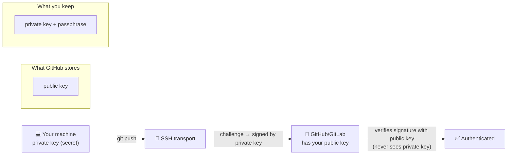
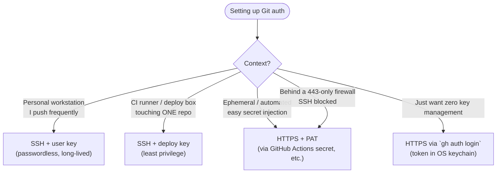

# 🧠 Topic: Git over SSH — Authenticating to Git Remotes

> [!abstract] Executive Summary (ELI5)
> When you `git push` or `git pull`, Git needs to prove *who you are* to the server (GitHub, GitLab, Bitbucket). There are two main ways: **HTTPS** (you type a username + password/token every time, or cache it) and **SSH** (you generate a **key pair** once — a public key you hand to GitHub, a private key you never share — and Git uses it to prove your identity silently on every operation). SSH is the standard for engineers because, once set up, it's **passwordless, token-free, and works for every repo your key is trusted on**. This note covers the full Git-over-SSH lifecycle: generating keys, attaching them to GitHub (as a *user key* or a *deploy key*), switching a repo's remote from HTTPS to SSH, and the SSH **agent** and **config file** that make multi-account and CI setups work.

> [!note] How this fits with the other Git notes
> This note covers **authentication/transport** — *how* your local Git talks to a remote and proves identity. It is the natural companion to [[Git_Rollback]] (which assumes you can already push/pull) and a prerequisite for any future note on GitHub Actions / CI deploy keys. It does **not** cover general SSH server administration (`sshd`, port forwarding, tunneling) — that belongs in a future `linux/networking/` or `ssh/` topic. Scope here is strictly *Git as a client authenticating to a Git host*.

---

## 🎯 The "Why"
- **Problem Solved:** A remote Git server must answer one question on every push/pull: *"who is this, and are they allowed?"* That's **authentication** (who) + **authorization** (what they can do). Git supports several transports, but in practice you choose between two:
  1. **HTTPS** — Git sends a username + a credential (password or, today, a **Personal Access Token**) over TLS. Works everywhere, through firewalls/proxies, but you must manage a token and Git must cache it somehow (a credential helper, a keychain, a `.netrc`…).
  2. **SSH** — Git reuses the `ssh` program as its transport. You authenticate with a **cryptographic key pair** instead of a password. No token to rotate-as-a-password, no credential helper gymnastics.
- **Why engineers default to SSH for Git:**
  - **Passwordless once configured.** No typing, no token prompts — `git push` just works.
  - **One identity, many repos.** A single user key trusted by your account unlocks every repo you own or collaborate on. No per-repo credential sprawl.
  - **Strong, phishable-resistant auth.** A 256-bit Ed25519 key is not guessable; there's no shared secret to leak via a fake login page (the private key never leaves your machine).
  - **Granular scoping via deploy keys.** A repo-only key lets a CI box touch *one* repo without holding the keys to your whole account.
- **Alternatives / neighbors:**
  - **HTTPS + Personal Access Token (PAT)** — the modern HTTPS default; GitHub killed password auth for Git in 2021. Fine and common, especially in CI/ephemeral runners where injecting a PAT via a secret is easy. Requires a credential helper to avoid re-pasting.
  - **HTTPS with GitHub CLI (`gh auth login`)** — `gh` manages an OAuth token in your OS keychain and wires it into Git for you. The smoothest HTTPS experience; great if you don't want to think about keys.
  - **Signed commits (GPG / SSH signing keys)** — a *different* use of keys: proving authorship of commits, not authenticating to the remote. Don't confuse "SSH key to push" with "SSH key to sign commits" — same crypto family, different purpose.
- **Trade-offs:**
  - **SSH** — setup friction up front (generate key, upload public half), then friction-free forever. Fails closed through restrictive corporate firewalls that only allow 443 (mitigation: GitHub offers SSH over the `ssh` host on port 443).
  - **HTTPS** — zero setup friction (anyone can clone public repos anonymously), ongoing token-management friction (tokens expire, need rotation, need caching). Easier in automated/CI contexts where injecting a secret is trivial.
  - Neither is "more secure" in an absolute sense; SSH's edge is that the secret (the private key) **never crosses the wire**, whereas a PAT is sent to the server on every authenticated request.

## 💡 Mental Model & Analogy
- **Analogy: the wristband and the bouncer.**
  - Your **public key** is a **wristband design** you hand to the venue (GitHub) ahead of time: *"if someone can produce the matching wristband, that's me."*
  - Your **private key** is the **actual wristband** you wear. You never hand it to anyone; you just *show* the bouncer you have it (via a cryptographic challenge-response — see below).
  - **HTTPS with a token** is instead a **PIN code** you type at the door every visit — works, but you're re-entering a shared secret each time, and the venue's sign-in sheet holds it.
  - The **SSH agent** is a **valet** that holds your wristband for you (with its passphrase unlocked) so you don't have to fumble for it on every visit.
  - A **deploy key** is a **single-room wristband**: good for exactly one repo's door, useless everywhere else. Perfect for handing to a CI server you don't fully trust.
- **The challenge-response (why the private key never leaves your machine):**
  When Git connects over SSH, the server doesn't ask "what's your password?" It sends your client a **random challenge**; your `ssh` client signs it with the **private key** and returns the signature; the server verifies it with the **public key** it has on file. The private key never traverses the network — only a *signature* does. That's the core reason SSH-key auth resists phishing: there's no reusable secret to steal via a man-in-the-middle.



> [!tip] The single most important mental model
> **The public key goes to the server; the private key stays with you — forever, never shared, never committed.** Every "SSH for Git" task is some permutation of: *generate a pair → put the public half where the host can see it → make sure your client offers the right private half.* When something breaks ("Permission denied (publickey)"), one of those three links is wrong: the host doesn't have the public key, your client isn't offering the private key, or the private key is unreadable (wrong perms / wrong passphrase). Debug in that order.

## 🛠️ Core Principles & Code Snippets

The Git-over-SSH lifecycle in five stages. Walk through them in order when setting up or debugging.

### 1. Generate a key pair (the modern default is Ed25519)
A key pair is two files: `id_ed25519` (private — **secret**) and `id_ed25519.pub` (public — **shareable**). Generate once per identity/machine.

```bash
ssh-keygen -t ed25519 -C "pavel@example.com"
# -t ed25519   → the recommended modern algorithm (fast, tiny, secure)
# -C "..."     → just a comment embedded in the public key; convention is your email.
#                It is NOT used for auth — it only helps you identify the key later.

# Press Enter to accept the default location (~/.ssh/id_ed25519).
# SET A PASSPHRASE. It encrypts the private key at rest, so a stolen laptop file is useless
# without it. The SSH agent (§4) means you type this passphrase ONCE per session, not per push.
```

> [!warning] Use Ed25519; avoid old RSA defaults
> `ssh-keygen` with no `-t` historically made a 2048-bit RSA key, and older tutorials suggest `rsa -b 4096`. Ed25519 is strictly better today: smaller keys, faster, no parameter pitfalls. If you must use RSA (very old server), require `-b 4096` and the modern SHA-2 signatures — SHA-1 RSA keys are rejected by current GitHub/OpenSSH. Default to `ed25519` and only deviate with a reason.

### 2. Attach the public key to GitHub/GitLab — **two different scopes**
This is where people mix things up. There are **two kinds of "add a key"**, with very different blast radius:

| | **User key** (account key) | **Deploy key** (repo key) |
|---|---|---|
| Added to… | your **user account** | a **single repository** |
| Grants access to… | **every repo** your account can reach | **that one repo only** |
| Typical use | your personal laptop / workstation | a **CI server**, a deploy box |
| Compromise impact | your entire account | only that one repo |
| Read/write | matches your account's perms | often **read-only** (write is opt-in) |

```bash
cat ~/.ssh/id_ed25519.pub
# Copy the ENTIRE output, starting with "ssh-ed25519 AAAA..." including the comment.
# Then:
#   User key:    GitHub → Settings → SSH and GPG keys → New SSH key
#   Deploy key:  Repo → Settings → Deploy keys → Add deploy key
```

> [!tip] Deploy keys are the "least privilege" tool for CI
> If a CI runner needs to clone (or push to) exactly one repo, give it a **deploy key**, not a personal user key. A compromised deploy key can't exfiltrate your other repos or mutate your account settings — the damage is contained. This is the Git-over-SSH embodiment of the least-privilege principle.

### 3. Switch an existing repo from HTTPS to SSH
A "remote URL" dictates which transport Git uses. Changing it is a one-liner and changes nothing about your commits or history.

```bash
git remote -v
# origin  https://github.com/user/repo.git (fetch)
# origin  https://github.com/user/repo.git (push)

git remote set-url origin git@github.com:user/repo.git
#                SSH form: git@HOST:owner/repo.git   ← note the COLON, not a slash

git remote -v
# origin  git@github.com:user/repo.git (fetch)   ← now SSH
```

- **The URL shape is how Git picks the transport:**
  - `git@github.com:user/repo.git` → **SSH** (handed to your `ssh` client)
  - `https://github.com/user/repo.git` → **HTTPS** (credential helper / token)
- **SCPs-style colon, not a slash:** `git@github.com:user/repo.git`. The colon separates the *user@host* from the *path*. A common copy-paste bug is turning the colon into a slash, which breaks parsing.

### 4. The SSH agent — so you type the passphrase once
The **agent** is a background process that holds your **decrypted** private keys in memory for the duration of your session. Without it, you'd type your key's passphrase on every `git push`. With it, you type it once (at `ssh-add` or first use), and the agent signs challenges thereafter.

```bash
# Start the agent and wire it into this shell
eval "$(ssh-agent -s)"          # prints and exports SSH_AUTH_SOCK + SSH_AGENT_PID

# Load your key (prompts for the passphrase once, then holds it decrypted)
ssh-add ~/.ssh/id_ed25519
ssh-add -l                      # list fingerprints of keys the agent currently holds

# On macOS — store the passphrase in Keychain so it survives reboots/relogins:
# (1) add to ~/.ssh/config:
#     Host github.com
#       AddKeysToAgent yes
#       UseKeychain yes
#       IdentityFile ~/.ssh/id_ed25519
# (2) then: ssh-add --apple-use-keychain ~/.ssh/id_ed25519
```

- **Why this matters for Git:** Git itself knows nothing about SSH keys or passphrases — it just shells out to `ssh`, which in turn consults `SSH_AUTH_SOCK` (the agent). So "Git isn't asking for my passphrase / is asking too often" is really an **agent** question, not a Git question.
- **On Linux desktops** the agent is usually started for you by the session manager (GNOME Keyring, KDE Wallet). On a plain SSH session into a server, you start it manually with `eval "$(ssh-agent -s)"`.

### 5. The SSH config file — multiple keys, multiple accounts
When you have **more than one key** (personal + work, or multiple GitHub accounts), `ssh` needs to know *which key to offer for which host*. You control this in `~/.ssh/config`. This is the single most useful file in Git-over-SSH.

```sshconfig
# ~/.ssh/config  (permissions: chmod 600)

# Default: personal GitHub account
Host github.com
  HostName github.com
  User git
  IdentityFile ~/.ssh/id_ed25519_personal
  AddKeysToAgent yes
  UseKeychain yes            # macOS only; harmless to leave on Linux

# Alias for a SECOND GitHub account (e.g. work)
# You'll clone using this alias instead of github.com:
#   git clone git@github-work:work-org/repo.git
Host github-work
  HostName github.com
  User git
  IdentityFile ~/.ssh/id_ed25519_work
  IdentitiesOnly yes
```

- **`Host` is an alias you invent; `HostName` is the real server.** The trick for multiple GitHub accounts: both aliases point to `HostName github.com`, but each offers a *different* `IdentityFile`. You distinguish them by cloning with the alias (`git@github-work:…`).
- **`IdentitiesOnly yes`** is essential when you have many keys: by default `ssh` offers *every* key it can find until one is accepted, which (a) can get you rate-limited by GitHub ("too many auth failures") and (b) can leak the *existence* of keys. `IdentitiesOnly yes` forces it to offer *only* the listed `IdentityFile`.

> [!tip] Multiple GitHub accounts = per-account key + per-account alias
> GitHub refuses to let the **same public key** be attached to two accounts (it uses the key to route you to exactly one identity). So multiple accounts *require* multiple key pairs, one each, wired through separate `Host` aliases in `~/.ssh/config`. The alias is what lets one machine be "two different people" to GitHub.

### 6. Test and debug the connection
GitHub helpfully provides an SSH endpoint that just identifies you and disconnects — the fastest way to verify your setup.

```bash
ssh -T git@github.com
# Success: "Hi pavel! You've successfully authenticated, but GitHub does not provide shell access."
# This is the expected "error" message — exit code 1, but it proves the key works.

ssh -T git@github-work        # test an alias from ~/.ssh/config (should greet the work account)

ssh -vT git@github.com        # -v prints which keys are being offered and why accepted/rejected
```

- **First-connect prompt:** the very first time you reach a host, `ssh` asks `Are you sure you want to continue connecting (yes/no)?` and records the server's host key in `~/.ssh/known_hosts`. This is **TOFU** (trust-on-first-use) protection against a substituted server. Say yes once; an unexpected change later ("WARNING: REMOTE HOST IDENTIFICATION HAS CHANGED!") is a red flag, not an annoyance to bypass.
- `-v` (or `-vv`, `-vvv`) is your debugging lens: it shows exactly which keys are tried, in what order, and why a rejection happened. When stuck, run `ssh -vT git@github.com` and read the output.

## 🧭 Decision: HTTPS vs SSH for a Git remote



## ⚠️ Pitfalls & Anti-patterns
- **Common Mistakes:**
  - **Committing a private key.** A `~/.ssh/id_ed25519` (no `.pub`) in a repo is a five-alarm leak — rotate it everywhere and scrub history (see [[Git_Rollback]] §5). Public keys (`.pub`) are safe to share; private keys never are.
  - **Wrong file permissions on the private key.** OpenSSH refuses to read a private key that's too open: `"bad permissions" / "UNPROTECTED PRIVATE KEY FILE"`. Fix: `chmod 600 ~/.ssh/id_ed25519` (and `chmod 700 ~/.ssh`). This is a *feature* — a world-readable private key would silently leak.
  - **Forgetting to set a passphrase.** Without one, anyone who copies the private key file has full access. Set one; let the agent (§4) absorb the inconvenience.
  - **Attaching a user key as a deploy key (or vice versa).** A deploy key is repo-scoped; if you paste your account key into a repo's deploy keys, you've pointlessly restricted it *and* confused future-you. Match the key to the scope you intend.
  - **Same public key on two GitHub accounts.** GitHub rejects this ("Key is already in use") because a key routes to exactly one identity. Second account → second key pair + a `~/.ssh/config` alias.
  - **`ssh` offering too many keys → "Too many authentication failures."** Happens when you have many keys and no `IdentitiesOnly yes`. The fix is a `~/.ssh/config` entry pinning the right `IdentityFile` per host.
  - **Treating "REMOTE HOST IDENTIFICATION HAS CHANGED" as an annoyance.** It means the server's host key differs from what's in `known_hosts`. Sometimes legitimate (server reinstall), sometimes a MITM. **Investigate before** `ssh-keygen -R github.com`-ing it away — that command blindly trusts the new key.
  - **Using the colon-vs-slash wrong in the SSH URL.** `git@github.com/user/repo.git` (slash) fails; it must be `git@github.com:user/repo.git` (colon). A classic copy-paste error.
- **When NOT to use SSH for Git:**
  - **CI environments where injecting a PAT via a secret is trivial** (e.g., `GITHUB_TOKEN` in Actions, or a secret PAT). HTTPS+token is often simpler than managing deploy keys across many ephemeral runners, and the token's scope is auditable.
  - **Networks that block port 22.** SSH defaults to port 22, which some corporate/egress firewalls block. Either fall back to HTTPS, or use GitHub's SSH-over-443 endpoint (`Host ssh.github.com` / `Hostname ssh.github.com` / `Port 443`).
- **Security considerations:**
  - **Passphrase every key.** It's the difference between "stole my laptop file" = total compromise vs. = useless file.
  - **Prefer deploy keys over user keys for automation.** Least privilege: a CI box only gets the repo it needs.
  - **Rotate on any suspicion.** Keys are long-lived by design; if one may have leaked, remove the public half from GitHub immediately and generate a fresh pair.
  - **Hardware security keys (FIDO2 / `ed25519-sk`).** The strongest option: the private key lives on a YubiKey and *cannot* be extracted. Worth the setup for high-value accounts.

## 🔗 Deep Connections
- **Parent Topic:** Git fundamentals — remotes, URLs, the push/pull lifecycle.
- **Related Concepts:** [[Git_Rollback]] (the leak-remediation flow assumes you understand key rotation), credential helpers & the OS keychain (the HTTPS-side analog of the SSH agent), signed commits (a *separate* use of keys — proving authorship, not authenticating to the remote), least-privilege design (deploy keys are the Git expression of it).
- **Prerequisites:** basic Git (`clone`/`push`/`pull`), comfort with the shell and file permissions (`chmod` — see [[Linux_Permissions]]), and the concept of asymmetric key pairs.

## ❓ Active Recall Questions
> [!faq]- Why is SSH-key authentication resistant to phishing in a way that HTTPS+token is not?
> With SSH, the **private key never leaves your machine** — the server sends a random challenge, your client signs it with the private key, and the server verifies the signature with your public key. There's no reusable secret crossing the wire. A fake "GitHub login page" can't steal your key because you never type it anywhere; it can only try to relay challenges, and it can't extract the key itself. A Personal Access Token, by contrast, is a shared secret you *send* to the server on every authenticated request, so a MITM or a malicious endpoint can capture and reuse it.

> [!faq]- You run `ssh -T git@github.com` and get `Permission denied (publickey)`. Name the three links to check, in order.
> (1) **Does the host have your public key?** (GitHub → Settings → SSH keys — is the key's fingerprint there?) (2) **Is your client offering the private key?** (`ssh -vT git@github.com` shows which keys it tries; if the right one isn't listed, fix `~/.ssh/config` `IdentityFile` or run `ssh-add`.) (3) **Is the private key file readable?** (Wrong permissions — `chmod 600` — or a wrong passphrase block it.) Debug in that order: host → client-offering → file.

> [!faq]- What's the difference between a user key and a deploy key, and when would you choose each?
> A **user key** is attached to your **account** and grants access to **every repo** your account can reach — use it for your personal workstation. A **deploy key** is attached to a **single repository** and grants access to **only that repo** (often read-only) — use it for a CI server or deploy box. The deploy key is the **least-privilege** choice for automation: a compromised runner can't touch your other repos or your account. Don't paste your account key in as a deploy key — it pointlessly narrows scope and confuses later debugging.

> [!faq]- You have a personal GitHub account and a work GitHub account on the same laptop. Why can't you reuse one key for both, and how do you make it work?
> GitHub routes an SSH identity by its public key, and **refuses to attach the same public key to two accounts** (it wouldn't know which account you mean). So you need **two key pairs** (one per account). Then use **`~/.ssh/config` aliases**: define `Host github.com` with your personal `IdentityFile`, and `Host github-work` (HostName `github.com`) with your work key. Clone work repos as `git@github-work:work-org/repo.git`. Add `IdentitiesOnly yes` so the right key is offered for each alias.

> [!faq]- What does `IdentitiesOnly yes` do in `~/.ssh/config`, and what problem does it solve?
> By default `ssh` offers **every** key it can find to the server, one by one, until one is accepted. With many keys this causes **"Too many authentication failures"** (servers rate-limit auth attempts) and can leak which keys exist. `IdentitiesOnly yes` forces `ssh` to offer **only** the `IdentityFile` listed for that host. It's essential in multi-key setups and harmless otherwise.

> [!faq]- You clone a repo and Git keeps asking for a username/password, but you set up SSH keys. What's almost certainly wrong, and the one-line fix?
> The **remote URL is still HTTPS**, so Git is using the HTTPS transport (which wants a token), not SSH. Your keys are fine — they're just not being consulted. Fix: `git remote set-url origin git@github.com:user/repo.git` to switch the remote to the SSH form (note the **colon** after the host). Verify with `git remote -v`.

> [!faq]- OpenSSH refuses to use your key with "UNPROTECTED PRIVATE KEY FILE". What's wrong, why does it matter, and the fix?
> The private key file's permissions are **too open** (e.g., group/world readable), and OpenSSH refuses to use it as a safety measure — a readable private key would silently leak. Fix: `chmod 600 ~/.ssh/id_ed25519` (and `chmod 700 ~/.ssh` for the directory). This is a deliberate guardrail, not a nuisance: it enforces that only you can read the secret.

> [!faq]- Why set a passphrase on an SSH key if it's "passwordless auth"? Doesn't that defeat the point?
> Two different passwords — don't conflate them. The **passphrase encrypts the private key file at rest**, so a stolen file is useless without it. It does *not* replace the cryptographic auth to the server (that's still key-based). The **SSH agent** means you type the passphrase **once per session** (or store it in the OS keychain), so day-to-day Git usage stays passwordless. Net effect: protection-at-rest with near-zero ongoing friction.

> [!faq]- The first time you SSH to GitHub you're asked "Are you sure you want to continue connecting?" What is this, what happens if you say yes, and what should a later "REMOTE HOST IDENTIFICATION HAS CHANGED" warning tell you to do?
> It's **TOFU (trust-on-first-use)**: `ssh` records GitHub's server host key in `~/.ssh/known_hosts` so it can detect a substituted server later. Say yes once. A later "host identification has changed" warning means the server's key differs from the recorded one — possibly a legitimate reinstall, but possibly a **man-in-the-middle**. **Investigate before** clearing it with `ssh-keygen -R github.com`; don't reflexively bypass a security warning.

---
## 📝 How to use this template effectively
1. **Never Copy-Paste:** If you find yourself copying documentation, stop. Read, close the tab, and write it from memory.
2. **Iterate:** Fill the 'ELI5' and 'Analogy' first. If you can't explain it simply, you don't understand it yet.
3. **The "Why" is King:** Seniority is defined by knowing *when* and *why* to use a tool, not just *how*.
4. **Update the Status:** `status` tracks the *work* lifecycle (`analyzing` → `experimenting` → `implemented` → `archived`). Separately, `mastery` tracks your *learning* progress: `beginner` → `growing` → `mastered`. Bump `mastery` as you apply this in real projects.
