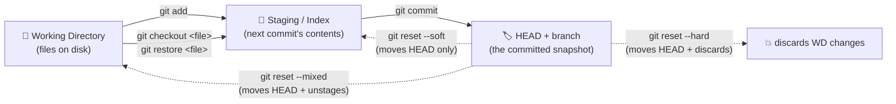
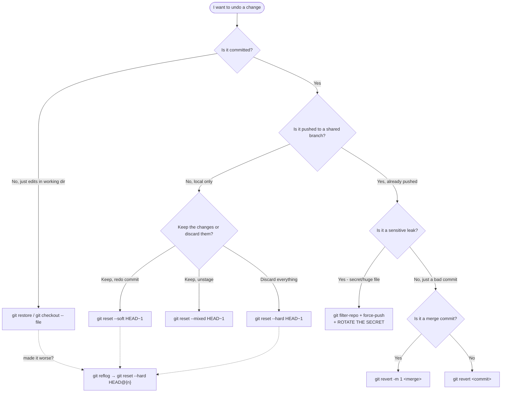

# 🧠 Topic: Git Rollback — Undoing Changes

> [!abstract] Executive Summary (ELI5)
> A **rollback** means "I made a change, and now I want to pretend I didn't." Git has several different tools for this because the right one depends on two questions: **(1) is the bad commit already shared with others (pushed)?** and **(2) do I want to *erase* history or *keep it visible*?** For unpushed local changes you reach for lightweight, history-rewriting tools (`reset`, `checkout`). For pushed changes you must use **history-preserving** tools (`revert`, `rebase`) so you don't rip commits out from under your teammates. Picking the wrong tool is the #1 source of Git disasters, so this note is organized around *which tool fits which situation*.

> [!note] How this fits with the other Git notes
> This note covers the *undo* family of operations. It assumes you already understand the **three trees** (Working Directory, Staging/Index, HEAD — see §The Mental Model), the basic commit cycle (`add` → `commit`), and shared-branch etiquette. It is the natural prerequisite to a future [[Git Rebase]] note, since `rebase` is itself a history-rewriting (and thus rollback-relevant) operation.

---

## 🎯 The "Why"
- **Problem Solved:** Humans commit mistakes — typos in code, broken builds pushed to `main`, accidental commits of secrets, a half-finished refactor that went sideways. You need a way to **reliably return the repository to a known-good state** without losing work you *do* want. The catch is that Git is a *distributed, shared* version system: what you do to history on your machine ripples to everyone who has already pulled it. So "undo" splits into two universes with very different safety rules:
  1. **Local, unshared history** — you can freely *rewrite* it. Nobody else has seen these commits, so changing them costs nothing.
  2. **Shared, pushed history** — you must *append* corrections (new commits that undo old ones), because other people's clones already contain the commits you'd be deleting. Rewriting shared history fragments the team's repo state.
- **The two safety axes** (memorize this — every rollback decision is a cell in this grid):

  |  | **Not yet pushed** | **Already pushed** |
  |---|---|---|
  | **Erase the change** | ✅ `git reset` (rewrite) | 🚫 Don't. Use `revert`. |
  | **Keep it visible** | ✅ `git revert` (also fine) | ✅ `git revert` (the safe default) |

- **Alternatives / neighbors:**
  - **`git reset`** — moves a branch pointer; can wipe commits from a branch. **History-rewriting.** Local only.
  - **`git revert`** — adds a *new* commit that undoes an earlier one. **History-preserving.** Safe on shared branches.
  - **`git checkout` / `git restore`** — moves the working tree or HEAD to inspect/restore files. Doesn't move your branch pointer (unless you're detaching HEAD). Read-only-ish.
  - **`git rebase`** — replays commits onto a new base; can drop or edit commits in passing (`-i`). History-rewriting — powerful but dangerous on shared branches.
  - **`git reflog`** — not an undo tool itself, but the *safety net*: it records every place HEAD has been, so even "deleted" commits are recoverable for ~90 days. This is why Git rollbacks are almost never truly destructive.
- **Trade-offs:** `reset` is fast and clean but a lie to anyone who pulled the old commits. `revert` is honest and shareable but leaves the repo messy (a "bad commit" + "undo commit" pair in history). Seniors choose based on **what the team's history should look like**, not on what's quickest to type.

## 💡 Mental Model & Analogy
- **Analogy: the shared ledger vs. your private notebook.**
  - Your **local branch** is a **private notebook** — you can cross out, tear out pages, rewrite yesterday's entry. Nobody sees it until you publish. That's `reset`/`rebase`: rewriting the notebook.
  - A **pushed branch** (like `main`) is a **shared ledger** that the whole team has already copied into their own notebooks. You **cannot silently tear a page out** — everyone's copy would now disagree. Instead you write a **new, dated entry that says "the previous entry is void"** (`revert`). The mistake stays visible (you can't pretend it didn't happen), but the *effective state* is corrected, and everyone's notebooks stay consistent.
  - `git reflog` is the **eraser shavings tray** — even torn-out pages leave traces for ~90 days, so you can almost always fish them back out.
- **The Three Trees** — every rollback tool is really just moving data *between* these three areas. Internalize this and the commands become obvious:



> [!tip] The single most important mental model
> A **commit is just a label (the branch pointer, e.g. `main`) stuck on a snapshot.** `git reset` doesn't "delete a commit" — it just **slides the label backward** to an older snapshot. The orphaned commits still exist (in the reflog, in `.git`) until garbage-collected (~90 days). That's why "deleted" is in scare quotes throughout this note: in Git, almost nothing is gone for good. The danger of `reset` on a *shared* branch isn't data loss — it's that **other people's labels still point at the old commits**, so the next merge/pull re-introduces them. The label disagrees across clones.

## 🛠️ Core Principles & Code Snippets

The right command is chosen by **(a) whether the change is pushed** and **(b) what you want to happen to your working tree**. Work through these sections top to bottom; the first case that matches is your answer.

### 1. Uncommitted local changes — you haven't even committed yet
This is the lightest rollback: discard changes in the working directory and/or staging area. Nothing has been committed, so nothing in history moves.

```bash
# Discard changes in ONE specific file (restore it from HEAD)
git restore <file>          # modern (Git 2.23+)
git checkout -- <file>      # older equivalent

# Discard ALL uncommitted changes, staged and unstaged, back to HEAD
git restore --staged . && git restore .   # modern, two steps
git reset --hard HEAD                       # classic one-liner (⚠️ nukes everything)

# Unstage a file you accidentally `git add`-ed, but KEEP your edits
git restore --staged <file>   # moves it from Index back to Working Directory
git reset HEAD <file>         # older equivalent
```

> [!warning] `git reset --hard` throws away uncommitted work permanently
> It discards *both* staged and unstaged changes and they are **not** in the reflog (the reflog only tracks commits, not uncommitted edits). If you `reset --hard` over half an hour of un-added work, it's gone. Prefer `git restore` for surgical discards, and commit (even to a WIP branch) before doing anything destructive.

### 2. Local commit(s) you have NOT pushed — the fast, rewrite path
Because nobody else has seen these commits, you can freely move your branch pointer. This is `git reset` territory. The three `--mode` flags differ only in **how much of the three trees they move**:

```bash
# Find the good commit to return to
git log --oneline              # copy the hash you want to go back to
git reflog                     # if you're lost, see everywhere HEAD has been

git reset --soft <commit>      # move HEAD back; changes stay STAGED (re-commit them)
git reset --mixed <commit>     # move HEAD back; changes become UNSTAGED (default)
git reset --hard  <commit>     # move HEAD back; changes DISCARDED entirely
```

**Which `--mode`?** Decide by what you want to do with the undone changes:
- `--soft` — *"I want to re-do the commit message or squash a few commits into one."* Changes are kept, staged, ready to recommit.
- `--mixed` (default) — *"I committed too early; let me review and re-stage selectively."* Changes are kept but unstaged.
- `--hard` — *"This commit was a mistake; throw the code away too."* Destructive to working tree.

```bash
# Concrete: you made 3 bad commits on top of abc1234 and want to undo all of them
git reset --hard abc1234
# branch now points at abc1234; the 3 commits are orphaned (recoverable via reflog ~90d)

# Undo the last commit but KEEP the changes (re-edit them)
git reset --soft HEAD~1        # HEAD~1 = "the commit before HEAD"
```

> [!tip] `HEAD~1` vs `HEAD^` vs a hash
> `HEAD~1` and `HEAD^1` both mean "first parent of HEAD" (the previous commit) — interchangeable for normal linear history. Use a full hash (`git reset --hard abc1234`) when you're jumping back several commits, since `HEAD~3` is easier to miscount.

### 3. Pushed commit(s) — the safe, append-only path (`git revert`)
Once a commit is on a shared branch, **do not `reset`/`rebase` it away.** Instead, `revert` creates a *new* commit that applies the inverse diff. History stays intact; teammates just pull the new revert commit.

```bash
# Revert a single commit (creates a NEW commit that undoes it)
git revert <bad-commit-hash>
# → opens an editor for the revert commit message, then commits automatically

# Revert a RANGE of consecutive commits (note: range is (old..new], oldest excluded)
git revert --no-commit oldest^..newest   # stage the reverts, commit once
git commit -m "Revert the broken feature branch"

# Revert the most recent commit
git revert HEAD
```

**How `revert` works mechanically:** it computes the diff introduced by `<bad-commit>`, applies the *negative* of that diff, and commits it. The original bad commit remains in history — which is exactly what you want on a shared branch (you get an auditable trail of "we made a mistake, and here's the commit that fixed it").

> [!tip] `revert` can conflict
> If later commits changed the same lines the bad commit touched, `git revert` will hit a merge conflict just like a merge would. Resolve it, `git add`, and `git revert --continue`. This is normal — it means the code evolved past the point where a clean inverse exists.

### 4. "Undo a merge commit" — the special case that trips everyone
A merge commit has **two parents**, so reverting it needs to know *which parent* represents the state you want to return to. Get this wrong and you'll undo the wrong side.

```bash
# A merge commit M has parents: -m 1 = the branch you merged INTO (mainline)
#                                -m 2 = the branch you merged FROM (the feature)
git revert -m 1 <merge-commit-hash>
# -m 1 says "restore the state as seen by the first parent" — almost always what you want
# when undoing a feature merge into main.
```

> [!warning] Reverting a merge makes re-merging painful
> Once you `git revert -m 1` a merge, Git treats those commits as "already applied." If you later fix the feature and try to merge it again, **Git will say "already up to date" and silently skip your changes.** To re-merge you must first **revert the revert** (undoing your undo), which re-opens the door. This is the classic "I reverted a merge and now I can't bring it back" footgun.

### 5. "I pushed a commit that should never have existed" (secret, password, huge file)
A plain `revert` leaves the secret *in history* — anyone browsing old commits still sees it. Here you *must* rewrite history, even on a shared branch, and then force-push. This is the **one legitimate reason to rewrite shared history.**

```bash
# Remove the file from ALL history (the modern, recommended tool)
git filter-repo --path secrets.env --invert-paths
# (older alternative: BFG Repo-Cleaner, or `git filter-branch` — deprecated and slow)

# Then force-push the rewritten history to the remote
git push --force-with-lease origin main
```

> [!danger] Rewriting pushed history is a team-wide operation
> After force-pushing, **every teammate must re-clone or `git reset --hard origin/main`** — their old history is now invalid and will re-introduce the secret if they push. **Rotating the leaked secret is mandatory** — assume it was already scraped; rewriting history only hides it going forward. Force-push is usually **blocked on `main`** by branch protection; coordinate with whoever can lift it.

### 6. "I messed up the rollback itself" — the reflog safety net
If a `reset --hard` or a bad `rebase` went too far, the reflog has your back. It records every move of HEAD for ~90 days (30 for unreachable commits).

```bash
git reflog                   # see every place HEAD has been: abc1234 HEAD@{0}: ...
git reset --hard HEAD@{2}    # jump back to wherever HEAD was 3 moves ago
# or
git reset --hard abc1234     # reset to a specific reflog hash
```

**The mantra:** *if it was ever committed, it's recoverable.* Only *uncommitted, un-added* work is truly fragile (no commit object exists for it). This is why the cardinal advice is **"commit early, even to a scratch branch, before doing anything scary."**

### 7. Cherry-picking the inverse — surgical, manual reverts
Sometimes you don't want to revert a whole commit, just one specific change from it. You can't `revert` part of a commit directly, but you can do it manually:

```bash
# Apply the inverse of one commit without auto-committing, then edit selectively
git revert --no-commit <commit>      # stage the inverse, don't commit
git restore --staged <file-to-keep>  # un-revert the parts you want to keep
git restore --worktree <file-to-keep>
git commit -m "Surgically revert just the broken part of <commit>"
```

## 🧭 Decision Flowchart — pick the right tool



## ⚠️ Pitfalls & Anti-patterns
- **Common Mistakes:**
  - **`git reset --hard` (or `rebase`) on a shared/pushed branch.** Other clones still point at the old commits; their next push re-introduces exactly what you tried to remove, and the history diverges into a mess of conflict resolution. Rule: *pushed = append-only (`revert`), unless it's a leak.*
  - **Using `revert` when you could `reset` (unpushed history).** Not wrong, but it litters local history with an unnecessary "Revert commit X" pair. For local-only mistakes, `reset` is cleaner.
  - **Forgetting `-m 1` when reverting a merge.** Without the parent number, Git refuses and tells you it's ambiguous — or worse, picks the wrong parent. Merge reverts **always** need `-m 1` (or `-m 2`, rarely).
  - **Reverting a merge and then trying to re-merge the branch.** Git says "already up to date" and silently drops your new work. Fix: revert the revert first, *then* merge the corrected branch.
  - **`git push --force` instead of `--force-with-lease`.** Plain `--force` blindly overwrites the remote even if a teammate pushed in the meantime, destroying their work. `--force-with-lease` refuses if the remote moved, protecting you. **Always prefer `--force-with-lease`.**
  - **Trusting that `revert` = safe and forgetting conflicts.** `revert` is safe for *history*, but it can still hit merge conflicts if intervening commits touched the same lines. Don't expect it to always apply cleanly.
  - **Rotating a leaked secret but NOT rewriting history** (or vice versa). Both are required: rewrite hides it going forward, rotation invalidates the already-exposed value. Doing only one leaves you exposed.
  - **Panic `reset --hard` over uncommitted work.** Uncommitted edits aren't in the reflog. Before any destructive op, `git stash` or commit to a WIP branch as a checkpoint.
- **When NOT to do a rollback at all:**
  - **Bugs in production** that have already been deployed and are being used by real users — sometimes a **forward-fix** (a new commit that fixes the bug) is safer than a revert, because a revert can re-break other things that have since come to depend on the buggy behavior. Revert = "go back to before"; forward-fix = "patch in place." Choose by blast radius.
  - **Long-lived feature branches** with many merges — reverting individual commits gets confusing; consider reverting the merge as a unit (§4) or just starting a fresh branch.
- **Performance / repo-health considerations:**
  - **Rewriting history (filter-repo) rewrites every commit hash** from the changed point forward. It's a big operation on large repos and breaks every open PR. Reserve it for genuine leaks, not tidying.
  - **Force-pushing frequently** trains the team to distrust history and makes `git bisect` and archaeology harder. A slightly messier *honest* history is often better than a "clean" rewritten one on shared branches.

## 🔗 Deep Connections
- **Parent Topic:** Git fundamentals (the three trees, the commit cycle, branching).
- **Related Concepts:** `git rebase` (history rewriting at scale — the sibling of `reset`), `git cherry-pick` (applying a single commit elsewhere — used in surgical reverts), branch protection rules (why `--force` is often blocked), Git internals (the object store & reflog — *why* rollbacks are recoverable).
- **Prerequisites:** comfort with `git add` / `git commit`, understanding HEAD and branch pointers, the distinction between your local clone and a remote.

## ❓ Active Recall Questions
> [!faq]- You pushed a broken commit to `main` 10 minutes ago. Coworkers may have pulled. What's the safe rollback, and why not `git reset --hard` + force-push?
> Use **`git revert <commit>`** — it adds a new commit that undoes the bad one, preserving history. You avoid `reset --hard` + force-push because coworkers already have the bad commit in their clones; rewriting history would make their copy disagree with the remote, and their next push would re-introduce the bad commit. `revert` keeps everyone's history linear and consistent. (`reset` + force-push is reserved for secrets/large files where the content must leave history entirely.)

> [!faq]- You have 3 local commits you never pushed, and they're all garbage. Fastest way to throw them away entirely? Fastest way to keep the code but redo them as one commit?
> **Throw away:** `git reset --hard HEAD~3` — moves the branch pointer back 3 commits and discards the working-tree changes. **Keep code, redo as one commit:** `git reset --soft HEAD~3` — moves the pointer back but leaves all changes *staged*, then `git commit -m "..."` to create a single new commit. `--soft` keeps changes staged; `--hard` discards them.

> [!faq]- Name the three `git reset` modes and what each does to the three trees (Working Directory, Index, HEAD).
> - **`--soft`** — moves only **HEAD** (the branch pointer). Index and Working Directory are untouched, so the undone changes end up *staged*.
> - **`--mixed`** (default) — moves **HEAD** and resets the **Index** to match. Working Directory is untouched, so changes end up *unstaged*.
> - **`--hard`** — moves **HEAD**, resets the **Index**, **and** overwrites the **Working Directory**. Changes are discarded entirely. This is the only destructive-to-working-tree mode.

> [!faq]- You ran `git reset --hard` and realized you wanted those commits back. Where are they, and how do you recover them?
> They still exist as orphaned commit objects, recorded in **`git reflog`** for ~90 days. Recover with `git reflog` (find the hash, e.g. `HEAD@{2}`), then `git reset --hard <hash>` or `git reset --hard HEAD@{2}` to jump back. The reflog tracks every move of HEAD, so "deleted" commits are almost always recoverable — *unless* the work was never committed in the first place.

> [!faq]- You need to revert a merge commit. Why does `git revert <merge>` fail or behave unexpectedly, and what flag fixes it?
> A merge commit has **two parents**, so Git doesn't know which parent's state to revert *to*. You must specify the parent number with **`-m 1`** (mainline — the branch you merged into), e.g. `git revert -m 1 <merge-hash>`. `-m 2` reverts to the *feature* branch's state, which is rarely what you want. Forgetting this flag is the classic merge-revert footgun.

> [!faq]- You reverted a feature merge last week, fixed the bugs, and now `git merge feature` says "Already up to date" with none of your fixes. Why, and how do you get the feature in?
> Reverting the merge told Git "these commits have been applied (and undone)," so re-merging the same branch is a no-op. To bring the feature back you must first **revert the revert** (`git revert <revert-commit>`), which re-applies the original merge, and *then* merge your fixed-up feature branch (or just continue on top). Lesson: reverting a merge is sticky — plan for the "revert the revert" dance if you ever want the feature again.

> [!faq]- You committed a `.env` file with real database credentials and pushed it to GitHub. Walk through the full remediation — and name the step people most often forget.
> (1) **Rotate the credentials immediately** — assume they were scraped; rewriting history does nothing about already-exposed values. (2) `git filter-repo --path .env --invert-paths` to purge the file from all history. (3) `git push --force-with-lease origin main`. (4) **Notify all teammates to re-clone or `git reset --hard origin/main`** so they don't re-push the old history. The most-forgotten step is **rotating the secret** — people rewrite history and think they're safe, but the leaked value is still valid in the wild.

> [!faq]- What's the difference between `git push --force` and `git push --force-with-lease`, and why should you always use the latter?
> `--force` overwrites the remote unconditionally, destroying any commits a teammate pushed while you weren't looking. `--force-with-lease` first checks that the remote is still at the commit you last fetched — if someone pushed in between, it **refuses**, protecting their work. It's strictly safer with no downside, so it should be your default for any history rewrite on a remote.

> [!faq]- You have uncommitted edits in your working directory and want to discard them safely. Two ways, and when does each apply?
> For a **single file**: `git restore <file>` (or `git checkout -- <file>`) — surgical, discards only that file's changes back to HEAD. For **everything** (staged + unstaged): `git reset --hard HEAD` — but this is destructive and skips the reflog for uncommitted work, so commit or stash first if unsure. The modern `git restore` is preferred for surgical discards because it can't accidentally wipe more than you intend.

---
## 📝 How to use this template effectively
1. **Never Copy-Paste:** If you find yourself copying documentation, stop. Read, close the tab, and write it from memory.
2. **Iterate:** Fill the 'ELI5' and 'Analogy' first. If you can't explain it simply, you don't understand it yet.
3. **The "Why" is King:** Seniority is defined by knowing *when* and *why* to use a tool, not just *how*.
4. **Update the Status:** `status` tracks the *work* lifecycle (`analyzing` → `experimenting` → `implemented` → `archived`). Separately, `mastery` tracks your *learning* progress: `beginner` → `growing` → `mastered`. Bump `mastery` as you apply this in real projects.
