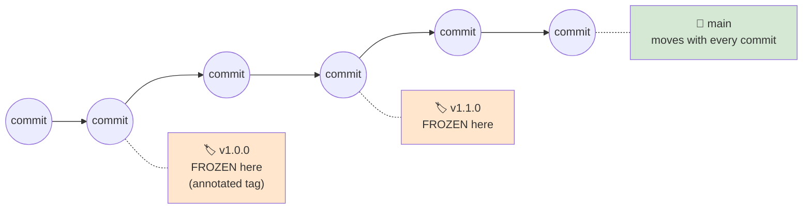
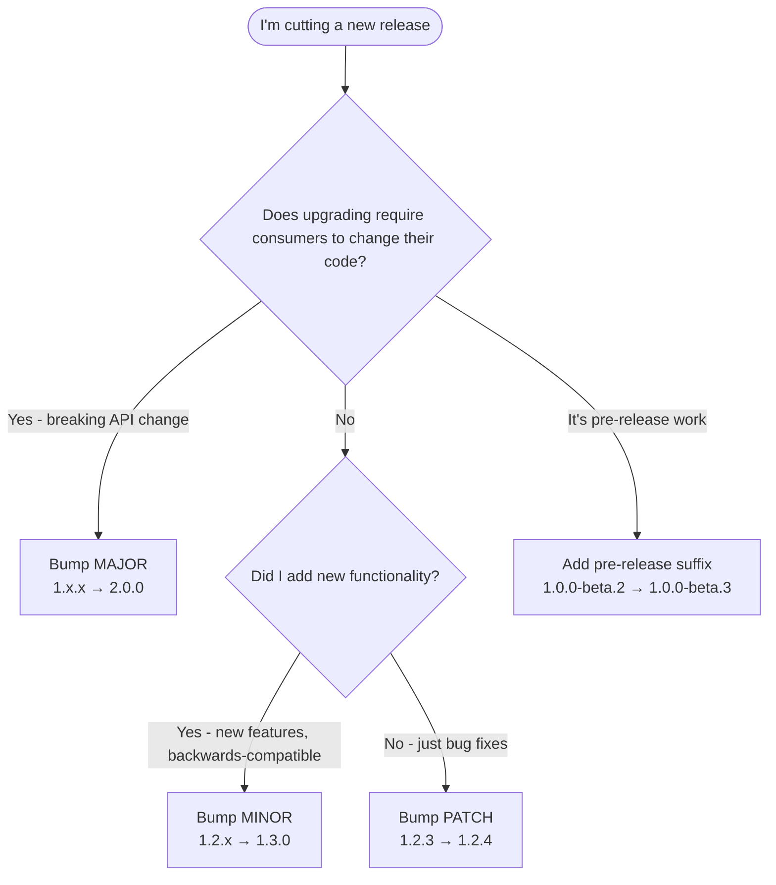
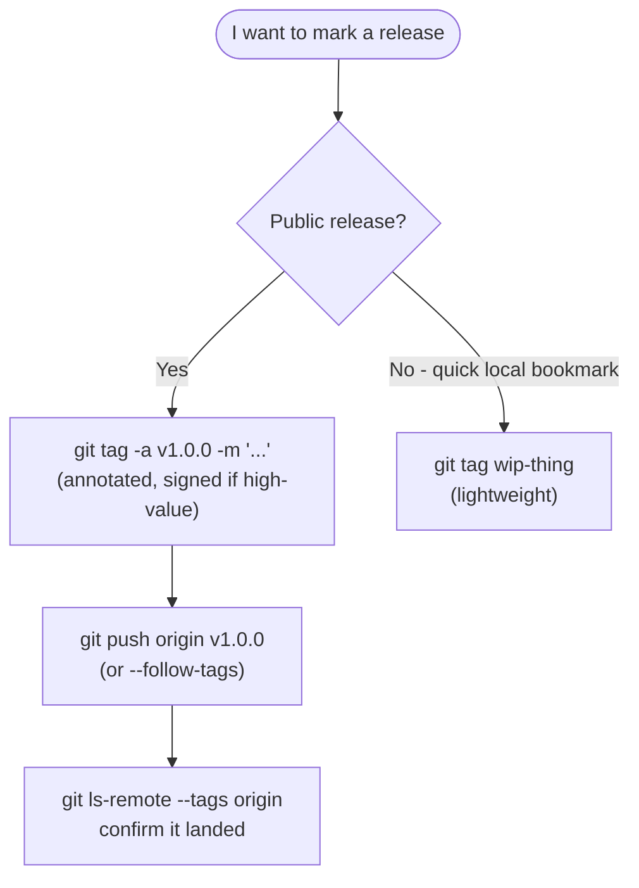

# 🧠 Topic: Git Tags & Semantic Versioning

> [!abstract] Executive Summary (ELI5)
> A **tag** is a **permanent nameplate** nailed to one specific commit — *"this exact commit is version 1.0.0."* Unlike a branch (a sticky note you slide forward with every commit), a tag **doesn't move**: the release is frozen at that snapshot forever. **Semantic Versioning (SemVer)** is the *wording on the nameplate* — a three-number version like `2.14.3` where each position carries a **contract**: bump MAJOR when you break things, MINOR when you add features, PATCH when you only fix bugs. Together they answer the two release questions: *"what code shipped?"* (the tag's commit) and *"how much should consumers brace themselves?"* (the SemVer bump). The combination — an **annotated** tag named `v2.14.3` on the release commit — is the universal Git-release handshake.

> [!note] How this fits with the other Git notes
> This note covers **release marking and versioning**. It assumes [[Git_Rollback]] (you understand commits as immutable snapshots and pointers) and [[Git_Over_SSH]] (you can push to remotes, including tags). It's the natural precursor to a future note on **GitHub Releases** and **CI/CD pipelines that cut releases** — both are built on top of tags. The SemVer half is tool-agnostic: it governs npm packages, Docker images, API versions, and changelogs, not just Git.

---

## 🎯 The "Why"
- **Problem Solved:** Two distinct questions every release must answer unambiguously:
  1. **"Which exact code is this release?"** — Commits have opaque hashes (`a3f2b1c`); humans need names. You need a way to say *"the state of the repo on March 4th, 2026, is what we shipped as 2.14.3"* — and it must **never drift** even as development continues past it.
  2. **"How risky is upgrading?"** — Given two versions, a consumer needs to know *before reading the changelog* whether upgrading is safe, adds features, or breaks them. A naked incrementing number (`build 1047`) tells them nothing; a *structured* number encodes the intent.
- **Git tags solve #1, SemVer solves #2.**
  - A **tag** is an immutable pointer to a commit — a named landmark that doesn't move when you keep committing. It's the difference between *"commit a3f2b1c"* (lookable-up but forgettable) and *"v2.14.3"* (meaningful and stable). Branches can't do this job: `main` points at *today's* tip, not the release.
  - **SemVer** is a versioning *specification* (`semver.org`) that makes the version string self-describing: `MAJOR.MINOR.PATCH`. Each segment is a promise about compatibility, so a consumer can decide to upgrade from the version number alone.
- **Alternatives / neighbors:**
  - **Branches as release markers** — wrong tool. Branches move; every commit slides the pointer. A release needs a frozen point, which is exactly what tags provide.
  - **Calendar versioning (CalVer)** — `2026.03.4` or `26.3`. Used by Ubuntu (`24.04`), PyTorch, Teradata. Better than SemVer when *time* matters more than *API compatibility* (OS releases, rolling apps). Doesn't encode "breaking?" — encodes "when?".
  - **Internal build numbers / commit counts** — `1.0.0+build.1047`. Monotonic and unambiguous but tells consumers nothing about impact. Often used *alongside* SemVer (as build metadata), not instead of it.
  - **Zero-ver / "evergreen"** — no version at all (some webapps). Works only when there's a single deployment you fully control; useless for libraries/CLI tools/APIs.
  - **Git describe** — `v2.14.3-4-ga3f2b1c` ("4 commits after tag v2.14.3, at hash a3f2b1c"). Not a versioning scheme, but the standard way to derive a *human-meaningful* name for any commit between tags. Used everywhere in build pipelines.
- **Trade-offs:**
  - **SemVer** is a *contract*, not a law — it's only as honest as the maintainer. The MAJOR bump is frequently under-used (maintainers call a breaking change a "minor" to avoid the optics of a v2). SemVer is most valuable when consumers can *trust* it; that trust is earned by discipline.
  - **Tags add bookkeeping** — you must remember to cut them, push them (tags don't travel with a normal `git push`!), and keep them consistent across forks/mirrors. The friction is real but small.
  - **Immutability cuts both ways** — once `v1.0.0` is published, you can't quietly retag it; moving a tag is a force-operation that breaks every clone that has it. (See pitfalls.)

## 💡 Mental Model & Analogy
- **Analogy: the surveyor's brass plaque vs. the construction fence.**
  - A **branch** is a **construction fence** — you keep moving it forward as you pour more concrete (commits). It marks *"where work currently is."*
  - A **tag** is a **surveyor's brass plaque** cemented into the ground at one spot — *"the property corner was surveyed HERE on this date."* You don't move plaques; you install new ones. `main` is the fence at today's edge; `v2.14.3` is a plaque frozen at the release.
  - **SemVer** is the **plaque's inscription convention**: the surveyor's office agrees that `MAJOR.MINOR.PATCH` means *"new survey invalidates old maps / adds detail / corrects a typo."* Read the inscription and you know how much your old maps are still good for, without re-walking the property.
- **The tag/branch distinction in one line:** *branches track progress; tags commemorate milestones.* A branch says "as of now"; a tag says "as of then, forever."
- **Why tags are immutable (and branches aren't):** a tag, once shared, is a **public promise** — *"this is what 2.14.3 was."* Reproducible builds, bug reports ("I'm on 2.14.3"), `git bisect`, and dependency resolvers all rely on a tag always resolving to the same commit. If tags drifted like branches, version numbers would be meaningless.



> [!tip] The single most important mental model
> **A tag is to a commit what a brass plaque is to a survey point: a permanent, named landmark that does not move.** This is the entire reason tags exist separately from branches. When something needs a *frozen, named, shareable* snapshot (a release, a "this is the version we audited," a "this is where the bug was introduced"), you reach for a tag — because a branch would drift out from under you. Everything else about tags (annotated vs lightweight, pushing, signing) is operational detail layered on that one idea.

## 🛠️ Core Principles & Code Snippets

### Part A — Git Tags

### 1. Two kinds of tag: lightweight vs annotated
This distinction matters and people mix it up. Git has two tag *types*, and they carry different amounts of information:

| | **Lightweight tag** | **Annotated tag** |
|---|---|---|
| What it is | just a named pointer to a commit (like a branch that never moves) | a **full Git object**: its own message, tagger, date, and (optional) signature |
| Created with | `git tag v1.0` | `git tag -a v1.0 -m "..."` |
| Carries metadata? | ❌ no message, no tagger info | ✅ message, author, date, optional GPG/SSH signature |
| Use case | quick local bookmarks, throwaway marks | **releases and public tags** (the real ones) |
| Recommended for releases? | ❌ | ✅ — always |

```bash
# Annotated (the right choice for releases)
git tag -a v1.0.0 -m "Release 1.0.0: initial public release"
# -a  → annotated (creates a tag object)
# -m  → the tag message (like a commit message)

# Lightweight (just a pointer — fine for personal bookmarks)
git tag v1.0.0

# See the difference:
git show v1.0.0          # annotated → shows tag message, tagger, date, THEN the commit
                         # lightweight → shows just the commit, no extra metadata
```

> [!tip] Rule of thumb: annotated for anything shared
> The Git docs themselves recommend **annotated tags for releases** — they carry the message ("Release 1.0.0"), the tagger's identity, the date, and can be **cryptographically signed** to prove the release came from you. Lightweight tags are fine as throwaway local bookmarks, but for anything you intend to push and publish, use `-a`. The cost is four extra keystrokes; the benefit is a real auditable release object.

### 2. Creating, listing, and inspecting tags
```bash
# Tag the current HEAD
git tag -a v1.2.0 -m "Release 1.2.0"

# Tag a SPECIFIC past commit (retroactive tagging — common when you forgot)
git tag -a v1.0.0 a3f2b1c -m "Release 1.0.0 (backdated)"

# List all tags (alphabetical, which is NOT semver-correct ordering!)
git tag
git tag -l "v1.*"          # filter with a glob

# List tags in SEMVER order (alphabetical gets 1.10.0 before 1.2.0 — wrong!)
git tag -l --sort=-v:refname   # -v:refname = version-aware sort, - = descending

# Inspect a tag in full
git show v1.2.0            # tag metadata + the commit it points to
git cat-file -t v1.2.0     # "tag" (annotated) vs "commit" (lightweight) — tells you which kind
```

> [!warning] `git tag` lists alphabetically, not semverically
> Plain `git tag` prints tags sorted as **strings**, so `v1.10.0` appears *before* `v1.2.0` — wrong if you're hunting for the latest. Use `git tag --sort=-v:refname` for version-aware (descending) ordering. This bites people who eyeball the list to find "the newest release."

### 3. Pushing tags — the #1 gotcha
**`git push` does not push tags.** Tags are separate from branch refs; a normal push ships commits and branch pointers, not tags. Forgetting this is the most common tag mistake — you tag locally, assume it's published, and the release never lands.

```bash
# Push ONE specific tag
git push origin v1.2.0

# Push ALL tags at once
git push origin --tags

# Push commits AND tags together (annotated tags reach the remote on push)
git push origin main --follow-tags

# Check what tags exist locally vs remote
git ls-remote --tags origin   # tags the remote has
git tag                       # tags you have locally
```

- **`--follow-tags`** is the disciplined default: it pushes only **annotated** tags reachable from the commits you're pushing. Add it once globally and never think about it again:
  ```bash
  git config --global push.followTags true
  ```

> [!tip] Why tags are opt-in to push
> Git treats tags as a separate namespace from branches because they serve a different purpose (commemoration, not progress). Auto-pushing every local tag — including your throwaway `wip-fix` bookmarks — would clutter the remote. The trade-off: you must be **deliberate** about publishing release tags. If your CI "didn't trigger on the release," check whether the tag actually got pushed (`git ls-remote --tags origin | grep v1.2.0`) — usually it didn't.

### 4. Checking out a tag → detached HEAD
Tags point at a historical commit. Checking one out puts you exactly there — but since you're not on a branch, HEAD is "detached."

```bash
git checkout v1.2.0           # or: git switch --detach v1.2.0
# → "You are in 'detached HEAD' state at commit ..."

# If you want to WORK from a tag (bugfix a release), make a branch first:
git checkout -b hotfix-1.2.1 v1.2.0   # branch from the tag, then commit on the branch
```

> [!warning] Committing in detached HEAD orphans your work
> In detached HEAD, any commits you make aren't on any branch — they're only reachable via the reflog. When you check out a branch, those commits become unreachable and eventually get garbage-collected (~90 days). **Never commit directly off a tag.** If you need to patch a release, branch from the tag first (`git checkout -b release-1.2.x v1.2.0`), commit on the branch, then tag the new release from that branch.

### 5. Deleting and moving tags (rare, and a bit sharp-edged)
Because tags are meant to be permanent, deleting/retagging is deliberately awkward and, on a remote, requires force.

```bash
# Delete a LOCAL tag
git tag -d v1.2.0

# Delete a REMOTE tag (yes, the colon syntax — like deleting a remote branch)
git push origin --delete v1.2.0
# or equivalently:  git push origin :refs/tags/v1.2.0

# MOVE a local tag to a different commit (force-tag)
git tag -f -a v1.2.0 <new-commit> -m "..."   # -f forces over the existing tag
git push origin v1.2.0 --force               # and force-push to remote
```

> [!danger] Moving or deleting a shared tag is a force operation — treat it like rewriting history
> Once a tag is published, other clones and mirrors (GitHub, forks, package registries, CI caches) have it. Force-moving `v1.2.0` to a different commit means **everyone's `v1.2.0` is now stale** until they refetch. Worse: a published release tag may have been consumed by a package manager or pinned in a `package-lock.json` — retagging it is effectively redefining "what v1.2.0 was" after the fact. The safe rule: **never move a published tag.** If the release was wrong, cut a new version (`v1.2.1`) instead. Reserve tag-moving for tags you pushed in the last 30 seconds and nobody else has.

### 6. Signed tags — proving release provenance
An annotated tag can be **cryptographically signed** (GPG or, since recent Git, an SSH key). A signed tag lets consumers *verify the release came from you*, not a compromised maintainer account or a mirrored repo.

```bash
git tag -s v1.2.0 -m "Release 1.2.0"        # -s = GPG-sign
git tag -s v1.2.0 -m "Release 1.2.0"        # configure with: git config user.signingkey <keyid>

# Verify a signed tag
git tag -v v1.2.0                            # -v = verify signature
```

- This is the **release-side analog** of signed *commits* (see [[Git_Over_SSH]] §alternatives — signing keys vs auth keys are the same crypto family, different purpose). A signed tag proves *this release*, not just *this commit*.
- GitHub shows a "Verified" badge on signed tags/releases. High-value projects (the Linux kernel, Git itself, Kubernetes) sign every release tag.

### Part B — Semantic Versioning

### 7. The SemVer string: `MAJOR.MINOR.PATCH`
SemVer (`semver.org`, v2.0.0) is a specification that turns a version number into a **compatibility contract**. The string has three mandatory segments, each with a strict meaning:

```
   MAJOR . MINOR . PATCH
     2   .  14  .  3
```

| Segment | Bumped when… | Consumer impact |
|---|---|---|
| **MAJOR** (`2`) | you make **incompatible / breaking API changes** | **breaking** — consumers may need code changes to upgrade |
| **MINOR** (`14`) | you add **functionality** in a backwards-compatible way | **safe** — new features, old code keeps working |
| **PATCH** (`3`) | you make **backwards-compatible bug fixes** | **safe** — just fixes, nothing new |

- **The promise:** given `1.4.2 → 1.5.0`, a consumer knows it's safe to upgrade (MINOR bump = added features, no breaks). Given `1.5.0 → 2.0.0`, they know to read the migration guide (MAJOR = breaks). The whole point of SemVer is that the *number itself* communicates risk without reading the changelog.
- **Start at `0.y.z`** for initial development. The spec says: anything `0.x` makes **no stability promises** — a MINOR bump *may* be breaking. Only `1.0.0` and above commits to the contract above. (See pitfall: people expect 0.x stability too early.)

### 8. Pre-release and build metadata (the optional suffixes)
Two optional segments extend the core version — and they change precedence in specific ways:

```
1.0.0-alpha.1+20260304      full form: core + pre-release + build metadata
```

- **Pre-release** (after a `-`, dot-separated identifiers): `1.0.0-alpha`, `2.0.0-rc.1`, `3.1.0-beta.2`.
  - Marks a version that is **not yet stable** — typically lower precedence than the eventual `1.0.0`.
  - Identifiers are alphanumeric or numeric; compared per-identifier (numeric ones compared as integers, alphanumeric lexically, numeric < alphanumeric).
- **Build metadata** (after a `+`): `1.0.0+20260304`, `2.0.0+exp.sha.5114f85`.
  - **NEVER affects precedence.** Two versions differing only in build metadata are considered equal precedence. It's purely informational (build number, commit hash, timestamp).

```bash
# Valid pre-release versions, in ascending precedence:
#  1.0.0-alpha        <  1.0.0-alpha.1   <  1.0.0-alpha.beta
#  <  1.0.0-beta      <  1.0.0-beta.2    <  1.0.0-beta.11
#  <  1.0.0-rc.1      <  1.0.0
```

> [!warning] Pre-release versions have LOWER precedence than the release
> This trips everyone: `1.0.0-beta` is **less than** `1.0.0`, not greater. A pre-release is "a draft of 1.0.0," so it sorts *before* the finished 1.0.0. The practical consequence: `npm install pkg@1.0.0` will NOT install `1.0.0-beta` — and `^1.0.0` ranges exclude pre-releases unless you explicitly opt in. If your CI installs "the latest 1.x" and silently skips your beta, this is why.

### 9. Precedence rules (how versions compare)
Precedence is computed by comparing MAJOR, then MINOR, then PATCH, then pre-release identifiers in order. Build metadata is ignored. The rules in brief:
1. Major/minor/patch compared numerically: `2.0.0 > 1.9.9`.
2. A version *without* pre-release has **higher** precedence than one *with*: `1.0.0 > 1.0.0-anything`.
3. Pre-release identifiers compared left to right; numeric < non-numeric; more fields > fewer (if all preceding equal): `1.0.0-alpha.1 > 1.0.0-alpha`.

### 10. The `v` prefix convention (`v1.0.0` vs `1.0.0`)
SemVer itself says the version is `1.0.0` (no `v`). But the overwhelming Git/GitHub convention is to **name tags `v1.0.0`** (lowercase `v`). Reconciling the two:
- The **tag name** is `v1.0.0` (the `v` is a Git-tag convention, makes `git describe` output read nicely and sorts cleanly).
- The **package version** (in `package.json`, the SemVer field) is `1.0.0` — no `v`.
- Be **consistent within a project**. Mixing `v1.0.0` and `1.1.0` tags breaks tooling that strips/preserves the prefix inconsistently. Pick one; document it.

### 11. Version ranges (`^` and `~`) — how SemVer powers dependency resolution
SemVer's contract is what makes **ranges** safe. Package managers (`npm`, `cargo`, etc.) let you depend on "anything compatible," and SemVer defines what "compatible" means:

```jsonc
// package.json dependencies
"lodash": "^4.17.21"   // caret: allows MINOR + PATCH changes, NOT MAJOR
                       //   → >=4.17.21  <5.0.0   (safe: no breaking changes expected)
"express": "~4.18.0"   // tilde: allows PATCH only
                       //   → >=4.18.0   <4.19.0  (only bugfixes)
```

| Range | Means | Expands to |
|---|---|---|
| `^1.2.3` | "compatible with 1.2.3" | `>=1.2.3  <2.0.0` |
| `^0.2.3` | special 0.x case | `>=0.2.3  <0.3.0` (0.x has no stability, so caret is narrower) |
| `^0.0.3` | special 0.0.x case | `>=0.0.3  <0.0.4` |
| `~1.2.3` | "patch-level fixes" | `>=1.2.3  <1.3.0` |
| `1.2.3`  | exact pin | `=1.2.3` |

- **The whole point of SemVer for library authors:** if you discipline your bumps, `^` ranges "just work" — consumers auto-get your bugfixes and features without breaking. **Break your own contract** (ship a breaking change as a MINOR bump) and you'll silently break every downstream `^` consumer. SemVer's value is entirely a function of the maintainer's honesty.

## 🧭 Decision Flowcharts

**Which version to bump (SemVer):**


**Which tag operation:**


## ⚠️ Pitfalls & Anti-patterns
- **Common Mistakes:**
  - **Tagging locally and forgetting to push.** Tags don't travel with `git push`. The single most common release mistake. Use `git push origin <tag>` or set `push.followTags true` globally.
  - **Using lightweight tags for releases.** Loses the message, tagger, date, and the ability to sign. Always `-a` for public releases — the metadata *is* the release record.
  - **Expecting `git tag` output to be SemVer-ordered.** It's alphabetical — `v1.10.0` before `v1.2.0`. Use `--sort=-v:refname` when "latest" matters.
  - **Committing in detached HEAD after `git checkout v1.x`.** Orphans your commits. Branch first (`git checkout -b release-x v1.x`) if you intend to patch the release.
  - **Moving or deleting a published tag.** Breaks every clone, fork, and cache that has it. Publish a new version (`1.2.1`) instead of rewriting `1.2.0`. Treat tag-mutation with the same gravity as history rewriting (see [[Git_Rollback]] §5).
  - **Shipping a breaking change as a MINOR bump.** Silently breaks every `^1.x` consumer. This is the cardinal SemVer sin; it erodes the trust that makes `^` ranges work. If in doubt, bump MAJOR.
  - **Expecting `0.x` stability.** Per spec, `0.y.z` makes **no** compatibility promises — a 0.x MINOR bump may be breaking. Don't publish a library at `0.x` and then complain when consumers pin exact versions; either reach `1.0.0` (commit to the contract) or clearly document the 0.x churn.
  - **Assuming `1.0.0-beta > 1.0.0`.** Wrong — pre-release sorts **before** the release. "Install latest 1.x" silently skips betas. If you want betas, opt in explicitly (`pkg@1.0.0-beta`, or a flag).
  - **Inconsistent `v` prefix.** Tagging `v1.0.0` then `1.1.0` confuses tooling. Pick a convention and stick to it (the `v`-prefix is the GitHub norm).
  - **Treating build metadata (`+...`) as affecting precedence.** It doesn't — `1.0.0+a` and `1.0.0+b` are equal precedence. Don't try to "version" via build metadata; bump a real segment.
- **When NOT to use SemVer:**
  - **OS releases, distribution names, time-based products** — use **CalVer** (`24.04`, `2026.03`). "When was this released?" matters more than "is the API compatible?" Ubuntu, PyTorch, Unity use CalVer for this reason.
  - **A single deployed app with no public API** (a SaaS frontend) — versioning adds bookkeeping without consumer benefit; an internal build number or commit hash suffices.
  - **Pre-1.0 experimental libraries where *everything* breaks constantly** — SemVer's contract is meaningless until the API stabilizes; consider staying at `0.x` honestly rather than fake-stabilizing at `1.0`.
- **Security / supply-chain considerations:**
  - **Signed tags** prove release provenance — a compromised maintainer account can push commits, but can't forge your signing key. Sign release tags for anything high-value (see §6).
  - **Don't move tags to inject malicious code into a "known" version.** This is a real supply-chain attack vector ("retag `1.2.0` with malicious code, consumers who pinned `1.2.0` get pwned"). Branch protection that blocks force-pushes to tags mitigates this on GitHub.
  - **Pin dependencies by exact version + lockfile** in security-sensitive contexts. `^` ranges trust the upstream's SemVer discipline; a lockfile freezes the exact resolved commit.

## 🔗 Deep Connections
- **Parent Topic:** Git fundamentals — refs (branches vs tags as the two ref kinds), commits as immutable snapshots.
- **Related Concepts:** [[Git_Rollback]] (tags are the *stable* counterpart to branch movement; signed tags relate to the leak/signing themes), [[Git_Over_SSH]] (SSH signing keys can sign tags), GitHub Releases (built on top of tags), `git describe` / `git bisect` (tag-aware tooling), **CalVer** (the time-based alternative), dependency ranges & lockfiles (npm `^`/`~`, cargo, pip — all powered by SemVer).
- **Prerequisites:** comfort with commits and branches, the push/pull lifecycle, and the idea of a "release" as a deliberate frozen milestone.

## ❓ Active Recall Questions
> [!faq]- What's the fundamental difference between a branch and a tag, and why do tags exist as a separate concept instead of "just using a branch named v1.0.0"?
> A **branch** is a pointer that **moves forward** with every commit — it tracks *current progress*. A **tag** is a pointer that **does not move** — it commemorates *a specific milestone forever*. Tags exist separately because releases need a **frozen, named, immutable** snapshot: "v1.0.0 must always resolve to this exact commit." If you used a branch, the next commit would slide it forward and "v1.0.0" would silently drift. Reproducible builds, bug reports, and dependency pinning all depend on a tag's immutability — that's why it can't just be a branch.

> [!faq]- Compare lightweight and annotated tags. Which should you use for a public release, and why?
> A **lightweight** tag is just a named pointer to a commit — no metadata. An **annotated** tag (`git tag -a`) is a full Git *object* with its own message, tagger, date, and optional GPG/SSH signature. Use **annotated** for public releases: the message ("Release 1.0.0"), the tagger identity, the timestamp, and especially the **signature** form an auditable release record, and `git show` displays them. Lightweight tags are fine for throwaway local bookmarks. The cost difference is `-a -m`, the benefit is a real release artifact.

> [!faq]- You tag a release locally with `git tag -a v1.2.0`, then tell your team "v1.2.0 is out." It isn't on GitHub. What did you forget, and why doesn't `git push` handle it?
> Tags are a **separate namespace** from branches, and `git push` only ships commits and branch pointers — **not tags**. Git made tags opt-in to push so that throwaway local bookmarks don't clutter the remote. You need `git push origin v1.2.0` (or `--tags` for all, or set `push.followTags true` globally so annotated tags ride along automatically). Always verify with `git ls-remote --tags origin` after a release.

> [!faq]- You ship a change that renames a public function `getData()` to `fetchData()`. Old code calling `getData()` breaks. Which SemVer segment do you bump, and what does bumping a smaller segment instead do to your consumers?
> Bump **MAJOR** (e.g., `1.4.2 → 2.0.0`) — it's a breaking/incompatible API change. If you bumped MINOR instead (`1.5.0`), every consumer with `"yours": "^1.4.2"` would **auto-upgrade** (caret allows MINOR bumps) and silently break, because they trusted MINOR to mean "backwards-compatible." Shipping a breaking change as MINOR is the cardinal SemVer sin: it weaponizes the trust that makes `^` ranges work against your own users.

> [!faq]- Is `1.0.0-beta.2` higher or lower precedence than `1.0.0`? What practical consequence does this have for `npm install yourpkg@^1.0.0`?
> **Lower** — a pre-release version always sorts *before* its corresponding release (it's "a draft of 1.0.0"). The consequence: `^1.0.0` and `npm install yourpkg@1.0.0` will **silently skip the beta** and only resolve to the stable `1.0.0`. If a user wants the beta they must ask for it explicitly (`yourpkg@1.0.0-beta.2`). Don't be surprised when "latest" ignores your pre-releases — that's the spec working as designed.

> [!faq]- You `git checkout v1.2.0` to look at a release, make a commit, then switch back to `main`. What happened to your commit, and what should you have done instead?
> You're in **detached HEAD**, so your commit isn't on any branch — it's only reachable via the reflog and will be **garbage-collected in ~90 days** (and invisible the moment you check out `main`). What you should have done if you intended to *patch the release*: branch from the tag first — `git checkout -b release-1.2.x v1.2.0` — commit on that branch, then cut a new tag (`v1.2.1`) from it. Never commit directly off a tag.

> [!faq]- A published release tag `v1.2.0` points at the wrong commit. A teammate suggests moving it with `git tag -f`. Why is this dangerous, and what should you do instead?
> Moving a published tag is a **force operation** that desyncs every clone, fork, mirror, and cache that has `v1.2.0` — they'll all keep the old commit until they refetch, and consumers who pinned `1.2.0` (or a lockfile that resolved it) are now looking at a different "1.2.0." Worse, retagging is a known **supply-chain attack** vector (retag with malicious code; pinned consumers get pwned). The safe rule: **never move a published tag.** Cut a new version (`v1.2.1`) instead. Reserve tag-moving for tags pushed in the last few seconds that nobody else has.

> [!faq]- What does `git describe` produce, and why is it useful in build pipelines?
> `git describe` outputs the nearest reachable tag plus a commit count and hash, e.g. `v1.2.0-4-ga3f2b1c` = "4 commits after tag v1.2.0, at commit a3f2b1c." It's the standard way to give **any** commit (not just tagged releases) a human-meaningful, monotonic name — perfect for embedding a version string into a build artifact, a Docker image tag, or a `--version` flag. It bridges the gap between sparse release tags and the continuous commit history.

> [!faq]- Why is `0.y.z` special in SemVer, and what's the honest thing to do if your library is still churning its API?
> Per spec, `0.y.z` is for **initial development** and makes **no compatibility promises** — even a MINOR bump may be breaking (there's no "1.0 contract" yet). The honest thing, if your API is unstable, is to **stay at `0.x`** and document that consumers should expect churn, rather than publishing `1.0.0` and pretending to a stability you can't keep. Reaching `1.0.0` is a *commitment* to the SemVer contract — the public API is settled and breaking changes require MAJOR bumps. Don't fake-stabilize at 1.0 just because it "looks mature."

> [!faq]- You depend on `"express": "^4.18.0"`. Express releases `4.19.0` and then `5.0.0`. Which will your `npm install` pick up automatically, and why does this "just work"?
> It picks up **`4.19.0`** but NOT `5.0.0`. The caret (`^`) allows MINOR and PATCH changes but refuses MAJOR, so it expands to `>=4.18.0 <5.0.0`. This "just works" *because of SemVer discipline*: MINOR promises backwards compatibility, so auto-upgrading within 4.x is safe; MAJOR (`5.0.0`) promises breaking changes, so it's deliberately excluded until you opt in. The entire mechanism is a bet on Express honoring its SemVer contract — if they shipped a break as `4.20.0`, every `^4` consumer would silently break.

---
## 📝 How to use this template effectively
1. **Never Copy-Paste:** If you find yourself copying documentation, stop. Read, close the tab, and write it from memory.
2. **Iterate:** Fill the 'ELI5' and 'Analogy' first. If you can't explain it simply, you don't understand it yet.
3. **The "Why" is King:** Seniority is defined by knowing *when* and *why* to use a tool, not just *how*.
4. **Update the Status:** `status` tracks the *work* lifecycle (`analyzing` → `experimenting` → `implemented` → `archived`). Separately, `mastery` tracks your *learning* progress: `beginner` → `growing` → `mastered`. Bump `mastery` as you apply this in real projects.
