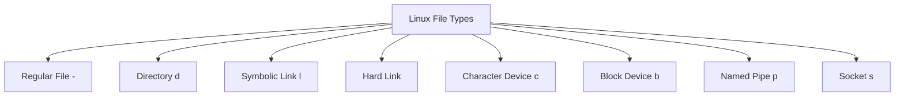

# 🧠 Topic: File Types

> [!abstract] Executive Summary (ELI5)
> In Linux, "everything is a file" includes more than just text documents. The filesystem treats directories, links, devices, and even communication channels as files, each with its own purpose and behavior.

---

## 🎯 The "Why"
- **Problem Solved:** Linux unifies many different resources under a single file abstraction. Knowing the file type tells you how to interact with it, what permissions mean, and whether it holds data, points to data, or represents hardware.
- **Alternatives:** Windows separates devices, files, and registry entries; macOS also uses Unix file types but hides some of them from casual users.
- **Trade-offs:** The unified abstraction makes scripting powerful, but it can be confusing when a "file" is actually a device or a pipe. You must inspect the type before making assumptions.

## 💡 Mental Model & Analogy
- **Analogy:** A Linux filesystem is like a post office. Regular files are letters, directories are sorting shelves, links are forwarding addresses, devices are the loading dock and mail trucks, pipes are temporary chutes between departments, and sockets are phone lines between post offices.
- **Visual/Diagram:**



## 🛠️ Core Principles & Code Snippets

### 1. Regular files (`-`)
- Contain actual data: text, images, binaries, configuration, logs.
- Most files you interact with are regular files.

```bash
ls -l file.txt
# -rw-r--r-- 1 alice alice 123 Jul 2 10:00 file.txt
# The first character '-' means regular file.

file /bin/ls
# /bin/ls: ELF 64-bit LSB pie executable
```

### 2. Directories (`d`)
- A special file that contains a list of filenames and their inode numbers.
- You can read, write, and execute a directory depending on permissions.
- Read lets you list entries; write lets you add/remove entries; execute lets you access contents.

```bash
ls -ld /etc
# drwxr-xr-x 1 root root 4096 Jul 2 09:00 /etc

mkdir mydir
ls -ld mydir
# drwxr-xr-x 2 alice alice 4096 Jul 2 10:00 mydir
```

### 3. Symbolic links (`l`)
- A pointer to another file or directory path.
- Can cross filesystems and point to directories.
- If the target is deleted, the link becomes broken.

```bash
ln -s /var/log logs
ls -l logs
# lrwxrwxrwx 1 alice alice 8 Jul 2 10:00 logs -> /var/log

readlink logs
# /var/log
```

### 4. Hard links
- Multiple directory entries that point to the same inode.
- Share the same underlying data and metadata.
- Cannot cross filesystems or point to directories.

```bash
ln file.txt hardlink.txt
ls -li file.txt hardlink.txt
# 123456 -rw-r--r-- 2 alice alice 123 Jul 2 10:00 file.txt
# 123456 -rw-r--r-- 2 alice alice 123 Jul 2 10:00 hardlink.txt
# Same inode number, link count is 2.
```

### 5. Character devices (`c`)
- Represent devices that transmit data one character at a time.
- Examples: `/dev/null`, `/dev/random`, `/dev/tty`.

```bash
ls -l /dev/null /dev/random
# crw-rw-rw- 1 root root 1, 3 Jul 2 10:00 /dev/null
# crw-rw-rw- 1 root root 1, 8 Jul 2 10:00 /dev/random
```

### 6. Block devices (`b`)
- Represent devices that read and write data in blocks.
- Examples: `/dev/sda`, `/dev/nvme0n1`, disk partitions.

```bash
ls -l /dev/sda
# brw-rw---- 1 root disk 8, 0 Jul 2 10:00 /dev/sda
```

### 7. Named pipes (`p`)
- Also called FIFOs.
- Allow two unrelated processes to communicate by reading and writing through a named file.
- Data flows in one direction, and the pipe blocks until a reader or writer connects.

```bash
mkfifo mypipe
ls -l mypipe
# prw-r--r-- 1 alice alice 0 Jul 2 10:00 mypipe

# In one terminal
cat > mypipe
# In another terminal
cat mypipe
```

### 8. Sockets (`s`)
- Enable inter-process communication, usually between processes on the same machine.
- Common for databases, systemd, and container runtimes.
- Unix domain sockets are filesystem paths; network sockets are not filesystem objects.

```bash
ls -l /var/run/docker.sock
# srw-rw---- 1 root docker 0 Jul 2 10:00 /var/run/docker.sock
```

### Inspecting file types

```bash
ls -l file      # Look at first character in permissions
file file       # Determine file content type
stat file       # Detailed inode and metadata
stat -c '%F' file   # Print file type in human form
```

> [!tip] Implementation Note
> Always check the first character of `ls -l` output before running destructive commands. A symbolic link that looks like a regular file can behave differently when moved, copied, or backed up.

## ⚠️ Pitfalls & Anti-patterns
- **Common Mistakes:**
  - Treating all files as regular files and copying devices or sockets with `cp -r`.
  - Not realizing that deleting a symbolic link does not delete the target.
  - Using `rm -rf` on a directory that contains hard links and expecting the data to be freed immediately.
- **When NOT to use:**
  - Named pipes are not databases; do not use them for durable storage.
  - Hard links should not be used across filesystems; they are bound to one inode table.
- **Performance/Security considerations:**
  - Symbolic links can be exploited to redirect file access. Be cautious of symlink attacks in `/tmp`.
  - World-writable directories plus predictable device names are risky.
  - Block devices bypass the filesystem cache; misuse can corrupt data.

## 🔗 Deep Connections
- **Parent Topic:** [[Linux Operating System]]
- **Related Concepts:** [[Linux_Important_Directories]], [[Linux_Permissions]], [[Linux_Commands]], [[Process_Management]], [[Unix_Like_Kernel]]
- **Prerequisites:** Basic command line usage, understanding of files and directories, familiarity with `ls` and `stat`.

## ❓ Active Recall Questions
> [!faq]- What is the difference between a hard link and a symbolic link?
> A hard link points to the same inode as the original file, sharing data and metadata. A symbolic link is a separate file that contains a path to another file. Hard links cannot cross filesystems or point to directories; symbolic links can.

> [!faq]- How can you quickly tell a file type from `ls -l` output?
> The first character of the permission string indicates the type: `-` for regular, `d` for directory, `l` for symbolic link, `c` for character device, `b` for block device, `p` for named pipe, `s` for socket.

> [!faq]- Why does a directory need execute permission?
> Execute permission on a directory allows you to access its contents. Without it, you cannot open files inside the directory even if you have read permission on the directory itself.

> [!faq]- What happens if you delete the target of a symbolic link?
> The symbolic link becomes a dangling link. It still exists but points to a non-existent path, and any operation on it fails until the target is restored or the link is updated.

---

## 📝 How to use this template effectively
1. **Never Copy-Paste:** If you find yourself copying documentation, stop. Read, close the tab, and write it from memory.
2. **Iterate:** Fill the 'ELI5' and 'Analogy' first. If you can't explain it simply, you don't understand it yet.
3. **The "Why" is King:** Seniority is defined by knowing *when* and *why* to use a tool, not just *how*.
4. **Update the Status:** Move from `analyzing` -> `implemented` -> `mastered` as you apply this in real projects.
