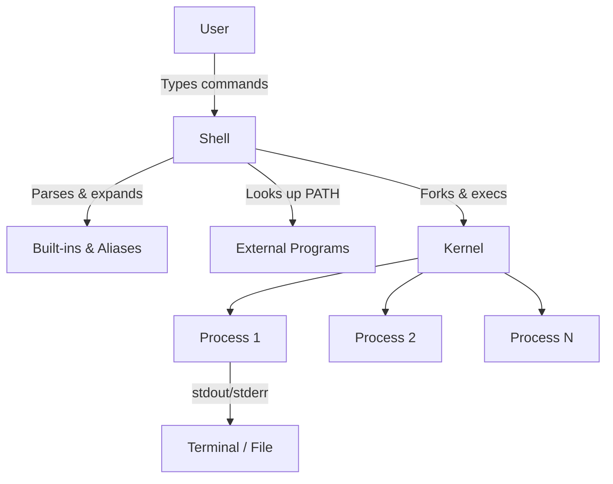

# 🧠 Topic: Linux Shell

> [!abstract] Executive Summary (ELI5)
> The Linux shell is a text-based translator between you and the kernel. Instead of talking to hardware directly, you type commands in a way humans understand, and the shell translates those commands into instructions for the kernel.

---

## 🎯 The "Why"
- **Problem Solved:** The kernel only understands low-level system calls. Humans need a higher-level, repeatable way to start programs, manage files, automate tasks, and chain operations together. The shell provides that interface.
- **Alternatives:** Graphical desktop environments, application-specific GUIs, programming language runtimes (Python, Perl), configuration management tools (Ansible, Puppet).
- **Trade-offs:** Shell scripts are fast to write and highly portable, but they can become hard to maintain for complex logic. For heavy computation, error handling, or large applications, a general-purpose language is usually a better fit.

## 💡 Mental Model & Analogy
- **Analogy:** The shell is like a waiter in a restaurant. You (the user) order in plain language (`ls`, `cat`, `docker run`). The waiter (shell) translates your order into instructions for the kitchen (kernel), brings back the result, and handles the details of plates, timing, and cleanup.
- **Visual/Diagram:**



## 🛠️ Core Principles & Code Snippets

1. **Shell is a program, not part of the kernel.** Popular examples: `bash`, `zsh`, `fish`, `dash`. The kernel starts the shell as the first user-space process after login.

2. **Commands fall into three buckets:**
   - **Built-ins** — executed directly by the shell (`cd`, `echo`, `export`, `alias`).
   - **External programs** — loaded from disk via `PATH` (`ls`, `cat`, `grep`, `docker`).
   - **Functions** — user-defined reusable blocks inside the shell.

3. **The shell glues programs together.** Pipes (`|`), redirections (`>`, `<`, `>>`), and command substitution (`$()`) let small tools compose into powerful workflows.

4. **Environment variables shape behavior.** `PATH`, `HOME`, `USER`, `LANG`, and custom variables control where programs are found and how they run.

```bash
# Which shell am I running?
echo $SHELL

# Inspect the search path
printf '%s\n' "$PATH" | tr ':' '\n'

# Chain small tools: find large log files, sort them, show top 5
du -h /var/log/* 2>/dev/null | sort -rh | head -n 5

# Run a command in a modified environment
LANG=C LC_ALL=C date
```

> [!tip] Implementation Note
> Prefer absolute paths and explicit variables in scripts (`/usr/bin/python3` instead of `python3`). It makes automation predictable across machines and users.

## ⚠️ Pitfalls & Anti-patterns
- **Common Mistakes:**
  - Treating shell as a general-purpose programming language for complex logic.
  - Forgetting to quote variables (`$var` vs `"$var"`), leading to word-splitting and glob surprises.
  - Using `cd` in a script without checking whether the directory exists.
- **When NOT to use:** For APIs, data processing at scale, or multi-threaded work, reach for Python, Go, or a dedicated tool instead of shell.
- **Performance/Security considerations:**
  - Shell scripts run with the privileges of the invoking user. Avoid `curl | bash` and untrusted `eval`.
  - `.bashrc`, `.profile`, and shell history can leak secrets or environment state.
  - Long-running shell scripts may accumulate subshells and file descriptors if not cleaned up.

## 🔗 Deep Connections
- **Parent Topic:** [[Linux Operating System]]
- **Related Concepts:** [[Unix_Like_Kernel]], [[Linux File System]], [[Process Management]], [[Bash Scripting]], [[Environment Variables]]
- **Prerequisites:** Basic command line navigation, understanding of files and processes, familiarity with text editors.

## ❓ Active Recall Questions
> [!faq]- What is the difference between the shell and the kernel?
> The kernel is the privileged core that manages hardware and processes. The shell is a user-space program that reads your commands, interprets them, and asks the kernel to execute programs on your behalf.

> [!faq]- Why does the shell need a `PATH` variable?
> `PATH` tells the shell which directories to search when you type an external command without an absolute path. Without it, the shell would not know where to find `ls`, `cat`, or custom binaries.

> [!faq]- When should you stop writing a shell script and switch to a real programming language?
> When you need complex data structures, robust error handling, extensive testing, network calls, or cross-platform portability beyond what POSIX shell or bash can cleanly express.

---

## 📝 How to use this template effectively
1. **Never Copy-Paste:** If you find yourself copying documentation, stop. Read, close the tab, and write it from memory.
2. **Iterate:** Fill the 'ELI5' and 'Analogy' first. If you can't explain it simply, you don't understand it yet.
3. **The "Why" is King:** Seniority is defined by knowing *when* and *why* to use a tool, not just *how*.
4. **Update the Status:** Move from `analyzing` -> `implemented` -> `mastered` as you apply this in real projects.
