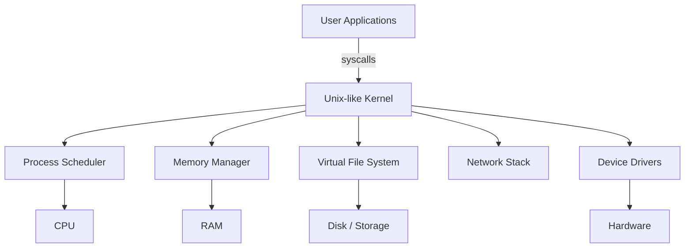

# 🧠 Topic: Unix-like Kernel

> [!abstract] Executive Summary (ELI5)
> A Unix-like kernel is the core of an operating system that acts like a traffic controller between your programs and the computer's hardware. It decides who gets CPU time, memory, and disk access, while making everything look like files you can read, write, and protect with permissions.

---

## 🎯 The "Why"
- **Problem Solved:** Hardware is messy and dangerous — every program cannot directly touch the CPU, memory, disk, or network. The kernel provides a safe, consistent interface so multiple programs and users can share the same machine without stepping on each other.
- **Alternatives:** Windows NT kernel (different design philosophy), real-time kernels (e.g., QNX, VxWorks), microkernels (e.g., seL4, GNU Hurd), unikernels.
- **Trade-offs:** Unix-like kernels prioritize portability, stability, and a rich ecosystem over minimalism or hard real-time guarantees. They are not the leanest option, but they are battle-tested, well-documented, and supported by massive tooling.

## 💡 Mental Model & Analogy
- **Analogy:** A Unix-like kernel is like a hotel manager. Guests (processes) check in, get a room (memory), use shared facilities (CPU, disk, network), and follow house rules (permissions). The manager enforces who can go where and resolves conflicts without letting guests barge into the kitchen or each other's rooms.
- **Visual/Diagram:**



## 🛠️ Core Principles & Code Snippets

1. **Everything is a file.** Disks, keyboards, network sockets, and running processes are exposed through a unified file abstraction. This lets admins use the same tools (`cat`, `grep`, `chmod`) across wildly different resources.

2. **Processes, not programs.** The kernel schedules processes — independent units of execution. It isolates them with separate address spaces and privileges.

3. **Privileges and permissions.** Users and groups control access. The kernel enforces read/write/execute permissions and special bits like `setuid`.

4. **System calls are the boundary.** User space cannot access hardware directly. It asks the kernel via syscalls such as `open()`, `read()`, `fork()`, `exec()`, and `mmap()`.

5. **Multi-user and multi-tasking from the start.** Unix was designed for many users sharing one machine, so isolation and resource sharing are baked into the design.

```bash
# Inspect the running kernel and loaded modules
uname -a
lsmod

# A process making syscalls is visible with strace
strace -c ls /tmp
```

> [!tip] Implementation Note
> When debugging Linux in DevOps, treat "the kernel did this" as the default hypothesis for permission denials, OOM kills, and network routing issues. Always check `dmesg`, `/var/log/kern.log`, and `sysctl` settings before blaming the application.

## ⚠️ Pitfalls & Anti-patterns
- **Common Mistakes:** Confusing the kernel with the shell or the entire operating system. The kernel is one component; the OS includes user-space tools, libraries, and init systems.
- **When NOT to use:** For resource-constrained embedded devices, a full Unix kernel may be too heavy. For hard real-time guarantees, a real-time OS or patched kernel (e.g., PREEMPT_RT) is usually required.
- **Performance/Security considerations:**
  - Tuning kernel parameters (`sysctl`) can improve throughput but break stability if done blindly.
  - Loading third-party kernel modules increases the attack surface and can crash the system.
  - Container runtimes (Docker, containerd) rely heavily on kernel features: cgroups, namespaces, seccomp, and capabilities.

## 🔗 Deep Connections
- **Parent Topic:** [[Linux Operating System]]
- **Related Concepts:** [[Linux File System]], [[Process Management]], [[Linux Permissions]], [[System Calls]], [[Containers and Kernel Namespaces]]
- **Prerequisites:** Basic command line usage, understanding of files and processes, familiarity with users and groups.

## ❓ Active Recall Questions
> [!faq]- What makes a kernel "Unix-like" rather than just "Unix"?
> It implements the core Unix philosophy and APIs (often POSIX-compliant) without necessarily being derived from the original AT&T Unix source code. Linux and the BSDs are Unix-like; commercial UNIX systems like AIX or Solaris are Unix variants.

> [!faq]- Why does the "everything is a file" design matter for DevOps?
> It lets engineers script and automate heterogeneous resources using the same small set of composable tools, reducing cognitive load and enabling powerful pipelines.

> [!faq]- How do containers relate to the Unix-like kernel?
> Containers are isolated user-space environments built on kernel features: namespaces for isolation, cgroups for resource limits, and capabilities for fine-grained privilege control.

---

## 📝 How to use this template effectively
1. **Never Copy-Paste:** If you find yourself copying documentation, stop. Read, close the tab, and write it from memory.
2. **Iterate:** Fill the 'ELI5' and 'Analogy' first. If you can't explain it simply, you don't understand it yet.
3. **The "Why" is King:** Seniority is defined by knowing *when* and *why* to use a tool, not just *how*.
4. **Update the Status:** Move from `analyzing` -> `implemented` -> `mastered` as you apply this in real projects.
