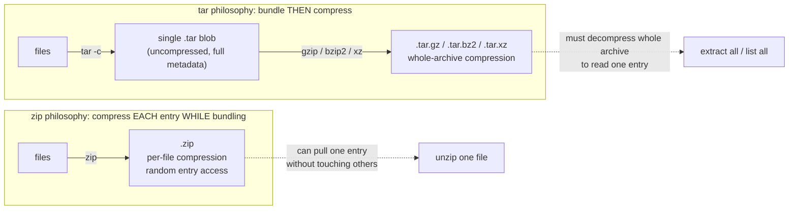

# 🧠 Topic: Archiving & Compression (`tar`, `zip`)

> [!abstract] Executive Summary (ELI5)
> **Archiving** bundles many files into one (think: boxing items for moving). **Compression** squeezes that box so it takes less space (think: vacuum-sealing the box). **`tar`** only boxes — it's a *tape archiver*; to vacuum-seal it you pipe through a separate compressor (`gzip`, `bzip2`, `xz`), which is why you see `.tar.gz` (box, *then* squeeze). **`zip`** does both in one step, squeezing each file as it goes into the box, which is why `.zip` is everywhere on Windows but is usually a worse choice for Linux backups. Knowing the difference — *archive vs compress*, and *compress-then-box vs box-then-compress* — is the whole concept.

> [!note] Why "archiving" and "compression" are one topic here
> On the command line they're almost always used together, but they are **two different operations** done by **different tools**. The #1 source of confusion is treating `.tar.gz` as one format. It isn't — it's a `tar` archive that was then run through `gzip`. This note teaches `tar` (archive) + its compression friends, then `zip` (archive+compress in one), and the trade-offs between the two philosophies.

---

## 🎯 The "Why"
- **Problem Solved:** Moving, backing up, or distributing a directory tree as a unit. Three problems must be solved:
  1. **Bundling** — turn thousands of files (with their structure, permissions, symlinks) into one transportable blob, so you copy *one* thing instead of ten thousand.
  2. **Shrinking** — text and logs compress 3–10×; a 1 GB log dir becomes a 150 MB archive. Saves disk, bandwidth, and time.
  3. **Portability vs fidelity** — sometimes you need maximum cross-platform compatibility (send to a Windows user); sometimes you need to *perfectly* preserve Unix metadata (backup of `/etc`). These pull in opposite directions, and that's why we have two tools.
- **`tar`** (tape archive) bundles with full Unix fidelity — permissions, ownership, symlinks, device nodes, directory structure — and lets you choose the compression algorithm separately. It is the Linux/Unix backup-and-transfer standard.
- **`zip`** bundles and compresses in one step, **per-entry** (each file compressed independently inside the archive). It's the cross-platform distribution standard — every OS opens `.zip` natively — at the cost of weaker Unix-metadata preservation and slightly worse ratios.
- **Alternatives:**
  - **`cpio`** — older Unix archiver, still used inside initramfs/RPM packages. Reads/writes a streaming format. You'll rarely invoke it by hand.
  - **`7z` / `7za`** (7-Zip) — best-in-class compression ratio (LZMA/LZMA2), but `.7z` isn't installed by default on most servers; great for archiving cold data, awkward for distribution.
  - **`zstd`** — modern (Zstandard, Facebook). Compresses nearly as well as `gzip` at 3–10× the speed, with strong modern features. Becoming the default in kernels, package managers, and containers. **The likely future default** — but the course material centers on `tar`+gzip and `zip`, so those are the focus here.
  - **`rar`** — proprietary, common on Windows warez/scene releases; Linux can usually only *extract* via `unrar`. Avoid for your own archives.
  - **Single-file compressors** — `gzip`/`bzip2`/`xz`/`zstd` compress *one* file each (they don't bundle). That's why `tar` exists to bundle first. `.gz` alone = one squeezed file, not an archive of many.
- **Trade-offs:** `tar`+gzip gives the best **fidelity** (full Unix metadata) and good ratios, and is universally available on Linux — but `.tar.gz` is awkward on Windows (needs 7-Zip or WSL). `zip` gives the best **portability** — double-click on any OS — but loses some Unix metadata and compresses slightly less efficiently (per-entry dictionaries can't share redundancy across files). Pick by audience: **backups and server-to-server → `tar`; distribution to humans/Windows → `zip`.**

## 💡 Mental Model & Analogy
- **Analogy:** Moving house. **Archiving** is putting everything into labelled moving boxes (one box is easier to carry than 500 loose items, and the labels preserve what goes where). **Compression** is vacuum-sealing each box so it's smaller. **`tar`** only boxes — it carefully records every item's permissions, owner, and symlink relationships on the box label. **`gzip`/`bzip2`/`xz`** only vacuum-seal. So `.tar.gz` = "box it, *then* vacuum-seal the whole box" — you must unseal before you can see what's inside. **`zip`** is a smart box that vacuum-seals *each item as you put it in*, so you can pull out one item later without re-sealing the rest. That single difference (compress-the-whole vs compress-each-item) explains almost every behavioral difference between the two.
- **Visual/Diagram — the two pipelines:**



> [!tip] The single most important mental model
> **`.tar.gz` is two operations layered; `.zip` is one operation that fuses them.** With `tar`, *bundling* and *compressing* are separate, swappable stages — you can pick your compressor (gzip/bzip2/xz/zstd) independently, and the compressor sees the *whole* tar stream (so it can deduplicate redundancy across files). With `zip`, each file is compressed independently *as it enters the archive* — you can extract one entry cheaply, but you lose cross-file compression gain and the algorithm is fixed. This is why tar wins on ratio/fidelity for backups and zip wins on random-access/portability for distribution.

## 🛠️ Core Principles & Code Snippets

### 1. The tar flag model — three verbs, attach a compressor
`tar`'s flags are **modular letters that compose**. Learn the grammar, not a table of incantations.

**Three required "verb" flags (pick exactly one):**
| Verb | Meaning | Mnemonic |
|------|---------|----------|
| `-c` | **c**reate a new archive | create |
| `-x` | e**x**tract from an archive | extract |
| `-t` | lis**t** the contents (do **not** extract) | list |

**Common modifier flags (attach as needed):**
| Flag | Meaning |
|------|---------|
| `-f ARCHIVE` | **f**ile — the archive's name. **Almost always required.** Must be the last flag before the filename. |
| `-v` | **v**erbose — print each file as it's processed. Repeat (`-vv`) for more detail. |
| `-z` | use **g**zip compression (`.tar.gz` / `.tgz`) |
| `-j` | use **b**zip2 compression (`.tar.bz2` / `.tbz2`) |
| `-J` | use x**z** compression (`.tar.xz` / `.txz`) |
| `-C DIR` | change to **D**IR before operating (for extraction paths, see §6) |

```bash
# NOTE: the leading dash is OPTIONAL in GNU tar. These two are identical:
tar -cvzf archive.tar.gz dir/        # verbose style (you'll see this most)
tar cvzf archive.tar.gz dir/         # classic style (also everywhere)
```

> [!tip] Order matters when `f` is involved
> `-f` takes the *next argument* as the archive filename. So `tar -cvzf out.tar.gz dir/` works, but `tar -cvfz out.tar.gz dir/` would create an archive literally named `z` (because `f` grabs the next token `z`). Convention: keep `f` last in the cluster: `-cvzf` or `-xvzf`.

### 2. The four everyday tar operations
```bash
# CREATE: bundle dir/ and gzip it in one step
tar -cvzf backup.tar.gz dir/

# EXTRACT: unpack here (current dir)
tar -xvzf backup.tar.gz

# LIST: see what's inside WITHOUT extracting  ⭐ always do this first
tar -tvzf backup.tar.gz

# EXTRACT one file / one subdir out of an archive
tar -xvzf backup.tar.gz dir/subdir/specific_file.txt
```

- **`.tgz`** and **`.tar.gz`** are the *same thing* — `.tgz` is just a short filename for systems that can't deal with two dots.
- `gzip`/`bzip2`/`xz` detect the format from the `tar` flag (`-z`/`-j`/`-J`). Modern GNU `tar` also **autodetects** on extract, so `tar -xvf anything.tar.*` usually just works without the compression flag. Specifying it explicitly is still good hygiene.
- The `t` (list) verb is your safety check before extracting anything from an untrusted source — see §7 (tarbombs).

### 3. Compression algorithm trade-offs — pick by goal
The compressor is a separate choice layered on `tar`. Trade **CPU time vs compression ratio**:

| Flag | Tool | Ratio | Speed (compress) | Notes |
|------|------|-------|------------------|-------|
| `-z` | **gzip** | baseline | fast | The default, universal. `.gz`. Use when in doubt. |
| `-j` | **bzip2** | better (~10–20% smaller than gzip) | slower | Good for cold archives. `.bz2`. |
| `-J` | **xz** (LZMA) | best (~30% smaller than gzip) | slowest; **high RAM** on decompress too | Best ratio; the choice for software distribution (kernel tarballs, distro packages). `.xz`. |
| `--zstd` | **zstd** | near-xz, sometimes better | **much faster** than all above | Modern default-in-waiting; kernels, packages, containers moving to it. |

- **Rule of thumb:** gzip for speed and compatibility; xz for smallest archive of cold data; zstd when available for the best speed/ratio balance.
- **Asymmetry warning:** xz *decompression* is fast, but xz *compression* at high levels is CPU- and memory-hungry. A `tar.xz` you make on a small VM at level 9 may exhaust RAM; level 6 (the default) is usually plenty.

### 4. What tar preserves that zip may not — fidelity
- `tar` was designed for **Unix backups**, so it records: file **permissions** (rwx bits), **ownership** (UID/GID — see [[Users_and_Groups]]), **symlinks** and hard links, **device nodes**, **directory structure**, and **timestamps** (mtime/atime/ctime).
- This is why `tar` is the standard for backing up `/etc`, `/home`, or a server config tree — extracting on another Linux box reproduces the metadata exactly.
- **Caveat — ownership on extract:** the stored UID/GID are restored only if you run as **root**. As a regular user, tar extracts with *your* ownership (it can't give files to other users). Use `--no-same-owner` to silence this in scripts; as root use `--same-owner` (often default) to preserve it.
- **zip** stores permissions only partially (no full Unix mode bits in the classic format) and historically mangles symlinks and ownership. It's a cross-platform format that optimizes for "open anywhere," not "reproduce Unix state." Don't use `.zip` for Linux system backups.

### 5. zip / unzip — bundle + compress in one step
```bash
# CREATE a zip (note: zip takes the archive name, THEN the inputs)
zip -r archive.zip dir/          # -r = recurse into directories (required for folders)

# LIST contents
unzip -l archive.zip

# EXTRACT all here
unzip archive.zip

# EXTRACT one file
unzip archive.zip path/to/file.txt

# UPDATE: add new files or refresh changed ones
zip -r archive.zip newfile.txt   # adds (doesn't replace unchanged)
zip -f archive.zip               # freshen: replace only CHANGED files already in the archive
```

- `zip`'s **argument order is the opposite habit from tar**: `zip ARCHIVE INPUTS` vs tar's `tar -c -f ARCHIVE INPUTS`. Easy to fumble — `zip dir/ archive.zip` would try to zip `archive.zip` *into* a new archive named `dir/`.
- **`unzip` is a separate binary** from `zip`. On a minimal server you may have `unzip` installed (read-only) without `zip` (create). Installing both is normal: `apt install zip unzip`.
- zip compresses **each entry independently** — extracting one file only decompresses that file. This is the **random-access** property tar.gz lacks: to read one file from a `.tar.gz` you must decompress the whole tar stream up to it.

### 6. Path control — the two most common gotchas
**Gotcha A — `tar` stores *relative* paths exactly as you give them:**
```bash
# These produce DIFFERENT internal paths in the archive:
cd /home/pavel && tar -cvzf a.tgz project/        # stores: project/...
cd /           && tar -cvzf b.tgz home/pavel/project/  # stores: home/pavel/project/...
```
Extracting `b.tgz` recreates `home/pavel/project/` under your cwd. To extract somewhere specific, use **`-C`**:
```bash
tar -xvzf b.tgz -C /tmp/restore/     # extracts under /tmp/restore/ regardless of stored paths
```

**Gotcha B — leading slashes are stripped by tar:**
```bash
tar -cvzf etc.tgz /etc/passwd
# tar: Removing leading `/' from member names   <-- tar warns and stores "etc/passwd", not "/etc/passwd"
```
This is a **safety feature**: if tar stored absolute paths, extracting an archive of `/etc` could **overwrite your real `/etc`**. Tar refuses, by default, to recreate absolute paths. Don't fight it with `--absolute-names` unless you deeply understand the risk.

### 7. Tarbombs — and why you always `tar -t` first
A **tarbomb** is an archive that dumps its contents *into the current directory* instead of into a single subdirectory — because whoever made it ran `tar -czf x.tgz *` from *inside* the folder, so the archive's top level is the files themselves, not a wrapper dir.

```bash
tar -tvzf suspicious.tgz
# If you see:
#   -rw-r--r-- README.md
#   -rw-r--r-- setup.sh
#   drwxr-xr-x src/
# ...with NO common top-level directory → extracting litters your cwd with these.
# vs. a well-behaved archive:
#   drwxr-xr-x app-1.2/             <-- one wrapper dir = safe
#   -rw-r--r-- app-1.2/README.md
```

**Defense:**
1. **Always `tar -t` (list) before `tar -x`** on anything you didn't make. (Works for `unzip -l` too.)
2. Extract into a fresh empty dir: `mkdir inspect && tar -xzf x.tgz -C inspect`.
3. For your own archives, always tar a *directory*: `tar -czf app-1.2.tar.gz app-1.2/` — never `cd app-1.2 && tar -czf ../x.tgz *`.

### 8. Streaming — tar as a pipe (the Unix-philosophy payoff)
Because tar's archive format is a stream, you can move trees across the network or through pipes without ever creating an archive file:

```bash
# Copy a directory tree to another host, compressed, no temp file:
tar -czf - -C /src parent_dir | ssh host2 'tar -xzf - -C /dest'
#        ^ "-" means stdout                     ^ "-" means stdin

# Pipe a single compressed tarball to gzip for a progress-free one-liner:
tar -cf - . | gzip -9 > out.tar.gz      # equivalent to tar -czf out.tar.gz .

# Backup a Postgres dump straight to compressed tar over SSH:
pg_dump mydb | ssh backuphost 'cat > db.sql && tar -czf db.tgz db.sql && rm db.sql'
```

- The `-` (or `/dev/stdout`, `/dev/stdin`) is how tar means "the archive is the stream, not a file." This composability is the payoff of the archive/compression split: each stage (`tar`, `gzip`, `ssh`) does one job and you snap them together with `|`.

## ⚠️ Pitfalls & Anti-patterns
- **Common Mistakes:**
  - **Forgetting `-f`'s position** → accidentally creating archives named `z` or `v`. Keep `f` last in the flag cluster, immediately before the filename.
  - **`tar -x` without `tar -t` first** on an untrusted archive → tarbomb litters or overwrites files in your cwd. Always list first.
  - **Mixing up zip's argument order** (`zip INPUTS ARCHIVE`) → silently creating the wrong archive or erroring. zip wants the *archive name first*.
  - **Confusing archive with compression** — e.g., expecting `gzip file.txt` to bundle a directory. `gzip` compresses *one file*; it does not archive. That's why we have `tar`.
  - **Using `.zip` for a Linux system backup** — symlinks/permissions/ownership won't round-trip cleanly. Use `tar`.
  - **Extracting as root from an untrusted archive** — a malicious tar can set dangerous metadata (setuid bits, weird ownership) or exploit path traversal. Extract as a non-root user into a sandbox dir.
  - **Re-compressing an already-compressed file** (`gzip photo.jpg`) — nearly zero gain and wasted CPU; compressed formats (jpeg, mp4, zip parts) are already near-incompressible.
- **When NOT to tar/zip:**
  - For **live system backups** of a running database — tar snapshots files at a moment in time with no consistency guarantee; use the DB's dump/snapshot tool (`pg_dump`, `xtrabackup`) instead.
  - For **huge scientific datasets** with specialized structure — formats like Parquet/Zarr + a columnar compressor beat general-purpose tar+gz.
  - For **regular incremental backups** — `tar`/`zip` are full-snapshot tools; use `rsync`, `borg`, or `restic` for dedup + incrementals.
- **Security considerations:**
  - **Path traversal** — a crafted archive can contain entries like `../../../etc/passwd`. GNU tar rejects leading `/` and `..` components by default; never bypass this with `--absolute-names` on untrusted input.
  - **Symlink attacks** — tar can recreate symlinks pointing outside the extract dir, then a later file write through that symlink escapes. Modern tar guards against many of these; extracting untrusted archives as non-root into a throwaway dir removes the blast radius.
  - **Zip bombs** — a tiny `.zip` that decompresses to petabytes (nested archives, extreme ratios). Antivirus and careful extraction limits mitigate; don't auto-extract on a server from user-supplied archives.

## 🔗 Deep Connections
- **Parent Topic:** [[Linux_Commands]] — archiving is a core file-management command family, alongside [[IO_Redirection]] and [[Filter_Commands]].
- **Related Concepts:** [[File_Types]] (`.tar.gz`, `.zip` are recognized by their magic bytes, not just extensions), [[Linux_Important_Directories]] (what's worth backing up: `/etc`, `/home`, `/var`), [[Linux_Permissions]] (what tar preserves and restores), [[Users_and_Groups]] (UID/GID round-tripping on extract).
- **Prerequisites:** the command line, files and directories, permissions/ownership.

## ❓ Active Recall Questions
> [!faq]- Distinguish **archiving** from **compression**. Name a tool that does only one, and a tool that does both.
> **Archiving** bundles many files into one (a container), without necessarily shrinking anything. **Compression** reduces size by encoding redundancy, on one file or one stream — it doesn't bundle. **`gzip`/`bzip2`/`xz`** do *only compression* (one file/stream each). **`tar`** does *only archiving* (no compression by itself — you add `-z`/`-j`/`-J` to pipe through a compressor). **`zip`** does *both in one operation*. The fact that they're separate Unix tools is exactly why `.tar.gz` is two steps: bundle with tar, then squeeze the tar stream with gzip.

> [!faq]- Why is `.tar.gz` two extensions, and what does each represent? What single tool would give the equivalent of `.zip` in one filename?
> `.tar.gz` = a **tar archive** (`.tar`, the bundled container with full Unix metadata) that was **then gzip-compressed** (`.gz`). Two operations, two extensions. There is no tar flag that *is* compression — `-z` just tells tar to pipe its output through `gzip`. `.zip`'s single extension represents *one operation that fuses bundling and per-entry compression* — so `.zip` is the one-filename equivalent of the whole `.tar.gz` dance, but with different (random-access, lower-ratio) trade-offs.

> [!faq]- Predict the result: you run `tar -cvfz out.tgz dir/`. What file gets created, and why?
> You get an archive named **`z`**, *uncompressed*, containing `dir/`. Reason: `-f` takes the **next argument as the archive name**, and the next argument after the flag cluster `-cvfz` is... `z` (the flag letters are consumed left-to-right; `f` grabs `z`). Then `out.tgz` and `dir/` are treated as *inputs*. Moral: keep `f` **last** in the cluster (`-cvzf`) so the filename comes next. (Some `tar` versions are forgiving, but don't rely on it.)

> [!faq]- Why can you extract a single file from a `.zip` cheaply, but extracting one file from a `.tar.gz` requires walking the whole compressed stream?
> **zip compresses each entry independently** as it enters the archive, with a central directory indexing where each entry lives. To extract one file, zip seeks to its offset and decompresses just that entry — true **random access**. **tar+gzip compresses the whole tar stream as one block** — the compressor (gzip) sees the archive as a single byte stream, so to reach a file near the end you must decompress everything before it. This is the core trade-off: zip trades some ratio and metadata fidelity for per-entry access; tar.gz trades random access for better cross-file compression and full Unix fidelity.

> [!faq]- You back up `/etc` as a `.zip` and restore it on a fresh box. What Unix metadata is at risk of not round-tripping, and why does `tar` not have this problem?
> `.zip` was designed cross-platform, so its classic format stores only **partial Unix mode bits**, and historically struggles with **symlinks, ownership (UID/GID), device nodes, and hard links**. Restoring `/etc` via `.zip` may produce broken symlinks, wrong owners, or missing setuid bits. **`tar`** was designed for Unix backups and records all of that — permissions, ownership, symlinks, device nodes, timestamps — so a `tar` extract as root reproduces the tree faithfully. That's why `tar` (not `zip`) is the standard for Linux system backups.

> [!faq]- What is a **tarbomb**, and what one habit prevents the damage on archives you didn't create?
> A tarbomb is an archive whose top level is *files* rather than a *wrapper directory* — usually because the maker ran `tar -czf x.tgz *` from inside the folder. Extracting it dumps those files (and dirs) directly into your **cwd**, littering or overwriting it. The one preventive habit: **always `tar -tvzf` (list) before `tar -xvzf`** on anything untrusted — if the listing shows no common top-level directory, extract into a fresh empty dir (`mkdir x && tar -xzf a.tgz -C x`). For archives you make, always tar a *directory* (`tar -czf app.tgz app/`), never a glob from inside.

> [!faq]- Why does `tar` strip the leading `/` when you run `tar -czf etc.tgz /etc/passwd`, and what would go wrong if it didn't?
> It's a **safety feature**. If tar stored and recreated absolute paths, extracting an archive of `/etc` or `/usr` could **overwrite your live system files** — silently and destructively. By stripping the leading `/`, tar forces paths to be relative to your *current* directory at extract time, so you choose where things land. Bypassing this with `--absolute-names` on untrusted input is a classic foot-gun. The warning message ("Removing leading `/' from member names") is normal and expected — don't try to "fix" it.

> [!faq]- Rank `gzip`, `bzip2`, `xz`, and `zstd` by compression ratio and by speed. Which do you pick for (a) a quick network transfer, (b) the smallest possible cold-storage archive, (c) a modern default where available?
> **Ratio (best→worst):** xz ≈ zstd (high) > bzip2 > gzip. **Speed (fastest→slowest):** zstd >> gzip > bzip2 > xz (xz is slowest and RAM-heavy on compress). Picks: **(a) quick transfer → gzip** (fast, universal) or **zstd** if both ends have it. **(b) smallest cold archive → xz** (best ratio; compression cost is paid once). **(c) modern default → zstd** — near-xz ratio at multiples of gzip's speed; kernels, package managers, and containers are migrating to it. In doubt: gzip — it's the universal lingua franca.

---
## 📝 How to use this template effectively
1. **Never Copy-Paste:** If you find yourself copying documentation, stop. Read, close the tab, and write it from memory.
2. **Iterate:** Fill the 'ELI5' and 'Analogy' first. If you can't explain it simply, you don't understand it yet.
3. **The "Why" is King:** Seniority is defined by knowing *when* and *why* to use a tool, not just *how*.
4. **Update the Status:** Move from `analyzing` -> `implemented` -> `mastered` as you apply this in real projects.
