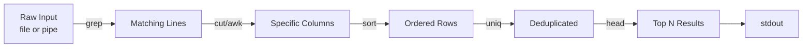

# 🧠 Topic: Linux Filter Commands

> [!abstract] Executive Summary (ELI5)
> Filter commands are text-processing tools that read text, transform it, and pass it along. You give them messy input (log files, command output, CSVs), and they hand back only the lines, columns, or characters you care about. They are designed to be chained together with pipes.

---

## 🎯 The "Why"
- **Problem Solved:** Real-world text is huge, unstructured, and noisy. You need to search it, slice it, sort it, deduplicate it, and reformat it without writing a script every time. Filter commands turn raw text into actionable answers in one line.
- **Alternatives:** Python/Perl one-liners (`python -c`, `perl -ne`), `awk` as a mini-language, dedicated log analyzers (`jq`, `rg`, `mlr`), or opening the file in an editor and searching manually.
- **Trade-offs:** Filters are tiny, composable, and present on every Unix. They shine for ad-hoc analysis and pipelines. For complex logic, stateful parsing, or structured data (JSON, XML), a real scripting language or a specialized tool (`jq`, `xsv`) is cleaner and less error-prone.

## 💡 Mental Model & Analogy
- **Analogy:** An assembly line in a factory. Raw material (stdin) enters the line, and each station (`grep` → `cut` → `sort` → `uniq`) performs one small transformation before passing the part to the next station. The final product (stdout) is the refined answer.
- **Visual/Diagram:**



## 🛠️ Core Principles & Code Snippets

### 1. `grep` — search lines matching a pattern

```bash
grep "error" app.log
# Print lines containing "error".

grep -i "error" app.log
# Case-insensitive search.

grep -v "debug" app.log
# Invert: print lines that do NOT match.

grep -n "TODO" *.py
# Show line numbers of matches.

grep -r "api_key" .
# Recursively search all files.

grep -E "^[0-9]+" data.txt
# Extended regex: lines starting with digits.
```

Common flags:
- `-i` case-insensitive.
- `-v` invert match (exclude).
- `-n` print line numbers.
- `-r` recursive.
- `-E` extended regex (alternation `|`, `+`, `?`).
- `-c` count matching lines only.
- `-w` match whole words only.

> [!tip] Implementation Note
> `grep -E` (or `egrep`) enables extended regex without backslashes. For fixed strings, use `grep -F` (or `fgrep`) — it is faster and avoids special-character surprises.

### 2. `cut` — extract columns or characters

```bash
cut -d: -f1 /etc/passwd
# Split on ':' and print the first field (usernames).

cut -c1-10 file.txt
# Print characters 1 through 10 of each line.

cut -d, -f2,4 data.csv
# Print fields 2 and 4 from a CSV.
```

Common flags:
- `-d` field delimiter (default is tab).
- `-f` field numbers to keep (comma-separated).
- `-c` character positions.
- `--complement` print everything except the selected fields.

> [!tip] Implementation Note
> `cut` splits on a single character and cannot handle quoted CSV fields with embedded delimiters. For real CSV parsing, use `awk`, `csvkit`, or `mlr`.

### 3. `awk` — pattern-action text processor

```bash
awk '{print $1}' access.log
# Print the first whitespace-delimited field.

awk -F: '{print $1, $7}' /etc/passwd
# Use ':' as field separator; print fields 1 and 7.

awk '$3 > 100 {print $1, $3}' scores.txt
# Print rows where the third field exceeds 100.

awk '{sum += $2} END {print sum}' data.txt
# Sum the second column and print the total.
```

Built-in variables:
- `$0` whole line, `$1`, `$2`... fields.
- `NR` current record (line) number.
- `NF` number of fields in the current record.
- `FS`/`OFS` input/output field separator.

> [!tip] Implementation Note
> `awk` is a full programming language. Use it when `cut` is too rigid (multiple delimiters, conditions, arithmetic) but a Python script is overkill.

### 4. `sed` — stream editor for text transformation

```bash
sed 's/old/new/' file.txt
# Replace the first "old" with "new" on each line.

sed 's/old/new/g' file.txt
# Replace all occurrences per line (global).

sed -n '5,10p' file.txt
# Print only lines 5 through 10.

sed '/^#/d' config.conf
# Delete all comment lines (starting with #).

sed -i 's/localhost/127.0.0.1/g' config.conf
# Edit the file in place (no separate output).
```

Common flags:
- `s/pattern/replacement/` substitute.
- `g` global replacement within a line.
- `-n` suppress automatic printing; pair with `p` to print selected lines.
- `-i` edit the file in place (add a backup suffix: `-i.bak`).
- `d` delete matched lines.

> [!tip] Implementation Note
> Always test `sed` without `-i` first to preview the result. `sed -i` with a broken regex can silently corrupt files. Keep a backup with `sed -i.bak`.

### 5. `sort` — order lines

```bash
sort names.txt
# Alphabetical sort.

sort -n sizes.txt
# Numeric sort.

sort -r numbers.txt
# Reverse order.

sort -t: -k3 -n /etc/passwd
# Sort by the 3rd field, ':' delimiter, numerically.

sort -u list.txt
# Sort and remove duplicates in one step.
```

Common flags:
- `-n` numeric.
- `-r` reverse.
- `-u` unique (deduplicate after sorting).
- `-t` field delimiter.
- `-k` sort key (field).
- `-h` human-readable numbers (`9K`, `2M`).

> [!tip] Implementation Note
> `sort` needs the data ordered before `uniq` can deduplicate it. The idiomatic pipeline is `sort | uniq`. `sort -u` does both at once.

### 6. `uniq` — remove or report adjacent duplicate lines

```bash
sort names.txt | uniq
# Deduplicate (input must be sorted first).

sort names.txt | uniq -c
# Prefix each line with a count of occurrences.

sort names.txt | uniq -d
# Print only lines that appear more than once.

sort names.txt | uniq -u
# Print only lines that appear exactly once.
```

Common flags:
- `-c` count occurrences.
- `-d` print only duplicated lines.
- `-u` print only unique (non-duplicated) lines.
- `-i` case-insensitive.
- `-f N` skip the first N fields when comparing.

> [!tip] Implementation Note
> `uniq` only compares a line to its immediate neighbor. Unsorted input leaves duplicates in place. Always pipe through `sort` first.

### 7. `head` / `tail` — first or last lines

```bash
head -n 20 file.log
# First 20 lines.

tail -n 50 file.log
# Last 50 lines.

tail -f app.log
# Follow the file in real time (great for logs).

tail -n +5 file.txt
# Skip the first 4 lines; print from line 5 onward.
```

Common flags:
- `-n N` number of lines.
- `-f` follow (tail only).
- `-c N` number of bytes.

> [!tip] Implementation Note
> `tail -f` blocks forever watching for appended data. Use `tail -F` (capital) to handle log rotation, where the file is renamed/recreated under the same path.

### 8. `tr` — translate or delete characters

```bash
echo "Hello" | tr 'a-z' 'A-Z'
# HELLO — lowercase to uppercase.

echo "a,b,c" | tr ',' '\n'
# Convert commas to newlines.

tr -d ' ' < file.txt
# Delete all spaces.

tr -s ' ' < file.txt
# Squeeze repeated spaces into one.
```

Common flags:
- `-d` delete characters in the set.
- `-s` squeeze repeated characters into one.
- `-c` complement the set (everything NOT listed).

> [!tip] Implementation Note
> `tr` reads from stdin only — it has no file argument. Use redirection (`tr ... < file`) instead of `cat file | tr ...`.

### 9. `wc` — word, line, and byte count

```bash
wc -l file.txt
# Count lines.

wc -w file.txt
# Count words.

wc -c file.txt
# Count bytes.

ls -1 | wc -l
# Count files in the current directory.
```

Common flags:
- `-l` lines.
- `-w` words.
- `-c` bytes.
- `-m` characters.

> [!tip] Implementation Note
> `wc -l` counts newlines, so a file without a trailing newline undercounts the last line. For exact line counts, ensure files end with a newline.

## ⚠️ Pitfalls & Anti-patterns
- **Common Mistakes:**
  - Running `uniq` without `sort` first and wondering why duplicates remain.
  - Using `cut` on quoted CSV fields with embedded commas — it naively splits on every delimiter.
  - Forgetting `sed -i` edits in place with no undo; a bad regex silently mangles the file.
  - Assuming `grep` is anchored — it matches substrings anywhere unless you use `^`, `$`, or `-w`.
  - Piping `cat file | grep ...` instead of `grep ... file` (the "Useless Use of Cat").
  - Expecting `head`/`tail` to behave identically on pipes vs. files (pipes are unseekable, so `tail` cannot jump to the end efficiently).
- **When NOT to use:**
  - Do not parse JSON/XML with `grep`/`sed` — use `jq`, `xmlstarlet`, or a real parser.
  - Do not use `awk`/`sed` for logic that needs arrays, complex state, or error handling — switch to Python/Go.
  - Do not use `cut` when fields are variable-width or delimited by multiple characters — use `awk`.
- **Performance/Security considerations:**
  - `grep -r` on a directory tree can traverse huge or sensitive areas; scope it with `--include`/`--exclude-dir`.
  - `sort` on very large files uses temporary disk space and can be slow; `sort -S` controls buffer size, `LC_ALL=C` speeds up byte-level sorting.
  - Patterns passed to `grep`/`sed` may appear in shell history or `ps` output — avoid embedding secrets; read them from a file with `-f`.
  - `sed -i` is destructive; always preview or keep a `.bak`.

## 🔗 Deep Connections
- **Parent Topic:** [[Linux Operating System]]
- **Related Concepts:** [[Linux_Commands]], [[Linux_Shell]], [[IO_Redirection]], [[Bash Scripting]], [[Environment Variables]]
- **Prerequisites:** Basic terminal navigation, understanding of stdin/stdout/stderr and pipes ([[IO_Redirection]]).

## ❓ Active Recall Questions
> [!faq]- Why must `uniq` come after `sort`?
> `uniq` only removes lines that are identical to their immediate predecessor. If duplicates are scattered across the file, they never become adjacent, so they survive. Sorting first groups identical lines together.

> [!faq]- What is the difference between `grep -E` and `grep -F`?
> `-E` enables extended regex (alternation, `+`, `?`, grouping without backslashes). `-F` treats the pattern as a fixed literal string — faster and safer when you are matching text that contains regex special characters like `.` or `*`.

> [!faq]- How do you replace only the first occurrence versus all occurrences on a line with `sed`?
> `sed 's/old/new/'` replaces the first match per line. Adding the `g` flag — `sed 's/old/new/g'` — replaces every match on each line.

> [!faq]- When should you prefer `awk` over `cut`?
> When you need conditional logic (`$3 > 100`), arithmetic (`sum += $2`), a multi-character or regex delimiter, or output formatting. `cut` is a dumb splitter; `awk` is a mini programming language.

> [!faq]- Why is `cat file | grep pattern` considered an anti-pattern?
> `grep` accepts filenames directly: `grep pattern file`. Prepending `cat` spawns an extra process and adds nothing. This is known as the "Useless Use of Cat" (UUOC).

> [!faq]- What does `tail -F` do that `tail -f` does not?
> `tail -f` follows a file by descriptor and stops tracking if the file is rotated (renamed or replaced). `tail -F` reopens the file by name, so it survives log rotation — the safer default for following live logs.

> [!faq]- How do you safely preview a `sed` substitution before editing the file in place?
> Run the command without `-i` and inspect stdout first. Once the output is correct, repeat with `-i` (or `-i.bak` to keep a backup of the original).

---

## 📝 How to use this template effectively
1. **Never Copy-Paste:** If you find yourself copying documentation, stop. Read, close the tab, and write it from memory.
2. **Iterate:** Fill the 'ELI5' and 'Analogy' first. If you can't explain it simply, you don't understand it yet.
3. **The "Why" is King:** Seniority is defined by knowing *when* and *why* to use a tool, not just *how*.
4. **Update the Status:** Move from `analyzing` -> `implemented` -> `mastered` as you apply this in real projects.
