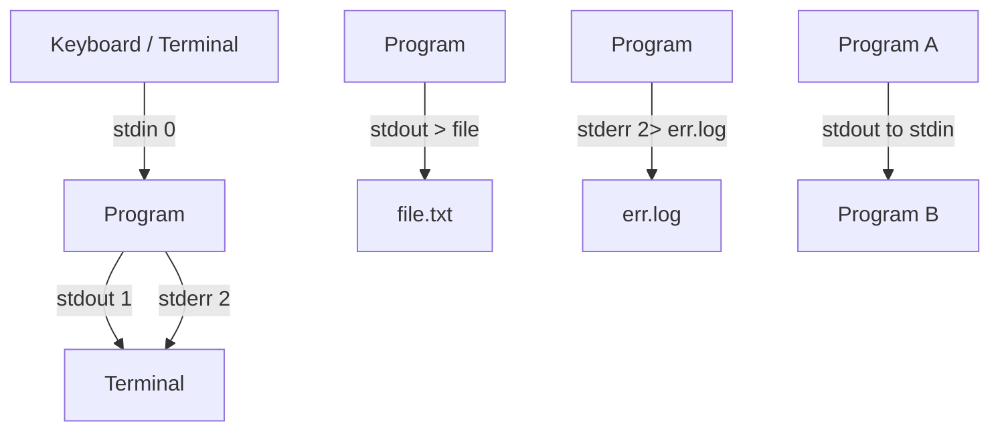

# 🧠 Topic: I/O Redirection

> [!abstract] Executive Summary (ELI5)
> Every program in Linux has three built-in channels: one for input, one for normal output, and one for errors. Redirection lets you reconnect those channels to files, devices, or other programs instead of the terminal. That is how you save output, hide errors, and chain commands into pipelines.

---

## 🎯 The "Why"
- **Problem Solved:** By default, a command's input comes from your keyboard and its output goes to your screen. Real workflows need input from files, output captured into logs, errors separated from normal results, and programs talking directly to each other. Redirection makes all of that possible without editing the programs themselves.
- **Alternatives:** Copy-pasting terminal output into a file, running commands inside an editor, or writing a wrapper script that opens files for each program. The shell's redirection operators do the same job in a single, composable line.
- **Trade-offs:** Redirection is concise and universal across every Unix tool, but redirection mistakes silently overwrite files (`>` truncates) or hide errors (`2>/dev/null`). Explicit file handling in a script is safer for critical data, but far more verbose.

## 💡 Mental Model & Analogy
- **Analogy:** A program is a worker at a desk with three slots: an in-tray (stdin), a normal out-tray (stdout), and a complaints out-tray (stderr). Redirection is you, the manager, deciding where each slot's papers actually go — a filing cabinet (file), the trash (`/dev/null`), or directly onto another worker's in-tray (a pipe).
- **Visual/Diagram:**



## 🛠️ Core Principles & Code Snippets

### 1. The three standard streams

Every process starts with three open file descriptors:

| Stream | FD | Default | Used for |
|--------|----|---------|----------|
| stdin  | 0  | keyboard | reading input |
| stdout | 1  | terminal  | normal output |
| stderr | 2  | terminal  | error/diagnostic messages |

```bash
# A program can be told where each of the three streams goes independently.
ls -la > out.txt 2> err.txt < /dev/null
```

### 2. Redirecting standard output — `>` and `>>`

```bash
echo "hello" > greeting.txt
# Write stdout to greeting.txt. Overwrites if it exists.

echo "world" >> greeting.txt
# Append stdout to greeting.txt.

ls -la > listing.txt
# Save a directory listing to a file.
```

Common operators:
- `>` redirect stdout to a file (truncates/overwrites).
- `>>` append stdout to a file.
- `>|` force overwrite even if `noclobber` is set.

> [!tip] Implementation Note
> The shell truncates the destination file *before* the command runs. `command > file.txt` will empty `file.txt` even if the command later fails, so back up important data before redirecting onto an existing file.

### 3. Redirecting standard input — `<`

```bash
sort < names.txt
# Feed names.txt into sort's stdin.

wc -l < access.log
# Count lines by reading the file via stdin.

mysql mydb < schema.sql
# Pipe a SQL script into the database client.
```

Common operators:
- `<` read stdin from a file.
- `<<WORD` here-document (read inline text until `WORD`).
- `<<<"text"` here-string (bash) — feed a single string into stdin.

```bash
# Here-document: create a config file inline
cat <<EOF > app.conf
host=localhost
port=8080
EOF

# Here-string: feed a string into a command
grep "error" <<< "this is an error message"
```

> [!tip] Implementation Note
> Redirection `<` replaces `cat file | command`. Both work, but `<` avoids spawning an extra process. Prefer `command < file` over `cat file | command`.

### 4. Redirecting standard error — `2>` and friends

```bash
ls /nonexistent 2> errors.log
# Send stderr to a file.

find / -name "*.conf" 2> /dev/null
# Discard all permission-denied errors.

ls / 2>> errors.log
# Append stderr to a file.
```

Common operators:
- `2>` redirect stderr to a file.
- `2>>` append stderr.
- `2>&1` merge stderr into stdout (so both go to the same place).

> [!tip] Implementation Note
> `2>/dev/null` is the standard way to silence noisy permission errors. But hiding errors can mask real problems — remove it while debugging, then add it back once the pipeline is correct.

### 5. Merging stdout and stderr — `2>&1` and `&>`

```bash
command > all.log 2>&1
# Send stdout to all.log, then redirect stderr to wherever stdout points.

command &> all.log
# Bash shorthand: send both streams to the same file.

command 2>&1 | grep -i error
# Merge stderr into stdout, then pipe the combined stream into grep.
```

> [!warning] Ordering Matters
> Redirections are processed left to right. `command 2>&1 > file` is a common bug: it merges stderr into the *current* stdout (the terminal) *before* stdout is redirected to the file. Result: errors still hit the screen. The correct order is `command > file 2>&1` — redirect stdout first, then point stderr at that same destination.

### 6. Pipes — connecting programs with `|`

```bash
ls -la | grep ".log"
# Output of ls becomes input to grep.

cat access.log | grep "404" | sort | uniq -c | sort -rn | head
# A full analysis pipeline.

echo "scale=2; 10/3" | bc
# Feed an expression into a calculator.
```

- A pipe connects the **stdout of the left command** to the **stdin of the right command**.
- stderr is **not** piped by default — it still goes to the terminal unless explicitly merged (`2>&1 |`).
- Pipes can be chained indefinitely; each stage runs concurrently as data flows.

> [!tip] Implementation Note
> Pipes run stages in parallel and buffer between them. For large datasets this is efficient, but a stage that buffers everything (some `awk`/`sort` variants) can delay downstream stages and consume memory.

### 7. `tee` — read stdin, write to stdout *and* a file

```bash
ls -la | tee listing.txt
# Show the listing on screen AND save it to listing.txt.

ls -la | tee listing.txt | grep ".log"
# Capture full output, then continue filtering it.

ls -la | tee -a listing.txt
# Append to the file instead of overwriting.

make build 2>&1 | tee build.log
# Save build output (including errors) while still seeing it live.
```

Common flags:
- (no flag) overwrite the file.
- `-a` append to the file.

> [!tip] Implementation Note
> `tee` is how you both watch a command's output in the terminal and save it to a log at the same time. It is indispensable for debugging pipelines and for commands you also want to observe in real time.

### 8. Discarding output — `/dev/null`

```bash
command > /dev/null 2>&1
# Throw away both stdout and stderr completely.

command &> /dev/null
# Bash shorthand for the same thing.

crontab -l 2> /dev/null
# Check for a crontab without printing an error if none exists.
```

- `/dev/null` is a special device file that discards everything written to it and returns EOF on read.
- Use it to silence noisy commands or to test "does this run without errors?" without caring about the output.

## ⚠️ Pitfalls & Anti-patterns
- **Common Mistakes:**
  - Writing `command 2>&1 > file` and wondering why errors still appear on the terminal — redirection order matters.
  - Using `>` when you meant `>>`, silently destroying a log file.
  - Piping stderr and being surprised that `grep` never sees error messages — pipes only carry stdout.
  - Redirecting onto the *same file* used as input: `sort file.txt > file.txt` truncates `file.txt` before `sort` reads it, leaving an empty file. Use a temp file or `sort -o file.txt file.txt`.
  - Assuming `<<EOF` and `<<<` are interchangeable — here-documents span multiple lines; here-strings feed a single word/line.
- **When NOT to use:**
  - Do not redirect to a file that is also an input of the same command — use `sponge` (from `moreutils`) or a temp file.
  - Do not pipe binary data through text tools (`grep`, `sed`) — they expect newline-delimited text and may mangle or truncate binary streams.
- **Performance/Security considerations:**
  - `> file` truncates the target immediately, even if the command fails — important for append-only logs.
  - Redirection targets are created with the shell's umask; sensitive logs may be world-readable. `install -m 600` or `chmod` afterward.
  - Shell expansion happens before redirection, so patterns with secrets in a command line can leak via `ps`. Prefer files (`< secret.env`) for credentials.
  - `set -o noclobber` protects against accidental `>` overwrites (forces `>|` to overwrite).

## 🔗 Deep Connections
- **Parent Topic:** [[Linux Operating System]]
- **Related Concepts:** [[Linux_Shell]], [[Linux_Commands]], [[Filter_Commands]], [[Bash Scripting]], [[Process Management]]
- **Prerequisites:** Basic understanding of processes, file descriptors, and how a shell parses a command line.

## ❓ Active Recall Questions
> [!faq]- What are the three standard streams and their file descriptor numbers?
> stdin is FD 0 (default: keyboard), stdout is FD 1 (default: terminal), and stderr is FD 2 (default: terminal). Every process inherits these three from its parent.

> [!faq]- What is the difference between `>` and `>>`?
> `>` redirects stdout to a file and overwrites (truncates) any existing content. `>>` appends stdout to the end of the file, preserving what was already there.

> [!faq]- Why does `command 2>&1 > file` fail to send errors to the file?
> Redirections are applied left to right. `2>&1` first points stderr at wherever stdout currently goes (the terminal), and *then* `> file` redirects stdout to the file. Stderr is left pointing at the terminal. The correct order is `command > file 2>&1`.

> [!faq]- What does `tee` do, and when is it useful?
> `tee` reads stdin and writes it to both stdout and a named file simultaneously. It is useful when you want to see a command's output live on the terminal while also saving it to a log, or when you want to tap into the middle of a pipeline to inspect intermediate output.

> [!faq]- Why is `command > same.txt < same.txt` dangerous, and how do you fix it?
> The shell truncates `same.txt` (via `>`) before the command reads it (via `<`), so the input is emptied first. Fix it by writing to a different file and then renaming, or use a tool that supports in-place output such as `sort -o same.txt same.txt` or `sponge`.

> [!faq]- What does `/dev/null` do, and why is `2>/dev/null` so common?
> `/dev/null` is a device file that discards everything written to it and returns EOF on read. `2>/dev/null` silently drops a command's error messages, which is commonly used to suppress "permission denied" or "no such file" noise in find/grep pipelines.

> [!faq]- Does a pipe carry stderr from one command to the next?
> No. A pipe (`|`) connects only stdout of the left command to stdin of the right command. To also carry stderr, first merge it into stdout with `2>&1`, then pipe: `command 2>&1 | grep pattern`.

---

## 📝 How to use this template effectively
1. **Never Copy-Paste:** If you find yourself copying documentation, stop. Read, close the tab, and write it from memory.
2. **Iterate:** Fill the 'ELI5' and 'Analogy' first. If you can't explain it simply, you don't understand it yet.
3. **The "Why" is King:** Seniority is defined by knowing *when* and *why* to use a tool, not just *how*.
4. **Update the Status:** Move from `analyzing` -> `implemented` -> `mastered` as you apply this in real projects.
