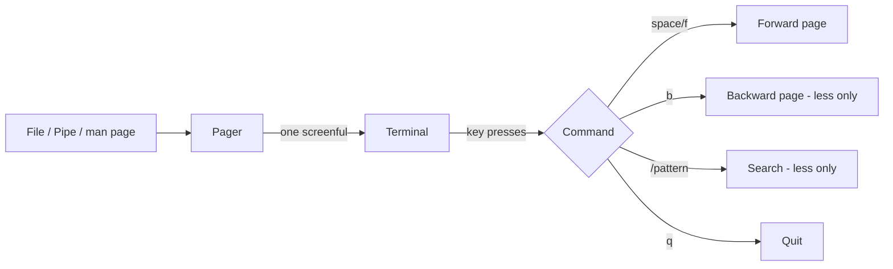

# 🧠 Topic: `less` and `more` — Terminal Pagers

> [!abstract] Executive Summary (ELI5)
> A pager is a viewer that shows a long text file one screenful at a time, instead of dumping the whole thing at once. `more` was the original — it only moves forward. `less` is its modern successor (the name is a joke: "less is more") and can scroll forward, backward, search, and jump around freely.

---

## 🎯 The "Why"
- **Problem Solved:** `cat` dumps an entire file to the terminal at once. For a 10,000-line log, that floods your scrollback, is impossible to read, and wastes time. A pager streams the file one screen at a time, lets you pause, scroll, search, and quit cleanly — without ever loading the whole thing into memory.
- **Alternatives:** `cat` (dumps everything), `head`/`tail` (only the ends), `nano`/`vim` (editors — heavier, risk accidental edits), `bat` (modern `cat` with syntax highlighting and paging built in), `most` (another pager), `glow` (Markdown rendering in terminal).
- **Trade-offs:** Pagers are read-only and lightweight, perfect for inspecting logs, man pages, and big outputs. They are not editors — to change content you need `vim`/`nano`. `less` is more capable than `more` and is the practical default; `more` is now mostly a fallback on minimal systems.

## 💡 Mental Model & Analogy
- **Analogy:** Reading a long book through a magnifying window that only shows one page at a time. `more` is a window that only slides **forward** — once you turn the page, you can't go back. `less` is a window that slides **both directions**, with a built-in search flashlight (`/`) to jump straight to any word.
- **Visual/Diagram:**



## 🛠️ Core Principles & Code Snippets

### 1. The core idea — paging instead of dumping

```bash
cat huge_log.txt
# BAD: floods the terminal, you only see the end.

less huge_log.txt
# GOOD: opens in an interactive viewer, one screen at a time.
```

A pager is the right tool whenever:
- A file is longer than one screen.
- You want to scroll, search, or re-read without re-running a command.
- You are reading a `man` page (which uses `less` by default).
- You pipe output that's too long to scan at once (`ls -la /etc | less`).

> [!tip] Implementation Note
> `less` does **not** read the entire file before displaying — it streams from disk on demand. That is why `less` opens a 2GB log file instantly, while `cat` would freeze the terminal.

### 2. Basic navigation (works in both `less` and `more`)

| Key | Action |
|-----|--------|
| `Space` or `f` | Forward one screen (page) |
| `Enter` | Forward one line |
| `b` | Backward one screen (**`less` only** — `more` cannot go back) |
| `q` | Quit |
| `h` | Help (shows all keys) |

```bash
more file.txt
# Space = next page, q = quit. No backward scroll.

less file.txt
# Space = forward, b = backward, q = quit.
```

> [!tip] Implementation Note
> If you only remember one pager, make it `less`. Everything `more` can do, `less` does too — plus searching, backward scrolling, and far more. `more` exists mainly for compatibility on minimal/embedded systems.

### 3. `less` — the full navigation set (vi-like keys)

| Key | Action |
|-----|--------|
| `Space` / `f` | Forward one screen |
| `b` | Backward one screen |
| `↓` / `↑` or `j` / `k` | Down / up one line (vi-style) |
| `g` | Go to top of file |
| `G` | Go to bottom of file |
| `PgUp` / `PgDn` | Backward / forward one screen |
| `<number>G` | Jump to line `<number>` (e.g., `50G`) |
| `Ctrl-G` or `=` | Show file info, position, and size |

```bash
less +50 file.txt
# Open the file already positioned at line 50.

less +F file.txt
# Open at the end and follow appended data — like `tail -f`.
```

> [!tip] Implementation Note
> The vi-style keys (`j`, `k`, `g`, `G`, `/`) in `less` are the same ones you learn for `vim`. Investing in one transfers directly to the other, and to `man` pages, and to many other Unix tools.

### 4. Searching inside `less`

| Key | Action |
|-----|--------|
| `/pattern` | Search forward |
| `?pattern` | Search backward |
| `n` | Next match (same direction) |
| `N` | Previous match (opposite direction) |
| `&pattern` | Show **only** matching lines (filter view) |

```bash
less +/error app.log
# Open the file and jump to the first match for "error".

# Inside less:
/error       # find "error" going forward
?warning     # find "warning" going backward
n            # next match
N            # previous match
&404         # display only lines containing "404"
```

> [!tip] Implementation Note
> The `&pattern` filter view is `less`'s hidden superpower. It turns `less` into a live, scrollable `grep` — you see only matching lines, but you can still scroll and search within them. Type `&` with no pattern to turn the filter off.

### 5. Useful `less` flags

```bash
less -N file.txt
# Show line numbers.

less -S file.txt
# Chop long lines instead of wrapping (useful for wide logs/tables).

less -i file.txt
# Case-insensitive search.

less -F file.txt
# Quit immediately if the file fits on one screen (no pager needed).

less -R file.txt
# Render ANSI color codes (raw control characters).

less -M file.txt
# Verbose prompt: shows filename, position, and percentage.

less +F file.txt
# Follow mode: open at end, watch for appended data (like tail -f).
```

Combining flags is common:
```bash
less -NSM file.txt
# Line numbers, no-wrap, verbose prompt — a practical default for reading logs.
```

> [!tip] Implementation Note
> `less -F` (capital F, the "quit-if-one-screen" flag) is worth setting as a default via `LESS=-F` in your shell. It makes `less` transparent for small files while still paging large ones.

### 6. `less` in a pipeline

```bash
ls -la /etc | less
# Browse a long directory listing interactively.

dmesg | less
# Read kernel messages page by page.

man less | less
# man already pages — but any long output can be piped in.

make build 2>&1 | less
# Scroll through build output, including errors.
```

- When output is piped into `less`, it comes from **stdin**, not a file — so file-navigation keys like `g`/`G` still work, but the filename is shown as `(stdin)`.
- `less` buffers piped input, so you may need to wait for the upstream command to finish before scrolling in some cases.

### 7. `more` — the original, minimal pager

```bash
more file.txt
# Space = next page, q = quit, h = help.
```

- `more` is **forward-only**: you cannot scroll back up once you've moved past a screen.
- It is still present on virtually every Unix system, including minimal containers (`busybox more`), where `less` may not be installed.
- Practical use today: quick one-off peeks, or environments where `less` is unavailable.

> [!tip] Implementation Note
> Don't invest time memorizing `more`'s specifics. If `less` is available (almost always), use it. Knowing `more` exists is enough — it's a fallback, not a daily driver.

## ⚠️ Pitfalls & Anti-patterns
- **Common Mistakes:**
  - Using `cat` on large files instead of `less`, flooding scrollback and losing your place.
  - Forgetting `q` to exit `less` and feeling "stuck" — the number-one beginner confusion with pagers.
  - Trying to edit inside `less` — it's read-only. Reach for `vim` or `nano` when you need changes.
  - Confusing `less -F` (quit-if-one-screen) with `less +F` (follow mode). Lowercase flag vs. command — very different effects.
  - Piping output through `less` and forgetting that the upstream command must finish before `less` shows everything (e.g., `find / | less` waits for the whole search).
- **When NOT to use:**
  - For small files that fit on one screen, just use `cat` — a pager adds an unnecessary step.
  - For structured data (JSON, CSV, Markdown), use a specialized viewer (`jq`, `bat`, `glow`) that understands the format.
  - For repeated searching, `grep` with a pattern is faster than opening `less` and searching manually.
- **Performance/Security considerations:**
  - `less` streams from disk, so it handles multi-gigabyte files without loading them into RAM. This is its key advantage over `cat`.
  - Piped input to `less` is buffered; very high-volume streams may consume memory before you start scrolling.
  - `less` runs any configured "input preprocessor" (via `LESSOPEN`), which can execute scripts on the file — be aware of this in hardened environments.

## 🔗 Deep Connections
- **Parent Topic:** [[Linux Operating System]]
- **Related Concepts:** [[Linux_Commands]], [[Filter_Commands]], [[IO_Redirection]], [[VIM_Editor]], [[Linux_Shell]]
- **Prerequisites:** Basic terminal usage, understanding stdin/stdout ([[IO_Redirection]]).

## ❓ Active Recall Questions
> [!faq]- What problem does a pager solve that `cat` does not?
> `cat` dumps the entire file to the terminal at once — fine for small files, but it floods scrollback, shows only the last screen, and cannot be navigated. A pager streams the file one screenful at a time, lets you scroll in both directions, search, and quit cleanly, all without loading the whole file into memory.

> [!faq]- What is the key difference between `more` and `less`?
> `more` is **forward-only** — once you advance a page, you cannot scroll back. `less` scrolls freely in **both directions**, supports searching (`/`, `?`), filtering (`&`), line jumping (`g`, `G`, `50G`), and follow mode (`+F`). In practice, `less` supersedes `more`; the name is a deliberate pun ("less is more").

> [!faq]- How do you search forward and backward inside `less`, and how do you jump between matches?
> `/pattern` searches forward, `?pattern` searches backward. `n` moves to the next match in the current search direction, and `N` (capital) moves to the previous match in the opposite direction.

> [!faq]- What does `less +F` do, and how is it related to `tail -f`?
> `less +F` opens the file at the end and **follows appended data**, behaving like `tail -f`. The advantage over `tail -f` is that you can press `Ctrl-C` to stop following and then freely scroll, search, and navigate the whole file without re-running the command.

> [!faq]- What does `less -F` (capital flag, no `+`) do, and why is it useful as a default?
> `-F` makes `less` **quit immediately if the file fits on one screen**, so small files print directly and large files page normally. Setting it via `LESS=-F` gives you the best of both worlds: paging only when it's actually needed.

> [!faq]- What does `&pattern` do inside `less`?
> It switches to a **filter view**, displaying only lines that match the pattern — turning `less` into a scrollable, searchable `grep`. Type `&` with no pattern to turn the filter off and see all lines again.

> [!faq]- Why does `less` open a 2GB log file instantly while `cat` freezes?
> `less` **streams** from disk on demand — it only reads enough to fill the current screen, so it never loads the whole file into memory. `cat` reads and writes the entire file end to end, which floods the terminal and blocks until finished.

> [!faq]- A beginner opens `less`, looks around, and can't get back to the shell prompt. What did they forget?
> They need to press **`q` to quit**. Forgetting `q` is the single most common pager confusion — there is no obvious "exit," and the terminal seems frozen until you press it.

---

## 📝 How to use this template effectively
1. **Never Copy-Paste:** If you find yourself copying documentation, stop. Read, close the tab, and write it from memory.
2. **Iterate:** Fill the 'ELI5' and 'Analogy' first. If you can't explain it simply, you don't understand it yet.
3. **The "Why" is King:** Seniority is defined by knowing *when* and *why* to use a tool, not just *how*.
4. **Update the Status:** Move from `analyzing` -> `implemented` -> `mastered` as you apply this in real projects.
