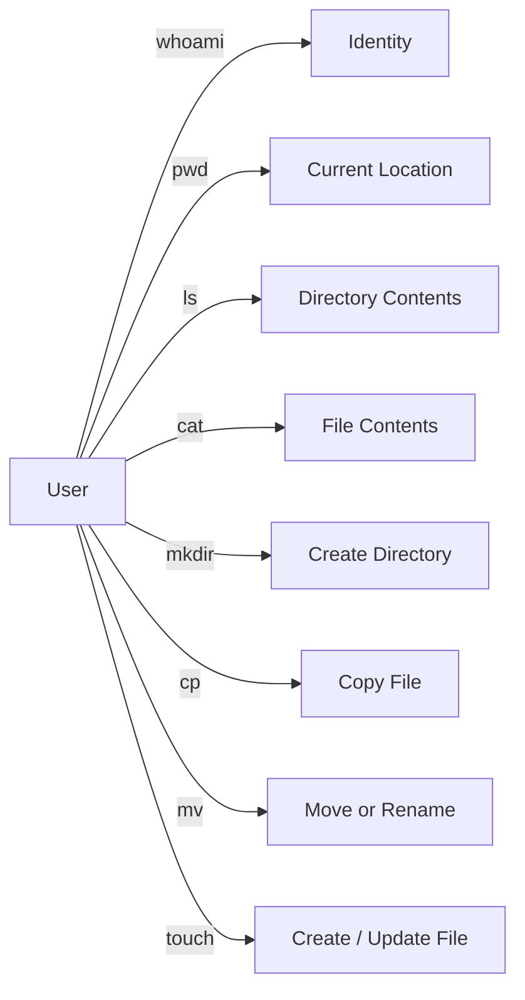

# 🧠 Topic: Linux Commands

> [!abstract] Executive Summary (ELI5)
> These commands are the basic toolkit for working in a terminal. They tell you who you are, where you are, what is around you, what is inside a file, and how to create, copy, move, and rename files and directories.

---

## 🎯 The "Why"
- **Problem Solved:** Before you can manage files, services, or users, you need to orient yourself and manipulate the filesystem. These commands answer basic questions (identity, location, contents) and perform common file operations (create, copy, move, update timestamps).
- **Alternatives:** A file manager GUI, `echo $USER`, `echo $PWD`, `find`, `less`, `bat`, `eza`. The classic commands are universal; alternatives add convenience but are not always installed.
- **Trade-offs:** The built-in commands are small, fast, and present on every Linux system. They are less fancy than modern replacements, but they are the safest baseline for scripts and remote servers.

## 💡 Mental Model & Analogy
- **Analogy:** Navigating a house in the dark. `whoami` asks "Who am I?", `pwd` asks "Which room am I in?", `ls` feels around the room for objects, `cat` reads a label, `mkdir` builds a new shelf, `cp` duplicates a document, `mv` relocates or renames it, and `touch` creates an empty file or updates its timestamp.
- **Visual/Diagram:**



## 🛠️ Core Principles & Code Snippets

### 1. `whoami` — print the current username

```bash
whoami
# alice
```

Useful when:
- Switching users with `su` or `sudo` and confirming the effective identity.
- Writing scripts that behave differently for root versus a regular user.
- Auditing who ran a command in shared environments.

```bash
if [[ $(whoami) != "root" ]]; then
  echo "Run as root to continue."
  exit 1
fi
```

### 2. `pwd` — print the current working directory

```bash
pwd
# /home/alice/projects
```

Useful when:
- You are deep inside a directory tree and need the full path.
- A script needs to remember where it started before changing directories.
- You want to construct an absolute path from a relative one.

```bash
START_DIR=$(pwd)
cd /tmp
# ...do work...
cd "$START_DIR"
```

### 3. `ls` — list directory contents

```bash
ls
# file.txt  dir  README.md

ls -la
# -rw-r--r-- 1 alice alice  123 Jul 1 12:00 file.txt
# drwxr-xr-x 2 alice alice 4096 Jul 1 12:00 dir

ls -lh /var/log
# Shows human-readable file sizes.

ls -t
# Sort by modification time, newest first.

ls -R
# Recursively list subdirectories.
```

Common flags:
- `-l` long format with permissions, owner, size, and date.
- `-a` show hidden files (names starting with `.`).
- `-h` human-readable sizes (KB, MB, GB).
- `-t` sort by time.
- `-R` recursive.
- `-d` list directories themselves, not their contents.

> [!tip] Implementation Note
> `ls` output is great for humans, but parsing it in scripts is fragile. Prefer `find` or glob patterns for automation.

### 4. `cat` — concatenate and print files

```bash
cat file.txt
# Hello, world!

cat file1.txt file2.txt > combined.txt
# Joins two files into one.

cat <<EOF > config.env
DB_HOST=localhost
DB_PORT=5432
EOF
# Creates a file from a here-document.
```

Useful when:
- Quickly viewing small files.
- Combining multiple files into one.
- Creating files inline in scripts.
- Feeding file contents into another command via a pipe.

```bash
cat /etc/os-release | grep "^ID="
# Better: grep "^ID=" /etc/os-release
```

> [!tip] Implementation Note
> For large files or interactive reading, use `less` or `more` instead of `cat`. For searching, use `grep` directly rather than `cat | grep`.

### 5. `mkdir` — create directories

```bash
mkdir projects
# Creates a single directory.

mkdir -p projects/app/src/components
# Creates parent directories as needed.

mkdir -m 750 private
# Creates a directory with specific permissions.
```

Common flags:
- `-p` create parent directories, do not fail if directory already exists.
- `-m` set permissions at creation time.
- `-v` print each directory created.

Useful when:
- Setting up project structures.
- Creating directories in scripts where intermediate paths may not exist.

### 6. `cp` — copy files and directories

```bash
cp file.txt backup.txt
# Copies a single file.

cp -r project project_backup
# Recursively copies a directory.

cp -i file.txt backup.txt
# Prompt before overwriting.

cp -a source dest
# Archive mode: preserves permissions, timestamps, symlinks, and recursion.
```

Common flags:
- `-r` or `-R` recursive copy for directories.
- `-i` interactive prompt before overwrite.
- `-v` verbose output.
- `-p` preserve permissions and timestamps.
- `-a` archive mode (recursive + preserve attributes + follow symlinks as symlinks).

Useful when:
- Backing up files before editing.
- Duplicating project directories.
- Copying configuration templates.

> [!tip] Implementation Note
> `cp -r` follows symlinks to directories. Use `cp -a` or `cp -L` carefully depending on whether you want to preserve symlinks.

### 7. `mv` — move or rename files and directories

```bash
mv oldname.txt newname.txt
# Renames a file.

mv file.txt /home/alice/archive/
# Moves a file into another directory.

mv -i file.txt /home/alice/archive/file.txt
# Prompt before overwriting the destination.

mv project projects/app/
# Moves a directory into another directory.
```

Common flags:
- `-i` interactive prompt before overwrite.
- `-v` verbose output.
- `-n` do not overwrite existing files.
- `-u` move only when source is newer than destination.

Useful when:
- Renaming files or directories.
- Organizing files into folders.
- Moving log files or artifacts after a build.

> [!tip] Implementation Note
> `mv` is atomic within the same filesystem. Renaming a file is often safer than copying and deleting because it cannot leave a partially written file.

### 8. `touch` — create empty files or update timestamps

```bash
touch newfile.txt
# Creates an empty file if it does not exist.

touch existing.txt
# Updates access and modification timestamps to now.

touch -c file.txt
# Do not create the file if it does not exist.

touch -t 202601010000 report.txt
# Sets a specific timestamp.
```

Common flags:
- `-c` do not create the file if missing.
- `-a` change only access time.
- `-m` change only modification time.
- `-t` set a specific timestamp (`[[CC]YY]MMDDhhmm[.ss]`).
- `-r reference_file` copy timestamps from another file.

Useful when:
- Creating placeholder files in scripts.
- Marking a task as completed by updating a timestamp.
- Forcing rebuilds in build systems that rely on file modification times.

> [!tip] Implementation Note
> `touch` does not open or modify file content. It only changes metadata, which is why it is safe for marking files without reading them.

## ⚠️ Pitfalls & Anti-patterns
- **Common Mistakes:**
  - Running `cat` on binary files and corrupting the terminal; use `file` or `xxd` instead.
  - Forgetting `ls -la` hides nothing — hidden files are only hidden from plain `ls`.
  - Using `whoami` in a script when you actually need the effective UID (`id -u`) or the original user (`$SUDO_USER`).
  - Copying directories with `cp` without `-r` and getting `cp: -r not specified; omitting directory`.
  - Moving files across filesystems with `mv` and not realizing it becomes a copy-and-delete operation.
  - Forgetting that `touch` creates an empty file when the target does not exist.
  - Running `rm` while thinking `mv` is a safe undo; it is not.
- **When NOT to use:**
  - `cat` is not an editor; use `vim`, `nano`, or `sed` for changes.
  - `ls` is not a file finder; use `find` or `fd` for complex searches.
  - `cp` without `-a` or `-p` when you need to preserve permissions, timestamps, or symlinks.
- **Performance/Security considerations:**
  - `cat` on sensitive files prints them to the screen and may leak into scrollback or shell history.
  - `ls` can be slow on directories with tens of thousands of files; use `find` with `-maxdepth` or `ls -f` when you only need names.
  - `pwd` in a symlinked directory may return the logical path (`-L`) or the physical path (`-P`); know the difference.
  - `mv` across filesystems can fail midway and leave a partially copied file; use `cp -a` then `rm` for critical moves.
  - `cp -r` on symlinks may duplicate content instead of the symlink itself; use `cp -a` when preserving symlink behavior matters.

## 🔗 Deep Connections
- **Parent Topic:** [[Linux Operating System]]
- **Related Concepts:** [[Linux_Shell]], [[Linux_Important_Directories]], [[Linux Permissions]], [[Environment Variables]], [[Bash Scripting]]
- **Prerequisites:** Opening a terminal, understanding files and directories, basic shell navigation.

## ❓ Active Recall Questions
> [!faq]- When is `whoami` preferable to `id` or `$USER`?
> `whoami` is the simplest way to print the current effective username. `id` gives much more detail (UID, GID, groups). `$USER` is a shell variable that may not reflect `su` or `sudo` changes.

> [!faq]- Why should `cat` not be used to read large files?
> `cat` dumps the entire file to the terminal at once. It is slow to read, pollutes scrollback, and offers no navigation. Use `less`, `head`, `tail`, or `grep` instead.

> [!faq]- What is the difference between `ls -l` and `ls -la`?
> `ls -l` lists files in long format but skips hidden files. `ls -la` adds the `-a` flag, which shows hidden files (names starting with a dot).

> [!faq]- When would you use `cp -a` instead of `cp -r`?
> `cp -a` preserves permissions, timestamps, and symlinks while copying recursively. `cp -r` only copies directories recursively and does not preserve the same level of metadata.

> [!faq]- What is the difference between moving a file within the same filesystem and moving it across filesystems?
> Within the same filesystem `mv` renames the inode quickly and atomically. Across filesystems it copies the data first and then deletes the source, which takes longer and can fail midway.

> [!faq]- What does `mkdir -p` do and why is it useful in scripts?
> It creates parent directories as needed and does not fail if the directory already exists. This makes scripts more robust when setting up nested paths.

> [!faq]- Does `touch` change the content of a file?
> No. `touch` only updates metadata, specifically access and modification timestamps. It creates an empty file only if the target does not exist.

---

## 📝 How to use this template effectively
1. **Never Copy-Paste:** If you find yourself copying documentation, stop. Read, close the tab, and write it from memory.
2. **Iterate:** Fill the 'ELI5' and 'Analogy' first. If you can't explain it simply, you don't understand it yet.
3. **The "Why" is King:** Seniority is defined by knowing *when* and *why* to use a tool, not just *how*.
4. **Update the Status:** Move from `analyzing` -> `implemented` -> `mastered` as you apply this in real projects.
