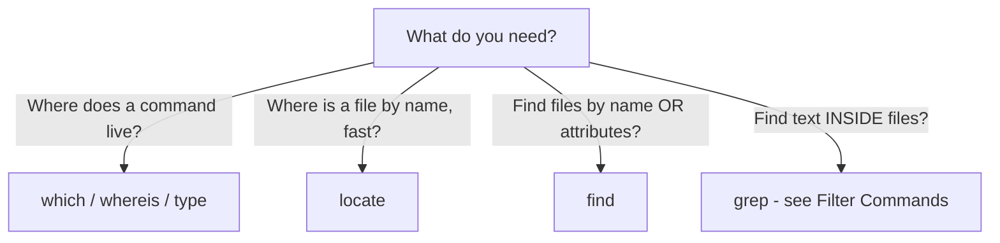

# 🧠 Topic: Linux Searching Commands

> [!abstract] Executive Summary (ELI5)
> "Searching" in Linux means two different things: finding a **file by its name or location**, and finding **text inside a file**. This note covers the first — commands that answer "where is this file or command?" The second — searching file contents with `grep` — lives in [[Filter_Commands]].

---

## 🎯 The "Why"
- **Problem Solved:** On a real system, files and commands live in dozens of directories (`/usr/bin`, `/etc`, `/home`, `/var`, ...). You constantly need to answer four questions: *Where does a command live? What kind of file is it? Where did I put that file? Are there files matching this name anywhere?* Search commands answer these without you manually `ls`-ing every directory.
- **Alternatives:** A GUI file manager, `ls -R` on a tree (slow and noisy), modern replacements like `fd` (a friendlier `find`) and `ripgrep`/`rg` (faster `grep`/`find` hybrid), or asking an AI assistant.
- **Trade-offs:** The classic tools (`find`, `locate`, `which`) are present on every Unix, script-friendly, and compose with other filters. They are verbose compared to `fd` or `rg`, but `fd`/`rg` are not installed by default and their syntax is non-standard — making the classics the right baseline for servers, containers, and CI.

## 💡 Mental Model & Analogy
- **Analogy:** A library with three helpers. `which`/`whereis`/`type` are the **information desk** — they tell you where a known command lives on the shelf. `locate` is a **card catalog** — fast, but only as current as its last update. `find` is a **librarian walking the aisles** — slow, thorough, and able to inspect each book's attributes (size, date, owner) as they go.
- **Visual/Diagram:**



## 🛠️ Core Principles & Code Snippets

### 1. `find` — the thorough, attribute-aware file searcher

`find` walks a directory tree in real time and matches files by **name, type, size, time, owner, permissions**, and more. It is the workhorse of file search.

```bash
find . -name "*.conf"
# Find files named *.conf under the current directory.

find . -iname "*.CONF"
# Case-insensitive name match.

find /var/log -type f -name "*.log"
# Only regular files (not directories) ending in .log.

find . -type d -name "node_modules"
# Only directories named node_modules.

find . -empty
# Empty files or directories.

find . -size +100M
# Files larger than 100 megabytes.

find /etc -mtime -7
# Files modified in the last 7 days (-mtime -7).

find /backup -mtime +30
# Files modified MORE than 30 days ago.

find . -name "*.tmp" -delete
# CAUTION: deletes every match. Preview without -delete first.

find . -name "*.js" -exec wc -l {} +
# Run wc -l on all matches, batching args for efficiency.
```

Common predicates:
- `-name PATTERN` / `-iname PATTERN` — match filename (shell glob); `-iname` is case-insensitive.
- `-type f|d|l` — regular file, directory, symlink.
- `-size [+|-]N[c|k|M|G]` — file size comparison.
- `-mtime [+|-]N` — modification time in days (`-7` = less than 7 days ago; `+7` = more than).
- `-mmin N` — modification time in minutes.
- `-user NAME` / `-group NAME` — ownership.
- `-perm MODE` — permissions (e.g., `-perm 644`, `-perm -u+s` for setuid).
- `-empty` — empty files or directories.
- `-delete` / `-exec CMD {} \;` / `-exec CMD {} +` — act on results.

> [!tip] Implementation Note
> `find` evaluates predicates **left to right** and short-circuits on `-a` (implied AND). Put cheap tests (like `-name`) before expensive ones (like `-exec`) for speed: `find . -name "*.log" -exec grep ERROR {} +`. The trailing `+` (vs `\;`) batches all matches into one command invocation — dramatically fewer process spawns.

> [!warning] `-delete` and `-exec rm` are irreversible
> Always run `find ...` **without** `-delete` first to preview the matches. A bad `-name` pattern combined with `-delete` can wipe far more than intended. For safety, prefer `-exec rm -i {} \;` (interactive) on critical paths.

### 2. `locate` — the fast, pre-indexed name searcher

`locate` queries a prebuilt database (`/var/lib/mlocate/mlocate.db`) instead of walking the filesystem, so it is **orders of magnitude faster** than `find` for name-only searches.

```bash
locate nginx.conf
# Prints every path matching *nginx.conf* in the index.

locate -i README
# Case-insensitive.

locate -r '\.log$'
# Regex match (paths ending in .log).

locate -c passwd
# Count matches instead of printing them.

sudo updatedb
# Rebuild the database. Run after installing software or creating many files.
```

Common flags:
- `-i` case-insensitive.
- `-r` / `--regex` regular expression match.
- `-c` count matches.
- `-e` verify the file still exists (the DB can be stale).
- `-A` print only paths matching ALL patterns (AND).

> [!tip] Implementation Note
> `locate`'s database is updated by a daily cron job (`/etc/cron.daily/mlocate`) or `plocate`'s timer, so it can report **files that were deleted today** or miss **files created today**. For current results, run `sudo updatedb` first. Newer systems ship `plocate` (a faster, drop-in replacement) — the syntax is identical.

### 3. `which` — where does a command's executable live?

`which` searches the directories in your `$PATH` and prints the full path of the executable that would run when you type a command.

```bash
which python3
# /usr/bin/python3

which -a python3
# Show ALL matches in PATH, not just the first.

which code
# /usr/local/bin/code  (or blank if not installed)
```

Common flags:
- `-a` print all matches (default prints only the first).

> [!tip] Implementation Note
> `which` only finds **external executables** on `PATH`. It does not know about shell built-ins (`cd`, `echo`), aliases, or functions — for those, use `type`. If `which docker` returns nothing but `docker` runs, it is likely a shell function or alias.

### 4. `whereis` — locate binaries, sources, and man pages

`whereis` searches a fixed set of standard directories (`/usr/bin`, `/usr/share/man`, `/usr/src`, ...) for a command's **binary, source code, and manual pages** simultaneously.

```bash
whereis ls
# ls: /usr/bin/ls /usr/share/man/man1/ls.1.gz

whereis -b ls
# Binary only.

whereis -m ls
# Man page only.

whereis -s ls
# Source only.
```

Common flags:
- `-b` binary only.
- `-m` manual section only.
- `-s` source only.
- `-B /path` limit binary search to specific directories.

> [!tip] Implementation Note
> `whereis` does **not** use `$PATH` — it searches hardcoded system directories. This means it can find man pages and source that `which` cannot, but it will miss binaries installed outside standard locations (e.g., `~/.local/bin`, `nvm` shims). Use `which` for "what runs?", `whereis` for "what is installed system-wide?"

### 5. `type` — what kind of command is this?

`type` is a **shell builtin** that tells you how the shell would interpret a name: as an alias, function, builtin, keyword, or external file.

```bash
type ls
# ls is aliased to 'ls --color=auto'

type cd
# cd is a shell builtin

type grep
# grep is /usr/bin/grep

type ll
# ll is an alias for 'ls -alF'

type -a echo
# echo is a shell builtin
# echo is /usr/bin/echo
```

Common flags:
- `-a` show all interpretations (builtin AND external path).
- `-t` print only the type word (`alias`, `function`, `builtin`, `file`, `keyword`).

> [!tip] Implementation Note
> `type` is the most authoritative of the three (`which`/`whereis`/`type`) because it reflects **what the shell actually does** — including aliases and functions, which `which` ignores. When a command behaves unexpectedly, run `type <name>` first to see what is really being invoked.

## ⚠️ Pitfalls & Anti-patterns
- **Common Mistakes:**
  - Running `find / -name "..."` without scoping — it traverses the **entire filesystem** (slow, noisy, and riddled with "Permission denied" errors). Scope to a subdirectory or add `2>/dev/null`.
  - Forgetting that `-name "*.conf"` must be **quoted**; without quotes the shell expands the glob before `find` sees it, so you search for a literal filename that may not exist.
  - Trusting `locate` blindly — its database is a snapshot, so freshly created or deleted files may be wrong. Run `sudo updatedb` or verify with `-e`.
  - Using `which` for shell builtins/aliases and getting no output, then concluding "it's not installed." Use `type` instead.
  - Using `-exec ... \;` (semicolon) when `+` (plus) would batch all matches into fewer process invocations — a major performance difference on thousands of files.
  - Putting `-delete` in a `find` command before previewing the match list.
- **When NOT to use:**
  - For interactive "fuzzy" file finding, `fd` ("`fd`") and `fzf` are faster and friendlier. But they are not installed by default.
  - For searching file **contents** at scale, use `grep -r` or `ripgrep` (`rg`) — see [[Filter_Commands]]. `find` is for attributes, not contents.
  - For programmatic use, prefer explicit paths over relying on `locate`'s stale index.
- **Performance/Security considerations:**
  - `find /` is expensive and can traverse sensitive directories; scope it with `-xdev` (don't cross filesystem boundaries) or `-maxdepth`.
  - `locate`'s database is world-readable and indexes all filenames — including files in private directories whose names may reveal secrets or user names. In hardened environments, `mlocate` indexes with per-user visibility rules; verify your setup.
  - `-exec` runs a command for every match; combined with user-supplied filenames this can be a code-injection vector. Avoid `-exec sh -c '... {} ...'` with untrusted input — use `find -print0 | xargs -0` with explicit argument separation.
  - `find` follows symlinks only with `-L`; by default it does not, which is safer but can miss files reached through symlinks.

## 🔗 Deep Connections
- **Parent Topic:** [[Linux Operating System]]
- **Related Concepts:** [[Linux_Commands]], [[Filter_Commands]] (for content search with `grep`), [[IO_Redirection]] (for `2>/dev/null` to silence permission errors), [[Linux_Important_Directories]]
- **Prerequisites:** Basic terminal navigation ([[Linux_Commands]]), understanding of `$PATH` and the shell ([[Linux_Shell]]).

## ❓ Active Recall Questions
> [!faq]- What are the two distinct families of "searching" in Linux, and which command owns each?
> **File/location search** — "where is this file or command?" (`find`, `locate`, `which`, `whereis`, `type`). **Content search** — "what text is inside these files?" (`grep` and its variants). This note covers the first; content search lives in [[Filter_Commands]].

> [!faq]- What is the core difference between `find` and `locate`, and when do you prefer each?
> `find` **walks the filesystem in real time** — accurate but slow, and can match on attributes (size, time, owner). `locate` queries a **prebuilt database** — extremely fast, but only matches names and can be stale. Prefer `locate` for quick name lookups (run `updatedb` if freshness matters); prefer `find` when you need attribute predicates or guaranteed-current results.

> [!faq]- Why might `which docker` return nothing even though `docker` runs fine in your shell?
> `which` only finds **external executables on `$PATH`**. It ignores aliases, shell functions, and builtins. If `docker` is an alias or function (common in dev setups), `which` returns blank. Run `type docker` instead — it shows what the shell actually invokes, including aliases and functions.

> [!faq]- Among `which`, `whereis`, and `type`, which is the most authoritative, and why?
> `type`. It is a shell builtin that reflects **what the shell actually does** — resolving aliases, functions, builtins, and external files in the order the shell checks them. `which` ignores aliases and builtins; `whereis` searches hardcoded system directories and ignores `$PATH`. When a command behaves unexpectedly, `type` is the first tool to reach for.

> [!faq]- Why is `find . -name "*.log" -exec grep ERROR {} +` faster than the same command with `\;`?
> `\;` runs `grep` **once per matching file** — thousands of process spawns. `+` **batches** all matching filenames into as few `grep` invocations as possible, drastically reducing process overhead. Always prefer `+` unless the command can only take one file at a time.

> [!faq]- Why must `-name "*.conf"` be quoted, and what happens if you forget?
> Without quotes, the **shell expands the glob first** against the current directory. If `*.conf` matches files locally, `find` receives those literal filenames instead of the pattern — searching for the wrong thing. If it matches nothing, the shell may pass the literal `*.conf` through (with `nullglob` off), masking the bug. Always quote patterns.

> [!faq]- What does `find / -name "..." 2>/dev/null` protect against, and what does it hide?
> It **discards stderr** — silencing the flood of "Permission denied" messages from directories `find` cannot read. The protection is a cleaner screen; the risk is that it also hides **real errors** (a broken path, a failing `-exec`, a trashed filesystem). Remove `2>/dev/null` while debugging.

> [!faq]- Why can `locate` report a file that no longer exists, and how do you guard against it?
> `locate` reads from a **prebuilt database** updated by a daily cron job (or `plocate` timer), not the live filesystem. A file deleted today may still be in the index; a file created today may be missing. Guard with `locate -e` (verify existence before printing) or run `sudo updatedb` to refresh.

---

## 📝 How to use this template effectively
1. **Never Copy-Paste:** If you find yourself copying documentation, stop. Read, close the tab, and write it from memory.
2. **Iterate:** Fill the 'ELI5' and 'Analogy' first. If you can't explain it simply, you don't understand it yet.
3. **The "Why" is King:** Seniority is defined by knowing *when* and *why* to use a tool, not just *how*.
4. **Update the Status:** Move from `analyzing` -> `implemented` -> `mastered` as you apply this in real projects.
