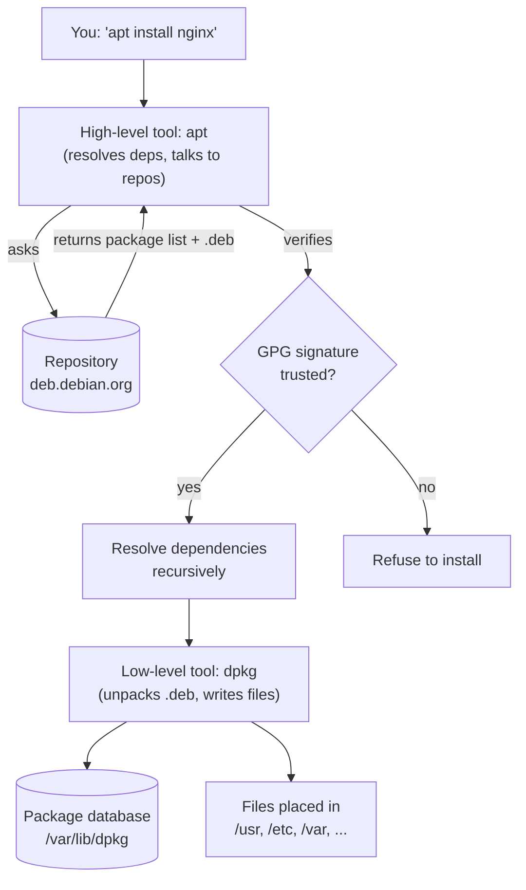

# 🧠 Topic: Linux Package Management

> [!abstract] Executive Summary (ELI5)
> A package manager is the **app store of Linux**. Instead of downloading installers from websites, you run one command and the system finds the software, downloads it, verifies it's authentic, installs it, and tracks every file so it can be cleanly removed later. Linux has **two families**: Debian-based (`apt`/`dpkg`, `.deb` files) and Red Hat-based (`dnf`/`rpm`, `.rpm` files). Each has a low-level tool that does the actual install and a high-level tool that resolves dependencies and talks to repositories.

---

## 🎯 The "Why"
- **Problem Solved:** Without a package manager, installing software means: hunting down a binary, trusting its source, manually placing files in the right directories, and somehow keeping track of what went where so you can uninstall or update it. Multiply by hundreds of programs with **shared dependencies** and you get "dependency hell" — the pre-package-manager Linux experience. A package manager solves five problems at once:
  1. **Discovery** — a searchable catalog of available software.
  2. **Dependency resolution** — if app A needs library B v1.2, the manager fetches B automatically and at the right version.
  3. **Integrity** — packages are **GPG-signed**; the manager verifies the signature before installing, preventing tampered/malicious software.
  4. **Lifecycle tracking** — every installed file is recorded in a database, so updates and removals are clean and complete.
  5. **Centralized updates** — `apt upgrade` / `dnf upgrade` patches the *entire system* in one command, closing security holes uniformly.
- **Alternatives:**
  - **Building from source** (`./configure && make && make install`) — maximal control, zero dependency management, no clean uninstall. The "old way."
  - **Language-specific managers** — `pip` (Python), `npm` (Node), `cargo` (Rust), `gem` (Ruby). These manage *language* packages, not system packages, and don't know about each other or the OS.
  - **Universal/binary package formats** — **Snap** (Canonical), **Flatpak** (distro-agnostic, sandboxed apps), **AppImage** (single portable file). These bypass the distro's package manager to ship one bundle that runs anywhere, at the cost of size and integration.
  - **Nix** — a functional, declarative package manager where every package lives in an isolated store path; enables atomic upgrades and rollbacks. Powerful, steep learning curve.
  - **Container images** — in modern DevOps, the "package" is often a container image (Docker/OCI); the host just needs a runtime, not a per-app install.
- **Trade-offs:** The distro package manager gives you **stability and integration** but at the cost of **version lag** — Debian/Ubuntu ship older, patched versions rather than the latest upstream release. If you need bleeding-edge versions, you reach for upstream repos, Snap/Flatpak, or language managers, sacrificing some of the distro's integration guarantees.

## 💡 Mental Model & Analogy
- **Analogy:** A package manager is a **furniture store with delivery + assembly + a lifetime warranty**. You don't drive to a warehouse, haul a box home, and figure out which screw goes where. You say "I want a desk" (`apt install`), the store checks its catalog (the **repository**), confirms it's from a trusted maker (**GPG signature**), delivers the desk plus any required tools it depends on (**dependencies**), assembles it in the right room (installs files to standard paths), and keeps your receipt (the **package database**) so you can return it cleanly later (`apt remove`).
- **Visual/Diagram — the two-layer model:**



> [!tip] The single most important mental model
> **Two layers.** The **low-level tool** (`dpkg` / `rpm`) does the mechanical work — unpack an archive, place files, record them in a database. It has **no idea** about the internet, repositories, or dependencies. The **high-level tool** (`apt` / `dnf`) sits on top: it knows about repositories, downloads packages, resolves the dependency graph, and then hands each package to the low-level tool to actually install. You almost never use the low-level tool directly — but knowing the split explains *why* `apt` can say "dependency error" while `dpkg` just unpacks whatever you point it at.

## 🛠️ Core Principles & Code Snippets

### 1. The two families and their tools

| Family | Distributions | Package file | Low-level | High-level |
|--------|---------------|--------------|-----------|------------|
| **Debian** | Debian, Ubuntu, Mint, Pop!_OS | `.deb` | `dpkg` | `apt` / `apt-get` |
| **Red Hat** | RHEL, CentOS, Fedora, Rocky, Alma | `.rpm` | `rpm` | `dnf` (was `yum`) |

- `yum` is the **predecessor** of `dnf` (Fedora switched in 2015; RHEL/CentOS in version 8). You'll still see `yum` in older docs and scripts; `dnf` is its modern, faster, dependency-resolving successor.
- `apt` is the newer, user-facing front-end to `apt-get` + `apt-cache`. In scripts, prefer **`apt-get`** (stable, scriptable output); interactively, use **`apt`** (nicer formatting, progress bar).

### 2. The four core operations — Debian family (`apt`)

```bash
# 1. UPDATE THE CATALOG (does NOT install anything!)
sudo apt update
# Fetches the latest package lists from each repository.
# Run this BEFORE install/upgrade, or you may install stale versions.

# 2. INSTALL
sudo apt install nginx
sudo apt install nginx=1.24.0-1    # pin a specific version
sudo apt install ./file.deb        # install a local .deb file (note the ./)

# 3. UPGRADE
sudo apt upgrade          # upgrade installed packages (won't remove others)
sudo apt full-upgrade     # upgrade + remove packages if needed to resolve deps

# 4. REMOVE
sudo apt remove nginx             # remove binaries, keep config files
sudo apt purge nginx              # remove binaries AND config files
sudo apt autoremove               # remove dependencies no longer needed
```

> [!warning] `apt update` vs `apt upgrade` — the #1 beginner confusion
> **`apt update` does not install or upgrade anything.** It only refreshes the local copy of "what's available" from each repository (the package lists in `/var/lib/apt/lists/`). **`apt upgrade`** is what actually installs newer versions. Always run `update` first, so `upgrade` knows the latest versions. Forgetting `update` means you may install a version that was current *when the lists were last fetched*, which could be days or weeks stale.

### 3. The four core operations — Red Hat family (`dnf`)

```bash
# 1. CHECK FOR UPDATES (dnf auto-refreshes metadata, no separate 'update' cmd)
sudo dnf check-update

# 2. INSTALL
sudo dnf install nginx
sudo dnf install nginx-1.24.0     # pin a version
sudo dnf install /path/to/file.rpm

# 3. UPGRADE
sudo dnf upgrade          # upgrades all packages (dnf uses 'upgrade' not 'upgrade')

# 4. REMOVE
sudo dnf remove nginx             # removes package + unused dependencies (by default)
sudo dnf autoremove               # remove orphaned dependencies
```

- Unlike `apt`, `dnf` refreshes repository metadata automatically (with a configurable expiry, default ~90 min). You don't strictly need a separate "update the catalog" step — but `check-update` lets you see what's pending before applying.

### 4. Searching and inspecting packages

```bash
# --- Debian (apt) ---
apt search nginx              # search package names + descriptions
apt show nginx                # details: version, dependencies, maintainer, size
apt list --installed          # all installed packages
apt list --upgradable         # packages with newer versions available
dpkg -l                       # full installed-package database (low-level)
dpkg -L nginx                 # what FILES did the nginx package install?
dpkg -S /usr/bin/curl         # which PACKAGE owns this file?

# --- Red Hat (dnf) ---
dnf search nginx
dnf info nginx
dnf list installed
dnf list upgrades
rpm -qa                       # all installed packages (low-level)
rpm -ql nginx                 # files installed by nginx
rpm -qf /usr/bin/curl         # which package owns this file
```

> [!tip] The two questions you'll ask most
> **"What did this package install?"** → `dpkg -L <pkg>` / `rpm -ql <pkg>`. **"Which package owns this file?"** → `dpkg -S <file>` / `rpm -qf <file>`. These are the reverse lookups that turn a mystery file into a known, managed package — essential when something breaks and you need to know what to reinstall or remove.

### 5. Repositories and sources

A **repository** ("repo") is a server hosting packages + metadata. Your package manager knows about several repos, listed in:

```bash
# Debian/Ubuntu
cat /etc/apt/sources.list         # main sources list
ls /etc/apt/sources.list.d/       # third-party repo files (*.list, *.sources)

# Red Hat
cat /etc/yum.repos.d/*.repo       # each file = one repo definition
dnf repolist                      # list currently enabled repos
```

- **Signing:** every repo ships a **GPG public key**. The package manager uses it to verify that packages truly came from that repo and weren't tampered with in transit. Add a third-party repo's key first (e.g., `rpm --import` on RHEL; signed-by/keyring on Debian), or the manager will refuse to install.
- **Why adding third-party repos is risky:** every repo you add is a **trust expansion** — you're saying "I trust this publisher to install anything on my system as root." A compromised or negligent third-party repo can push malicious updates. Prefer official distro repos; pin third-party repos to specific packages.
- **Pinning (Debian):** `/etc/apt/preferences` lets you rank repos so, e.g., a package comes from the stable repo unless you explicitly ask for the testing version.

```bash
# Adding a third-party repo (Debian/Ubuntu, modern signed-by style)
# 1. Download the publisher's GPG key into the keyring
curl -fsSL https://example.com/repo/key.gpg | sudo gpg --dearmor -o /usr/share/keyrings/example.gpg
# 2. Add the source, referencing the keyring
echo "deb [signed-by=/usr/share/keyrings/example.gpg] https://example.com/repo stable main" \
  | sudo tee /etc/apt/sources.list.d/example.list
sudo apt update
```

### 6. Where files actually go (the FHS layout)

Package managers install files into standard directories per the **Filesystem Hierarchy Standard** — so every package agrees on where things live:

| File type | Destination | Example |
|-----------|-------------|---------|
| Executables (binaries) | `/usr/bin`, `/usr/sbin` | `/usr/bin/curl` |
| Libraries | `/usr/lib`, `/usr/lib64` | `/usr/lib/x86_64-linux-gnu/` |
| Configuration | `/etc` | `/etc/nginx/nginx.conf` |
| Documentation | `/usr/share/doc` | `/usr/share/doc/nginx/` |
| System-managed state | `/var` (logs, caches) | `/var/log/nginx/` |

- This is **why** `apt remove` (without `purge`) **keeps** `/etc` config files — they're flagged as "conffiles" and preserved across removal so a reinstall resumes where you left off. `purge` deletes them.
- It's also why **manual `./configure && make install` is dangerous**: it often dumps files into `/usr/local` *outside* the package database, so `apt`/`dnf` don't know they exist, can't update them, and can't remove them cleanly. They become invisible orphans.

### 7. Services started by packages

```bash
sudo apt install nginx
# Many packages register and (on newer systems) start a systemd service automatically.
systemctl status nginx        # check it
systemctl enable --now nginx  # enable at boot + start now
```

- On Debian/Ubuntu, many daemon packages use **policy questions** (debconf) at install time, e.g., "restart service automatically on upgrade?" Your answer is remembered for future upgrades.
- This is a key DevOps gotcha: **installing a package can change running system state**, not just lay down files. A package install in production can restart a service and cause a blip.

### 8. Package groups / modules — installing a role at once

```bash
# Red Hat: install a whole "group" (e.g., dev tools, web server role)
dnf groupinstall "Development Tools"
dnf grouplist

# Debian: tasks are similar coarser bundles
apt install tasksel && tasksel   # e.g., "Ubuntu desktop" task

# RHEL 8+ modules: pick a stream/version of a stack (e.g., nodejs:18 vs nodejs:20)
dnf module list
dnf module enable nodejs:20
dnf module install nodejs:20
```

- **Modules** (RHEL 8+) are the modern answer to "I need a specific major version of a stack from the official repo" — without resorting to third-party repos.

## ⚠️ Pitfalls & Anti-patterns
- **Common Mistakes:**
  - Running `apt upgrade` without `apt update` first → installing stale versions, or failing with "package not found" when the lists don't yet reference the new version.
  - Confusing `apt remove` (keeps config) with `apt purge` (removes config). The leftover config in `/etc` causes "phantom" behavior after reinstall if you expected a clean slate.
  - `apt install package.deb` (without `./`) → apt interprets `package.deb` as a package *name* and searches the repo, failing. Use `apt install ./package.deb` (with path) to install a local file.
  - Building from source into `/usr/local` and then expecting `apt`/`dnf` to update or remove it. It won't — those files are outside the package database and become invisible orphans that conflict with future package versions.
  - Mixing repositories carelessly (stable + testing + unstable on Debian, or EPEL + random coprs on RHEL) → dependency conflicts, un-installable states, "held broken packages." Add repos deliberately and use pinning.
  - Adding a third-party repo's GPG key globally to the trusted keyring (the old `apt-key add` way, now deprecated) — this trusts the key for *all* packages, not just that repo. Use the `signed-by=` per-repo keyring style.
  - Forgetting that **installing a package can start/enable a service** — surprising in production or in a container build.
  - Confusing `apt` (interactive, pretty) with `apt-get` (scriptable, stable output). CI/CD scripts should use `apt-get` so output parsing doesn't break across versions.
- **When NOT to use the distro package manager:**
  - You need a **specific newer version** than the distro ships → use upstream backports, a language manager (`pyenv`, `nvm`), or Snap/Flatpak.
  - In **containers** → install only what the image needs; avoid `sudo` (run as non-root), and consider multi-stage builds so build tools don't ship in the final image.
  - For **application dependencies** (a Python app's libraries) → use the language manager (`pip`, `bundler`), not the OS package manager. Mixing the two causes version drift.
- **Security considerations:**
  - **GPG verification is the integrity boundary.** If you `--nogpgcheck` your way past failures, you've disabled the only thing preventing a tampered package. Investigate why the signature fails rather than bypassing it.
  - **`apt`/`dnf` run as root** and execute package maintainer scripts (preinst/postinst) as root. A malicious or buggy package = full compromise. This is why repo trust matters.
  - Keep the system patched: `unattended-upgrades` (Debian) or `dnf-automatic` (RHEL) can auto-apply security updates. Balance this against the risk of an update breaking a production service.
  - Audit third-party repos periodically: every added repo is permanent trust until removed.

## 🔗 Deep Connections
- **Parent Topic:** [[Unix_Like_Kernel]] — package managers run in user space but install kernel modules, firmware, and system libraries.
- **Related Concepts:** [[Linux_Important_Directories]] (FHS layout — where packages install files), [[Linux_Shell]] (scripting installs), [[Root_User_vs_Regular_User]] and [[Sudo]] (installs require root), [[Users_and_Groups]] (packages may create service users).
- **Prerequisites:** Basic command line, the root/sudo model, the filesystem hierarchy.

## ❓ Active Recall Questions
> [!faq]- What is the difference between a low-level (`dpkg`/`rpm`) and high-level (`apt`/`dnf`) package tool, and why does the split exist?
> The **low-level tool** does the mechanical install: unpack a `.deb`/`.rpm`, place files, record them in a database (`/var/lib/dpkg` or the rpm db). It has **no concept of repositories, the network, or dependencies**. The **high-level tool** sits on top: it fetches package lists from repos, resolves the dependency graph recursively, downloads packages, and hands each one to the low-level tool. The split exists because dependency resolution and repo management are complex concerns cleanly separated from "unpack this archive." You almost always use the high-level tool.

> [!faq]- What's the difference between `apt update` and `apt upgrade`? What goes wrong if you skip the first?
> **`apt update`** refreshes the local package *lists* (the catalog of what's available) from each repository — it installs nothing. **`apt upgrade`** actually installs newer versions of installed packages. If you skip `update`, your local lists may be days old, so `upgrade` either installs stale versions or fails with "package/version not found" because it doesn't yet know about the newer release. Always `update` then `upgrade`.

> [!faq]- Predict the result: you run `apt install package.deb` (no path). What happens, and how do you fix it?
> `apt` interprets `package.deb` as a package **name** and searches the configured repositories for it — it fails with "unable to locate package." To install a **local** `.deb` file, give apt a path so it knows it's a file: `apt install ./package.deb` (the `./` is the tell). Under the hood this still resolves dependencies from the repos, which is why `apt install ./file.deb` is preferred over raw `dpkg -i file.deb` (which fails on missing deps).

> [!faq]- You `apt remove nginx` and reinstall it, but the old config in `/etc/nginx` is still there. Why? How do you get a truly clean slate?
> `apt remove` keeps files flagged as **conffiles** (configuration under `/etc`) so a reinstall resumes where you left off — a deliberate choice to avoid clobbering your edits. To remove config too, use **`apt purge nginx`** (or `remove --purge`). This is also why "I removed and reinstalled but it still has the old config" is one of the most common package-management confusions.

> [!faq]- You built a tool with `./configure && make && make install` and now `apt` can't update or remove it. Why, and what's the lesson?
> `make install` placed files into `/usr/local` (typically) **outside the package database**, so `apt`/`dnf` have no record of them — they're invisible orphans. The package manager can't update, remove, or even know about them, and they may conflict with a future package version that installs to the same path. Lesson: prefer the distro package; if you must build from source, use `checkinstall` to generate a `.deb`/`.rpm` from the install, or install into an isolated prefix (or use a container).

> [!faq]- Two commands: `dpkg -L nginx` and `dpkg -S /usr/bin/curl`. What does each answer, and when do you reach for them?
> **`dpkg -L nginx`** lists every **file** the nginx package installed (forward lookup: package → files). **`dpkg -S /usr/bin/curl`** does the reverse: which **package** owns this file (file → package). You reach for `-L` when something broke and you want to see what a package laid down; you reach for `-S` when you found a mystery file and want to know which package (to reinstall, remove, or report a bug against). `rpm -ql` / `rpm -qf` are the RHEL equivalents.

> [!faq]- Why is adding a third-party repository a security-relevant decision, and what's the modern (Debian) way to scope its trust?
> Every repo you add is **trust expansion**: its packages are GPG-signed and installed as root, so a compromised or negligent publisher can push malicious updates to your system. The old `apt-key add` trusted a key globally for *all* packages. The **modern way** is a per-repo keyring with `signed-by=`: store the key in `/usr/share/keyrings/publisher.gpg` and reference it in the repo line (`deb [signed-by=/usr/share/keyrings/publisher.gpg] ...`), so the key is trusted **only** for that repo's packages. Prefer official repos; pin third-party repos narrowly.

> [!faq]- You're writing a CI script. Should you use `apt` or `apt-get`, and why?
> **`apt-get`.** `apt` is the interactive front-end — its output format (progress bars, colors, "hint" messages) is **not stable** across versions and can break parsing. `apt-get` has **stable, scriptable output** and is documented as the choice for automation. Same logic: use `apt-get update && apt-get install -y <pkg>` in scripts, not `apt`. Always pass `-y` for non-interactive installs.

> [!faq]- In modern DevOps, when would you NOT use the distro package manager for an application's dependencies?
> (1) When you need a **specific version** the distro doesn't ship → upstream repo, language version manager (`pyenv`/`nvm`), or Snap/Flatpak. (2) For a **language app's own dependencies** (a Python app's pip libraries) → use the language manager, not `apt`, to avoid version drift between the app and the OS. (3) In **containers** → install only what the image needs, avoid `sudo`, and use multi-stage builds so build-only tools don't ship in the final image. The OS package manager is for system software; the language manager is for app software.

---

## 📝 How to use this template effectively
1. **Never Copy-Paste:** If you find yourself copying documentation, stop. Read, close the tab, and write it from memory.
2. **Iterate:** Fill the 'ELI5' and 'Analogy' first. If you can't explain it simply, you don't understand it yet.
3. **The "Why" is King:** Seniority is defined by knowing *when* and *why* to use a tool, not just *how*.
4. **Update the Status:** Move from `analyzing` -> `implemented` -> `mastered` as you apply this in real projects.
