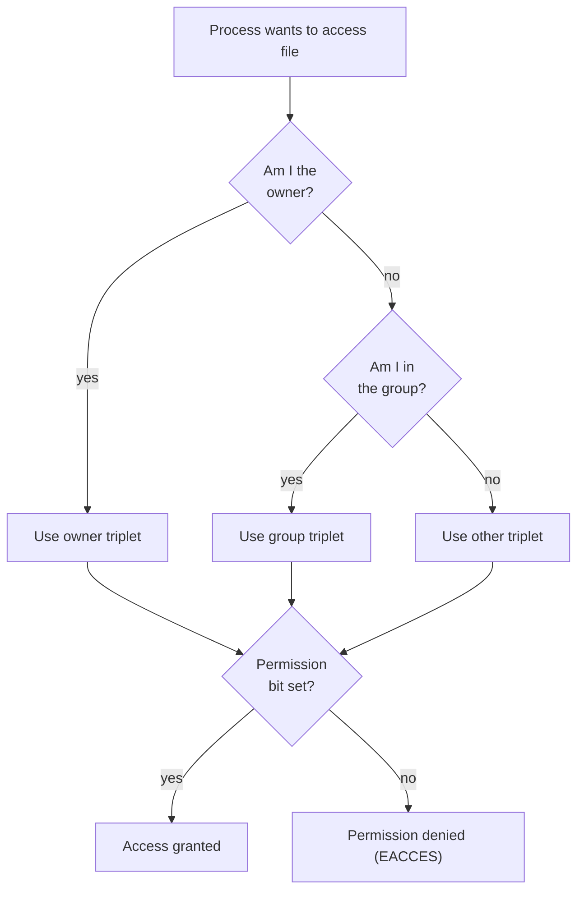

# 🧠 Topic: Linux File Permissions

> [!abstract] Executive Summary (ELI5)
> Every file and directory on Linux carries a small label that says who can read, write, or execute it. That label is split into three audiences — **owner**, **group**, and **others** — and three actions — **r**, **w**, **x**. The kernel checks this label on every file operation. `chmod` changes the label, `chown` changes whose name is on it, and `umask` decides what label brand-new files get by default.

---

## 🎯 The "Why"
- **Problem Solved:** On a multi-user system, files must be private to their owner, shareable with a team, or public to everyone — and the kernel must enforce this on every access without trusting applications to police themselves. The Unix permission model is a compact, predictable scheme that has scaled from single servers to container runtimes.
- **Alternatives:**
  - **POSIX ACLs** (`setfacl`/`getfacl`) — finer-grained per-user/per-group permissions layered on top of the base model. Use when "owner+group+other" is too coarse (e.g., give two specific users different access to the same file).
  - **MAC systems** — SELinux (type enforcement), AppArmor (path profiles). These enforce *policy* (e.g., "nginx may read `/var/www` but not `/home`") independent of ownership, and are mandatory even for root.
  - **Capabilities** (`setcap`) — split root's powers into granular privileges a file can grant to a binary.
- **Trade-offs:** The classic rwx model is trivially simple, universal, and survives in every Unix tool — but it cannot express "Alice has read, Bob has read-write" without creating a dedicated group. That gap is why ACLs exist. Learn the base model first; it is the substrate every advanced system builds on.

## 💡 Mental Model & Analogy
- **Analogy:** A file is a **safe with three keyholes**, arranged left-to-right: one for the **owner**, one for the **group**, one for **everyone else**. The kernel tries only the *first keyhole that matches you* — if you're the owner, it ignores the group and other slots entirely; if you're in the group, it ignores "other". Each keyhole has three tumblers: **r** (look inside), **w** (change the contents), **x** (run it / enter it).
- **Visual/Diagram:**



> [!tip] The "first match wins" rule
> Permissions are **not additive**. If you own a file, the group and "other" bits are irrelevant to you — even if they grant more. A file `-rw-rwxrwx` owned by you still gives you only `rw-`. This surprises people who expect permissions to stack.

## 🛠️ Core Principles & Code Snippets

### 1. Reading the `ls -l` output

```bash
ls -l /etc/passwd
# -rw-r--r-- 1 root root 2931 Jul 13 10:00 /etc/passwd
#  └┬┘└┬┘└┬┘└┬┘
#   │  │  │  └── others:    r--   (read only)
#   │  │  └───── group:     r--   (read only)
#   │  └──────── owner:     rw-   (read + write)
#   └─────────── type + special bits
```

- **Character 1** is the file type: `-` regular file, `d` directory, `l` symlink, `c`/`b` device, `p` pipe, `s` socket. See [[File_Types]].
- **Characters 2–10** are three triplets: owner (user), group, others.
- The **owner** and **group** names follow the link count. Files created by a user are owned by that user's UID and **primary GID** (see [[Users_and_Groups]]).

### 2. What r, w, x actually mean — files vs directories

Permissions mean **different things for files and directories**. This is the single most misunderstood part of the model.

| Bit | File | Directory |
|-----|------|-----------|
| `r` | View file contents (`cat`, `grep`) | **List** entry names inside (`ls`) |
| `w` | Modify file contents (truncate, append, edit) | **Add, delete, rename** entries in the directory |
| `x` | **Execute** the file (run it as a program) | **Enter / traverse** the directory (`cd`, access a file by path) |

> [!warning] The directory write gotcha
> To **delete or rename** a file, you need **write + execute on the directory**, *not* write on the file itself. You can delete a read-only file if its directory is writable — because deletion modifies the *directory*, not the file. The classic demo: a file `-r--r--r--` in a `drwxrwxrwx` directory can be `rm`'d by anyone. This is exactly what the **sticky bit** (below) exists to prevent.

> [!tip] Why you need `x` to read a file by path
> Accessing `/a/b/c.txt` requires execute permission on **every directory in the path**: `/`, `/a`, and `/a/b`. Read permission on `/a/b` only lets you *list* it; without `x` you cannot traverse into it to reach `c.txt`. This is why home directories are typically `drwxr-x---` — others get neither list nor traverse.

### 3. Numeric (octal) notation — and why it's octal

```bash
chmod 755 script.sh      # rwxr-xr-x
chmod 644 notes.txt      # rw-r--r--
chmod 600 ~/.ssh/id_rsa   # rw-------   (the SSH key standard)
chmod 700 ~/.ssh          # drwx------
chmod 1777 /tmp          # sticky bit (see §6)
```

The number is three (or four) **octal digits**, each digit encoding one triplet. Octal is used because each permission triplet is exactly **3 bits** — and one octal digit maps cleanly to 3 bits:

```
 r w x      bits      octal
 ─ ─ ─      ─────     ─────
 1 0 0  =   100₂  =   4   (read)
 0 1 0  =   010₂  =   2   (write)
 0 0 1  =   001₂  =   1   (execute)
 ─ ─ ─
 rwx = 111₂ = 7        r-x = 101₂ = 5    rw- = 110₂ = 6    r-- = 100₂ = 4
```

So `755` = `(4+2+1)(4+0+1)(4+0+1)` = `rwx r-x r-x`. The fourth leading digit (optional) encodes the **special bits** — setuid, setgid, sticky — covered in §6.

> [!tip] Don't memorize the table — derive it
> r=4, w=2, x=1. Add the bits you want. `rwx`=7, `rw-`=6, `r-x`=5, `r--`=4. That's the whole lookup. Common modes worth recognizing on sight: `755` (executable/script), `644` (config file), `600` (secret/key), `700` (private dir), `1777` (world-writable+sticky like `/tmp`).

### 4. Symbolic notation — `chmod ugoa +-=`

```bash
chmod u+x script.sh        # add execute for owner
chmod g-w data.txt         # remove write for group
chmod o=r report.pdf       # set others to exactly read-only (clears w,x)
chmod a+r public.html      # a = all (ugo)
chmod ugo+x,g+s shared/    # combine: +x for all, setgid on the dir
chmod +x deploy.sh         # no letter = default: affects 'a' but honors umask
```

- **Who:** `u` owner, `g` group, `o` others, `a` all (default when omitted, with a umask wrinkle).
- **Operator:** `+` add, `-` remove, `=` set exactly (wipes other bits for that who).
- **Permissions:** `r`, `w`, `x`, and the special `s`, `t`, plus capital **`X`** (see §5).

Use **symbolic** when you want to change *relative to* the current state ("just add execute without touching read/write"). Use **numeric** when you want an *absolute* end state ("this must be exactly 644").

### 5. Recursive `chmod` and the capital `X`

```bash
chmod -R 644 ./project     # WARNING: 644 on a dir = no execute = cannot cd into it!
chmod -R a+rwX ./project   # X = execute only for dirs OR files that already have x
```

- Running `chmod -R` with a numeric mode is the most common way to **brick a directory tree**: directories need the `x` bit to be traversable, and `644` strips it. You'll get `Permission denied` trying to `cd` in.
- **Capital `X`** fixes this: it grants execute only to (a) directories, or (b) files that already have *some* execute bit set. This is the correct way to make a tree readable-and-traversable without accidentally marking every text file executable:
  ```bash
  chmod -R u+rwX,go+rX ./project   # owner: rw+traverse, others: r+traverse, no stray +x on files
  ```

### 6. The three special bits — setuid, setgid, sticky

These live in the otherwise-unused fourth position and show up as letters in `ls -l`:

| Bit | Octal | Shows as | On a file | On a directory |
|-----|-------|----------|-----------|----------------|
| **setuid** | 4000 | `s` in owner triplet | Runs the binary **as its owner** (e.g., `passwd` runs as root) | (rarely meaningful) |
| **setgid** | 2000 | `s` in group triplet | Runs as the file's group | **New files inherit the directory's group** (team-shared folders) |
| **sticky** | 1000 | `t` in others triplet | (historical, ignored) | **Only the file's owner can delete/rename it**, even if the dir is world-writable |

```bash
ls -l /usr/bin/passwd /tmp
# -rwsr-xr-x ... /usr/bin/passwd     <- setuid: the 'x' became 's'  (4755)
# drwxrwxrwt ... /tmp                <- sticky:  the 'x' became 't'  (1777)

chmod u+s /usr/bin/myapp     # setuid  (or 4755)
chmod g+s /shared/projects   # setgid on a dir — new files get group 'projects' (2775)
chmod +t /shared/uploads     # sticky  (1777)
```

- **Why `/tmp` is `1777`**: it must be world-writable so anyone can create files, but without the sticky bit any user could delete anyone else's files. The sticky bit makes "world-writable but you can only touch your own stuff" possible. This is the canonical use case.
- **Why `/usr/bin/passwd` is setuid root**: editing `/etc/shadow` requires root, but you shouldn't need root to change *your own* password. The `passwd` binary runs *as root* so it can write shadow — but the binary itself enforces that you're only changing your own entry. Setuid is powerful and dangerous: every setuid-root binary is a privilege-escalation target. Audit them: `find / -perm -4000 2>/dev/null`.
- **Setgid on a directory** is how shared team folders work: drop a directory, `chgrp devs` it, `chmod g+s` it, and every file created inside is automatically group-owned by `devs` instead of the creator's primary group. Without this, files created in a shared dir get the *creator's* primary GID, fracturing group ownership.

> [!warning] Capital `S` vs lowercase `s`, `T` vs `t`
> When the underlying execute bit is **present**, the special bit shows as lowercase (`s`, `t`). When execute is **absent**, it shows uppercase (`S`, `T`). So `rwsr-xr-x` = setuid + execute, but `rwSr-xr-x` = setuid **without** execute — a broken/pointless state (you've marked a binary to run-as-owner but it isn't runnable). Uppercase is almost always a mistake.

### 7. `umask` — how default permissions are computed

```bash
umask          # 022   (typical default for regular users)
umask 077      # make new files private to the owner
mkdir d && touch f && ls -l
# drwxr-xr-x d     <- 777 & ~022 = 755
# -rw-r--r-- f     <- 666 & ~022 = 644

umask 077
mkdir d2 && touch f2 && ls -l
# drwx------ d2    <- 777 & ~077 = 700
# -rw------- f2    <- 666 & ~077 = 600
```

- New files start from a **base mode of 666** (rw-rw-rw-, no execute — never auto-create executable files). New directories start from **777** (rwxrwxrwx).
- `umask` is a **mask of bits to remove** from that base: `final = base & ~umask`. The bits in umask are the ones turned *off*.
- **Common confusion:** people add/subtract umask from the base. It's a bitwise AND-NOT, which happens to *look* like subtraction for normal values (`666 - 022 = 644`), but breaks for weird masks (e.g., umask `033` → file is `644`, not `633`). Think "mask, not subtract."

> [!tip] Why files start at 666, not 777
> The kernel deliberately omits the execute bit on new regular files so that you can't accidentally create an executable just by `touch`-ing it. You must explicitly `chmod +x`. Directories get 777 because they always need the execute (traverse) bit to be useful.

## ⚠️ Pitfalls & Anti-patterns
- **Common Mistakes:**
  - `chmod -R 644 dir/` and then being unable to `cd` into any subdirectory (directories lost their `x` bit). Use `chmod -R a+rX` or `u+rwX,go+rX` instead.
  - Assuming permissions are additive — a `-rw----r--` file owned by you still gives you only `rw-`; the trailing `r` for others doesn't stack onto your owner bits.
  - `chmod 777` on a secret "just to make it work" (`~/.ssh/id_rsa` must be `600` or SSH refuses it). Broad permissions on secrets break the tools that depend on them.
  - Confusing **write-on-file** (edit contents) with **write-on-directory** (delete/rename the entry). A read-only file in a writable directory is still deletable.
  - Setting setuid on a shell script — **modern Linux ignores setuid on interpreted scripts** (the kernel execs the interpreter, not the script, and the interpreter isn't setuid). It gives a false sense of privilege escalation that doesn't actually happen.
  - Forgetting that a **capital `S` or `T`** means the special bit is set without execute — usually a misconfiguration, not the intent.
  - `chown` changing the owner but not realizing the file may now be subject to a *different* `umask`-derived default for future siblings.
- **When NOT to rely on the base model:**
  - When you need per-user granularity on a single file ("Alice: rw, Bob: r") — use **ACLs** (`setfacl -m u:alice:rw,u:bob:r file`).
  - In hardened environments where even root should be constrained — MAC (SELinux/AppArmor) applies policy independent of ownership.
  - On network filesystems (NFS) where UID mapping and `root_squash` change who "owner" really is.
- **Security considerations:**
  - Audit setuid-root binaries regularly: `find / -perm -4000 -type f 2>/dev/null`. Each one is an escalation surface.
  - World-writable directories **must** have the sticky bit set, or any user can delete anyone's files (`/tmp` being the canonical example).
  - A file's permissions mean nothing if the **parent directory** is writable+executable by an attacker — they can delete and replace the file. Secure the directory, not just the file.
  - `umask 022` is a sane default for single-user boxes; `077` is safer for anything handling secrets. Set it in `~/.bashrc` or `/etc/profile`.

## 🔗 Deep Connections
- **Parent Topic:** [[Unix_Like_Kernel]] — permissions are enforced by the kernel's VFS on every `open`/`exec`.
- **Related Concepts:** [[Users_and_Groups]] (who the triplets apply to), [[Root_User_vs_Regular_User]] (root bypasses all checks), [[Sudo_and_Sudoers]] (escalation), [[File_Types]], [[Linux_Important_Directories]] (`/tmp`, `~/.ssh`).
- **Prerequisites:** Reading `ls -l` output, understanding users vs groups vs others.

## ❓ Active Recall Questions
> [!faq]- What three audiences and three actions does the Unix permission model use, and how are they ordered in `ls -l`?
> Three audiences: **owner (user), group, others**. Three actions: **read (r), write (w), execute (x)**. In `ls -l` the 9 permission characters are ordered owner-group-others, each as rwx: e.g. `rwxr-xr--`. See [[Linux_Permissions]].

> [!faq]- To delete a file, do you need write permission on the file, on its directory, or both? Why?
> You need **write + execute on the directory**. Deletion removes the directory *entry*, which is a modification of the directory — not of the file's contents. A read-only file (`-r--r--r--`) in a writable directory (`drwxrwxrwx`) can be `rm`'d by anyone. This is exactly the problem the **sticky bit** solves.

> [!faq]- Predict the result: `umask 022`, then `touch f && mkdir d`. What are the modes of `f` and `d`?
> Files start at base `666`, dirs at `777`; the mask is removed: `f` = `666 & ~022` = **644** (`rw-r--r--`), `d` = `777 & ~022` = **755** (`rwxr-xr-x`). The key insight: files never get the execute bit automatically, even though the base looks like it could.

> [!faq]- Why is `/tmp` mode `1777`? What would break without the leading `1`?
> `1777` = world-writable (`rwxrwxrwx`) **plus the sticky bit** (`1`). `/tmp` must be writable by everyone, but without the sticky bit any user could delete any other user's files. The sticky bit restricts deletion/rename to the file's owner (or root). Without it, `/tmp` would be a free-for-all that breaks multi-user safety.

> [!faq]- You run `chmod -R 644 project/` and suddenly can't `cd` into any subdirectory. What went wrong and how do you fix it correctly?
> `644` = `rw-r--r--` has **no execute bit**, and directories need `x` to be traversable. Stripping it bricks the tree. Fix with the capital-`X` form: `chmod -R u+rwX,go+rX project/` — `X` adds execute only to directories (and already-executable files), so dirs become traversable without marking every text file executable.

> [!faq]- What does it mean when `ls -l` shows a capital `S` instead of lowercase `s` in the owner triplet (e.g. `rwSr-xr-x`)?
> Capital `S` means **setuid is set but the owner execute bit is absent**. The file is marked to run-as-owner, yet isn't executable by the owner — a broken, almost-always-unintended state. Lowercase `s` (`rwsr-xr-x`) is the healthy form: setuid *and* executable. The same upper/lower convention applies to `T`/`t` for the sticky bit.

> [!faq]- A file is `-rw-rwxrwx` and owned by you. Can you execute it? What does this reveal about how the kernel checks permissions?
> No — owner triplet is `rw-`, no `x`. Permissions are checked by **first match wins**, not by adding the most permissive triplet. Because you are the owner, only the owner triplet applies; the generous group/other bits are ignored. If you needed execute, you'd have to set it on the owner (`chmod u+x`).

> [!faq]- What does setting the **setgid** bit on a directory accomplish, and why is it used for shared team folders?
> New files and subdirectories created inside inherit the **directory's group** instead of the creator's primary GID. In a shared team folder (`chgrp devs`, `chmod g+s`), every file anyone creates is automatically group-owned by `devs`, so the whole team can collaborate without per-file `chgrp`. Without setgid, each file would get the creator's primary group, fragmenting group ownership.

---

## 📝 How to use this template effectively
1. **Never Copy-Paste:** If you find yourself copying documentation, stop. Read, close the tab, and write it from memory.
2. **Iterate:** Fill the 'ELI5' and 'Analogy' first. If you can't explain it simply, you don't understand it yet.
3. **The "Why" is King:** Seniority is defined by knowing *when* and *why* to use a tool, not just *how*.
4. **Update the Status:** Move from `analyzing` -> `implemented` -> `mastered` as you apply this in real projects.
