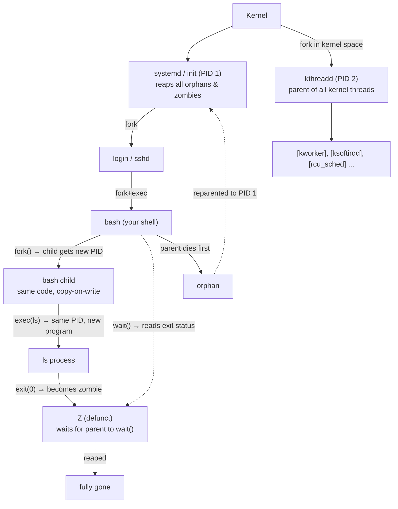

# 🧠 Topic: Linux Processes

> [!abstract] Executive Summary (ELI5)
> A **process** is a running program — a program on disk plus its live state (memory, open files, CPU time). The kernel gives each one a **PID** and schedules them so they appear to run at once. Every process is born when its parent **forks** (clones itself); the child then usually **execs** (replaces its code with a new program). When a process dies, the kernel keeps a tiny **zombie** entry holding its exit status until the parent collects it. **`ps`** lists processes, **`top`** watches them live, **`kill`** sends them signals, and **systemd (PID 1)** is the great-grandparent that adopts every orphan.

> [!note] How this fits with the other Linux notes
> Processes are the load-bearing concept the others hang off: [[Linux_Services_and_Systemd|services]] are *long-lived processes supervised by systemd*; [[Unix_Like_Kernel|the kernel]] *schedules* them; [[Users_and_Groups|users]] *own* them; signals are how you control them. This note covers the process model itself — creation, states, inspection, signaling, and the four special kinds (parent/child, orphan, zombie, kernel thread). It links out to the services note rather than re-covering `systemctl`.

---

## 🎯 The "Why"
- **Problem Solved:** A computer has one CPU (or a few) and finite RAM, but you run dozens of things at once — your shell, an editor, SSH, a web server, a database, kernel housekeeping. Four problems must be solved:
  1. **Multiplexing** — give each program the illusion of a private, uninterrupted machine (separate address space, scheduled CPU time).
  2. **Creation & identity** — start programs, give each a unique PID, and record *who owns it* and *which terminal* it's tied to.
  3. **Control** — ask a process to terminate, pause, or reload without yanking the rug out from under it; and *force*-kill it when it won't listen.
  4. **Cleanup** — collect exit statuses so the process table doesn't fill with the walking dead.
- The Unix answer is a single abstraction — the **process** — manipulated by a small set of syscalls (`fork`, `exec`, `wait`, `exit`, `kill`) and inspected through `/proc` by tools like `ps` and `top`.
- **Alternatives / neighbors:**
  - **Threads** — multiple execution streams *sharing* one address space (lighter than processes, but no memory isolation). Seen as separate PIDs in some tools (`ps -eLf`), one PID in others.
  - **Containers** — processes walled off by namespaces/cgroups but still *just processes* on the host kernel (see [[Unix_Like_Kernel]]). `ps aux` on the host sees container processes.
  - **Other OS models** — VMS/Windows NT create processes differently (one call that both creates and loads a program). Unix splits it into `fork` + `exec`, which is *more* flexible (you can set up the child's environment between the two).
- **Trade-offs:** the fork+exec split is elegant and composable (pipes, redirection, subshells all fall out of it) but `fork()` is **expensive in spirit** — it clones a whole address space. Linux mitigates this with **copy-on-write**: parent and child share the same physical pages until one writes. So fork is cheap *in practice*, which is why the Unix process model scales.

## 💡 Mental Model & Analogy
- **Analogy:** A process is a **worker on a job site**. The program on disk is the *instruction manual*; the process is the *worker currently following it*, holding tools (open files), standing somewhere (working directory), costing wages (CPU/RAM). When a worker spawns a helper, that's a **fork** — a new worker with the same paperwork. If the helper then *swaps in a different manual*, that's **exec** — same worker (same PID!), new job. A worker whose foreman quit gets reassigned to the **site manager (PID 1)** — that's an **orphan**. A worker who finished but whose timecard nobody has collected yet sits in the office as a **zombie**. The **kernel threads** are the site's own maintenance crew — no manual, no tools from outside, just internal upkeep, identifiable by their `[bracketed]` uniforms.
- **Visual/Diagram — process family tree, fork+exec, and reaping:**



> [!tip] The single most important mental model
> **A new program does not mean a new PID from a fresh process.** Running `ls` in the shell is `fork` (shell clones itself, child has a *new* PID) **then** `exec` (child *replaces* its program with `ls`, PID **stays the same**). So the `ls` process's PID is the child's PID, and its **PPID is the shell's PID**. Confusing fork (new process, same program) with exec (same process, new program) is the root of most process-model misunderstandings.

## 🛠️ Core Principles & Code Snippets

### 1. What a process *is* — the kernel's view
A process is the kernel's record of a running program. Each has:
- **PID** — unique process ID (the kernel hands these out, eventually wrapping).
- **PPID** — parent PID. Every process (except PID 1) has exactly one parent. The `ps -ef` tree is just `PID ↔ PPID` links.
- **UID / GID** — *who owns it* (see [[Users_and_Groups]]). Determines file access and **who may signal it** — you can only `kill` your own processes; root can signal any.
- **TTY** — controlling terminal, or `?` for daemons/kernel threads with no terminal.
- An **address space** (isolated memory), a set of **open file descriptors** (inherited from the parent at fork), a **state**, and accumulated **CPU/mem** usage.

The kernel exposes all of this as files under `/proc/<pid>/` — `ps` and `top` are just pretty-printers over `/proc`.

### 2. Process states — the STAT column you'll see everywhere
Every process is in exactly one state. This is the key to reading both `ps` and `top`:

| Code | Name | Meaning |
|------|------|---------|
| **R** | Running / Runnable | On CPU, or in the run queue waiting for a CPU. (Not necessarily consuming CPU *right now*.) |
| **S** | Interruptible sleep | Blocked waiting for an event (I/O, timer, a signal). Most processes sit here most of the time — it's the normal idle state. Woken by a signal. |
| **D** | Uninterruptible sleep | Usually waiting on disk I/O. **Cannot be woken or killed** — not even `kill -9` works until the I/O returns. The infamous "D-state" / "uninterruptible." |
| **Z** | Zombie (defunct) | Terminated, but the parent hasn't read its exit status yet. Already dead — you can't kill it. |
| **T** | Stopped | Paused by `SIGSTOP`/`Ctrl-Z` or a debugger (`ptrace`). Resumes on `SIGCONT`. |
| **I** | Idle | An idle **kernel thread**. |

Modifiers can follow the letter: `<` (high priority), `N` (low/niced), `s` (session leader — a shell), `l` (multi-threaded), `+` (in the foreground process group). So `Ss` = sleeping session leader (a typical shell), `R+` = running in foreground.

> [!warning] D-state is the one that bites
> A process stuck in **`D`** ignores *everything*, including `kill -9`. SIGKILL is only delivered when the process is scheduled, and a D-state process isn't schedulable until its I/O completes. If the I/O never completes (a hung NFS mount, a wedged disk), the process is unkillable until the underlying problem clears or you reboot. Don't reach for `kill -9` harder — diagnose the I/O.

### 3. `ps aux` — the BSD view (what's using resources)
```bash
ps aux
# USER  PID  %CPU %MEM    VSZ   RSS TTY  STAT START   TIME COMMAND
```
- **BSD syntax** — note: no dash. (`a`=all with a tty, `u`=user-oriented format, `x`=include processes with no tty, e.g. daemons.)
- Columns worth a mental model:
  - **`USER`** — the owner. Tells you whether *you* can signal it and what files it can touch.
  - **`VSZ`** — virtual memory size (KiB). The whole virtual address space, including lazy-allocated and swapped pages. **Inflated and misleading** — a process can have a huge VSZ and tiny real footprint.
  - **`RSS`** — resident set size (KiB). The physical RAM actually used. **This is the number to compare** when asking "what's eating my memory."
  - **`STAT`** — the state codes from §2.
  - **`TTY`** — `?` means "no controlling terminal" (daemons, kernel threads).
  - **`TIME`** — total CPU time consumed, *not* wall-clock elapsed.

### 4. `ps -ef` — the SysV view (who's whose child)
```bash
ps -ef
# UID  PID  PPID  C STIME TTY          TIME CMD
```
- **POSIX/SysV syntax** — note the dash. (`-e`=every process, `-f`=full format.)
- The headline difference from `aux`: it shows **`PPID`** (parent PID). That's what makes the *process tree* visible. Add `--forest` to render parent/child as a tree.
- **Choose by intent:** `ps aux` when you care about **resource use** (CPU/MEM/RSS); `ps -ef` when you care about **parentage and trees**. Same data underneath (both read `/proc`), two syntax families with different default columns. Neither is "more correct."

```bash
ps -ef --forest          # the family tree, indented
ps -eo pid,ppid,stat,cmd --forest   # tree with states
ps -eLf                  # show every THREAD (LWP) — a process may be many
```

### 5. Kernel threads — the maintenance crew
- **Kernel threads** run entirely in kernel space — no user program, no user address space. They do housekeeping: flushing caches, handling soft IRQs, RCU, memory reclaim.
- In `ps`/`top` they show **names in square brackets**: `[kthreadd]`, `[ksoftirqd/0]`, `[kworker/u8:2]`, `[migration/0]`, `[rcu_sched]`.
- **`kthreadd` is PID 2** and is the parent of all other kernel threads — `ps -ef --forest` shows them all nested under it.
- They're schedulable entities with PIDs, so they appear in your process lists, but you **can't meaningfully signal them** and they almost always show `0` CPU unless actively working. State `I` = idle kernel thread.
- Practical takeaway: don't be alarmed by a wall of `[bracketed]` entries in `top` — that's normal kernel plumbing, not a problem.

### 6. Forking — how processes are born (`fork` + `exec`)
```bash
# In a shell, run a command and inspect the relationship:
ls
echo "shell PID=$$, its parent PPID=$PPID"   # $$ = this shell's PID
```
The lifecycle every command goes through:
1. **`fork()`** — the shell (parent) clones itself. The **child** gets a *new PID*, PPID = parent's PID. Memory is shared **copy-on-write** (cheap). Both parent and child return from `fork()` — child sees `0`, parent sees the child's PID.
2. *(optional setup)* — the child can redirect FDs, close files, change priority *before* becoming the new program. **This is the whole reason fork and exec are separate** — it lets the shell wire up pipes, redirection, and the environment between them.
3. **`exec()`** — the child *replaces* its program image with the new one (`ls`). **PID unchanged**, code/data/stack overwritten. From here it's the `ls` process.
4. **`exit()`** — the program finishes and returns an exit status.
5. **`wait()`** — the parent collects the status. Until it does, the child is a **zombie** (§8).

> [!tip] Daemon = deliberate orphaning
> A **daemon** (background service) is created by inverting this: the program `fork`s, the **parent exits**, and the child keeps running. Because its parent is gone, the child is **reparented to PID 1** (an orphan, §7) — which detaches it from the starting terminal so it survives logout. systemd does this plumbing for you declaratively (see [[Linux_Services_and_Systemd]]); manually it's the classic "double-fork" daemonization dance.

### 7. Orphans — reparented, not killed
- An **orphan** is a child whose parent died *before* the child finished. **The orphan does not die** — the kernel **reparents** it to **PID 1** (init/systemd), or to the nearest **subreaper** if one is set.
- PID 1's defining duty is to **`wait()` on its adopted children** so they don't linger as zombies. This is *the* reason PID 1 must never crash — it's the process-table garbage collector.
- **Subreapers:** a process can declare itself a subreaper via `prctl(PR_SET_CHILD_SUBREAPER)`, so descendant orphans reparent to *it* instead of PID 1. **systemd `--user`, Docker, and container runtimes** do this — that's how a container's orphaned processes stay inside the container's care rather than escaping to the host's init.
- This is *desirable* for daemons (§6) and *benign* in normal use. The pathological case is the **zombie**, which is the *opposite* failure.

### 8. Zombies (defunct) — dead but not reaped
- A **zombie** is a process that has **terminated** (called `exit()` or was killed) but whose parent has **not yet called `wait()`** to read the exit status. The kernel can't free its process-table slot because the exit status must be handed to someone.
- A zombie holds **no memory and uses no CPU** — only a tiny PID entry with the exit code and accounting stats. In `ps`/`top` it shows state **`Z`** and often `<defunct>`.
- **You cannot kill a zombie with `kill -9`** — it is already dead; SIGKILL has nothing to act on. The fixes:
  1. Get the **parent to call `wait()`** (fix the buggy parent, or just wait — a slow parent may reap eventually).
  2. **Kill or restart the parent** — then the zombie is reparented to PID 1, which reaps it immediately.
- **Why it matters:** the process table is finite. Run out of PIDs and `fork()` starts failing (`ENOMEM` / "Resource temporarily unavailable"). A leaky parent hemorrhaging zombies can take down a host — not by RAM, but by exhausting the process table.

### 9. `kill` — signals are requests, not commands
```bash
kill 1234            # SIGTERM (15) — polite: "please shut down" (the default)
kill -15 1234        # same as above, explicit
kill -9 1234         # SIGKILL — uncatchable, immediate kernel kill (last resort)
kill -HUP 1234       # SIGHUP — "hangup"; many daemons reload config on this
kill -l              # list all signal names and numbers
```
- A **signal** is a tiny asynchronous notification. The default action of most is "terminate," but a process can **catch, ignore, or block** most of them to clean up first. That's why `kill` (SIGTERM) is a *request* — a well-written program closes files, flushes buffers, then exits.
- **`SIGKILL` (9) and `SIGSTOP` cannot be caught, blocked, or ignored.** SIGKILL is the nuclear option — the process gets no chance to clean up (half-written files, leaked temp files, unflushed DBs). Use it only when SIGTERM is ignored.
- Other essential signals: **SIGINT** (2, `Ctrl-C`), **SIGTERM** (15, default, graceful), **SIGSTOP**/**SIGCONT** (pause/resume, like `Ctrl-Z`/`fg`), **SIGHUP** (1, terminal hangup → reload for daemons).
- **You may only signal processes you own**; root can signal anyone. Sending a signal doesn't mean instant death — it's delivered when the process is next scheduled (another reason D-state ignores even SIGKILL).
- Name/​pattern variants: `killall nginx` (all by exact name), `pkill -f "python api.py"` (match the full command line). ⚠️ `killall` on some Unixes (Solaris) literally kills *everything* — the Linux version is name-scoped, but know your platform.

### 10. `top` — live process monitoring
```bash
top
# load average: 0.45, 0.62, 0.58   (1, 5, 15 min)
# Tasks: 230 total, 1 running, 229 sleeping, 0 stopped, 0 zombie
# %Cpu(s):  3.2 us,  1.1 sy,  0.0 ni, 95.5 id,  0.2 wa, ...
# MiB Mem :  16000 total, 8000 free, 5000 used, 3000 buff/cache
#   PID USER  PR NI VIRT RES SHR S %CPU %MEM TIME+ COMMAND
```
Three header blocks decode the whole system:

**a. `load average` (1, 5, 15 min)** — the exponentially-smoothed average number of processes that were **runnable *or* in uninterruptible (D) sleep**. Rule of thumb: a load equal to your **CPU core count** ≈ fully utilized; above that = a backlog is forming. **Gotcha:** because D-state (disk I/O wait) is counted, high load does *not* always mean CPU-bound — a disk-bound box shows high load with idle CPUs. Cross-check with the `wa` (I/O wait) CPU figure and the per-process `%CPU`.
**b. `Tasks`** — `total / running / sleeping / stopped / zombie`. These map directly onto the states in §2: *running* = R, *sleeping* = S + D, *stopped* = T, *zombie* = Z. A non-zero **zombie** count here is an instant red flag.
**c. `%Cpu(s)`** — `us` (user), `sy` (system/kernel), `id` (idle), `wa` (I/O wait), `ni` (nice), `hi`/`si` (hardware/software interrupts), `st` (stolen by a hypervisor). High `wa` → disk-bound; high `us` → app-bound; high `sy` → kernel/syscall-heavy.

Column meanings to carry over from `ps`: `VIRT` ≈ VSZ (inflated), `RES` ≈ RSS (the real footprint), `S` = state, `TIME+` = CPU time. `PR`/`NI` are scheduling priority / niceness.
- Useful interactive keys (not a table to memorize — reach for `h` for help): `q` quit, `M` sort by memory, `P` sort by CPU (default), `1` per-CPU breakdown, `k` kill a PID, `c` full command line, `z` color.

### 11. `systemctl` — managing processes the *clean* way
For long-lived processes you almost never `kill` them by hand or fork them manually — you let systemd own them. `systemctl` is your interface to that. (Full treatment in [[Linux_Services_and_Systemd]]; the process-relevant slice:)
```bash
systemctl status nginx          # shows MainPID, the cgroup, and ALL member processes
systemctl restart nginx         # stop the process tree + start fresh (clean, supervised)
systemctl kill nginx            # send a signal to the whole service's cgroup at once
```
- Why this beats `kill`: systemd tracks a service's processes as a **cgroup**, so `systemctl status` lists every member, `systemctl restart` reaps them all cleanly, and `Restart=` supervision brings them back if they crash. No more "which PID is the worker vs the master?" — the unit owns the tree.
- `systemctl status nginx` literally shows the **Main PID** and the **CGroup** process list — the bridge between the services world and the process world.

## ⚠️ Pitfalls & Anti-patterns
- **Common Mistakes:**
  - **Reaching for `kill -9` first.** SIGKILL skips cleanup — unflushed buffers, half-written files, corrupted DB state. Always try plain `kill` (SIGTERM) and wait a moment; escalate to `-9` only if it's stuck.
  - **Trying to `kill -9` a zombie or a D-state process.** A zombie is *already dead* (kill the parent instead); a D-state process can't be signaled until its I/O completes. `kill -9` does nothing in both cases — don't rage-click.
  - **Treating `VSZ` as memory usage.** It's the whole virtual address space, mostly lazy/swapped/never-touched. Judge footprint by **`RSS`/`RES`**, not `VSZ`.
  - **Confusing fork with exec.** fork = *new* process, *same* program (the clone). exec = *same* process (PID), *new* program. A child's PID is set by fork and is *unchanged* by the subsequent exec.
  - **Forgetting that `ps` is a snapshot.** It samples `/proc` once and exits; it does not update. For live behavior use `top` (or `htop`). Spinning up `ps` in a tight loop to "monitor" is an anti-pattern.
  - **Ignoring the `Tasks: ... zombie` line in `top`.** A climbing zombie count means a parent is leaking — find and fix/kill the parent, don't chase the zombies.
  - **Expecting signals to be synchronous.** `kill` returns immediately; delivery happens when the target is next scheduled. A blocked or sleeping process may take a while to honor even SIGTERM.
- **When NOT to hand-manage processes:**
  - For **services/daemons** — let systemd (or your container runtime) own them. Manual `kill`/`nohup`/`&` is the brittle, pre-systemd way and won't survive reboot or be supervised.
  - For **batch jobs needing logs and restart policy** — use a `.service` or `.timer`, not a `&` in a shell you might close.
- **Security considerations:**
  - **Signal permission = ownership.** Only the owner (or root) may signal a process. Don't run services as a shared user that many people can `su` into — that lets them `kill` each other's processes.
  - **Least privilege:** run each service as its own dedicated user so a compromise can't signal or inspect (`/proc/<pid>`) unrelated processes.
  - A process keeps its owner's full privileges for its lifetime; a setuid binary or `sudo` escalation widens what it can signal and read. See [[Sudo]].

## 🔗 Deep Connections
- **Parent Topic:** [[Unix_Like_Kernel]] — the kernel *is* the process scheduler; it implements `fork`/`exec`/`wait`/`kill` as syscalls and exposes process state via `/proc`.
- **Related Concepts:** [[Linux_Services_and_Systemd]] (services = supervised long-lived processes; PID 1's orphan-reaping role), [[Users_and_Groups]] (process ownership governs signaling and file access), [[Sudo]] (escalation to signal/root-owned processes), [[Linux_Important_Directories]] (`/proc/<pid>/`).
- **Prerequisites:** the command line, users/permissions, the file abstraction (processes are exposed as files in `/proc`).

## ❓ Active Recall Questions
> [!faq]- Distinguish `fork` and `exec`. When you run `ls` in bash, which step gives the new process its PID, and which changes its program?
> **`fork()`** creates a new process (a clone of the parent) and assigns it a **new PID** — its PPID is the shell's PID. **`exec()`** then *replaces* that child's program image with `ls` but **keeps the same PID**. So: fork gives the PID, exec changes the program. The `ls` process's PID is the child's PID from fork, unchanged by exec. The split exists so the child can set up FDs/pipes/environment between fork and exec.

> [!faq]- You `kill -9` a process but it doesn't die. Name the two states where this is expected, and the correct response for each.
> (1) **Zombie (`Z`)** — it's already dead; `wait()`/reaping is the parent's job. Fix: kill or restart the **parent** so the zombie is reparented to PID 1 and reaped. (2) **Uninterruptible sleep (`D`)** — usually blocked on disk I/O; signals (even SIGKILL) aren't delivered until the I/O returns. Fix: resolve the underlying I/O problem (hung NFS, wedged disk); the process becomes killable once it leaves D-state. In neither case does repeating `kill -9` help.

> [!faq]- What's the difference between an orphan and a zombie? Which one is harmful and why?
> **Orphan** = a *running* process whose parent died; it's reparented to PID 1 and keeps going (usually benign — this is how daemons work). **Zombie** = a *terminated* process whose parent hasn't called `wait()` to collect its exit status; it lingers as a process-table entry. Zombies are the harmful one: they cost no RAM/CPU but **hold a PID slot**, and enough of them exhaust the process table so `fork()` fails. Orphans are cleaned up automatically by PID 1's reaping.

> [!faq]- In `top`, the load average is 4.5 on a 2-core box, but `%Cpu id` shows 70% idle. What's likely happening, and how does the `Tasks` line's definition of "running" relate to it?
> Load average counts processes that are **runnable *or* in uninterruptible (D) sleep**. High load with idle CPU + check the `wa` (I/O-wait) figure → the box is **disk/IO-bound**, not CPU-bound: many processes are blocked in D-state waiting on I/O, inflating load without using CPU. The `Tasks: ... running` count is exactly the runnable (R) set; the D-state sleepers are folded into the load number but not into "running." This is why load average can exceed CPU count without CPU saturation.

> [!faq]- When would you choose `ps aux` over `ps -ef`, and vice versa? What does each show that the other doesn't by default?
> Same data (both read `/proc`), different syntax families and columns. **`ps aux`** (BSD) shows **`%CPU`, `%MEM`, `VSZ`, `RSS`** — use it for *resource* questions ("what's eating memory?"). **`ps -ef`** (SysV) shows **`PPID`** — use it for *parentage/tree* questions ("who started this?"). Add `--forest` to `-ef` to render the tree, and `ps -eLf` to see threads (LWPs).

> [!faq]- A parent process is leaking zombies and you can't fix its code. How do you clear the zombies, and why does that work?
> **Kill (or restart) the parent.** When the parent dies, the kernel **reparents** its zombie children to **PID 1 (init/systemd)**, whose core job is to `wait()` on adopted children — it reaps them immediately, freeing the process-table slots. This works because zombies aren't killed (they're dead); they're *collected* by a parent that calls `wait()`, and PID 1 always does. Don't try to `kill -9` the zombies themselves.

> [!faq]- In `ps` output you see `[kthreadd]`, `[ksoftirqd/0]`, and `[kworker/u8:2]`. What are these, what is their parent, and can you `kill` them?
> They're **kernel threads** — schedulable processes that run entirely in kernel space doing housekeeping (soft IRQs, work queues, etc.). Their names appear in **square brackets**, and they're all children of **`kthreadd` (PID 2)**, itself a child of PID 1. You **cannot meaningfully signal them** with `kill` — they don't handle user signals and mostly show `0` CPU unless active. They're normal kernel plumbing, not a problem.

> [!faq]- Why is running a process as a shared/login user a security smell, in process terms?
> **Signal permission follows ownership.** Any process running as user `X` may send signals (including `kill -9`) to *any other process owned by `X`*, and can inspect it via `/proc/<pid>/`. If many operators share one account, any of them can kill or read the others' processes — no isolation. The fix is **least privilege**: run each service as a dedicated user so a compromise or a clumsy operator can't touch unrelated processes.

---
## 📝 How to use this template effectively
1. **Never Copy-Paste:** If you find yourself copying documentation, stop. Read, close the tab, and write it from memory.
2. **Iterate:** Fill the 'ELI5' and 'Analogy' first. If you can't explain it simply, you don't understand it yet.
3. **The "Why" is King:** Seniority is defined by knowing *when* and *why* to use a tool, not just *how*.
4. **Update the Status:** Move from `analyzing` -> `implemented` -> `mastered` as you apply this in real projects.
