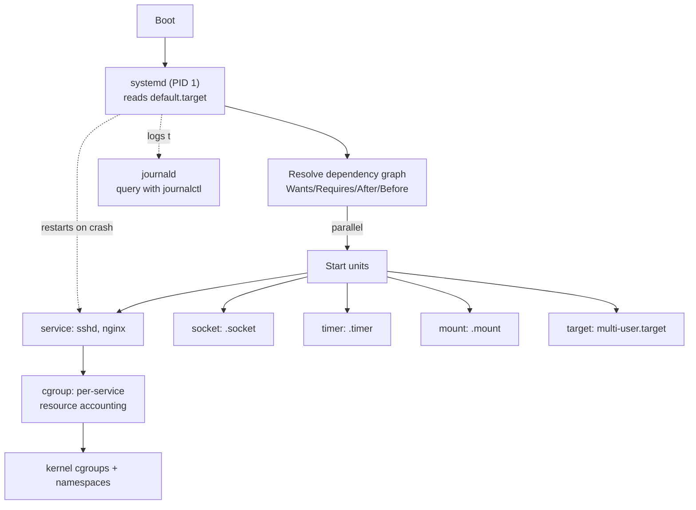

# 🧠 Topic: Linux Services & systemd

> [!abstract] Executive Summary (ELI5)
> A **service** is a program that runs in the background — a web server, a database, an SSH daemon — doing its job without anyone logged in. **systemd** is the manager that starts them at boot, watches them, restarts them if they crash, and gives you one command (`systemctl`) to control all of them. Nearly every modern Linux distro boots with systemd as **PID 1** — the first process, the ancestor of everything else.

> [!note] Why "services" and "systemd" are one topic
> On modern Linux you cannot talk about services without systemd — it *is* the service manager. Older distros used **SysV init** (numbered shell scripts in `/etc/init.d/`); some used **Upstart** (Ubuntu, briefly). systemd replaced both ~2014. This note covers systemd as the modern standard, with a short section on the legacy model so you can read older docs.

---

## 🎯 The "Why"
- **Problem Solved:** A server needs to run dozens of background programs — `sshd`, `nginx`, `postgres`, `cron`, the DNS resolver, the network config, the log collector. Five problems must be solved:
  1. **Startup ordering** — the database must start *before* the app that connects to it; networking must come up *before* anything binds a port.
  2. **Survivability** — if a daemon crashes, something must notice and restart it.
  3. **Concurrency** — boot is slow if services start one-at-a-time. Independent services should start in parallel.
  4. **Uniform control** — one command to start/stop/status/enable every service, not a different shell script per daemon.
  5. **Resource accounting** — know which service is using the CPU/RAM, and cap the rogue one.
- systemd solves all five with one design: it models everything as a **unit** with declared dependencies, starts independent units in parallel, supervises them via **cgroups**, and exposes uniform control through `systemctl`.
- **Alternatives:**
  - **SysV init** — the legacy model. Scripts run sequentially by "runlevel." Simple, but slow boots, no supervision, no parallelism, every daemon rolled its own script. Still the reference point for old tutorials.
  - **Upstart** — Ubuntu's event-driven init (2006–2014), now abandoned.
  - **OpenRC** — used by Gentoo/Alpine; dependency-based, no supervision by default, lighter than systemd.
  - **runit / s6 / daemontools** — minimal supervise-everything designs (each service under a supervisor). Tiny, favored by the "anti-systemd" crowd.
  - **Container orchestrators** — in modern DevOps, "service management" often moves up a layer: Kubernetes restarts your pods, Nomad supervises your jobs. But the *host* still runs systemd underneath.
- **Trade-offs:** systemd is **large and monolithic** — it absorbed logging (`journald`), networking (`networkd`), DNS (`resolved`), time (`timedated`), and more. Critics call it bloat and a single point of failure (PID 1). Defenders point to its speed, uniformity, and the features (cgroup accounting, declarative units, reliable service supervision) that the alternatives lack. Like it or not, it's the standard on every mainstream distro.

## 💡 Mental Model & Analogy
- **Analogy:** systemd is the **stage manager of a theater**. Each **unit** is an act, a prop, a lighting cue, or a sound effect. The stage manager reads the **runbook** (the unit files) to know what depends on what ("raise the curtain *after* the lights are set"), starts independent things in parallel, watches every performer, and restarts an act if an actor walks off stage. `systemctl` is the manager's intercom — one consistent way to cue anything. **Targets** are scene milestones ("intermission," "curtain call") that group units into a boot stage.
- **Visual/Diagram — the unit hierarchy and boot flow:**



> [!tip] The single most important mental model
> **Units, not scripts.** In SysV, a service was a shell script you ran. In systemd, a service is a **declarative unit file** describing *what* to run and its *dependencies* — systemd itself does the starting, stopping, supervising, and accounting. You don't write "start" logic; you declare intent (`ExecStart=...`, `WantedBy=...`) and systemd figures out the how. This is the same shift as from imperative to declarative config.

## 🛠️ Core Principles & Code Snippets

### 1. systemd is PID 1 — and that means something

```bash
ps -p 1 -o comm=
# systemd
```

- PID 1 is the **first user-space process**. The kernel starts it, and everything else is its descendant.
- Being PID 1 is why systemd can: reap orphan/zombie processes, own the cgroup hierarchy, and be the single supervisor. It's also why a PID 1 crash is catastrophic — there is no parent to restart it.
- This is the core of the "systemd does too much" debate: it's PID 1 *and* the service manager *and* the logger *and* more.

### 2. Units — the universal abstraction

systemd manages many kinds of **units**, each a `.unit-type` file:

| Unit type | File | What it models |
|-----------|------|----------------|
| **service** | `nginx.service` | A long-running daemon (the common case) |
| **socket** | `nginx.socket` | An IPC/network socket (enables socket activation) |
| **timer** | `backup.timer` | A scheduled job (the systemd cron replacement) |
| **target** | `multi-user.target` | A synchronization point grouping units (replaces runlevels) |
| **mount** | `/data.mount` | A filesystem mount |
| **path** | `inotify.path` | React to a path/file event |
| **slice** | `system.slice` | A cgroup hierarchy node for resource accounting |

- The same `systemctl` verbs (`start`, `stop`, `status`, `enable`, `restart`) work on **all** unit types. That uniformity is the point.
- Unit files live in `/etc/systemd/system/` (admin), `/run/systemd/system/` (runtime), `/usr/lib/systemd/system/` (package-installed). Earlier paths override later ones — see `systemctl cat <unit>` for the effective file.

### 3. The four core verbs — and `enable` vs `start`

```bash
sudo systemctl start nginx       # start it NOW (runtime)
sudo systemctl stop nginx        # stop it NOW
sudo systemctl restart nginx     # stop + start (interrupts connections)
sudo systemctl reload nginx      # re-read config WITHOUT dropping (graceful)
sudo systemctl status nginx      # is it running? recent logs? cgroup info?
```

> [!warning] `enable` vs `start` — the most common confusion
> - **`start`** = runtime state. The service runs **right now**. Reboot and it's gone (unless enabled).
> - **`enable`** = boot state. The service is wired to start **at next boot**, but does **nothing right now**.
>
> A freshly installed package is often `enabled` but not `started`, or vice versa. The four combinations mean different things:
>
> | | enabled | disabled |
> |---|---|---|
> | **active (started)** | runs now, starts at boot | runs now, won't survive reboot |
> | **inactive** | will start at next boot | off until you start it |
>
> To do both at once: `sudo systemctl enable --now nginx`. To undo both: `sudo systemctl disable --now nginx`.

### 4. Inspecting and listing

```bash
systemctl list-units                  # everything currently loaded
systemctl list-units --type=service   # only services
systemctl list-units --state=failed   # ⭐ find broken services fast
systemctl list-unit-files --state=enabled   # what's set to start at boot
systemctl list-dependencies nginx     # the dependency tree
systemctl cat nginx                   # the effective unit file (all overrides merged)
systemctl show nginx                  # every property as key=value (machine-readable)
```

- **`--state=failed`** is the first diagnostic when "something's wrong on this host" — it lists every unit that systemd tried and failed to keep running.
- **`systemctl cat`** shows you the *real* unit systemd will use, after merging drop-in overrides (see §8).

### 5. Reading and writing a unit file

A minimal service unit:

```ini
# /etc/systemd/system/myapp.service
[Unit]
Description=My Application
After=network-online.target        # ordering: start AFTER networking
Wants=network-online.target        # pull in networking (weak dependency)

[Service]
Type=simple                        # ExecStart is the main process; considered 'up' immediately
ExecStart=/usr/local/bin/myapp --config /etc/myapp.conf
Restart=on-failure                 # restart if it exits non-zero
RestartSec=5s                      # wait 5s between restarts (avoids spin-loop)
User=myapp                         # drop privileges — don't run as root
WorkingDirectory=/var/lib/myapp
Environment=NODE_ENV=production

[Install]
WantedBy=multi-user.target         # when enabled, start at the multi-user boot stage
```

- **`Type=` matters a lot:**
  - `simple` (default) — ExecStart is the main process; systemd considers it started immediately. Fine for most daemons.
  - `forking` — the classic Unix daemon that forks and the parent exits. systemd needs `PIDFile=` to track the child.
  - `notify` — the service calls `sd_notify()` to tell systemd "I'm ready" (used by modern daemons that signal readiness).
  - `oneshot` — runs once and exits (for setup scripts in `ExecStartPre`).
- **`Restart=` supervision is the heart of why systemd is better than a shell script:** `always` restarts on any exit, `on-failure` only on non-zero. Combined with `RestartSec=` and `StartLimitBurst=`/`StartLimitIntervalSec=`, this gives controlled auto-recovery without infinite spin loops.

### 6. Dependencies — Wants, Requires, After, Before

These four directives encode the dependency graph:

| Directive | Meaning |
|-----------|---------|
| `Wants=` | **Weak** dependency — pull it in, but if it fails, we still start. (Most common.) |
| `Requires=` | **Strong** dependency — pull it in; if it fails, we're stopped too. |
| `After=` | **Ordering** only — if both are starting, start this one *after* the named unit. Does **not** pull it in. |
| `Before=` | Ordering — start this one *before* the named unit. |

> [!tip] The Wants-vs-After split confuses everyone
> **`Wants=` decides *whether* a unit starts. `After=` decides *when*.** They're orthogonal. A common pattern is `Wants=network-online.target` + `After=network-online.target` together — the Wants pulls networking in, the After makes sure we don't start until it's actually up. Listing something in `After=` alone does **nothing** unless something else (a Wants/Requires, or being in the same target) pulls it in.

### 7. Targets — the modern runlevels

```bash
systemctl get-default              # the target boot aims for (usually multi-user.target or graphical.target)
systemctl set-default multi-user.target
systemctl isolate rescue.target    # switch to a different target NOW (stops units not in it)
```

- SysV used numbered **runlevels** (0=halt, 3=multi-user, 5=graphical, 6=reboot). systemd uses named **targets** that group units.
- `multi-user.target` ≈ runlevel 3 (no GUI). `graphical.target` ≈ runlevel 5. `rescue.target` ≈ single-user mode. `reboot.target`/`poweroff.target` replace runlevels 6/0.
- `systemctl isolate X` switches the running set to target X — useful for rescue/diagnostic modes.

### 8. Override drop-ins — never edit the package unit file

```bash
# Create an override WITHOUT touching the original (which a package update would clobber)
sudo systemctl edit nginx.service
# Opens a blank drop-in: /etc/systemd/system/nginx.service.d/override.conf

# After ANY unit file change, reload systemd so it re-reads them:
sudo systemctl daemon-reload
sudo systemctl restart nginx
```

- **`systemctl edit`** creates a drop-in directory/file that **overrides** specific directives, leaving the package's original unit intact. This is the safe way to customize — a package update refreshes `/usr/lib/systemd/system/nginx.service` but never touches your `/etc/systemd/system/nginx.service.d/`.
- **`systemctl daemon-reload`** is required after editing unit files — it tells systemd to re-scan them. Forgetting it is the #1 "why didn't my change take effect" mistake.
- To see the merged result: `systemctl cat nginx` (shows original + all drop-ins).

### 9. Logs — `journalctl`

```bash
journalctl                         # the entire journal (everything)
journalctl -u nginx                # logs for a specific unit ⭐
journalctl -u nginx -f             # follow (like tail -f)
journalctl --since "1 hour ago"
journalctl -p err                  # only priority ERROR and worse
journalctl -b                      # since last boot (-b -1 = previous boot)
journalctl -k                      # kernel messages only (like dmesg)
journalctl _PID=1234               # logs from a specific process
```

- **journald** is systemd's structured logger — it captures stdout/stderr of every unit plus kernel messages, indexed and queryable.
- This replaces the older world of `tail /var/log/syslog` / `/var/log/messages` with a single source: `journalctl -u <unit>`. No more "which log file did this daemon write to?"
- The journal is **structured** — you can filter by unit, priority, boot, PID, time. The downside: it's a binary format, queryable only via `journalctl` (not `cat`/`grep`).

### 10. Timers — the systemd cron replacement

```ini
# /etc/systemd/system/backup.timer
[Timer]
OnCalendar=daily                   # 00:00 each day (supports finer cron-like syntax)
Persistent=true                    # if missed (machine off), run on next boot
Unit=backup.service                # what to trigger (default: matching .service)

[Install]
WantedBy=timers.target
```

```bash
systemctl enable --now backup.timer
systemctl list-timers              # see all timers and their next fire time
```

- A `.timer` triggers a matching `.service`. It's a more powerful, logged, and cgroup-accounted replacement for cron entries.
- Advantages over cron: `Persistent=true` catches missed runs, dependencies work, logs go to journald, and `systemctl list-timers` gives a unified view.

## ⚠️ Pitfalls & Anti-patterns
- **Common Mistakes:**
  - Editing `/usr/lib/systemd/system/nginx.service` directly instead of using `systemctl edit`. A package update will silently **overwrite** your changes. Always use drop-ins.
  - Forgetting **`systemctl daemon-reload`** after editing a unit file and wondering why the change "didn't take." systemd caches the parsed unit graph; you must tell it to rescan.
  - Confusing **`enable`** (boot wiring) with **`start`** (runtime). A `disabled` service can still be `active` if you `start`ed it manually; an `enabled` service can be `inactive` until next boot.
  - Setting `Restart=always` without `RestartSec=` or `StartLimitBurst=` → a crashing service spins in a tight loop, hammering the CPU and filling the journal. Always pair with a delay and a burst limit.
  - Writing a `Type=simple` unit for a daemon that **forks** (the classic forking daemon). systemd loses track of the real process, considers it dead, and either restarts it endlessly or marks it failed. Use `Type=forking` + `PIDFile=` for those.
  - Running services as **root** by default. Drop to a dedicated user (`User=`, `Group=`) — least privilege.
  - Treating `systemctl status` as the only diagnostic. It shows recent log lines, but `journalctl -u <unit>` gives full history with filtering.
- **When NOT to use systemd units:**
  - In **containers** — the container runtime (Docker/Kubernetes) is the supervisor; running systemd *inside* a container is an anti-pattern (it's PID 1 of the host, not the container, unless you explicitly design for it).
  - For **one-off scripts** in a shell session — just run them; a service unit is for long-lived or boot-started programs.
  - For app **process management within a host app** — use that ecosystem's tools (pm2, supervisor, systemd-user). The *system* instance is for system services.
- **Security considerations:**
  - A unit file runs `ExecStart` as root by default — a writable unit file is an instant privilege escalation. Unit files should be `root:root` and not world-writable.
  - Use **`systemd-analyze security <unit>`** to get a hardening score and see exposed attack surfaces (e.g., no `PrivateTmp=`, no `NoNewPrivileges=`).
  - Hardening directives worth knowing: `ProtectSystem=strict`, `ProtectHome=true`, `PrivateTmp=true`, `NoNewPrivileges=true`, `ReadWritePaths=`. They sandbox services with namespaces/cgroups.
  - cgroup resource limits (`MemoryMax=`, `CPUQuota=`) prevent a runaway service from taking down the host — set them on anything third-party.

## 🔗 Deep Connections
- **Parent Topic:** [[Unix_Like_Kernel]] — systemd uses kernel cgroups (resource accounting), namespaces (hardening), and is itself started by the kernel as PID 1.
- **Related Concepts:** [[Process_Management]] (processes are what services run), [[Linux_Package_Management]] (packages install unit files and may enable services), [[Sudo]] (controlling services requires root), [[Linux_Important_Directories]] (`/etc/systemd/system/`, `/var/log/journal/`).
- **Prerequisites:** Users and permissions (services run as users), the process model, the filesystem layout.

## ❓ Active Recall Questions
> [!faq]- What is the difference between `systemctl start nginx` and `systemctl enable nginx`? Give the four state combinations.
> **`start`** = runtime state (running now). **`enable`** = boot wiring (starts at next boot). The four combinations: **active+enabled** (runs now, survives reboot — the normal desired state), **active+disabled** (runs now, won't survive reboot — temporary/manual start), **inactive+enabled** (will start at next boot, off now), **inactive+disabled** (off until you start it). Use `enable --now` to do both, `disable --now` to undo both.

> [!faq]- Why must you run `systemctl daemon-reload` after editing a unit file?
> systemd caches the parsed unit graph in memory. Editing a `.service` file changes the on-disk file, but systemd keeps using its cached copy until you tell it to rescan. `daemon-reload` is that signal — without it, your change "doesn't take effect" and you'll waste time debugging a working edit. Run it after any unit-file or drop-in change, then `restart` the unit.

> [!faq]- You edit `/usr/lib/systemd/system/nginx.service` to tune nginx, and a week later a package update wipes your change. What went wrong, and what's the correct approach?
> `/usr/lib/systemd/system/` is owned by the **package manager** — updates clobber it. The correct approach is **`systemctl edit nginx.service`**, which creates a drop-in under `/etc/systemd/system/nginx.service.d/override.conf`. Your override merges with (and takes precedence over) the original, and a package update never touches it. View the merged result with `systemctl cat nginx`.

> [!faq]- Explain the difference between `Wants=` and `After=` in a unit file, and why both are usually listed together for a network dependency.
> `Wants=` is a **pull-in** (weak dependency): "start this unit too." `After=` is **ordering only**: "if both are starting, start me after that one." They're orthogonal — `After=` alone does **not** pull a unit in. For a network dependency you list both: `Wants=network-online.target` pulls networking into the boot, and `After=network-online.target` ensures your service waits until networking is actually up before starting.

> [!faq]- Predict what happens: you write a `Type=simple` unit for a daemon that forks and the parent exits. How does systemd react, and how do you fix it?
> systemd considers the **ExecStart process** the main process. With `Type=simple`, when the parent forks and exits, systemd sees the "main process" disappear and concludes the service has **died** — it either marks it failed or restarts it (depending on `Restart=`), while the real daemon runs orphaned. Fix: use **`Type=forking`** and provide **`PIDFile=`** so systemd knows to track the forked child as the main process.

> [!faq]- A service keeps crash-looping and filling the journal. What directives prevent runaway restarts?
> `Restart=on-failure` (or `always`) **must be paired** with a delay and a burst limit, or a crashing service spins in a tight loop. Use **`RestartSec=5s`** (wait between restarts), **`StartLimitIntervalSec=`** + **`StartLimitBurst=`** (e.g., max 5 restarts per 60s), and optionally **`StartLimitAction=`** to decide what happens when the limit is hit (e.g., stop trying). Without these, a config typo can peg the CPU and flood logs.

> [!faq]- `systemctl status nginx` shows the service is active, but you want the full log history with time filtering. What do you run?
> `journalctl -u nginx` — this queries **journald**, which captures the unit's stdout/stderr in a structured, indexed store. Add filters: `journalctl -u nginx --since "1 hour ago"`, `-p err` (priority), `-f` (follow), `-b` (since boot). `systemctl status` only shows a few recent lines; `journalctl` is the full-history query tool. The journal is binary and structured — query it via `journalctl`, not `grep` on a log file.

> [!faq]- Why is running systemd *inside* a container considered an anti-pattern, and what plays the supervisor role instead?
> systemd is designed to be **PID 1 of a host**, owning the cgroup hierarchy and supervising all services. Inside a container, the runtime (Docker, containerd, Kubernetes) is the supervisor — it handles restarts, health checks, and resource limits. Running systemd in a container duplicates supervision, fights the runtime for cgroup control, and adds weight. The container entrypoint should be the single service; the orchestrator supervises it.

---

## 📝 How to use this template effectively
1. **Never Copy-Paste:** If you find yourself copying documentation, stop. Read, close the tab, and write it from memory.
2. **Iterate:** Fill the 'ELI5' and 'Analogy' first. If you can't explain it simply, you don't understand it yet.
3. **The "Why" is King:** Seniority is defined by knowing *when* and *why* to use a tool, not just *how*.
4. **Update the Status:** Move from `analyzing` -> `implemented` -> `mastered` as you apply this in real projects.
