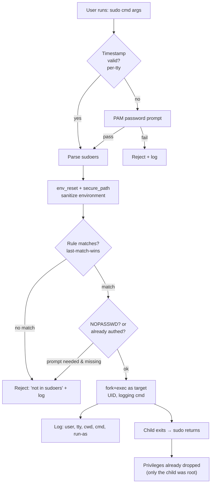

# 🧠 Topic: `sudo` — Privilege Delegation in Depth

> [!abstract] Executive Summary (ELI5)
> `sudo` ("superuser do") lets a regular user run a single command as root (or another user), then drops privileges back. **Who can do what** is decided by the policy in `/etc/sudoers` and `/etc/sudoers.d/*` — evaluated last-match-wins. The real value isn't "run as root"; it's **delegation + audit + friction**. This note covers the mechanics the overview skips: the timestamp cache, rule precedence, env sanitization, and the attack surface.

> [!note] Relationship to the overview note
> [[Sudo_and_Sudoers]] (in `users_and_groups/`) is the beginner-facing overview: what `sudo` is, the `su` comparison, basic rule syntax. **This note** goes deeper into sudoers internals, precedence, environment handling, and the security model. Read the overview first.

---

## 🎯 The "Why" (deep cut)
- **Problem Solved:** A multi-user system needs to grant *some* privileged capability to *some* users without handing out root's password or a root shell. `sudo` is a **policy engine with audit logging** that sits between a regular user and a privileged operation. The deeper value, beyond "run as root," is threefold:
  1. **Delegation with least privilege** — alice can restart nginx but not read `/etc/shadow`.
  2. **Accountability** — every invocation is logged with who/what/when/where, tying an action to a named identity.
  3. **Intentionality friction** — the password prompt is a deliberate speed bump before a destructive action.
- **Alternatives:**
  - `su -` — full root shell; coarse, weaker audit, requires sharing the root password.
  - **Linux capabilities** (`setcap`) — grant a binary a specific kernel privilege (e.g., `CAP_NET_BIND_SERVICE`) without full root. Finer-grained but irreversible per-binary.
  - **Polkit / `pkexec`** — desktop-focused, action-based (not command-path-based) policy; used by PackageKit, systemd, etc.
  - **Doas** — OpenBSD's minimal sudo replacement; smaller attack surface, simpler config (`permit alice cmd`).
  - **Cloud IAM / JIT brokers** (Teleport, HashiCorp Boundary) — for fleets where you want time-boxed, approver-gated access.
- **Trade-offs:** `sudo`'s config is a high-value attack target — a one-character typo (`NOPASSWD: ALL`) is a full privilege escalation. And `sudo`'s attack surface is large: it parses a DSL, resolves paths, mutates the environment, and runs as root. The complexity is the price of flexibility.

## 💡 Mental Model & Analogy
- **Analogy:** `sudo` is a **security guard at a building's restricted wing**. You don't get a master key (root shell). You walk up, show your ID (password), state exactly which door you need (`/usr/bin/systemctl restart nginx`), the guard checks the access roster (`/etc/sudoers`), signs the logbook (`/var/log/auth.log`), escorts you to the door, and walks you back out. Next time within 15 min, the guard recognizes you and skips the ID check (timestamp cache).
- **Visual/Diagram:**



## 🛠️ Core Principles & Internals

### 1. The four escalation shapes — and what each costs you

| Command | Auth with | Scope | `$HOME` | When to use |
|---------|-----------|-------|---------|-------------|
| `sudo cmd` | your pwd | one command | yours | Default. One-off privileged action. |
| `sudo -i` | your pwd | root login shell | `/root` | Multi-step admin; you want root's full env. |
| `sudo -s` | your pwd | root shell, **your env** | yours | Rare; you need root uid but your dotfiles. |
| `su -` | **root's pwd** | root login shell | `/root` | Legacy; no sudo available, or root password is the design. |

```bash
sudo systemctl restart nginx   # one command, drops back
sudo -i                        # root login shell (cd /root, .bash_profile loaded)
sudo -s                        # root shell, but $HOME still yours
sudo -u deploy /opt/release.sh # run as a NON-root user (delegation downward)
```

> [!tip] The "authenticates with" asymmetry
> `sudo` asks for **your** password (proving *you* authorized the action). `su` asks for the **target's** password (proving you *know* root's secret). The difference is accountability vs. knowledge. Modern setups disable the root password entirely — which makes `su` impossible but `sudo` fine — precisely to force everything through the auditable path.

### 2. The sudoers policy — rule structure and evaluation

```
who    host=(runas:group)    [NOPASSWD:]   commands
```

- **who** — `alice`, `%groupname`, `+netgroup`, or `User_Alias`.
- **host** — hostname or `Host_Alias` (lets one config span a fleet: a rule applies only on matching hosts).
- **(runas:group)** — the user (`:group`) the command may run as. `(root)` default; `(ALL:ALL)` means any.
- **commands** — comma-separated **absolute** paths, `Cmnd_Alias`, or `ALL`.

**Evaluation is LAST-MATCH-WINS:**

```
# Order matters — later rules override earlier ones.
alice   ALL=(ALL) ALL                         # alice can do everything
alice   ALL=(ALL) !/bin/su, !/usr/bin/passwd  # ...EXCEPT su and passwd
```

- If multiple rules match, the **last one in the file** decides. Order your rules specific → general, or put general rules first and negate exceptions after.
- `/etc/sudoers.d/*` drop-in files are read **after** the main file (the `#includedir` directive), so they override. This is why drop-ins are the safer place to make changes.

### 3. Aliases — DRY your policy

```bash
# User alias — group rule sources by role
User_Alias  DBAS    = alice, bob
Host_Alias  PROD    = db01, db02, db03
Cmnd_Alias  PGCTL   = /usr/bin/pg_ctlcluster, /usr/bin/psql

# Now rules read like policy, not line noise
DBAS    PROD=(postgres) NOPASSWD: PGCTL
```

- Aliases make a fleet-wide sudoers file readable and auditable — a reviewer sees `DBAS PROD=(postgres) PGCTL` and immediately understands intent.
- `Cmnd_Alias` is also a security tool: it pins the **exact** binaries allowed, preventing both PATH issues and "close enough" binary substitution.

### 4. The timestamp cache — how `sudo` remembers you

```bash
sudo apt update   # prompts for password
sudo apt upgrade  # NO prompt — cached
# ... 16 minutes later ...
sudo apt autoremove  # prompts again — cache expired
```

- Default window: **15 minutes** (`timestamp_timeout` in sudoers).
- **Scope:** per-tty by default — a second terminal prompts independently. This prevents one session's auth from leaking into another context.
- **Storage location:** `/run/sudo/ts/<user>` (on systemd) or `/var/db/sudo/ts/` (older). These are timestamp *records*, not credentials — sudo never stores your password.
- **Knobs:**
  - `Defaults timestamp_timeout=0` — prompt every time (max safety).
  - `Defaults timestamp_timeout=-1` — cache indefinitely until reboot (convenience; riskier).
  - `sudo -k` — manually invalidate now (use before handing over the machine).
  - `sudo -v` — refresh the cache without running a command (keep auth alive during long prep).

> [!warning] The timestamp is a window of opportunity
> Within the cache window, **anyone with access to your unlocked tty can sudo without your password.** The cache is convenience, not security. Screen-lock and `sudo -k` are the mitigations. Setting `timestamp_timeout=0` is the paranoid-but-defensible default for sensitive hosts.

### 5. Environment handling — `env_reset` and `secure_path`

`sudo` does **not** inherit your environment wholesale. By default:

- **`env_reset`** — wipes the environment, then restores only an allowlist (`env_keep`) of safe vars (`DISPLAY`, `HOME`, `PATH` if overridden, etc.). This blocks `LD_PRELOAD`, `LD_LIBRARY_PATH`, `PYTHONPATH` style attacks where your env could hijack a root process.
- **`secure_path`** — overrides `$PATH` for sudo'd commands to a known-safe value (e.g., `/usr/local/sbin:/usr/local/bin:/usr/sbin:/usr/bin:/sbin:/bin`). This is why a binary your shell finds may not be the one sudo runs — and it's the defense against PATH-shadowing.

```bash
# Inspect what env a sudo'd command actually gets
sudo sudo -V | grep -i 'secure path\|reset'

# Preserve your env (DANGEROUS — defeats the sanitization; know why before using)
sudo -E LD_PRELOAD=/tmp/evil.so some-command   # illustrates the attack vector
```

> [!tip] Why `-E` is usually a mistake
> People reach for `sudo -E` when "it works without sudo but breaks with sudo" — almost always an env or PATH issue. Instead of disabling sanitization, fix the root cause: set `env_keep` for the specific var you need, or use an absolute path. `-E` silently reopens the attack surface `env_reset` was designed to close.

### 6. The rule of absolute paths — PATH shadowing in detail

```bash
# VULNERABLE rule
bob ALL = NOPASSWD: systemctl

# bob's $HOME/bin is first in PATH and contains:
cat ~/bin/systemctl
#!/bin/sh
exec /bin/sh   # ← instant root shell when bob runs 'sudo systemctl anything'
```

- sudo resolves non-absolute command names via `$PATH`. An attacker who can write to a directory earlier in `secure_path` (or who controls `env_keep`/`-E`) plants a same-named script that sudo runs **as root**.
- **Defense:**
  1. Always specify **absolute** paths: `/usr/bin/systemctl`.
  2. Specify **arguments** too, when feasible: `/usr/bin/systemctl restart nginx` — this won't match `systemctl stop` or a bare shell.
  3. Prefer `Cmnd_Alias` groups so the allowlist is centralized and reviewable.

### 7. Inspecting and debugging sudo

```bash
sudo -l                 # what can *I* run? (the #1 diagnostic)
sudo -l -U alice        # (as root) what can alice run?
sudo -ll                # long form, with rule provenance
sudo -k                 # invalidate timestamp (force next prompt)
sudo -v                 # refresh timestamp without running anything
sudo -V                 # sudo version + compiled defaults (secure_path, etc.)
```

- **`sudo -l` is always the first move.** "Sudo isn't working" almost always means "the rule I expected isn't matching" — `-l` shows you the effective policy for your user, including `NOPASSWD` entries and run-as targets.
- If `-l` shows nothing, you're not in sudoers / the `sudo` or `wheel` group. If it shows the wrong commands, your drop-in file is being shadowed or your rule ordering is wrong.

### 8. Audit trail — where sudo logs

```bash
# Debian/Ubuntu
tail /var/log/auth.log | grep sudo
# RHEL/CentOS (no auth.log by default)
journalctl _COMM=sudo
# Structured audit (sudo logs JSON if compiled with SUDOERS_LOG_FORMAT=json)
```

A typical entry records: **who** (user), **where** (tty/host), **as whom** (run-as user), **what** (full command + args), and **when**. In a compliance context, this log is the entire point of sudo — without it, you've delegated power without accountability.

## ⚠️ Pitfalls & Anti-patterns
- **Common Mistakes:**
  - Editing `/etc/sudoers` directly with `vim`/`nano`. A syntax error breaks sudo **system-wide**, and since you need sudo to fix sudo, you're locked out → recovery mode. Always use `visudo` (validates on save) or a drop-in `visudo -f /etc/sudoers.d/name`.
  - `NOPASSWD: ALL` to "make the deploy script work." This is root with no audit gate at the moment of action — any compromise of that account is instant full takeover. Scope `NOPASSWD` to one absolute command path.
  - Relative command paths (`NOPASSWD: systemctl`) enabling PATH shadowing. Always absolute, preferably with arguments.
  - Forgetting sudoers is **last-match-wins** and that a permissive rule later in the file silently overrides your carefully-scoped earlier rule.
  - Assuming the password prompt *is* the security. It isn't — the **sudoers policy** is. The prompt only proves identity; the rules decide authorization.
  - `sudo -E` to "fix" env issues, reopening the `LD_PRELOAD`/`PYTHONPATH` attack surface that `env_reset` was designed to close.
  - Trusting `sudo -i` vs `sudo -s` to behave identically — `$HOME`-dependent tools (git, ssh, editors reading `~/.config`) behave differently under each.
- **When NOT to use sudo:**
  - **Containers** — prefer `USER` in the Dockerfile and rootless runtimes. Installing/configuring sudo inside a container is an anti-pattern; containers should run as a non-root uid by design.
  - **Unattended scripts / cron / CI** — a passwordless root shell in a script is a foothold. Use a dedicated service account with a single `NOPASSWD` command, or (better) a capability (`setcap`) that grants exactly the kernel privilege needed.
  - **Fleet-wide access** — local sudoers doesn't scale across hosts. Use a JIT broker (Teleport, Boundary) or config-managed sudoers via Ansible/Chef so policy is reviewable in version control.
- **Security considerations:**
  - `/etc/sudoers` and `/etc/sudoers.d/*` must be mode **`0440`**, owned `root:root`. `visudo` enforces this; direct edits may not.
  - Audit the set of setuid-root binaries and `NOPASSWD` rules together: `find / -perm -4000` + `grep -r NOPASSWD /etc/sudoers*`. Each is an escalation surface.
  - `sudo`'s own attack surface is non-trivial — it's a setuid-root binary that parses a DSL, resolves paths, and mutates env. Keep it patched (CVEs exist, e.g., Baron Samedit, CVE-2021-3156).
  - Timestamp cache files in `/run/sudo/ts/` are per-user; on a shared host they're a (minor) side-channel confirming who has sudoed recently.

## 🔗 Deep Connections
- **Parent Topic:** [[Unix_Like_Kernel]] — sudo uses setuid-root; the actual privilege change is a kernel `setuid(2)` syscall.
- **Related Concepts:** [[Root_User_vs_Regular_User]] (the split sudo bridges), [[Users_and_Groups]] (who the `who` field refers to), [[Linux_Permissions]] (the model sudo elevates above), [[Sudo_and_Sudoers]] (the beginner-facing overview).
- **Prerequisites:** The root/regular user split, users and groups, file permissions (`/etc/sudoers` must be `0440`).

## ❓ Active Recall Questions
> [!faq]- `sudo` asks for your password; `su -` asks for root's. Why is this the operational basis for disabling the root password entirely?
> With `sudo`, the root password is never shared — every escalation is tied to a named user in the audit log. This lets you **disable root login** (lock `/etc/shadow`, set root shell to `/usr/sbin/nologin`) while still allowing delegated administration. With `su`, every admin must know root's password, defeating individual accountability. Modern best practice: no root password, all escalation through sudo.

> [!faq]- You write two sudoers rules for alice: first `ALL=(ALL) ALL`, then `ALL=(ALL) !/usr/bin/passwd`. Can alice run `passwd`?
> **No.** Sudoers is evaluated **last-match-wins**. Both rules match alice, so the second one decides — it negates `/usr/bin/passwd`. Order matters: put general/permissive rules first and specific negations after. If the order were reversed, the later `ALL` would re-grant what the negation removed.

> [!faq]- A drop-in file `/etc/sudoers.d/alice` grants alice a rule that contradicts the main `/etc/sudoers`. Which wins, and why?
> The **drop-in wins.** `/etc/sudoers` contains `#includedir /etc/sudoers.d`, and included files are read *after* the main file — so by last-match-wins, the drop-in's rule overrides. This is exactly why drop-ins are the safer place to make changes: they're isolated, reversible (delete the file), and don't risk breaking the main file.

> [!faq]- What does `env_reset` protect against, and why is `sudo -E` usually the wrong fix?
> `env_reset` wipes the environment and restores only a safe allowlist, blocking `LD_PRELOAD`, `LD_LIBRARY_PATH`, `PYTHONPATH`-style attacks where your env could hijack a root process. `sudo -E` disables this sanitization, reopening the attack surface. The right fix for "works without sudo, breaks with sudo" is to add the specific variable to `env_keep` or use absolute paths — not to disable sanitization wholesale.

> [!faq]- Why must sudoers command paths be absolute? Walk through the PATH-shadowing attack.
> sudo resolves non-absolute names via `$PATH`/`secure_path`. If an attacker can write to a directory early in that path, they plant a same-named script (`~/bin/systemctl`) that sudo runs **as root** — instant privilege escalation. Defense: always absolute paths (`/usr/bin/systemctl`), and specify arguments (`/usr/bin/systemctl restart nginx`) to further narrow the match. `Cmnd_Alias` centralizes the allowlist.

> [!faq]- Within the 15-minute timestamp window, what security property is weakened, and how do you mitigate it on a shared workstation?
> The cache means **anyone with access to your unlocked tty can sudo without re-entering your password** — identity is assumed from the recent auth. Mitigations: screen-lock when idle, `sudo -k` before stepping away, `Defaults timestamp_timeout=0` on shared/sensitive hosts, and remember the cache is **per-tty** so a second terminal is independently gated.

> [!faq]- A teammate says "sudo is safe because it prompts for a password." What's the misconception?
> The password only proves **identity** ("yes, this is alice"). **Authorization** — what alice is allowed to do — is decided entirely by the sudoers policy. If the policy says `NOPASSWD: ALL`, no password is even required, and the "safety" is illusory. The real security boundary is the **sudoers rules** (and their file permissions, `0440`), not the prompt.

> [!faq]- `sudo -l` shows nothing for your user. Name three distinct causes.
> (1) You're not in the `sudo`/`wheel` group and have no user-specific rule. (2) A drop-in file in `/etc/sudoers.d/` is **syntactically broken** and sudo silently ignored the whole include. (3) The main `/etc/sudoers` lost its `#includedir` line or was edited outside `visudo` and is malformed. `sudo -l` plus `sudo -V` (compiled defaults) are the diagnostics; `visudo -c` checks all policy files for syntax.

---

## 📝 How to use this template effectively
1. **Never Copy-Paste:** If you find yourself copying documentation, stop. Read, close the tab, and write it from memory.
2. **Iterate:** Fill the 'ELI5' and 'Analogy' first. If you can't explain it simply, you don't understand it yet.
3. **The "Why" is King:** Seniority is defined by knowing *when* and *why* to use a tool, not just *how*.
4. **Update the Status:** Move from `analyzing` -> `implemented` -> `mastered` as you apply this in real projects.
