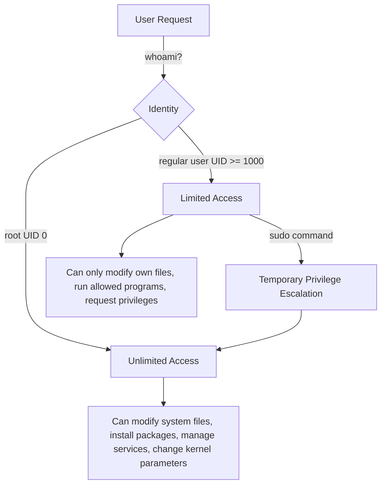

# 🧠 Topic: Root User vs Regular User

> [!abstract] Executive Summary (ELI5)
> The root user is the administrator with unlimited power over the system. A regular user is a normal account that can only touch its own files and run safe commands. The split exists so one mistake or one compromised program cannot destroy the whole machine.

---

## 🎯 The "Why"
- **Problem Solved:** Operating systems need a way to protect critical files and services from accidental or malicious changes. Separating root from regular users limits the blast radius of mistakes, bugs, and intrusions.
- **Alternatives:**
  - Running everything as root (convenient but dangerous).
  - Capability-based security where specific privileges are granted per process (e.g., Linux capabilities, `setcap`).
  - Role-based access control (RBAC) and tools like `sudo` groups, SELinux, or AppArmor.
- **Trade-offs:** Using a regular user slows down admin tasks because you must prefix privileged commands with `sudo`. That extra friction is intentional — it forces you to think before changing the system.

## 💡 Mental Model & Analogy
- **Analogy:** A regular user is like a tenant in an apartment building. They can decorate their own apartment and use shared facilities, but they cannot knock down walls or touch the electrical panel. Root is the building owner who holds the master key and can rewire anything.
- **Visual/Diagram:**



## 🛠️ Core Principles & Code Snippets

### 1. UID identifies the user

```bash
id
# uid=1000(alice) gid=1000(alice) groups=1000(alice),27(sudo)

id root
# uid=0(root) gid=0(root) groups=0(root)
```

- **UID 0** is root.
- **UID 1–999** are usually system accounts (daemon, www-data, sshd).
- **UID 1000+** are regular human users on most distributions.

### 2. Root can do anything

```bash
whoami
# root
rm -rf /
# DO NOT RUN THIS — it destroys the system
```

Root bypasses file permissions and ownership checks. It can read any file, kill any process, modify the kernel, and change other users' data.

### 3. Regular users live inside their own boundaries

```bash
whoami
# alice
cat /etc/shadow
# Permission denied
cat /home/alice/.bashrc
# Works because alice owns it
```

A regular user can:
- Read and write files in their own home directory.
- Run commands that do not require special privileges.
- Read most world-readable files and directories (`/etc`, `/usr`, `/tmp`).

A regular user cannot:
- Modify system configuration files.
- Install packages system-wide.
- Bind to network ports below 1024.
- Read or modify other users' private files.

### 4. `sudo` and `su` bridge the gap

```bash
# Run a single command as root
sudo apt update

# Open a root shell
sudo -i

# Switch to another user
su - bob

# Edit a file as root
sudo vim /etc/nginx/nginx.conf
```

- `sudo` logs commands and can be restricted to specific users, groups, or commands in `/etc/sudoers`.
- `sudo -i` gives you a root login shell.
- `su -` switches to root with a full login environment.
- `sudo -E` preserves your environment variables.

### 5. File permissions reflect the split

```bash
ls -l /etc/passwd /home/alice/file.txt
# -rw-r--r-- 1 root  root  1234 Jul 1 00:00 /etc/passwd
# -rw-r--r-- 1 alice alice  123 Jul 1 00:00 /home/alice/file.txt
```

- `/etc/passwd` is owned by root and readable by everyone.
- `/home/alice/file.txt` is owned by alice.
- Root can still modify both, but a regular user can only modify the second.

## ⚠️ Pitfalls & Anti-patterns
- **Common Mistakes:**
  - Logging in directly as root for daily work.
  - Running `sudo` blindly without understanding the command.
  - Installing software with `sudo` when a local install works (`pip --user`, `npm` without root, `~/.local/bin`).
  - Forgetting that `sudo` runs with a different `$HOME` and environment unless configured otherwise.
- **When NOT to use root:**
  - Browsing the web, editing personal files, writing code, running untrusted scripts.
  - Anything that does not explicitly require modifying the system.
- **Performance/Security considerations:**
  - Root mistakes are irreversible. There is no recycle bin for `rm -rf /etc`.
  - An attacker who owns a root process owns the system. A regular user compromise is usually limited to that user's data.
  - Use `sudo` with command restrictions (`/etc/sudoers`) to grant only the privileges a role needs.
  - Audit logs (`/var/log/auth.log`, `journalctl _COMM=sudo`) help trace who elevated privileges.

## 🔗 Deep Connections
- **Parent Topic:** [[Linux Operating System]]
- **Related Concepts:** [[Linux_Permissions]], [[Linux_Shell]], [[Linux_Important_Directories]], [[Process_Management]], [[Sudo_and_Sudoers]]
- **Prerequisites:** Basic command line usage, understanding of files and directories, familiarity with users and groups.

## ❓ Active Recall Questions
> [!faq]- Why does Linux distinguish between root and regular users instead of giving everyone full access?
> The separation limits the damage from mistakes, malware, and compromised accounts. It enforces the principle of least privilege.

> [!faq]- What is the difference between `sudo` and `su`?
> `sudo` runs a single command as another user, usually root, while logging the attempt. `su` starts a new shell as another user and is often used to become root for an extended session.

> [!faq]- Why should you avoid running everyday tasks as root?
> Everyday tasks do not need system-level privileges. Running as root increases the risk of accidental system damage and gives attackers full control if any program or browser tab is compromised.

---

## 📝 How to use this template effectively
1. **Never Copy-Paste:** If you find yourself copying documentation, stop. Read, close the tab, and write it from memory.
2. **Iterate:** Fill the 'ELI5' and 'Analogy' first. If you can't explain it simply, you don't understand it yet.
3. **The "Why" is King:** Seniority is defined by knowing *when* and *why* to use a tool, not just *how*.
4. **Update the Status:** Move from `analyzing` -> `implemented` -> `mastered` as you apply this in real projects.
