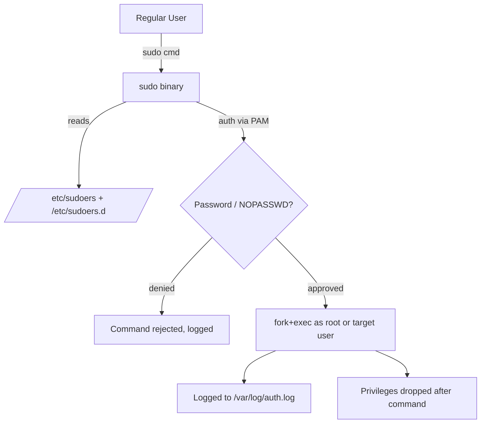

# 🧠 Topic: `sudo` and `sudoers`

> [!abstract] Executive Summary (ELI5)
> `sudo` ("superuser do") lets a regular user run a command as root (or another user) **for one command only**, then drops back to normal. Who is allowed to do what is controlled by a config file, `/etc/sudoers`, that you edit with a safety-checking tool called `visudo`. It is the controlled, auditable alternative to logging in as root.

---

## 🎯 The "Why"
- **Problem Solved:** Root can do anything, which is dangerous. Giving someone the root password (or a root shell) grants unlimited, untraceable power. `sudo` solves three problems at once: (1) **fine-grained delegation** — "alice may run `systemctl restart nginx` but nothing else"; (2) **auditability** — every invocation is logged with who/what/when; (3) **temporary escalation** — you escalate for one command, not an entire session.
- **Alternatives:**
  - `su -` (switch to a full root shell) — powerful but coarse, no per-command limits, weaker audit trail.
  - Polkit / `pkexec` — used by desktop environments for GUI privilege prompts.
  - Linux capabilities (`setcap`) — grant specific kernel privileges to a binary without full root.
  - Doas (OpenBSD's minimal sudo alternative) — simpler config, smaller attack surface.
  - Cloud IAM / just-in-time access brokers (Teleport, HashiCorp Boundary) — for fleets.
- **Trade-offs:** `sudo` adds friction (you type your password) and config complexity. But that friction is the point — it forces intentionality before privileged actions and leaves a paper trail. The alternative, a root shell, optimizes for speed at the cost of safety.

## 💡 Mental Model & Analogy
- **Analogy:** A bank vault. Logging in as root is having the **master key** — you walk in and do anything, unrecorded. `sudo` is the **keycard system at the front desk**: you request access to a specific room, sign the logbook, do your task, and hand the card back. `visudo` is the security manager who validates that the access rules are syntactically correct before they take effect.
- **Visual/Diagram:**



## 🛠️ Core Principles & Code Snippets

### 1. The four ways to escalate — `sudo`, `su`, `sudo -i`, `su -`

```bash
sudo systemctl restart nginx
# Run ONE command as root, then return to normal. Logs the action.

sudo -i
# Start an interactive root LOGIN shell (loads root's .profile, sets $HOME).

sudo -s
# Start a root shell but KEEP your environment ($HOME stays yours).

su -
# Switch to root with a full login environment. Requires the ROOT password.

su - bob
# Switch to user bob. Requires bob's password.

sudo -u bob command
# Run a command as a specific non-root user.
```

The key distinctions:

| Command | Authenticates with | Scope | Environment |
|---------|-------------------|-------|-------------|
| `sudo cmd` | **your** password | one command | mostly yours |
| `sudo -i` | your password | root shell | root's login env |
| `sudo -s` | your password | root shell | your env |
| `su -` | **root's** password | root shell | root's login env |

> [!tip] Implementation Note
> `sudo` asks for **your** password; `su` asks for the **target's** password. This is why modern setups disable the root password entirely and route everything through `sudo` — you never share the root password, and every escalation is tied to a named user in the logs.

### 2. The `sudoers` rule syntax

`/etc/sudoers` is the policy file. Each rule has the form:

```
who    host=(runas)    commands
```

```
# alice may run ANY command as ANY user on ANY host, after typing her password
alice   ALL=(ALL:ALL) ALL

# bob may restart nginx without a password
bob     ALL=(root) NOPASSWD: /usr/bin/systemctl restart nginx

# the %sudo group may run any command
%sudo   ALL=(ALL:ALL) ALL

# carol may run commands as the 'deploy' user only
carol   ALL=(deploy) /opt/deploy/bin/release.sh
```

Field breakdown:
- **who** — username, `%groupname`, or `+netgroup`.
- **host** — hostname this rule applies to (use `ALL` for any; allows one config for a fleet).
- **(runas)** — the user (and `:group`) the command may run as. `(root)` or `(ALL:ALL)`.
- **commands** — comma-separated list of absolute command paths; `ALL` = anything.
- **`NOPASSWD:`** — skip the password prompt for the listed commands.

> [!warning] Command paths must be absolute
> `bob ALL=NOPASSWD: systemctl restart nginx` is **insecure** — sudo resolves `systemctl` via `$PATH`, and an attacker who can write to a PATH directory may shadow it with a malicious script. Always specify the absolute path: `/usr/bin/systemctl`. Better yet, specify arguments too, so `systemctl restart anything` is not permitted.

### 3. `visudo` — the only safe way to edit sudoers

```bash
sudo visudo
# Opens /etc/sudoers in $EDITOR (vi/nano) WITH a syntax check.

sudo visudo -f /etc/sudoers.d/deploy
# Edit a drop-in file, also with validation.
```

- `visudo` parses the file after you save and **rejects syntax errors** — restoring the previous version if the new one would not parse.
- Editing `/etc/sudoers` directly with `vim`/`nano` can leave a malformed file that **breaks sudo entirely**, locking you out of root access (the "sudo tax" — you must boot into recovery mode to fix it).

> [!tip] Implementation Note
> Prefer drop-in files in `/etc/sudoers.d/` over editing the main `/etc/sudoers`. Each application or role gets its own file (e.g., `/etc/sudoers.d/nginx`), making changes reviewable and reversible. The main file ships with `#includedir /etc/sudoers.d` by default.

### 4. Granting sudo via group membership

```bash
# Debian/Ubuntu: members of the 'sudo' group
sudo usermod -aG sudo alice

# RHEL/CentOS: members of the 'wheel' group
sudo usermod -aG wheel alice

# Verify
groups alice
# alice sudo
```

- On Debian/Ubuntu, the `sudo` group is granted `ALL=(ALL:ALL) ALL` in `/etc/sudoers`.
- On RHEL/CentOS/Fedora, the equivalent group is `wheel`.
- Granting via groups is cleaner than per-user rules — add/remove from the group, not the policy file.

### 5. Inspecting your sudo privileges

```bash
sudo -l
# List the commands YOU are allowed to run with sudo.

sudo -l -U alice
# (as root) List alice's allowed commands.

sudo -k
# Reset the sudo timestamp — force password prompt on next use.

sudo -v
# Refresh the sudo timestamp without running a command.
```

- `sudo -l` is the key diagnostic — it shows exactly what you (or another user) may do, including any `NOPASSWD` entries.
- `sudo -k` is useful before handing the machine to someone else or in scripts that should not reuse a cached auth.

### 6. The sudo timestamp and caching

```bash
# By default, sudo caches your auth for 15 minutes (configurable).
# During that window, subsequent sudo calls do not prompt.

sudo command1   # prompts for password
sudo command2   # cached — no prompt
# ... wait 15 min ...
sudo command3   # prompts again
```

- Controlled by `timestamp_timeout` in sudoers (in minutes).
- The cache is **per-terminal** by default (tty-based), so a second terminal prompts independently.
- Setting `timestamp_timeout=0` forces a password on every invocation — maximum safety, maximum friction.

## ⚠️ Pitfalls & Anti-patterns
- **Common Mistakes:**
  - Editing `/etc/sudoers` with `vim`/`nano` directly instead of `visudo`, breaking the syntax and locking out sudo.
  - Writing `NOPASSWD: systemctl` (no absolute path), allowing PATH shadowing attacks.
  - Over-granting with `NOPASSWD: ALL` to avoid password friction — this is effectively root with no audit gate.
  - Forgetting that `sudo -E` preserves your environment, which can cause scripts to behave differently than under a clean root login.
  - Assuming `sudo` is safe because it prompts for a password — the real security is in the **sudoers rules**, not the prompt.
  - Confusing `sudo -i` (root login shell) with `sudo -s` (root shell, your env) and being surprised by `$HOME`-dependent behavior.
- **When NOT to use sudo:**
  - For long admin sessions, `sudo -i` or `su -` is more ergonomic than prefixing every command.
  - For unattended scripts (cron, CI), prefer a dedicated service account with the minimum capability, or `NOPASSWD` scoped to one command — not a passwordless root shell.
  - For containers, use `USER` in the Dockerfile and rootless modes instead of installing and configuring `sudo`.
- **Performance/Security considerations:**
  - `sudo` config is a high-value attack target. A typo'd `NOPASSWD: ALL` is a full privilege escalation.
  - `/etc/sudoers` and `/etc/sudoers.d/*` should be mode `0440`, owned `root:root`. `visudo` enforces this.
  - Every sudo invocation is logged — `/var/log/auth.log` (Debian/Ubuntu) or `journalctl _COMM=sudo` (systemd). Audit these in security-sensitive environments.
  - `sudo` inherits the invoking user's environment unless restricted; use `env_reset` (default) and an explicit `env_keep` allowlist in sudoers to prevent `LD_PRELOAD` and similar attacks.

## 🔗 Deep Connections
- **Parent Topic:** [[Linux Operating System]]
- **Related Concepts:** [[Root_User_vs_Regular_User]], [[Users_and_Groups]], [[Linux Permissions]], [[Linux_Shell]]
- **Prerequisites:** Understanding users and groups ([[Users_and_Groups]]), the root/regular split ([[Root_User_vs_Regular_User]]), basic file permissions.

## ❓ Active Recall Questions
> [!faq]- What problem does `sudo` solve that `su` does not?
> Three things: (1) **fine-grained delegation** — sudoers rules can allow specific users to run specific commands as specific users; `su` gives all-or-nothing access. (2) **auditability** — sudo logs every invocation with who/what/when; `su` does not. (3) **temporary escalation** — you escalate for one command, not a full root session. See [[Sudo_and_Sudoers]].

> [!faq]- `sudo` asks for your password; `su` asks for the root password. Why does this distinction matter operationally?
> With `sudo`, the root password is never shared — every escalation is tied to a named user in the logs. This enables disabling the root password entirely (modern best practice) while still allowing delegated administration. With `su`, everyone who escalates must know the root password, defeating accountability.

> [!faq]- What is the full form of a sudoers rule, and what does each field mean?
> `who host=(runas:group) commands`. **who** = user/`%group` allowed to escalate. **host** = which machine (enables fleet-wide configs). **(runas)** = the user (and group) the command may execute as. **commands** = absolute paths of permitted binaries, or `ALL`. Optional prefixes: `NOPASSWD:` to skip the password.

> [!faq]- Why must command paths in sudoers be absolute, and what attack does relative naming enable?
> sudo resolves non-absolute command names via the invoking user's `$PATH`. An attacker who can write to an early PATH directory can place a malicious `systemctl` there, and sudo will execute it as root. Specifying `/usr/bin/systemctl` defeats PATH shadowing. Specifying arguments too (e.g., `/usr/bin/systemctl restart nginx`) further limits scope.

> [!faq]- Why must you edit `/etc/sudoers` with `visudo` and never a plain text editor?
> `visudo` **validates the syntax** after saving and rejects the change if it would not parse, restoring the previous version. A malformed sudoers file breaks `sudo` entirely — and since you need sudo to fix it, you may be locked out of root access, requiring recovery mode. The risk is not theoretical; it is the single most common sudo disaster.

> [!faq]- What is the difference between `sudo -i` and `sudo -s`, and when does it matter?
> `sudo -i` starts a **login shell** — it loads root's `.profile`, sets `$HOME` to `/root`, and changes the working directory. `sudo -s` starts a root shell but **keeps your environment** (`$HOME` stays yours). The difference matters for tools that read `$HOME` (shell rc files, `~/.config`, `~/.ssh`): `sudo -i` behaves like a real root login; `sudo -s` does not.

> [!faq]- You run `sudo -l`. What does it tell you, and why is it the first diagnostic command for sudo problems?
> It lists **the exact commands you are allowed to run via sudo**, including any `NOPASSWD` entries and the users/groups you may run as. It is the first diagnostic because it shows the effective policy for your user — revealing whether a rule is missing, mis-scoped, or shadowed by another. If `sudo -l` does not show what you expect, the sudoers config is wrong.

> [!faq]- What is the `timestamp_timeout` and how does it affect the security/usability tradeoff?
> It is the number of minutes sudo **caches your authentication** (default 15) so you are not re-prompted on every command within the window. Longer = less friction but a wider window for someone at your unlocked terminal to escalate. `0` forces a prompt every time (maximum safety). The cache is per-tty by default.

---

## 📝 How to use this template effectively
1. **Never Copy-Paste:** If you find yourself copying documentation, stop. Read, close the tab, and write it from memory.
2. **Iterate:** Fill the 'ELI5' and 'Analogy' first. If you can't explain it simply, you don't understand it yet.
3. **The "Why" is King:** Seniority is defined by knowing *when* and *why* to use a tool, not just *how*.
4. **Update the Status:** Move from `analyzing` -> `implemented` -> `mastered` as you apply this in real projects.
